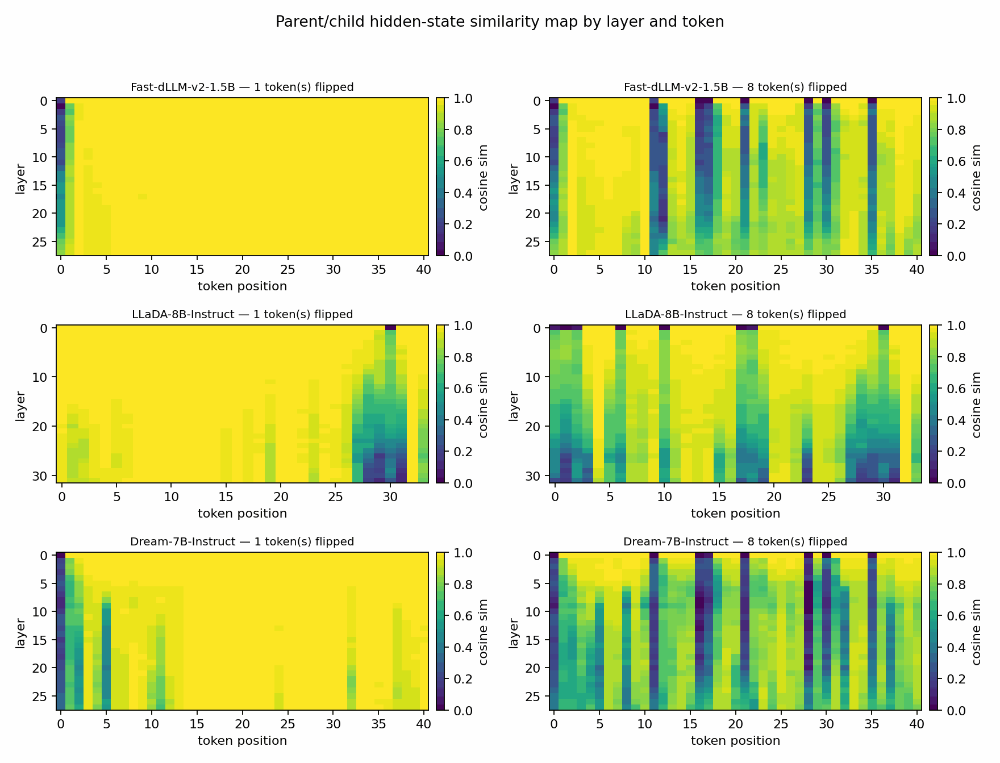
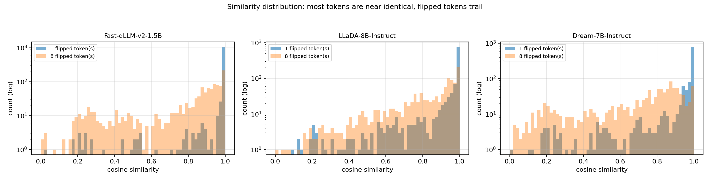
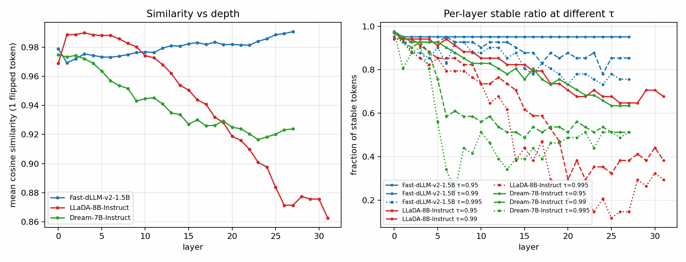
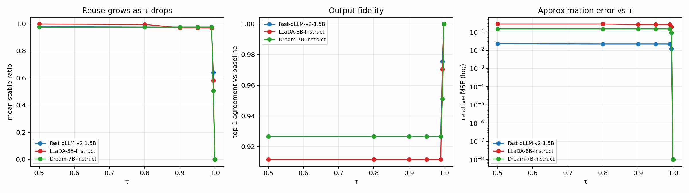
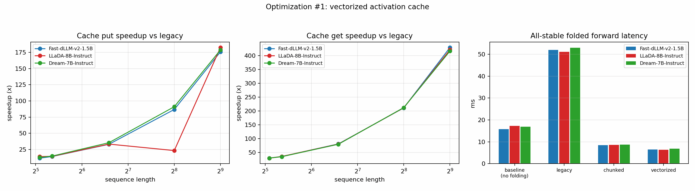
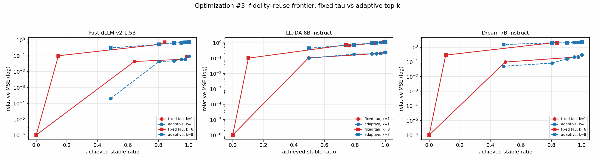

<div align="center">

# ActFold

**面向 Diffusion LLM 投机解码的跨分支激活复用（Branch Folding）研究框架**

[](https://www.python.org/downloads/)
[](https://pytorch.org/)
[](LICENSE)


[项目概述](#项目概述) •
[核心创新](#核心创新) •
[最新实验结果](#最新实验结果) •
[安装](#安装) •
[快速上手](#快速上手) •
[进阶用法](#进阶用法) •
[文档](#文档) •
[引用](#引用)

</div>

---

## 项目概述

ActFold 是一个降低 Diffusion LLM 投机解码**验证阶段算力**的研究框架。

在投机解码中，多个子分支（candidate branches）从同一条父序列出发被独立验证。
尽管子分支通常只与父序列相差少数几个 token，标准实现仍然对每个子分支触发
**全量前向重计算**——这是验证阶段的系统性冗余。

ActFold 用 **Branch Folding（分支折叠）** 攻击这一冗余：在每一层，每个 token
被二分为 **stable**（复用父分支激活）或 **divergent**（重计算），两组结果合并
为单次输出。判定逐层、逐 token 独立进行，即使分支在许多位置不同，只要隐状态
一致的位置就能获益。

> **目标影响**：验证阶段 TFLOPs 削减 21%–62%，精度损失极小。

### 核心思想

对每层 `l`、每个 token 位置 `t`、每个扩散步 `s`：

```
sim(l, t, s) = cosine_similarity(h_parent[l, t, s], h_child[l, t, s])
```

- **Stable tokens**（`sim > τ`）：直接复用缓存的父分支 FFN 输出。
- **Divergent tokens**（`sim ≤ τ`）：在完整子分支隐状态上运行该层，
  保持 self-attention 上下文不被破坏。

相似度门控本身是**语义安全网**：任何被误判为 stable 的位置都会被门控拦下
重算，这为后续所有激进优化（前缀复用、固定容量 CUDA Graph、批量发布）提供了
正确性底线。

---

## 核心创新

ActFold 的创新遵循一条统一的工程方法论：**先测量、再定位瓶颈、后设计机制**——
每一项机制都以本机实测证据为选题依据，以零语义变化（输出逐位一致）为设计约束，
以 mutation 测试 + 跨工件基准为验收面。

### 创新总览

| # | 创新点 | 动机（实测证据） | 机理 | 结果 |
|---|--------|------------------|------|------|
| 1 | **Branch Folding 逐层逐 token 门控复用** | 投机验证中子分支仅差少量 token，却整分支全量重算 | 每层逐 token cosine 门控 stable/divergent 二分 + 合并 | demo 85.5% FLOPs 削减，MSE 2.35e-03 |
| 2 | **向量化激活缓存** | 旧 cache 单层读取 0.65–0.70ms **超过**层重算本身（0.53–0.61ms）——折叠零加速的根因 | 连续缓冲 + 批 `index_select` 替代逐 token dict | put/get 快 12–183× / 30–429×；全稳定路径 2.3–2.7× **快于重算** |
| 3 | **前缀折叠 + 截断前缀复用**（AR003/AR007） | 变长子分支原本直接报错；父比子长原本无法复用 | 门控前缀对齐（因果模型前缀逐位相同→全 stable）；截断复用以门控为安全网 | `folded_generate` 真正跨步折叠（stable≈0.84，token 与全重算逐位一致） |
| 4 | **真接受语义**（AR004/AR006） | 历史 logit 均值是无意义分数，不构成论文级指标 | 同位置约定 + 独立 draft 模型分布的接受率计量（`model_draft`） | 论文级投机解码接受率 + EMA 判定 |
| 5 | **批量分支前向**（AR015） | N 个子分支串行验证 = N·L 次 layer 调用，launch 开销主导 | `branch_ids` 复数 kwarg 贯穿三层（层/入口/生成循环），同父等长候选**单次批量前向** | 批量 eager vs 串行 **2.0–5.6×**（6/6 配置） |
| 6 | **批量 CUDA Graph 捕获**（AR002/AR016） | 热路径由 launch 与宿主侧开销主导，eager 无法再压 | 固定发散容量 padded 消除每层数据依赖同步（graph 前置条件）+ 独立 `[N,T]` runner 捕获 + **重放前父缓存再校验**（防同形覆写静默错值） | 折叠子步 **−47.1%**（AR002）；graph vs 裸基线 1.37–1.77× 首次墙钟证据（AR016） |
| 7 | **自适应发散容量重捕获**（AR017） | 固定容量 C=0.5 vs 实测发散需求 D_frac 仅 13–16% → **FFN 重算过配 3.0–3.8×**；反向低容量则每突发一次违例即丢失 graph 收益 | 观测驱动状态机：违例→增长重捕获、连续耐心观测→收缩重捕获、节流 + 上限退役保证稳定；发散计数由既有预算读回**零额外同步暂存** | 深几何 adaptive vs baseline **2.30×/2.46×**（2σ 阈值的 9–12× 裕量，decisively supported）；容量较固定值缩减 3.01–3.02× |
| 8 | **发布路径宿主成本压缩**（AR018） | 六相探针实测：发布相位占自适应全步 **60.7%/71.2%/29.7%/31.5%**（最大单项），其中逐行 clone 是纯冗余（put 自带拷贝） | 单次整块 `child_buf.clone()` fresh 快照（by-reference cache 安全的防别名论证）+ 单次 `mask_buf.sum(dim=2)` 批量归约经 `record_precomputed` 入账；launch 账本 **3·L·N → L·N+2** | 发布占比降至 **45.3%/50.9%/15.7%/17.6%**；最终加速比 **2.40/2.67/2.66/2.95×** |

### 机理详解（按创新演进顺序）

#### 1. Branch Folding：基础机理

见上文"核心思想"。关键设计：**注意力永远在完整序列上运行**（divergent token
的重计算必须携带完整子分支上下文），只有 FFN 输出按 token 复用；`SplitFoldedTransformerLayer`
进一步将 FFN 拆为仅对 divergent 行计算（attention 全序列），在 B×T≥512 时
per-layer 加速 1.1–1.93× 且输出与全重算一致。

#### 2. 向量化激活缓存：修复"折叠反而更慢"

第一阶段诊断发现折叠路径比基线**更慢**的根因不在算法而在数据结构：逐 token
dict 缓存的读取成本（0.65–0.70ms/层）超过了层计算本身。`VectorizedActivationCache`
把激活存进连续缓冲、以批量 `index_select` 读写，使"全 stable 折叠前向"首次
**快于**全量重算（2.3–2.7×）。

#### 3. 前缀折叠：让跨步生成真正复用

生成循环中每步子序列比父序列长一个 token——形变负载原本无法折叠。AR003 引入
前缀对齐：门控只比较公共前缀（因果模型下逐位相同→全 stable），追加后缀恒
divergent。AR007 进一步允许**父比子长**：父激活截断到子长度，真前缀经门控
认证后复用，非前缀子分支在门控处发散、全量重算。

#### 4. 批量分支前向（AR015）：N 分支一次算完

同父、等长、parent-batch==1 的候选集合不再逐个串行验证：`branch_ids` 复数
关键字贯穿 `FoldedTransformerLayer` → `ManualFoldedForward` → `folded_generate`
三层，N 个分支拼成 batch 单次前向。其余形态（变长/多父）自动回退串行路径，
零行为变化。

#### 5. 批量 CUDA Graph（AR002/AR016）：消除 launch 与同步

CUDA Graph 要求捕获体无数据依赖同步。为此 AR002 先用**固定发散容量 padded
gather**替代 `nonzero`（消除每层一次的同步），再以 `FoldedGraphRunner` 捕获
固定形状子分支前向。AR016 把批量调用接进图路径：独立 `[N,T]` runner、
**每次重放前宿主侧再校验父缓存形状**（防止 ChunkedActivationCache 整块替换
场景下的同形静默覆写——这是正确性核心，不是优化）、逐分支行切片 clone 发布。

#### 6. 自适应发散容量（AR017）：容量跟随需求

图捕获把发散容量冻结在捕获时刻，而实测 D_frac 仅 13–16%——固定 C=0.5 意味着
FFN 重算量是需求的三倍以上。`AdaptiveCapacityPolicy` 状态机观测每步最大层
发散量（由既有预算读回顺带暂存，**零额外同步**）：持续过配→收缩重捕获、
违例→立即增长重捕获、increment-then-check 节流 + 成功次数上限退役保证稳定；
任意时刻至多双图，失败退化回旧 runner 永不劣于现状。增长钩子位于预算超限分支
内（违例即信号），收缩钩子位于发布之后（发布必须消费旧 runner 的静态缓冲）。

#### 7. 发布路径宿主成本压缩（AR018）：压掉最后一项宿主开销

容量右移后，六相探针（revalidate/prefill/replay/readback/publish/clone）
显示发布相位成为最大单项（小几何占 60.7–71.2%）。旧发布循环的 L×N 双循环每步
付出 3·L·N 次 launch：逐行 clone（put 自带拷贝，纯冗余）+ 逐行 sum 归约。
AR018 以两项正交机制压缩为 L·N+2：

- **快照发布**：单次整块 `child_buf.clone()` 产出私有 fresh 快照，行视图交给
  `cache.put`——快照私有可能导致 by-reference cache 存到静态缓冲视图被后续
  重放污染，fresh 快照从论证上排除该别名；
- **批量稳定度归约**：单次 `mask_buf.sum(dim=2)` 产出全部 (layer,row) 稳定
  计数，0-dim 视图经新入口 `record_precomputed` 入账（与 `record` 产出逐字段
  一致，下游聚合面零改动；`debug_enabled` 回退原入口保留 divergence_positions）。

发布内容逐位不变（对拍 UT 钉住），无新开关、无新语义——纯实现优化。

---

## 最新实验结果

### 端到端墙钟：折叠验证 vs 裸基线（P1-7 四级演进）

**最终结果**（合成 LLaMA-layout，V=1000，T=512，Quadro RTX 5000 16GB，
WDDM，驱动 556.18，seed 2026，n=30 round-robin 交错，p50 ms；
每步 = N 候选完整验证）：

| 配置 (H, L, N) | baseline eager | graph 固定容量 | graph 自适应（AR018） | vs baseline（AR017 → AR018） |
|----------------|---------------|---------------|----------------------|------------------------------|
| H=256, L=8, N=4  | 11.315  | 5.664  | **4.708**  | 1.55× → **2.40×** |
| H=256, L=8, N=8  | 22.197  | 9.910  | **8.300**  | 1.68× → **2.67×** |
| H=1024, L=16, N=4 | 70.026 | 46.425 | **26.318** | 2.30× → **2.66×** |
| H=1024, L=16, N=8 | 143.186 | 89.444 | **48.594** | 2.46× → **2.95×** |

> 演进链：AR015 批量前向（eager 串行 → 批量 2.0–5.6×）→ AR016 批量图捕获
> （vs baseline 1.37–1.77×，方向全正）→ AR017 自适应容量（深几何 2.30/2.46×
> decisively）→ AR018 发布压缩（四配置全面抬升，小几何从 ~1.6× 抬到 ~2.5×）。
> 全部配置三路径 argmax 精确一致 + 自适应 vs 固定 allclose 1e-4；每分支
> stable_ratio 与独立逐行重算逐值相等。

**机理验证：六相相位分解**（AR018 自适应路径稳态，p50 ms）：

| 配置 | revalidate | prefill | replay | readback | publish | clone | 发布占比（AR017 探针 → AR018） |
|------|-----------|---------|--------|----------|---------|-------|--------------------------------|
| H=256, L=8, N=4  | 0.110 | 0.318 | 1.833  | 0.052 | **2.132** | 0.081 | 60.7% → **45.3%** |
| H=256, L=8, N=8  | 0.111 | 0.314 | 3.237  | 0.057 | **4.225** | 0.125 | 71.2% → **50.9%** |
| H=1024, L=16, N=4 | 0.184 | 0.826 | 20.664 | 0.101 | **4.144** | 0.083 | 29.7% → **15.7%** |
| H=1024, L=16, N=8 | 0.195 | 1.556 | 36.190 | 0.128 | **8.545** | 0.132 | 31.5% → **17.6%** |

**容量追踪证据**（AR017）：D_frac 实测 13–16%，自适应容量轨迹
[1024, 1024, 340, …] / [2048, 2048, 680, …] 在恰一次收缩后稳定，最终容量
340/680 对需求 p50 272/544——FFN 重算较固定 C=0.5 缩减 **3.01–3.02×**，
适配后零预算违例。

工件：`results/optimization/ar018_publish_bench.json`（含 AR017 跨工件锚点、
相位分解、峰值显存、CUPTI 探测注记）；复现 `python -m scripts.ar018_publish_bench`
（`--quick` 冒烟）。

### 真实模型两阶段实验（LLaDA-8B / Dream-7B / Fast-dLLM-v2-1.5B）

两阶段受控实验覆盖三个真实 Diffusion LLM 家族（bfloat16）：诊断阶段
（RTX 6000D 84GB）+ 优化阶段（RTX PRO 6000 Blackwell 96GB）。子分支由随机
翻转 `n ∈ {0,1,2,4,8,16,32,128}` 个 token 构造。原始数据：
`results/experiments/` 与 `results/optimization/`。

#### 1. 算法不变量

| 不变量 | Fast-dLLM | LLaDA-8B | Dream-7B |
|---|---|---|---|
| 自折叠 stable ratio / MSE | 1.000 / **0.0** | 1.000 / **0.0** | 1.000 / **0.0** |
| 强制全 divergent stable / MSE | 0.000 / **0.0** | 0.000 / **0.0** | 0.000 / **0.0** |
| 基线全量前向 (ms) | 16.5 | 17.6 | 16.6 |
| 旧缓存全稳定折叠 (ms) | 52.1 | 51.2 | 53.7 |
| **向量化缓存全稳定折叠 (ms)** | **6.45** | **6.37** | **6.81** |

自折叠与强制全 divergent 前向与基线**逐位一致**；向量化后全稳定折叠路径
**2.3–2.7× 快于重算**。

#### 2. 相似度结构与阈值

| 模型 | 翻转 1 token（mean / p05） | 翻转 8 token（mean / p05） |
|---|---|---|
| Fast-dLLM-v2-1.5B | 0.9797 / 0.9584 | 0.7957 / 0.2494 |
| LLaDA-8B-Instruct | 0.9387 / 0.6029 | 0.8195 / 0.3945 |
| Dream-7B-Instruct | 0.9408 / 0.5939 | 0.6932 / 0.1654 |

stable ratio 在 τ∈[0.5, 0.99] 形成平台、仅在 0.999 附近崩塌（bf16 噪声主导）；
LLaDA/Dream 对单 token 扰动的敏感度约为 Fast-dLLM 的六倍。逐层折叠最优区
是模型相关的（Fast-dLLM 早期层、LLaDA/Dream 晚期层最安全）。

#### 3. 零加速根因诊断（第一阶段）

| 单层成本 (ms) | Fast-dLLM | LLaDA-8B | Dream-7B |
|---|---|---|---|
| 层重算 | 0.538 | 0.533 | 0.606 |
| **缓存读取（旧实现）** | **0.699** | **0.652** | **0.697** |
| 缓存写入 | 0.228 | 0.190 | 0.230 |
| 相似度门控 | 0.067 | 0.065 | 0.066 |

缓存读取成本超过层计算本身，且旧实现只要层内出现一个 divergent token 就整层
重算——这是"算法省 FLOPs、实测零加速"的完整根因链，也是向量化缓存的选题依据。

#### 4. 跨步扩散采样

| 模型 | token 与基线一致率 | 平均逐步 stable ratio | baseline / folded (ms) |
|---|---|---|---|
| Fast-dLLM-v2-1.5B | **1.000** | 0.980 | 471 / 3791 |
| LLaDA-8B-Instruct | 0.727 | 0.989 | 726 / 3730 |
| Dream-7B-Instruct | 0.712 | 0.987 | 768 / 3867 |

Fast-dLLM 的折叠采样与基线**逐 token 一致**；LLaDA/Dream 达到同等 stable
ratio 但因 logits 对扰动更敏感、贪心解码放大早期差异而损失一致性（提高 τ
可缓解）。

#### 5. 优化 #2：层内 FFN 拆分

| 形状（LLaDA 层，H=4096） | 1% divergent | 10% divergent | 50% divergent |
|---|---|---|---|
| B=1, T=2048 | 1.78× | 1.69× | 1.24× |
| B=4, T=2048 | **1.93×** | 1.78× | 1.32× |

拆分与不拆分输出 MSE/top-1 完全一致；`batch × seq ≥ 512` 才自动启用。

#### 6. 优化 #3：自适应分位门控

| 模型（翻转 1 token） | 固定 τ=0.99（stable / rel-MSE / top-1） | 自适应目标 0.8（stable / rel-MSE / top-1） |
|---|---|---|
| Fast-dLLM | 0.976 / 6.07e-2 / 0.927 | 0.805 / **4.33e-2** / 0.927 |
| Dream-7B | 0.976 / 2.20e-1 / 0.902 | 0.805 / **8.35e-2** / **0.976** |

门控可精确命中任意目标 stable ratio，覆盖固定阈值无法触达的平台/悬崖区。

#### 7. 优化 #4：融合 gather-select kernel

T=8192, H=4096 时融合 Triton kernel 达 **3.43×**（逐位精确，仅大形状启用）。

#### 8. 推荐配置

| 场景 | 配置 |
|---|---|
| 多分支验证（同父等长候选） | `ManualFoldedForward(use_cuda_graph=True, graph_adaptive_capacity=True)`——批量图路径，2.4–2.95× vs 裸基线 |
| 长序列 / 大 batch（B×T ≥ 2048） | 追加 `use_split_layers: true`；T ≥ 8192 时融合 kernel 自动启用 |
| 保真敏感复用 | `AdaptiveQuantileGate(target_stable_ratio=...)`；Dream 仅折叠后 1/3 层 |
| 采样质量优先 | τ ≥ 0.99 或自适应目标 0.9–0.95；Fast-dLLM 容忍跨步折叠 |

#### 9. 实测图

| | |
|---|---|
|  |  |
|  |  |
|  |  |

#### 10. 复现

```bash
# 诊断（逐模型）
python scripts/algo_experiments.py --model fastdllm --out results/experiments/fastdllm
python scripts/overhead_bench.py --model fastdllm --out results/experiments/fastdllm

# 优化
python scripts/opt1_cache_bench.py --model fastdllm --out results/optimization/opt1/fastdllm
python scripts/opt2_shape_bench.py --out results/optimization/opt2/shape
python scripts/opt3_adaptive_bench.py --model dream --out results/optimization/opt3/dream
python scripts/opt4_fused_bench.py --out results/optimization/opt4

# 端到端墙钟（P1-7 四级演进）
python -m scripts.ar016_batched_bench          # 批量图首证
python -m scripts.ar017_adaptive_bench         # 自适应容量
python -m scripts.ar018_publish_bench          # 发布压缩（最终结果）
python -m scripts.ar018_publish_bench --quick  # 冒烟
```

完整报告：[`docs/DEEP_EXPERIMENT_REPORT.md`](docs/DEEP_EXPERIMENT_REPORT.md)、
[`docs/OPTIMIZATION_REPORT.md`](docs/OPTIMIZATION_REPORT.md)、
[`docs/OPTIMIZATION_GUIDE.md`](docs/OPTIMIZATION_GUIDE.md)（全部 25 个 AR 的
机制与证据链）、[`docs/ACADEMIC_REPORT.md`](docs/ACADEMIC_REPORT.md)。

---

## 特性一览

| 特性 | 说明 |
|------|------|
| **Branch Folding 引擎** | `ManualFoldedForward`（推荐路径）零侵入包装任意 Transformer 栈，逐 token 激活复用；`FoldedModel` 仍可用（已弃用） |
| **批量分支验证**（AR015） | `branch_ids` 复数 kwarg：同父等长候选单次批量前向，其余形态自动串行回退 |
| **CUDA Graph 验证**（AR002/AR016） | `use_cuda_graph=True` 固定形状捕获 + 独立批量 runner + 重放前父缓存再校验；变长负载静默 eager 回退 |
| **自适应发散容量**（AR017） | `graph_adaptive_capacity=True`：观测驱动重捕获状态机，容量跟随实测需求，失败退化永不劣于现状 |
| **压缩发布路径**（AR018） | 单次整块快照 + 批量稳定度归约（launch 3·L·N → L·N+2），发布内容逐位不变，零新增同步 |
| **前缀折叠**（AR003/AR007） | 变长生成步前缀对齐折叠；父比子长时截断前缀复用，门控作语义安全网 |
| **真接受语义**（AR004/AR006） | 同位置约定的接受率/log-prob 计量；`model_draft` 模式接入独立草稿模型（论文级指标） |
| **向量化激活缓存** | 连续缓冲 + `index_select`；put/get 快 12–183× / 30–429× |
| **层内 FFN 拆分** | attention 全序列 + FFN 仅 divergent 行；B×T ≥ 512 自动启用 |
| **自适应分位门控** | 按相似度排名（top-k）精确命中目标 stable ratio |
| **融合 Triton kernel** | gate+mask+count 单 kernel、融合 gather-select、融合 merge（逐位精确 + PyTorch 回退） |
| **逐层稳定度 profiler** | 记录真实逐层 stable ratio（批量路径经 `record_precomputed` 零同步入账） |
| **Diffusion 原生采样器** | LLaDA / Dream / Fast-dLLM 参考实现（对齐官方 recipe），跨步折叠链 + 掩码 token 统一解析 |
| **真实评测后端** | `lm-eval` / `evalplus` 集成；无 mock 回退 |
| **计算-带宽成本模型** | 从 FLOPs 与显存带宽双口径估计墙钟 |

---

## 安装

### 依赖

- Python 3.10+，PyTorch 2.0+，Hugging Face `transformers`
- CUDA GPU（可选；CPU 回退可用）
- `lm-eval` / `evalplus`（评测后端）

### 从源码安装

```bash
pip install -r requirements.txt        # 运行时依赖
pip install -r requirements-bench.txt  # 评测后端
pip install -r requirements-dev.txt    # 开发工具
pip install -e .                       # 可编辑安装
```

---

## 快速上手

### 1. 运行 demo

```bash
# 合成演示模型——无需下载，任意平台可跑
python demo.py

# 标准因果 LM（GPT-2 / LLaMA / Qwen / Mistral ...）
python demo.py --model gpt2 --model-family causal_lm

# Diffusion 原生生成 + Branch Folding
python demo.py \
    --model <llada-checkpoint> \
    --model-family llada \
    --prompt "The future of artificial intelligence is" \
    --num-steps 128 \
    --max-new-tokens 32
```

合成模型期望输出：

```text
 Total FLOPs reduction: 85.5%   # 修正：输入 embedding 是查表，只计 LM head
 Output equivalence (MSE): 2.35e-03  [HIGH]
 Estimated stable token ratio: 93.75%
```

### 2. 包装模型并验证子分支（推荐路径）

```python
import torch
from actfold.core import ActivationCache, SimilarityGate
from actfold.models.architecture_utils import ManualFoldedForward

cache = ActivationCache(max_entries_per_layer=1024, device="cuda")
gate = SimilarityGate(tau=0.95, metric="cosine")

# 零侵入包装：不修改原模型（区别于已弃用的 FoldedModel）
mff = ManualFoldedForward(raw_model, cache=cache, gate=gate, split_layers=True)

# 父分支前向填充缓存
parent_logits = mff(parent_tokens, branch_id="parent")

# 子分支验证：stable 位置复用父激活
child_logits = mff(child_tokens, branch_id="child", parent_branch_id="parent")
```

### 3. 多分支批量 + CUDA Graph + 自适应容量（加速主路径）

```python
from actfold.core.adaptive_capacity import AdaptiveCapacityConfig

mff = ManualFoldedForward(
    raw_model,
    cache=cache,
    gate=gate,
    split_layers=True,
    use_cuda_graph=True,              # 固定形状 [N, T] 图捕获
    graph_capacity_ratio=0.5,         # 初始发散容量
    graph_adaptive_capacity=True,     # AR017：容量跟随实测需求
    graph_adaptive_config=AdaptiveCapacityConfig(),
)

# 同父、等长、parent-batch==1 的候选集合：单次批量前向 + 图重放
logits = mff(
    stacked_candidates,                      # [N, T]
    branch_id=None,
    branch_ids=["c0", "c1", "c2", "c3"],
    parent_branch_id="parent",
)
```

### 4. 端到端折叠生成

```python
from actfold.speculative.folded_generation import folded_generate

result = folded_generate(
    adapter,
    prompt_ids,
    max_new_tokens=32,
    folded_model=adapter.folded_model,
)
print(result.tokens)          # [batch, prompt_len + max_new_tokens]
print(result.stable_ratio)    # 实测逐层平均 stable ratio
print(result.acceptance_rate) # 真接受率（AR004）
```

### 5. 运行评测

```bash
bash scripts/run_real_model_benchmark.sh
bash scripts/run_benchmarks.sh actfold/configs/real_model_example.yaml
```

---

## 系统架构

```
┌─────────────────────────────────────────────────────────────┐
│                      Diffusion LLM                           │
└──────────────────────┬──────────────────────────────────────┘
                       │
        ┌──────────────▼──────────────┐
        │      Draft Generator        │
        └──────────────┬──────────────┘
                       │
            ┌──────────▼──────────┐
            │   Parent Branch     │
            └──────────┬──────────┘
                     │ │ │ │  N 个候选
          ┌─────────▼──▼─▼──▼──────────┐
          │   ActFold 批量验证          │
          │  （AR015 批量 + AR016 图）  │
          │  ┌─────────────────────┐  │
          │  │   Similarity Gate   │  │
          │  └──────────┬──────────┘  │
          │    ┌────────┴────────┐    │
          │    ▼                 ▼    │
          │ Stable Tokens   Divergent │
          │    │               Tokens  │
          │    ▼                 ▼    │
          │ Activation     Full Layer │
          │   Cache        Recompute  │
          │    │                 │    │
          │    └────────┬────────┘    │
          │             ▼             │
          │      Merged Output        │
          │   （AR017 自适应容量）     │
          │   （AR018 压缩发布）       │
          └─────────────┬─────────────┘
                        │
             ┌──────────▼──────────┐
             │   Accepted Branch   │
             └─────────────────────┘
```

### 模块地图

```
actfold/
├── models/         # Diffusion LLM 包装器与原生采样器（含 ManualFoldedForward）
├── core/           # 折叠引擎：cache/gate/folded layers/CUDA graph/自适应容量
├── profiler/       # 稳定度 profiler（批量路径零同步入账）
├── speculative/    # Draft 生成、验证引擎、折叠生成
├── eval/           # 评测：BenchmarkRunner / lm-eval / evalplus 适配器
├── utils/          # 配置、FLOPs 计量、成本模型、日志
└── configs/        # YAML 实验配置
```

---

## 进阶用法

### Diffusion 原生采样

`num_steps > 1` 时 `DiffusionLLM.generate()` 按模型家族分发参考采样器
（对齐官方 recipe：掩码调度、块解码、置信度重掩码、CFG、温度/top-p/top-k）：
**LLaDA**（右 padding 画布 + 块解码）、**Dream**（MaskGIT 式迭代 +
`maskgit_plus`/`topk_margin`/`entropy` 置信规则）、**Fast-dLLM**
（小块阈值解掩码 + 自回归块扩展 + 停止 token 早停）。

> 采样器为高质量参考实现；发表数字请对具体 checkpoint 用官方实现复核。

### 配置驱动评测

```yaml
# actfold/configs/real_model_example.yaml
model_name_or_path: "gpt2"
model_family: "causal_lm"
use_real_eval: true
eval_backend: "auto"

# ActFold 开关
use_stability_profiler: true
use_vectorized_cache: true
use_split_layers: false       # attention 全序列 + FFN 仅 divergent
split_min_tokens: 512
use_cuda_graph: true          # 固定形状图捕获
graph_capacity_ratio: 0.5
graph_adaptive_capacity: true # AR017 自适应容量
use_cost_model: true
use_folded_generation: true
```

### 消融

```bash
bash scripts/run_ablation.sh actfold/configs/real_model_example.yaml
bash scripts/run_ablation.sh --synthetic
```

支持：阈值敏感性（τ ∈ {0.90, 0.95, 0.99}）、逐层折叠策略、缓存预算、
缓存实现对比（per-token / chunked / vectorized）、FFN 拆分形状扫描、
自适应门控前沿、融合 kernel 对拍。

---

## 质量保障

- **black**（line-length=100）/ **isort** / **pyflakes** 零告警
- **mypy**（`--ignore-missing-imports`，66 文件）clean
- **pytest** 快速套件 **855 passed**（CUDA 实测，含逐位对拍与 spy 计数钉）
- 每个机制的验收面：Red/Green 分离 TDD + **mutation 测试**（删机制必红，
  SHA256 逐字节还原）+ 跨工件墙钟基准（声明与判定分离，2σ 判据，
  inconclusive 诚实照收）

```bash
python -m black --check actfold tests demo.py scripts
python -m pyflakes actfold tests demo.py scripts
python -m mypy actfold --ignore-missing-imports
python -m pytest tests/ -q -m "not slow"
python demo.py
```

真实后端用例标记 `@pytest.mark.slow`：`python -m pytest tests/ -q -m slow`。

---

## 文档

- [`docs/ALGORITHM.md`](docs/ALGORITHM.md) — Branch Folding 形式化描述
- [`docs/EXPERIMENTS.md`](docs/EXPERIMENTS.md) — 复现工作流
- [`docs/DEEP_EXPERIMENT_REPORT.md`](docs/DEEP_EXPERIMENT_REPORT.md) — 两阶段深度实验报告（诊断 + 优化，真实模型实测）
- [`docs/OPTIMIZATION_GUIDE.md`](docs/OPTIMIZATION_GUIDE.md) — **25 个 AR 的完整机制与证据链**（每项创新动机 → 机理 → mutation → 基准）
- [`docs/OPTIMIZATION_REPORT.md`](docs/OPTIMIZATION_REPORT.md) — 优化阶段报告
- [`docs/ACADEMIC_REPORT.md`](docs/ACADEMIC_REPORT.md) — 学术版报告
- [`AGENTS.md`](AGENTS.md) — 贡献者与 AI 代理的约定和陷阱清单
- [`CHANGELOG.md`](CHANGELOG.md) — 发布历史（AR001–AR018）

---

## 当前限制与路线图

1. **端到端墙钟数字来自合成 LLaMA-layout 模型**。2.40–2.95× 的四配置矩阵
   在真实 checkpoint（LLaDA-8B / Dream-7B / Fast-dLLM）上的端到端复测是
   下一步主目标；真实模型两阶段实验（TFLOPs 削减与逐层结论）已在
   [最新实验结果](#最新实验结果) 覆盖。
2. **批量路径要求同父、等长、parent-batch==1**。变长/多父批量仍是串行回退
   （变长步已在前缀折叠下获益，AR003/AR007）；多祖先激活树是路线图主体。
3. **小几何剩余宿主开销**。发布压缩后小几何发布相位仍占 45–51%——剩余主项
   是 L·N 次 put 拷贝带宽与 Python 循环开销；(256,8,4) 级小形状的 2σ 展布
   检验受 WDDM 限制（效应 delta 稳定方向正）。
4. **采样质量是模型敏感的**。Fast-dLLM 跨步折叠 token 一致率 1.000；
   LLaDA/Dream 在 stable≈0.99 时为 0.71–0.73（提高 τ 或用自适应目标缓解）。
5. **专用 draft 架构（Medusa/Eagle）为 tier 2**。`model_draft` 已支持任意
   独立草稿模型的论文级接受率计量（AR006）。
6. **逐模型 YAML 是模板**——请填入实际 Hugging Face 标识或本地 checkpoint 路径。

---

## 故障排查

| 症状 | 原因 | 解决 |
|------|------|------|
| `RuntimeError: A real tokenizer is required...` | 评测路径缺 tokenizer | 传入带 tokenizer 的模型或用 `--synthetic` |
| `TypeError: Can't instantiate abstract class ... with abstract method embed` | 自定义 `DiffusionLLM` 缺 `embed()` | 实现 `embed(tokens)` 返回 `[B, T, H]` |
| CUDA 上未用 Triton kernel | 未装 `triton` 或 hidden dim 不被 128 整除 | Linux/WSL 安装 `triton>=2.0`；PyTorch 回退恒正确 |
| `evalplus` 在 Windows 失败 | 沙箱依赖 Unix `resource` 模块 | WSL 内运行 evalplus，或 Windows 用 lm-eval |
| 慢测试超时 | 真实后端需加载模型与数据集 | 快速套件 `-m "not slow"`，慢测试单独跑 |
| CUDA Graph 不生效 | 形状与捕获不一致 / attention mask 对象不同 / 非 cosine `SimilarityGate` / 挂了 `FoldingScheduler` | 图路径前置条件见 AGENTS #37；变长步会静默 eager 回退（前缀折叠仍生效） |

---

## 贡献

欢迎贡献！请先阅读 [`CONTRIBUTING.md`](CONTRIBUTING.md)（代码风格、测试、PR 流程）。

---

## 引用

如在你的研究中使用 ActFold，请引用：

```bibtex
@software{actfold2025,
  title = {ActFold: Cross-Branch Activation Reuse and Branch Folding},
  author = {ShaneLiu04},
  year = {2025},
  url = {https://github.com/ShaneLiu04/ActFold},
}
```

---

## 许可证

ActFold 以 [MIT License](LICENSE) 发布。

---

> **声明**：本研究代码库。生产部署需要额外的优化、测试和目标推理框架集成。
