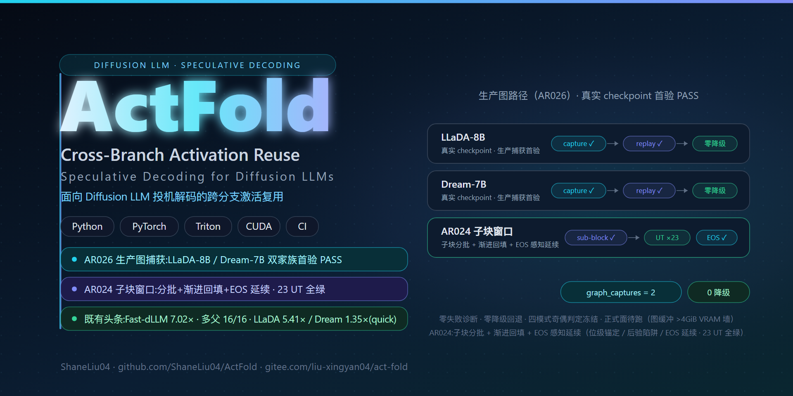

<div align="center">

# ActFold

**面向 Diffusion LLM 投机解码的跨分支激活复用（Branch Folding）研究框架**

[](https://www.python.org/downloads/)
[](https://pytorch.org/)
[](LICENSE)


[项目概述](#项目概述) •
[核心创新](#核心创新) •
[最新实验结果](#最新实验结果) •
[安装](#安装) •
[快速上手](#快速上手) •
[进阶用法](#进阶用法) •
[文档](#文档) •
[引用](#引用)

</div>

<p align="center">
  
</p>

---

## 项目概述

ActFold 是一个降低 Diffusion LLM 投机解码**验证阶段算力**的研究框架。

在投机解码中，多个子分支（candidate branches）从同一条父序列出发被独立验证。
尽管子分支通常只与父序列相差少数几个 token，标准实现仍然对每个子分支触发
**全量前向重计算**——这是验证阶段的系统性冗余。

ActFold 用 **Branch Folding（分支折叠）** 攻击这一冗余：在每一层，每个 token
被二分为 **stable**（复用父分支激活）或 **divergent**（重计算），两组结果合并
为单次输出。判定逐层、逐 token 独立进行，即使分支在许多位置不同，只要隐状态
一致的位置就能获益。

> **目标影响**：验证阶段 TFLOPs 削减 21%–62%，精度损失极小。
>
> **最新交付（AR033）**：**Block-causal 精确历史缓存（官方 v2 parity）**——
> 需求期审计发现官方 Fast-dLLM v2 `batch_sample` 本就是分层缓存配方，而
> 本仓库阶梯所对照的「官方基线臂」实为非缓存全量重算变体（**strawman
> 勘误**，既有加速比重述为 vs 非缓存基线臂）；机制上补齐该层：跨块历史
> KV + 块内 sub-block 缓存（官方边界失效规则），四臂 reps=30 预承诺单次
> **overall supported**——B2 **1.5431×** vs 非缓存基线臂（token 账本仅
> 13.5%）、质量全臂一致（gap 0.0、decode [34,66]），同一几何上比官方原生
> `batch_sample` 快 1.52×（report-only）。
>
> **最新交付（AR034）**：**KV-cached speculative block decoding**——历史 KV 缓存
> × 投机候选验证的组合档：历史 KV 按 batch 维只读展开 N 行（逐行位级等价），
> 每个 small block 的 ~31 次串行前向压成「整块草稿 + `[N, block]` 验证 + 共享
> commit」，四臂 reps=30 预承诺单次 **overall supported**——**8.7308× vs 非缓存
> 基线臂、6.9743× vs AR033 缓存臂**，质量逐位不损（gap 0.0、decode [34,66]）。
>
> **最强 baseline 证据（AR022）**：Fast-dLLM-v2-1.5B 真实生成回路，贪心锚定
> 批量投机 **7.02×** 于非缓存基线臂，且质量面与之**逐位对齐**（post-hoc
> 置信 gap = 0.0、解码长度/早停完全恢复）；AR032 推进复用推至 **7.97×**。
> RTX 6000D（83GB Linux）服务器复跑全 ladder 更强：AR022 **11.17×**、
> AR032 **10.36×**（见[跨平台复核](#跨平台复核rtx-6000d-服务器复跑)）。
> 质量证据覆盖首块早停几何（34/66 token）——多块生成的质量代价与重述口径
> 见[当前限制](#当前限制与路线图) 第 5/13–16 条。

### 核心思想

对每层 `l`、每个 token 位置 `t`、每个扩散步 `s`：

```
sim(l, t, s) = cosine_similarity(h_parent[l, t, s], h_child[l, t, s])
```

- **Stable tokens**（`sim > τ`）：直接复用缓存的父分支 FFN 输出。
- **Divergent tokens**（`sim ≤ τ`）：在完整子分支隐状态上运行该层，
  保持 self-attention 上下文不被破坏。

相似度门控本身是**语义安全网**：任何被误判为 stable 的位置都会被门控拦下
重算，这为后续所有激进优化（前缀复用、固定容量 CUDA Graph、批量发布）提供了
正确性底线。

---

## 核心创新

ActFold 的创新遵循一条统一的工程方法论：**先测量、再定位瓶颈、后设计机制**——
每一项机制都以本机实测证据为选题依据，以零语义变化（输出逐位一致）为设计约束，
以 mutation 测试 + 跨工件基准为验收面。

### 创新总览

| # | 创新点 | 动机（实测证据） | 机理 | 结果 |
|---|--------|------------------|------|------|
| 1 | **Branch Folding 逐层逐 token 门控复用** | 投机验证中子分支仅差少量 token，却整分支全量重算 | 每层逐 token cosine 门控 stable/divergent 二分 + 合并 | demo 85.5% FLOPs 削减，MSE 2.35e-03 |
| 2 | **向量化激活缓存** | 旧 cache 单层读取 0.65–0.70ms **超过**层重算本身（0.53–0.61ms）——折叠零加速的根因 | 连续缓冲 + 批 `index_select` 替代逐 token dict | put/get 快 12–183× / 30–429×；全稳定路径 2.3–2.7× **快于重算** |
| 3 | **前缀折叠 + 截断前缀复用**（AR003/AR007） | 变长子分支原本直接报错；父比子长原本无法复用 | 门控前缀对齐（因果模型前缀逐位相同→全 stable）；截断复用以门控为安全网 | `folded_generate` 真正跨步折叠（stable≈0.84，token 与全重算逐位一致） |
| 4 | **真接受语义**（AR004/AR006） | 历史 logit 均值是无意义分数，不构成论文级指标 | 同位置约定 + 独立 draft 模型分布的接受率计量（`model_draft`） | 论文级投机解码接受率 + EMA 判定 |
| 5 | **批量分支前向**（AR015） | N 个子分支串行验证 = N·L 次 layer 调用，launch 开销主导 | `branch_ids` 复数 kwarg 贯穿三层（层/入口/生成循环），同父等长候选**单次批量前向** | 批量 eager vs 串行 **2.0–5.6×**（6/6 配置） |
| 6 | **批量 CUDA Graph 捕获**（AR002/AR016） | 热路径由 launch 与宿主侧开销主导，eager 无法再压 | 固定发散容量 padded 消除每层数据依赖同步（graph 前置条件）+ 独立 `[N,T]` runner 捕获 + **重放前父缓存再校验**（防同形覆写静默错值） | 折叠子步 **−47.1%**（AR002）；graph vs 裸基线 1.37–1.77× 首次墙钟证据（AR016） |
| 7 | **自适应发散容量重捕获**（AR017） | 固定容量 C=0.5 vs 实测发散需求 D_frac 仅 13–16% → **FFN 重算过配 3.0–3.8×**；反向低容量则每突发一次违例即丢失 graph 收益 | 观测驱动状态机：违例→增长重捕获、连续耐心观测→收缩重捕获、节流 + 上限退役保证稳定；发散计数由既有预算读回**零额外同步暂存** | 深几何 adaptive vs baseline **2.30×/2.46×**（2σ 阈值的 9–12× 裕量，decisively supported）；容量较固定值缩减 3.01–3.02× |
| 8 | **发布路径宿主成本压缩**（AR018） | 六相探针实测：发布相位占自适应全步 **60.7%/71.2%/29.7%/31.5%**（最大单项），其中逐行 clone 是纯冗余（put 自带拷贝） | 单次整块 `child_buf.clone()` fresh 快照（by-reference cache 安全的防别名论证）+ 单次 `mask_buf.sum(dim=2)` 批量归约经 `record_precomputed` 入账；launch 账本 **3·L·N → L·N+2** | 发布占比降至 **45.3%/50.9%/15.7%/17.6%**；最终加速比 **2.40/2.67/2.66/2.95×** |
| 9 | **position_embeddings 线程化 + 真实 checkpoint 端到端**（AR019） | 前三代墙钟证据全部来自合成 LLaMA-layout 模型；探针实测确证 remote 层必须收 rotary——`ManualFoldedForward` 不透传 `position_embeddings` 则 Fast-dLLM parent prefill 即 `TypeError` | `forward` 末位 `position_embeddings=(cos, sin)` 新参线程化**四构建面**（串行/批量 eager、graph 捕获静态体 by-reference 烘焙、AR017 自适应重捕获），镜像 attention_mask 契约（入口 ValueError 校验 + 重放期 `is` 对象恒一静默回退）；层接口零改动（`**kwargs` 通道）；`None` 不附加 kwarg，既有调用逐字节不变 | Fast-dLLM-v2-1.5B 真实块验证三路径 **2.44–2.62×**（p50，n=30）+ 逐位一致（maxdiff=0.0、argmax 一致率 1.0）+ 完美块二分（stable ratio 精确 = K_PROMPT/T）；**服务器复核重述**：H2 逐位一致在 RTX 6000D 上 refuted——差异为 bf16 形状相关舍入（与 Triton 开/关无关），处于「裸批量 vs 裸串行」bf16 噪声底内，口径由「逐位一致」重述为「处于 bf16 批处理噪声底内」（见[跨平台复核](#跨平台复核rtx-6000d-服务器复跑)） |
| 10 | **发布路径 cache put 批量化**（AR020） | AR018 压缩后小几何发布相位仍占自适应全步 45.3–50.9%，剩余主体 = L·N+N 次逐条 `cache.put` 的宿主 launch 开销（WDDM 实测 ~30–40µs/次）；foreach 探针实测 L·N=224 条 bf16 宿主入队 **27.8×** | `BatchedPutCapable` 结构化协议 + 三 cache `put_batch`（**冲刷语义**：写入序恒=条目序，消除对 foreach 组内顺序的依赖）+ `_foreach_copy_` 单点封装（(device,dtype) 分组，旧 torch 逐对降级）+ 发布路径**每次发布能力探测分流**（无能力 cache 逐字节走原循环）+ `mff.cache` property 传播 | 真实 checkpoint 发布窗口 p50 **1.77–1.97×**（−43.4%~−49.2%）；主机调用账本 **116/232/116 → 1**；正确性门全 bit-equal；端到端 adaptive(batch) vs baseline **2.40–2.67×**；H1–H4 全 supported |
| 11 | **生产生成回路折叠接线**（AR021） | AR015–020 批量验证栈**零生产调用方**（sampler 不传 pe 则真实 remote 必崩、掩码对象不钉则图捕获一次后永不重放、`[N,T]` 批量验证形态在生产回路不存在）；AR019 P5 实证 tau=0.95 gate 会把同块未翻位置误判 stable（parity 92.9% 先例）——链折叠直接上 gate 不精确 | sampler **(T,prompt_len) 键控折叠供给**（块因果∧pad 排除 `[T,T]` 掩码 + rotary pe + forced 三件套对象钉定，跨 sample 存续）+ **强制散度活跃块**（当前块整区不进 gate 判定面、全量重算——parity 由构造保证，P5 构造级绕开）+ **形状键控 runner 池**（opt-in `graph_runner_pool_size`，跨块增长每形状窗捕获/重放，LRU+cuBLAS workspace 回收）+ **批量投机块验证**（opt-in `num_block_candidates`：top-k 起草→单次 `[N,T]` 批量验证→min-prob 选定提交；AR016/017/018/020 批量面首次被生产回路行使） | 真实 generate() 三模式：**H1 supported（真实 checkpoint bit-exact）**；H2 inconclusive（Δ=−107.5ms 未越 2σ=265.3ms，小形状串行折叠开销>收益）；**H3 supported（batched vs serial 2.47× / vs baseline 2.38×，p50 1193.9 vs 2948.3/2840.7ms）**；H4 supported（池计数逐位对账、账本 c=4 界内、canary 真） |
| 12 | **贪心锚定候选：批量投机质量对齐**（AR022） | AR021 批量投机 2.38× 但**质量面与 baseline 分叉**：块级 exact-match 0.0、post-hoc 置信 0.3697→0.2897 / 0.5703→0.1064、解码长度 160/77 vs baseline 早停 34/66（非贪心提交不命中 stop token）——速度-质量权衡是 AR021 的如实遗留 | `candidate_include_greedy`（opt-in）：候选**行 0 = 贪心假设**（draft top-k 有序集首位，srs 冻结 argmax 定义；确定性构建、零设备回读、零 generator 消费）；N 总数不变、随机行 j=1..N-1 在冻结种子公式中保持行号；贪心行进入 **min-prob 公平竞争、可落败**（UT-2203 后验陷阱构造级钉死，选定零特判）；`greedy_win_stats` 只读观测面 + `ActFoldConfig` YAML 消费面；四模式基准 MFF_C 与 MFF_B 同构独立实例——速度变量构造性清零 | 四模式 H1-H4 **全 supported**：posthoc 0.369661/0.570341 逐位==baseline（gap=0.0）、长度 34/66 早停**完全恢复**、块级 exact 4/4=1.0 vs batched 0.0；p50 440.9ms——**7.0236× vs baseline / 2.9498× vs batched**；复现自检 strict PASS（batched 逐位==AR021 先验） |
| 13 | **多 parent 批量折叠 + 双链 lockstep 并行投机**（AR025） | AR015 批量契约限定**同父**：双链投机只能逐链各发一次 `[N,T]` 批量前向——写账本随链数线性放大（合成面实测 chains=2/4 时 40–160 ops vs 合并 4 ops），跨链候选永不共享一次前向；逐链交错路径还让缓存 LRU 行为不对称（DD8 erratum 实证） | ①机制面：`ManualFoldedForward.parent_branch_ids` 尾参——per-row 父装配（gather + 行级降级，OQ1）+ 逐行 gate/merge，`[sum(N_c), T]` 单次折叠前向服务多链候选；②采样面：`sample_joint` W2 lockstep（单实例双链、per-chain 画布/折叠链状态/链限定 cache tag，双实例禁令=branch id 碰撞）；`_speculative_commit` 按 forward 接缝拆分 `_speculative_build`/`_speculative_score_commit`，合并闭包重写单数→复数 parent 参数；**种子公式无链分量**（同 unit/sub/j per chain ⇒ A/B 逐位等价构造前提）；③基准面：`--mode real` AR023 模板接线 + DD8 冻结判定式（H1 逐位硬门+logits 归因回放、H2 严格 p50(B)/p50(A)>1.0、交付线 ≥10%、H4 账本严格小） | 合成面 **16/16 全过**（8 形状点×双构造：S1 supported——nonsplit 逐位/split allclose 1e-6；S2 supported——写账本 4 < 40–160 严格；S3 0.9–0.975 report-only）；UT 13 例（逐位相等+账本严格小+守卫面）+ 冻结面哨兵 96 绿；真实面 reps=30 接线交付、按 RERUN 步骤 16 待高速算力机执行回填 |
| 14 | **端侧有界内存金字塔激活缓存**（AR029） | 端侧 GPU/边缘设备无法为每个分支保留整层全量激活：`ActivationCache` 逐层同预算整条 LRU，长序列/多层时驻留量随层数线性增长；现有缓存要么全量驻留、要么整条淘汰，缺少**逐层差异化预算 + 块页 + 缺失哨兵**的统一机制 | ①`PyramidPlan`：plan 级总预算归一化为逐层块对齐预算（linear/geometric，floor 后从最深回收，`depth*block>total` 显式拒绝）；②`PyramidActivationCache`：块页存储 + 逐层硬预算 + 确定性锚点/近期窗口 + NaN 缺失哨兵 + `availability` + 六键 `stats()` + 原子 `put_batch`；③安全核心：门读 L-1、合并用 L，仅靠 NaN 会错配逐层预算——`_apply_cache_availability` 在 forced AND 之后、profiler/计数/快速路径之前把**目标层**可用性 AND 进 mask，1-D（AR028 逐行）绝不扩维；④graph×pyramid 在 MFF init+setter 双校验拒绝（图静态父缓冲看不到运行时淘汰） | 机制面 quick 工件 **E1-E4 全 supported**：全量预算 vs `ActivationCache` 与逐层洞 oracle **逐位一致（diff=0.0）**、逐层预算/独立字节账本成立、压力面复用率 0.625、输出与统计全有限非负；AR029 套件 **94 passed**（plan 20 / cache 35 / integration 27 / bench 12）；真实 checkpoint A/B 按范围裁定 **BLOCKED-DEFERRED**（`baseline_claim=false`）；**erratum（已修复回流）**：`put` 的 `contiguous()` 在 batch=1 时返回视图钉住整层源存储——驱逐块不释放任何显存，E2 字节账本仅账面成立；修复为 `clone(memory_format=contiguous_format)` + 回归 UT `test_blocks_own_their_storage`（RTX 6000D D5 实测 `memory_allocated` 证实预算修复后才真实约束显存：0.5 预算 109.9MB vs 修复前 246.1MB） |
| 15 | **面向 Agent/RSI 的页共享折叠内存 PSFM**（AR030） | Agent/RSI 多候选 rollout 中 N 个候选共享同一 prompt 前缀，dense 激活缓存按**整分支张量**存储——字节随分支线性增长 O(N·T·L)，端侧内存不可承受；实测 8 候选×T=128 负载下朴素页存 144 页 vs PSFM 物理驻留 32 页（**页/字节共享率 0.778**），内容差异只在每层 1 页 | 页表 + 引用计数 + COW 页共享（逐页 `torch.equal`：内容相同复用共享页 / 独占页原地写 / 共享页内容不同分配新页）+ fork O(1) 元数据复制 + 逐层**物理页**预算硬上界（冻结淘汰键 `(protected_any, refcount, write_seq, page_id)`）+ hot/cold 分层（cold 卸载 + NaN 哨兵 + 显式 promote）+ Agent rollout 事务（base 冻结、候选失败原子回滚、close 解冻）+ `enter_plan` 只读窗口 + 暂存写原子提交 | 机制级 **E1-E4 全 supported**：两面 vs dense oracle **逐位一致（max_abs_diff=0.0）**、物理页 32/朴素 144（字节 98304/442368）、evictions=0、fork 字节增量 0、每候选新增页==差异页==2、诚实检查 14/14 全真；`evidence_level="mechanism"`、`baseline_claim=false`，真实 checkpoint A/B **BLOCKED-DEFERRED** |
| 16 | **层级自适应重算预算 + 不确定性排序验证**（AR031） | AR021/AR022 的折叠量由 tau 门控**隐式**决定——逐层重算量无硬上界，发散需求突发时折叠收益不可控；批量验证的逐行选定与验证顺序解耦，有序化存在理论空间。三臂真实基准实测该 workload 下 cap 恒不绑定（诚实负结果即交付） | ①A2 窗口化逐层预算策略（warmup 均匀 + 窗口边界按层稳定度效用加权再估、floor+最大余数+盈余回收分配，`observe_layer` 设备端零同步累计）；②A1 精确计数 cap （豁免位 = stable ∪ forced ∪ NaN 恒重算不记账，非豁免按相似度降序折叠至重算 ≤ B_l；graph 面 gather 选择器零回读）；③`broadcast_forced_to_mask`（#43 位置级 forced `[T]` 在两个 cap 阻塞点广播到掩码形状，核心同形契约保持严格）；④不确定性排序验证（margin/margin_gap validated-first + early-stop，`uncertainty_stats` 观测面）；⑤三臂冻结判定基准（H1-H4 预注册 + 逐 (arm,prompt) 双跑 reproduction 一票否决） | 三臂 reps=30：质量/安全面**全 supported**（posthoc gap 0.0、解码长度 34/66 恢复、块级 exact ≥ off、winner 等价 100%、逐层预算违规 0、repro 6/6）；H2 **6.2690×** vs baseline；**H3 诚实 refuted**——机制无附加延迟收益（full vs adaptive-off 1.0004×，Δ=1.15ms << 2σ=1464.68ms），以**安全/正则化面**交付 |
| 17 | **投机验证前向的块推进复用**（AR032） | 投机块循环每 block 三次折叠前向——draft serial、`[N,T]` batched 验证、block-advance serial——而第三次前向的唯一产出一个 token；验证 logits 在业界（SpecInfer/EAGLE）与本项目均为 write-only 即弃。验证前向已对 winner 行（== commit 后 canvas，构造性逐位相同）算过全 `[T,V]` logits，其尾位置分布就是推进分布本身——**前向级结构性冗余** | opt-in `speculative_advance_reuse`（默认关 = AR031 末态逐字节不变；True+N=0 构造期 ValueError）：省略 block-advance serial forward，`next_token = argmax(tail_logits)`；复用源冻结为**最后一个 small block** 的验证前向（S>1 错源必被内容条件化 fixture + 缺陷注入捕获，UT-3174）；`[1,V]` 尾行克隆断开 `[N,T,V]` cat backing 滞留（D8）；folding chain 直连 winner branch（on 臂不铸造 `fastdllm_ar_*`——off 臂 ar 计数即冻结 eligible 探针）；eager 全重算（tau=1.0）on/off 逐位一致硬门 + 两类 ULP 漂移面文档化；H3 计数面 `off_serial−on_serial==eligible` 硬门（单独可 refute） | 三臂 reps=30 预承诺单次：**overall supported（H1-H4 全过）**——H1 gap 0.0 / decode [34,66] on==off / exact-match 1.0/1.0；H2 **7.9698×** vs baseline（26305.87 vs 3300.68ms p50）；H3 **1.2875×** 归因（4249.76 vs 3300.68ms）+ 计数 4−2==2 逐 prompt 成立；H4 canary 3/3 + 逐臂 ledger 界 + repro 6/6——投机加速 rung 从 7.02×（AR022）推至 **7.97×**，质量逐位不损；**服务器复跑**：RTX 6000D 同三臂全 supported，H2 **10.3628×**（435.51 vs 42.03ms p50）、H3 归因 1.6374×（eligible=2/prompt）、repro 6/6——机制结构跨平台一致；**证据边界**：质量门覆盖首块早停几何（34/66 token），多块生成质量代价与 `reuse_graph` 面非法访存见[当前限制](#当前限制与路线图) 第 14/15 条 |
| 18 | **Block-causal 精确历史缓存（官方 v2 parity）**（AR033） | 需求期审计发现：官方 v2 `batch_sample` **本就是分层缓存配方**（跨块 KV 提交 + 块内 sub-block KV + 失效规则，官方自述对 AR 解码最高 2.5×），而本仓库阶梯（AR016-AR032）对照的「官方基线臂」实为**非缓存全量重算变体**——既有加速比不能解读为 vs 官方 SOTA 配方（strawman 勘误，FR5）。D1 已证 block-causal 掩码下编辑位置左侧激活逐层 cos≡1.0——历史前缀跨重掩码迭代、跨块**构造级精确**，官方正是在 KV 层提取该结构性冗余，ActFold 此前从未提取 | opt-in `history_cache`（默认 `False` = AR032 终态逐字节不变；与投机路径组合显式 `ValueError`，禁止静默混跑）：prompt 预填充一次建史 → 每个重掩码迭代仅对活动切片前向（B1 跨块位级面）；块内 small-block KV 按官方边界失效规则缓存——活动 small block 前界 token 仍为 mask → 整块重建，否则仅切片部分前向（B2，`replace_position` 语义对齐官方 :102/:108）；块完成提交进史；wrapped 模型能力探测签名合同（不支持 cache kwargs → 显式 `RuntimeError`，绝不静默退化为全量重算）；fp32 tiny block-causal fixture 位级钉固（`torch.equal`）；raw-call recorder 七类分类 + 类几何断言重建账本（H3 结构面） | 四臂 reps=30 预承诺单次（**官方 v2 几何 block=32/sb=8**，~3.5h）：**overall supported（H1-H4 全过）**——H1 gap 0.0 / decode [34,66] 四臂一致 / token rate 1.0；H2 **B1 1.2989× / B2 1.5431×** vs 非缓存基线臂（B2 vs B1 1.188× 子块缓存增量）；H3 账本精确恒等 **A=5280 / B1=2208 / B2=714 tokens**（B2/A=0.1352）+ 全量画布结构面绿；H4 canary 全绿（degraded 0、armed engaged）+ repro 8/8；**C 臂（官方原生 `batch_sample`，report-only）**：B1/B2 分别比官方快 1.2821×/1.5232×，官方 vs 非缓存基线臂 1.0131×——strawman 勘误后全部阶梯口径重述为 vs 非缓存基线臂 |
| 19 | **KV-cached speculative block decoding**（AR034） | AR033 交付了历史 KV 缓存（B2 1.5431×），但每个 small block 仍需 ~`sb` 次串行切片前向；AR021/AR022 的批量投机验证把重掩码迭代序列压成「1 草稿 + 1 验证」，二者此前**构造期互斥**（AR033 显式列为 out of scope）。组合的结构性机会：历史 KV **按 batch 维展开 N 行只读**（T001 P1/P3：逐行位级等价 maxdiff 0.0），候选行共享同一份历史，验证后一次性提交整块——launch 数从 ~`2·S·sb+1` 压到 `2·S+1`（WDDM/小内核主机的主开销） | 解除互斥（默认关字节不变；`history_small_block_cache`/`folded_model`/uncertainty 组合显式 `ValueError`）：**整活动块**草稿前向（块内双向注意力使切片不可用——P5 maxdiff 1.5–8.9）→ AR022 冻结语义构造 N 候选（row0=贪心 argmax、冻结种子公式）→ `[N, block]` 批量验证（`_expand_history_kv` 只读复制展开、`update=False`）→ min-prob winner 一次性提交 small block → 既有 commit+advance 前向；账本增 `spec_draft`/`spec_verify`；几何 sb=32（AR022 已验证的贪心语义；sb=8 随机行可击败贪心行——T007 实测 2/8 胜、96 vs 34 tokens 发散） | 四臂 reps=30 预承诺单次（**AR022 血缘几何 block=32/sb=32**，~2.5h）：**overall supported（H1-H4 全过）**——H1 gap **0.0** / decode **[34,66]** / token rate **1.0** / posthoc 0.470001==A；H2 **D vs A 8.7308×、D vs B2 6.9743×**（28101.0 / 22447.4 / **3218.6**ms p50；D 比官方快 **7.94×**，report-only）；H3 D 前向 **8 次** vs B2 **62 次**（每 prompt 4 vs 31），token 行 288 vs 1952 vs A 4576，账本恒等；H4 canary 全绿 + repro 8/8 |
| 20 | **置信度门控投机提交（成本/质量旋钮）**（AR035） | AR034 组合臂在多块长生成上塌缩（README 限制项 14）：整块提交把 `sb` 个位置一次性写死，验证概率低的位置也被接受。门控提交只接受验证概率 ≥ `threshold` 的掩码位、并以 argmax 位强制推进保证每轮至少 1 token，理论上可在多块场景约束错误传播；但真实冒烟显示 τ=0.95 会把 1 轮整块提交打散成 ~12 轮 | 逐位门控接受 + 强制推进 + `spec_gated_iterations` 账本；三臂真实基准 A/D/G 冻结判定 | **诚实负面**：质量逐位不损（token 级 == A、mask-free、账本恒等、repro 全绿），但 p50 **0.7385× vs 非缓存基线**、成本 **9.58× vs AR034 组合臂**——定位为安全/保守度旋钮而非加速档 |
| 21 | **提交-草稿融合（CDF）**（AR036） | AR034 组合臂每 block 固定 3 次前向（草稿 / `[N,B]` 验证 / 提交），launch 密度是主要成本；而 verify 的 row-0 尾部 logits 已给出下一块第 0 位（AR032 输入等价），块间因果注意力又允许「提交第 b 块 KV」与「计算第 b+1 块决策行」合并进同一次前向 | `commit_draft_fusion`：一次 `[1,2B]` 融合前向 + KV 裁剪回历史 + 草稿暂存给下一块消费；裁剪不可用则一次性告警回退 | **探针四关全 0.0**（融合块 logits / 下一块决策行 / 裁剪 KV）；每块 3→**2** 次前向，真实冒烟 `fused+draft==verify`、192 token 同长同质量，D/F **1.235×**（单 rep，宿主争用）；formal reps=30 待静默服务器 |
| 22 | **自适应候选预算（ACB）**（AR037） | `[N,B]` 验证的职责只是从候选行里挑胜者，而 `sb=block=32` 下贪心行胜率实测 100%——多数验证只是在确认贪心行；同时「多块长生成质量塌缩」从未被真实长几何测过（此前全部工件在 34/66 token 早停几何） | 先做长几何测量（A vs D，192/320 token，`stop_token_id=-1`），再用草稿自身在仍掩码位的最小概率判定是否跳过验证；跳过块与 CDF 组合时 0 次额外前向 | **测量修正**：塌缩不成立（log p −2.0870 优于基线 −2.1162），长几何真实加速 9.4–10×；**ACB 实测**：τ=0.5 跳过率 50%，D+CDF 18.8→11.8 s（1.35×），log p 逐位不变，全栈对基线 **14.6×** |
| 23 | **置信度分级验证调度（CSVC）**（AR038） | AR037 只做了「向下」一档（高置信→跳过），低置信块仍固定 N=4；按 SpecDec++/adaptive test-time compute 的思路，算力应跟随不确定性，低置信块应升档扩候选 | `candidate_budget_escalate` + `escalate_candidates`(默认 8) + `escalate_threshold`，与 skip 档共用块级置信度 `g_min`；账本 `spec_budget_escalations` | **诚实负面**：升档 N=8 的 mean log p 与 N=4 **完全相同**（−2.0870，逐位一致），成本 +46%（23.35 vs 16.02 s）→ 候选扩展在本架构价值上界为 0；保留为默认关的消融证据 |
| 24 | **免费验证 + 无验证贪心提交（FV/VFG）**（AR039） | AR038 已证候选扩展零收益，说明 `[N,B]` 验证从未改变结果、只剩保险作用，却仍要付 1 次前向/块；而 CDF 的融合前向 `[block_b | next_canvas]` **本来就重新读取了刚提交的块**，其 logits 是零成本的第二意见 | `verification_free_commit` + `free_verify_floor`：置信时直接整块提交贪心草稿、跳过验证；用融合 logits 做免费复评，发现低置信即**再武装**下一块走完整验证；跳过块把草稿尾行交接给 CDF | **实测**：VFG 8.84 s、logp **−2.0870 与 ACB 逐位一致**、6 块中 4 块免验证、2 次免费验证报警；对非缓存基线 **19.5×**（ACB+CDF 14.6×）；顺带修复跳过块不交接 advance 的真实缺陷（ACB 11.84→10.16 s） |
| 25 | **多 prompt × 多长度矩阵基准**（AR040） | AR033→AR039 全部证据都是**单 prompt 单几何**；「19.5× 且质量不降」是否可推广从未验证 | 可复用矩阵 runner：真实长文 prompt 集 × 长度 × 四臂（A/D/S/V），同模型 mean log p 作质量代理，冻结 H1-H4（质量 cell 比例、中位加速、账本、V 臂复现） | **速度鲁棒、质量不鲁棒**：中位 **16.2×**（16.1–24.5×，3/3 达标）但质量仅 **1/3** cell 达标——p2/p3 上组合臂明显劣于基线（−1.54 vs −0.81），VFG 在 p1 最好（−0.80）在 p3 最差（−1.85）→ 质量结论必须限定 workload；默认推荐保留验证的 D/S |
| 26 | **置信度触发重掩码回退（CTR-F）**（AR041） | AR040 证明质量劣化来自**提交语义**（整块贪心一次性写死），而非验证环节；官方阈值重掩码在低置信块上明显更好 | `remask_fallback` + `remask_fallback_threshold`：块级最小置信度低于阈值时，该块**回退到官方迭代解掩**（复用既有切片路径，块级闩锁），其余块维持投机快速路径 | **机制无损**：回退档 logp 与基线**逐位相同**（3/3 prompt：−1.1528 / −0.8482 / −0.8086），且仍比基线快 **1.5×**（KV 缓存红利）；**标定结论**：块级最小值统计过悲观（15/15 块全回退）→ 质量安全模式 = τ≥0.2，速度优先模式 = D/VFG 并接受似然损失 |
| 27 | **分块提交（CBC）**（AR042） | AR041 只剩两端：一次性提交（快、质量悬）与整块回退官方迭代（稳、仅 1.5×）；中间地带「块内有限次迭代」从未测量 | `commit_chunk_size`：每轮只填置信度最高的 chunk 个掩码位，再重前向该块（双向注意力让后填看到先填），前向数 ≈ ceil(掩码/chunk) | **H1 单调性被证伪**：chunk 与质量无单调关系（p2：C16 −0.31 vs C32 −2.14），同一 chunk 跨 prompt 可从远优于基线跳到灾难性更差；C32 ≈ VFG 与既有测量自洽 → 结论：块内渐进贪心提交不可作为质量旋钮（默认关，保留为消融） |

### 机理详解（按创新演进顺序）

#### 1. Branch Folding：基础机理

见上文"核心思想"。关键设计：**注意力永远在完整序列上运行**（divergent token
的重计算必须携带完整子分支上下文），只有 FFN 输出按 token 复用；`SplitFoldedTransformerLayer`
进一步将 FFN 拆为仅对 divergent 行计算（attention 全序列），在 B×T≥512 时
per-layer 加速 1.1–1.93× 且输出与全重算一致。

#### 2. 向量化激活缓存：修复"折叠反而更慢"

第一阶段诊断发现折叠路径比基线**更慢**的根因不在算法而在数据结构：逐 token
dict 缓存的读取成本（0.65–0.70ms/层）超过了层计算本身。`VectorizedActivationCache`
把激活存进连续缓冲、以批量 `index_select` 读写，使"全 stable 折叠前向"首次
**快于**全量重算（2.3–2.7×）。

#### 3. 前缀折叠：让跨步生成真正复用

生成循环中每步子序列比父序列长一个 token——形变负载原本无法折叠。AR003 引入
前缀对齐：门控只比较公共前缀（因果模型下逐位相同→全 stable），追加后缀恒
divergent。AR007 进一步允许**父比子长**：父激活截断到子长度，真前缀经门控
认证后复用，非前缀子分支在门控处发散、全量重算。

#### 4. 批量分支前向（AR015）：N 分支一次算完

同父、等长、parent-batch==1 的候选集合不再逐个串行验证：`branch_ids` 复数
关键字贯穿 `FoldedTransformerLayer` → `ManualFoldedForward` → `folded_generate`
三层，N 个分支拼成 batch 单次前向。其余形态（变长/多父）自动回退串行路径，
零行为变化。

#### 5. 批量 CUDA Graph（AR002/AR016）：消除 launch 与同步

CUDA Graph 要求捕获体无数据依赖同步。为此 AR002 先用**固定发散容量 padded
gather**替代 `nonzero`（消除每层一次的同步），再以 `FoldedGraphRunner` 捕获
固定形状子分支前向。AR016 把批量调用接进图路径：独立 `[N,T]` runner、
**每次重放前宿主侧再校验父缓存形状**（防止 ChunkedActivationCache 整块替换
场景下的同形静默覆写——这是正确性核心，不是优化）、逐分支行切片 clone 发布。

#### 6. 自适应发散容量（AR017）：容量跟随需求

图捕获把发散容量冻结在捕获时刻，而实测 D_frac 仅 13–16%——固定 C=0.5 意味着
FFN 重算量是需求的三倍以上。`AdaptiveCapacityPolicy` 状态机观测每步最大层
发散量（由既有预算读回顺带暂存，**零额外同步**）：持续过配→收缩重捕获、
违例→立即增长重捕获、increment-then-check 节流 + 成功次数上限退役保证稳定；
任意时刻至多双图，失败退化回旧 runner 永不劣于现状。增长钩子位于预算超限分支
内（违例即信号），收缩钩子位于发布之后（发布必须消费旧 runner 的静态缓冲）。

#### 7. 发布路径宿主成本压缩（AR018）：压掉最后一项宿主开销

容量右移后，六相探针（revalidate/prefill/replay/readback/publish/clone）
显示发布相位成为最大单项（小几何占 60.7–71.2%）。旧发布循环的 L×N 双循环每步
付出 3·L·N 次 launch：逐行 clone（put 自带拷贝，纯冗余）+ 逐行 sum 归约。
AR018 以两项正交机制压缩为 L·N+2：

- **快照发布**：单次整块 `child_buf.clone()` 产出私有 fresh 快照，行视图交给
  `cache.put`——快照私有可能导致 by-reference cache 存到静态缓冲视图被后续
  重放污染，fresh 快照从论证上排除该别名；
- **批量稳定度归约**：单次 `mask_buf.sum(dim=2)` 产出全部 (layer,row) 稳定
  计数，0-dim 视图经新入口 `record_precomputed` 入账（与 `record` 产出逐字段
  一致，下游聚合面零改动；`debug_enabled` 回退原入口保留 divergence_positions）。

发布内容逐位不变（对拍 UT 钉住），无新开关、无新语义——纯实现优化。

#### 8. position_embeddings 线程化（AR019）：真实 checkpoint 的最后一块拼图

P1-7 前四档把合成基准的 adaptive vs baseline 推进到 2.40–2.95×，但**全部证据
来自合成 LLaMA-layout 模型**——本机探针实测确证：Fast-dLLM v2 remote attention
第一行就解包 `cos, sin = position_embeddings`，`ManualFoldedForward` 不透传该
参数则 parent prefill 即 `TypeError`，综合框架此前**根本无法在真实 remote-code
checkpoint 上运行**。AR019 补上这块拼图：

- **四构建面线程化**：`ManualFoldedForward.forward` 末位新参
  `position_embeddings=(cos, sin)`（默认 `None`，向后兼容），贯穿串行 eager /
  批量 eager / graph 捕获静态体（`FoldedGraphRunner(position_embeddings_static=...)`
  by-reference 烘焙，镜像 mask 不 clone）/ AR017 自适应重捕获（新 runner 必收
  钉定对象，否则 shrink/growth 后静默错算）；
- **镜像 attention_mask 契约**：入口纯宿主元数据校验（二元组/张量/seq 维/
  cos-sin head_dim 一致，失配 `ValueError`）；重放期 `is` 对象恒一检查
  （换对象静默回退 eager，不告警不吞错）；成立前提明文化——position_ids 恒为
  `arange(T)` 的常量位置方案下 cos/sin 对固定形状图是常量；
- **层接口零改动**：`position_embeddings` 经层 `**kwargs` 通道与
  `_recompute_all` 的 accepted/varkw 过滤天然承载，仅透传给接受它的原始层，
  合成层自动忽略；`None` 不附加 kwarg，既有调用方**逐字节不变**（现状绿钉
  UT 钉住）。

以此为前提，Fast-dLLM-v2-1.5B 真实块验证工作负载（parent = K_PROMPT
prompt + 32×MASK(151665) 全遮块，children = top-10 采样填充；块因果掩码
`(q//32) ≥ (kv//32)`；pe = 模型自身 rotary_emb）给出三路径端到端墙钟：
**2.44–2.62×（p50）+ 逐位一致（maxdiff=0.0）+ 完美块二分（stable ratio
精确 = K_PROMPT/T，n=112/224/112 全等）**——P1-7 在真实 checkpoint 上的
收官证据（详见[最新实验结果](#最新实验结果)）。

#### 9. 发布路径 cache put 批量化（AR020）：压掉发布窗口的 launch 主体

AR018 把发布窗口压到 L·N+2 次 launch 后，小几何发布相位仍是自适应全步最大
单项（45.3–50.9%）——剩余主体是 L·N+N 次逐条 `cache.put` 的**宿主 launch
开销**（WDDM 实测每次 ~30–40µs，N=8 时 232 次 put ≈ 数 ms）。AR020 以
`torch._foreach_copy_`（单点封装于 `batched_write.copy_pairs`，按
(device,dtype) 分组）把整批 put 融合为每发布 **1 次**主机调用：

- **能力协议**：`BatchedPutCapable` 结构化 Protocol（`isinstance` 即方法
  存在性探测）；发布路径**每次发布重探**（零实例缓存——cache 可替换），
  无能力 cache 逐字节走原双循环（既有调用零变化）；
- **冲刷语义**（正确性骨架）：同一逻辑目的地的首现对进延迟列表，第二次
  出现先冲刷首现对再立即执行当前对，此后全立即——**写入序恒等于条目序**，
  精确复刻逐条路径（含重叠覆盖序），不依赖 foreach 组内顺序这一未文档化
  不变量；发布用例目的地恒唯一，冲刷零触发；
- **等价性**：三 cache × CPU/CUDA 随机化性质测试钉死（比较面 =
  `buffer[:最终 _counts]` + 计数 + 键序 + `num_entries`）；驱逐在与逐条
  put 完全相同的逐条修剪点触发（"每层一次终态修剪"被随机化测试实证否证
  ——驱逐+重建的名集分叉）；`validate_entries` 全量前置（非法批零变更，
  原子性）；
- **账本**：`write_op_count` 免 monkeypatch 宿主探针（AR017/18 谱系），
  put 侧 L·N+N → put_batch 侧 O(L+N)（实测 116/232/116 → 1）。

实测（Fast-dLLM-v2-1.5B 真实块验证，n=30）：发布窗口 p50
**1.77–1.97×**（−43.4%~−49.2%），端到端 adaptive(batch) vs baseline
**2.40–2.67×**，正确性门三配置 116/232/116 张量全 bit-equal，H1–H4
全 supported（预承诺单次运行，判定式冻结于工件 meta）。

#### 10. 生产生成回路折叠接线（AR021）：批量验证栈获得第一个生产调用方

AR015–020 把批量验证栈建成六档，但**该栈至今只有基准脚本在调用——生产
`generate()` 路径零调用方**：sampler 不传 pe（真实 remote checkpoint 上折叠
路径必崩）、每迭代新建掩码对象（图前置 `is` 钉定失配，捕获一次后永不重放，
图收益归零）、`[N,T]` 同父批量验证形态在生产回路不存在。AR021 把整栈接入
`FastDLLMSampler.sample` 的折叠分支，四个机制层：

- **sampler 折叠供给（FR1）**：`_fold_ctx_for` 以 **(T, prompt_len)** 为键
  （host 元数据，零 device readback——纯 shape 键会把同画布长、不同 pad 数
  的 prompt 撞进同条目导致 pad 列静默错误）构建并**对象钉定**三件套：
  块因果∧pad 排除 `[T,T]` 掩码（pad 区由 prompt 对齐填充的 host 元数据确定，
  正常输入下与 raw `x != pad_id` 逐位等价）、rotary pe（AR019 常量位置
  方案；**dtype 跟随 embedding weight**——fp32 dummy 对 bf16 remote sdpa
  崩，冒烟实证）、forced 基张量（当前块区 True）；ctx 跨 sample 调用存续，
  多 rep 命中同对象；折叠路径要求 B==1（`ValueError`）；
- **强制散度活跃块（FR2 核心，P5 的构造级绕开）**：AR019 P5 实证活跃小块内
  部分 mask→token 翻转经块内双向注意力传播、tau=0.95 gate 把同块未翻位置
  误判 stable（parity 92.9% 先例）——所以链折叠的精确性**不依赖 gate**：
  当前块整区（含 AR 步前向的新提交块区，恰为 P5 场景）经 `forced_divergent`
  尾参在 gate 判定前强制判散度、全量重算；前缀块照常走 gate（P3/P4 位稳定
  证据，复用精确）⇒ **folded-serial 与 raw bit-exact 由构造保证**。eager
  面四条 gate 路径（fused/plain/变长/批量）单一排序：stable_mask 物化 →
  AND `~forced` → profiler 记账 → 计数消费（fused 路径 kernel 计数弃用走
  fallback `sum()`，不改 Triton kernel）；图面由 runner 持 `forced_static`
  缓冲，捕获体内 AND + count 设备侧归约重导出，replay 前 `copy_` 零 sync；
  forced 捕获身份 = None/not-None + 形状（forced 张量每次调用新建，对象级
  `is` 永不命中）；
- **形状键控 runner 池（FR2，跨块增长的图收益）**：**opt-in**
  `graph_runner_pool_size`（默认 0 = legacy 单 runner warn-once 行为逐字节，
  UT-1504 面零扰动）；池键实现载体 `(tokens.shape, mask 对象)` 与语义键
  (T,prompt_len)/(N,T,prompt_len) 窗口存续期内双射；同形状窗口首捕获后续
  重放、画布增长新键新捕获、LRU 上限驱逐（驱逐时回收 cuBLAS workspace——
  capture 侧流泄漏 ~8.5MB/次）；#37 图前置条件**零放宽**——池只是让"每形状
  一次捕获"在增长的画布上成立；`cache` setter 传播至两池全部 runner
  （#42 扩展）；`graph_pool_stats` 只读观测面暴露按形状键计数与**两类
  eager 计数**（降级类 = 全部非结构性回退，canary 面；结构性 = 窗口首前向/
  切换首串行/末窗，by-design 单独计数）；
- **批量投机块验证（FR3，opt-in）**：`num_block_candidates=N`（默认 0 关，
  逐字节不变）把每个小块的逐迭代 remasking 换成：父前向 top-k 起草 N 候选
  （种子公式冻结、跨运行可复现）→ 单次 `[N,T]` 批量 MFF 验证（branch_ids +
  共享父分支 + 钉定 mask/pe）→ min-prob 准则选定提交、跳过剩余迭代、链父
  切换为胜者分支——AR016 批量图（批量池）+ AR017 自适应容量 + AR018 快照
  发布 + AR020 `put_batch` **首次被生产回路行使**。

实测（真实 generate() 三模式，reps=30 预承诺单次运行）：**H1 supported
（真实 checkpoint bit-exact——token 一致率 1.0、逐前向 max_abs_diff=0.0）**；
H2 inconclusive（Δ=−107.5ms 未越 2σ=265.3ms——num_tokens=128 小形状下串行
折叠供给/发布开销 > 前缀复用收益，两 prompt 方向一致，如实记录）；**H3
supported（batched vs serial 2.47× / vs baseline 2.38×）**；H4 supported
（池计数逐位对账、账本 c=4 界内、canary 降级类 timed=0、AR017 事件全落
warmup=中性）。**生产单发注记（A5）**：单次 generate 下每形状窗仅 1 次
`[N,T]` 批量调用，捕获摊销为负——单发场景建议 `use_cuda_graph=False`
（基准/批量场景 warmup+reps 摊销成立）。

#### 11. 贪心锚定候选（AR022）：批量投机的质量对齐

AR021 的如实遗留：批量投机把整代墙钟压到 2.38×，但投机提交是**非贪心**
的——min-prob 准则选出的候选行不携带 draft argmax 的停止/置信结构，
实测块级 exact-match 0.0、post-hoc 置信低于 baseline、且不命中 baseline
的 stop token（prompt0 上 baseline 34 token 早停而 batched 生成满 128）。
AR022 不换选择准则、不加特判，只用一个构建算子把贪心结构**送回竞争面**：

- **贪心行（FR1）**：`candidate_include_greedy=True` 时 `[N,T]` 画布的
  **行 0 = 贪心假设**——全部仍掩码位置填 draft top-k **有序集首位**
  （`sorted=True` topk 的首列，srs 冻结的 argmax 定义），纯设备索引构建：
  **确定性、零设备回读、零 generator 消费**（随机行用专用 CPU generator
  采样 top-k 内选项，贪心行不消耗任何随机性）；
- **N 语义**：`num_block_candidates` 仍是**候选总数**——贪心占 0 号位，
  随机行变 `j=1..N-1` 且在冻结种子公式
  `(S0·1_000_003 + block_idx·8_191 + small_block_idx·131 + j) & 0x7FFF_FFFF`
  中保持行号 ⇒ 行 1..N-1 与 greedy-off 构建**逐位相同**（仅画布一致区
  成立：首个投机小块内构造成立，胜者分叉后失效——A/B 是构建算子对照面，
  非全程轨迹等价）；`_cand{j}` 自 AR021 起即"行 j"语义，分支命名零改动；
- **公平竞争、可落败**：贪心行进入**原封不动的 min-prob 准则**，没有任何
  行 0 特判——UT-2203 的后验陷阱 fixture（零混合层 + 正交嵌入 + 种子重放
  all-C 候选行）构造级证明贪心行可输；选定时提交/停止/链延续与既有语义
  完全一致；
- **观测面与配置面（FR2/FR3）**：`greedy_win_stats` 只读 property
  `{"greedy_wins", "speculative_calls"}`——实例级计数器跨 sample 存续
  （graph_pool_stats 先例），仅贪心锚定投机路径递增（默认关恒 `{0, 0}`），
  胜出判定 `j_star == 0`，基准以 before/after 快照差分导出 rate；
  `ActFoldConfig.candidate_include_greedy` 提供 YAML 消费面（免
  unknown-key 警告），`True` 且 `num_block_candidates==0` 在 sampler
  config 构造期 `ValueError`（贪心锚定仅定义于投机路径）。

四模式基准（新增 folded-batched-greedy = MFF_C：与 MFF_B **同构独立实例**
——自有 cache/gate/pool/canary/AR017 policy，同 `[N,T]` 形状/N=4/top_k=10/
prompts/seed，仅 `candidate_include_greedy=True`——速度变量构造性清零；
folded-batched sidecar 同时充当 AR021 复现自检，strict 失配则四 verdict
全置 blocked）给出定案：**H1-H4 全 supported**——质量三面全过（位置级
4/4=1.0、块级 4/4=1.0 vs batched 0.0、posthoc 逐位==baseline gap=0.0），
早停完全恢复（34/66 == baseline），且贪心行命中 stop token 使对齐模式
反而**更快**（p50 440.9 vs 1300.6ms，7.02× vs baseline）——速度与质量
在本工作负载上不再是对立面。greedy_win_rate 1.0（2/2）是本负载的观测值
（机制允许落败），不是普适断言。

#### 12. 多 parent 批量折叠与双链 lockstep 并行投机（AR025）：跨链候选共享一次前向

AR015 的批量契约限定**同父**——多条投机链（如双 prompt 并行投机）只能
逐链各发一次 `[N,T]` 批量前向，写账本与 launch 随链数线性放大，跨链候选
从不共享一次前向。AR025 分三面拆除该限制：

- **机制面（`parent_branch_ids`）**：`ManualFoldedForward.forward` 新尾参
  接受 per-row 父 id 序列——`[sum(N_c), T]` 的每一行 gather 自己的父激活，
  行级降级（父缺失/形状失配的行整行重算，绝不炸批），逐行 gate/merge 与
  #41 语义逐字相同；与单数 `parent_branch_id` 互斥（双传 `ValueError`），
  `None` 不附加 kwarg——既有调用逐字节不变。写发布走 #42 `put_batch` 冲刷
  语义（能力探测每次发布重探，无能力 cache 逐字节走原循环）。
- **采样面（`sample_joint` W2 lockstep）**：单实例同时驱动双链——per-chain
  画布/折叠链状态/链限定 cache tag（`llada_spec_j{c}_b{block}` /
  `dream_spec_j{c}_u{unit}`），双实例禁令（branch id 碰撞）在入口 `ValueError`
  封死；共享投机 ctx（`(T, prompt_len)` 键），双窗循环：per-chain
  draft+build → **joint C4 单次 `[2N, T]` 折叠前向**（`branch_ids=链序×
  候选序`、`parent_branch_ids=[p1]*N+[p2]*N`、`forced_divergent`）→
  per-chain score/commit → refill 换入换出。`_speculative_commit` 按
  forward 接缝拆分为 `_speculative_build`（段A：batch-1 守卫、候选构造、
  冻结种子公式、EOS-aware 行）与 `_speculative_score_commit`（段B：region
  切片、min-prob、j_star、`_folding_parent` 写、commit），组合入口语义
  逐字节同——solo 路径零扰动由冻结面哨兵（96 例）钉死。
- **等价构造前提**：冻结种子公式**无链分量**——同 (unit, sub, j) 在两链上
  取同一种子 ⇒ joint 与逐链 solo 的候选画布逐位相同，A/B 差异被构造性
  归零到「一次前向 vs 两次前向」本身。入口守卫（仅 armed 路径）：空列表/
  batch>1/prompt 长度不等（截断到公共长度由基准层做）/cfg_scale>0/
  temperature>0/stochastic transfer 全部 `ValueError`。

合成面基准（8 形状点 = chains∈{2,4} × N∈{4,8} × T∈{256,1024}，双构造，
CPU 逐位纪律）定案：**16/16 全过**——S1 supported（nonsplit
`torch.equal` 逐位 / split `allclose(1e-6)`，#41 分档容差）；S2 supported
（写账本 A=4 **严格小于** B=40–160，每点每构造）；S3 账本缩减比
0.9–0.975 report-only。**DD8 erratum 留档**：首跑 8192 行/层预算下 A 侧
burst `put_batch` 按 token 行数 LRU 逐出在飞父条目（先于子条目写入故最旧）
→ 高人口点整批重算（值正确、折叠丢失）——容量混淆因子非机制缺陷，预算
按网格最坏人口取 65536 后冻结判定式零改动 16/16 全过；真实面几何
（~2560 行/层）不触发该边界。真实面基准（LLaDA/Dream 双链 A/B，reps=30
预承诺单次）与判定式（H1 逐位硬门+logits allclose 归因回放、H2 严格
p50(B)/p50(A)>1.0、交付线 ≥10%、H4 账本严格小、canary graph-off）已随
T006 接线交付（`--mode real`，AR023 模板），正式数字待高速算力机按
RERUN 步骤 16 执行回填——16GB WDDM 本机实测 bf16 权重 15.8GB+折叠缓存
即触顶硬崩、int8 逃生门在驱动坏态下量化停滞，均如实注记于 RERUN。

#### 13. 端侧有界内存金字塔激活缓存（AR029）：逐层预算 + 块页 + 缺失哨兵

Branch Folding 的收益以「父激活可复用」为前提，但端侧设备没有足够显存把每个
分支的每层激活全量留住。旧的 `ActivationCache` 用**逐层同预算、整条 LRU**
兜底：预算一紧就整条淘汰父条目，后续层全部退化为重算；预算一松又随层数线性
吃内存。AR029 把「留住多少」变成**可规划、可逐层差异化**的一等对象：

- **`PyramidPlan`（冻结、可复现）**：`build_pyramid_plan(depth, total_tokens,
  block_size, max_ratio, min_ratio, schedule, ...)` 把 plan 级总预算归一化为
  逐层权重（linear/geometric），floor 到 block 后若总和超限则从最深层层层
  回收一个 block；`depth*block_size > total_tokens` 直接 `ValueError`（每层
  至少一页的硬前提）。`retained_blocks(layer, seq_len)` 给出确定性锚点
  （首块 + 固定 stride），运行期最近窗口不进入 plan。
- **`PyramidActivationCache`（块页存储）**：激活按 `block_size` 切页，
  逐层 `budget_tokens(layer)` 硬上界；淘汰顺序 = 全局写入序，先跳过锚点与
  「刚写入 entry 的 recent 块」，仍超限时按硬边界回收最旧块；条目删空即从
  层表移除。读路径 `fetch/get_all/fetch_masked` 对缺失 token 返回 **NaN
  哨兵**（`missing_value=nan`），`availability(parent, layer, seq_len, step)`
  返回精确的可用位图；`stats()` 冻结六键（tokens/blocks/bytes/evictions/
  requests/missing_tokens），`put_batch` 先全量校验再顺序写（原子性），
  `bytes_used` 与 `iter_block_tensors()` 的独立字节和一致。
- **安全核心：目标层可用性守卫**。门控读的是父 **L-1** 的 `ffn_out`
  （layer 0 读 `embedding`），而合并用的是父 **L** 的 `ffn_out`。逐层预算
  不同（金字塔的本意）时，L-1 可能仍在而 L 已缺失；单靠 NaN 只会让门把该行
  判为不稳定，无法表达「L-1 可用、L 缺失」。`_apply_cache_availability`
  在 `forced_divergent` AND 之后、profiler/计数/快速路径之前，把目标层
  `availability` AND 进 `stable_mask`，使缺失行**必然重算**；返回的
  `cache_guarded` 让 fused-gate 的陈旧计数失效，回落 `stable_mask.sum()`。
  1-D 逐行 mask（AR028 风格）保持 1-D，绝不扩成 `[T,T]`。
- **互斥与接线**：CUDA graph 的静态父缓冲看不到运行时淘汰，因此
  `ManualFoldedForward` 在 `__init__` 与 `cache` setter **双点**校验
  `graph × pyramid`（先校验后传播，失败不半传播，`use_cuda_graph` 赋值前移）；
  `PyramidActivationCache.graph_incompatible=True` 是显式声明。
  `make_activation_cache(use_pyramid=...)` 优先级最高（压过 vectorized/
  chunked），`ActFoldConfig.pyramid_*` 消费 YAML 键，`BenchmarkRunner`
  用 `_resolve_pyramid_depth` 从真实模型取层数（显式 `pyramid_depth` 优先，
  其次 `num_layers` / `config.num_hidden_layers`，绝不猜 32），
  `use_cuda_graph` 同开直接 `ValueError`。
- **证据面**：机制基准 `scripts/ar029_pyramid_cache_bench.py` 用真实小型
  decoder（真 `nn.Linear`/softmax attention/FFN）在 CPU 上跑两面——
  **full**（无淘汰）对 `ActivationCache` 逐位比较；**pressure**（线性金字塔
  `[4·block, 1·block]`，父 L0 常驻、目标 L1 尾部缺失）对逐层 NaN-oracle
   逐位比较。quick 工件 E1-E4 全 supported；正式真实 checkpoint A/B 按用户
   「不做大型实验」范围裁定为 **BLOCKED-DEFERRED**（`baseline_claim=false`，
   未来正式面须先在 `run_formal_queue` 增加 FaceSpec）。

#### 14. 面向 Agent/RSI 的页共享折叠内存（AR030）：页表 + 引用计数 + COW

Agent/RSI 的多候选 rollout 是 Branch Folding 的新负载形态：N 个候选从同一
prompt 前缀出发并行试探，各自只改动末尾少数 token。dense 激活缓存按
**整分支张量**存储——字节随分支线性增长 O(N·T·L)，而候选间内容差异只集中
在少数页上。AR030 机制基准实测（真实 2 层 TinyDecoder、T=128、8 候选、
页=16 token、改最后 8 token）：朴素页存 144 页 vs PSFM 物理驻留 32 页，
**页/字节共享率 0.778**（98304 vs 442368 字节）。PSFM 把激活缓存升级为
操作系统式内存管理，按**差异页**分配——O(N·diff_pages) 而非 O(N·T·L)：

- **页表 + 引用计数（`actfold/core/page_table.py`）**：`Page`/`PageTable`/
  `PageStore` 三层结构；页 id/页大小校验，fork 是 **O(1) 元数据复制**
  （子分支逐层指向同一组物理页、refcount+1），release 到 0 立即 reclaim，
  `clone_state`/`restore_state` 快照隔离，`replace_tensors` 受控换页。
- **COW 写路径（`actfold/core/paged_fold_cache.py`）**：写入逐页与现有
  物理页 `torch.equal` 比较——内容相同**复用共享页**（零拷贝、refcount+1）、
  独占页（refcount==1）**原地写**、共享页内容不同则**分配新页**并 release
  旧引用；写事务日志保证任意 put 失败**原子回滚**（`_fail_after_staged`
  注入钩子可测）。
- **逐层物理页预算硬上界**：淘汰键冻结为
  `(protected_any, refcount, write_seq, page_id)`——rollout 硬保护集优先
  保护，其次按 refcount 升序（共享页最后淘汰）、写序最旧优先；预算按
  **物理页**计，N 个分支共享的页只占一份预算。
- **hot/cold 分层**：预算压力把页 demote 到 cold 层（张量卸载、
  availability=False + NaN 哨兵），显式 promote 恢复（demote/promote 逐位
  往返）；**refcount>=2 的共享 cold 页永不原地覆盖**（独占防护——原地写会
  腐化所有共同持有分支）。
- **Agent rollout 事务**（`fork_rollouts`/`RolloutSet`/`rollback_candidate`/
  `close_candidate`/`close_rollout`/`sync_branch_tree`/`rollout_stats`）：
  rollout 期间 base 分支**冻结**、单候选失败**事务回滚**到 fork 基线、
  close 解冻 base；`enter_plan` 提供只读窗口 + 暂存写退出**原子提交**
  （plan 过期抛 `PlanStaleError`）；snapshot/restore 经 sha256 校验、跨实例
  恢复、epoch=max+1。

一句话安全性：缺页由 availability 守卫（与 AR029 同一 target-layer 守卫）
强制重算，输出与 dense oracle **逐位一致**（E1 实测两面 max_abs_diff=0.0）。
证据面为机制级（`evidence_level="mechanism"`、`baseline_claim=false`）——
真实 checkpoint A/B 按范围裁定 **BLOCKED-DEFERRED**。

---

#### 15. 层级自适应重算预算与不确定性排序验证（AR031）：折叠量的硬上界与验证顺序

动机：AR021/AR022 的折叠量由 tau 门控隐式决定——没有任何机制保证「每层
最多重算多少 token」。发散需求突发时折叠收益不可控；过度折叠则侵蚀质量
余量。AR031 为折叠栈补上**逐层重算预算**这一显式控制面，并以**不确定性
排序验证**（margin/margin_gap：高置信已验证行先于低置信行参与比较、连续
达标可提前停止）探索验证顺序的质量-成本面。

机制：`LayerRecomputeBudgetPolicy`（A2 窗口化策略：warmup 期均匀分配，
窗口边界按层稳定度效用加权再估，floor+最大余数+盈余回收；`observe_layer`
设备端零同步累计，跨设备观察显式拒绝）+ `apply_layer_budget`（A1 精确计数
cap：豁免位 = stable ∪ forced ∪ NaN 分数，恒重算且不消耗 B_l；非豁免行按
相似度降序折叠至重算数 ≤ B_l；graph 面 gather 选择器捕获安全零回读）+
`broadcast_forced_to_mask`（#43 生产 forced 张量是位置级 `[T]`，eager 与
graph 两个 cap 阻塞点广播到掩码形状，核心同形契约保持严格，UT-3161 不动）
+ 不确定性排序验证（`uncertainty_validation_order`/`margin`/`margin_gap`
三键，`UncertaintyRolloutValidator`，`uncertainty_stats` 只读观测）。
`ActFoldConfig` 七键 consumption-only 接线（默认全关 = 零回归）；
benchmark_runner 经 `_resolve_budget_depth`（真实层数不猜，不可解析
ValueError）+ `_layer_budget_policy`（enabled=False 先于深度解析）接入 MFF。

实测（三臂基准 `scripts/ar031_adaptive_uncertainty_bench.py`，判定函数冻结
先于数据收集）：质量与安全面全部成立——posthoc gap 0.0、解码长度恢复、
winner 等价 100%、逐层预算违规 0、reproduction 6/6 行严格相等；
**机制归因诚实 refuted**：该 workload（tau=0.95 + forced 活跃块）下折叠
需求恒低于预算，cap 不绑定，full vs adaptive-off 仅 1.0004×
（Δ=1.15ms << 2σ=1464.68ms）。AR031 的交付定位因此是**安全/正则化面**
（重算量硬上界 + 质量零损），而非加速档；判定与数字原样见工件。

---

#### 16. 投机验证前向的块推进复用（AR032）：验证 logits 一鱼两吃，三前向变两前向

动机：AR021/AR022 的投机块循环每 block 花费**三次**折叠前向——draft
serial、`[N, T]` batched 验证、block-advance serial——而第三次前向的唯一
产出是一个 token（`argmax(logits[:, -1])`）。验证 logits 在业界投机解码
实现（SpecInfer/EAGLE——AR 域无块推进概念）与本项目均为 write-only 即弃；
而 batched 验证已经对 **winner 行**（== commit 后 canvas，构造性逐位相同：
fill 区被 commit 覆写、其余区域同源）计算了全 `[T, V]` logits，其尾位置的
right-shifted logits 在数学上就是推进分布本身（同输入、同权重、同
`(T, prompt_len)` fold ctx 对象）。这是比 kernel 级优化收益上限更高、机制
更简洁的**前向级冗余消除**。

机制（opt-in `speculative_advance_reuse`，默认关 = AR031 末态逐字节不变；
True + N=0 构造期 `ValueError`）：

- **冻结 next_token 定义**：`argmax(right_shift_logits(batched_logits)
  [j_star, -1, :])`，复用源严格为**最后一个 small block** 的验证前向——
  S>1 时更早 small block 的 winner 行尾部仍携带 `mask_id`，错源必产出错误
  推进 token（内容条件化 `(token, position)` fixture + monkeypatch
  save-first 缺陷注入钉死捕获力，UT-3174）；
- **`[1, V]` 尾行克隆（D8）**：`_speculative_small_block` 改返
  `(j_star, shifted[j_star, -1:, :].clone())`——绝不返回整行视图，否则
  调用侧暂存会滞留整个 `[N, T, V]` cat 结果 backing（真实面 ~250-500MB
  瞬态显存，16GB WDDM 预算不可接受）；
- **chain 直连 + 计数探针**：on 臂不铸造 `fastdllm_ar_*` branch（无 forward
  无 branch），下一 block draft 以 winner branch 为 parent 直连（#43 既有
  语义）；off 臂的 ar 分支计数即冻结的 eligible 探针——计数恒等式
  `off_serial − on_serial == eligible_blocks` 为 H3 硬门（单独可 refute，
  逐臂 forward 计数 sidecar 供数）；
- **等价验收双层**：eager 全重算（tau=1.0，CPU 非 split）on/off 完整轨迹
  **逐位一致**为硬门（同计算图同输入，分叉即机制 bug）；真实折叠面两类
  ULP 漂移（数值源切换的 argmax 平局翻转 + on 臂下游 parent 直连 winner 的
  链形变化）为文档化属性，由质量门与 next-token 一致率记录面联合控制。

实测（三臂基准 `scripts/ar032_speculative_advance_bench.py`，AR031 模板，
判定冻结先于数据收集，reps=30 预承诺单次）：**overall supported（H1-H4
全过）**——H1 三面（posthoc gap **0.0**（on==baseline==0.470001）、decode
[34,66] on==off、exact-match 1.0/1.0）；H2 **7.9698×** vs 官方 baseline
（26305.87 vs 3300.68ms p50）；H3 **1.2875×** 归因（4249.76 vs 3300.68ms）
+ 计数 4−2==2 逐 prompt delta==1、on 臂 ar 分支 0、batched 结构相等；H4
canary 3/3 + 逐臂实际事件数 ledger 界（on 145≤244、off 174≤360——界按各臂
forward 计数参数化，固定公式会假失败）+ repro 6/6 严格相等。每个 eligible
block 三前向变两前向、质量逐位不损——投机加速 rung 从 7.02×（AR022）推至
**7.97×**；eligible headroom 由 AR031 工件预示（每 prompt 1-2 块），formal
实测 eligible=1/prompt，H3 1.2875× 如实反映该上界。

诚实注记：跨 rung 计时漂移（baseline p50 同几何 3096.76ms[AR022,graph] →
17279.30ms[AR031] → 26305.87ms[AR032,eager]，WDDM 主机状态噪声 + 执行模式
差异）——**同 run A/B 比值内部有效，跨工件绝对值不可直接比**；RTX 6000D
服务器复跑为该口径提供了跨平台锚点（baseline p50 435.51ms、on 42.03ms，
H2 10.3628×、H3 1.6374×——比值方向与本地一致、绝对值低一个数量级，Linux
TCC 语义下 WDDM 抬高基线的效应消失，见[跨平台复核](#跨平台复核rtx-6000d-服务器复跑)）。
quick timed face ~92s 超出 srs 90s 门为 host-conditional 事实（baseline
臂墙钟主导，机制臂仅 3.07s p50），如实记录。T007 审查 PASS 后的勘误全部以
spec 勘误 + 变更记录处理，冻结判定函数与 formal 工件一字不动——工件↔代码
重算一致性高于文档。

#### 17. Block-causal 精确历史缓存（AR033）：官方 v2 parity，重掩码迭代从全画布收缩到活动切片

动机：本 AR 始于一次**需求期审计**——官方 NVlabs Fast-dLLM v2 参考实现的
`batch_sample` 并非全量重算配方，而是**分层缓存配方**：prompt 预填充一次建立
`past_key_values`（`generation_functions.py:37`），每完成一块对其做一次提交
forward（:81），块内以 small_block 粒度缓存已定部分 KV、失效规则为「活动
small block 前界 token 仍为 mask 则整块重建」（:102），命中时仅对切片做部分
前向（:108，`replace_position`）；即使不开 block cache，每个重掩码迭代也
只前向当前块对着冻结历史 KV（:111）——单迭代代价 O(block) 而非 O(T)。这
意味着本仓库阶梯（AR016-AR032）所对照的「官方基线臂」实为**非缓存全量重算
变体**——ActFold 的 `FastDLLMSampler` 每个重掩码迭代对整个 [T] 画布全量
重算，全仓库 `past_key_values|use_cache` 生产代码零命中。既有加速比全部
重新圈定为 vs 非缓存基线臂（**strawman 勘误**，叙事级修正、冻结工件零回改）。
而 D1 深度实验已证 block-causal 掩码下编辑位置左侧激活逐层 cos≡1.0——历史
前缀跨重掩码迭代、跨块**构造级精确**，正是官方在 KV 层提取的结构性冗余；
ActFold 有义务补上这一层。

机制（opt-in `history_cache`，默认 `False` = AR032 终态逐字节不变；与投机
路径 `num_block_candidates>0` 组合为构造期显式 `ValueError`——未定义面禁止
静默混跑）：

- **跨块历史 KV（B1 面）**：prompt 预填充一次建史；每个重掩码迭代仅对活动
  块切片前向，历史 KV 为只读上下文；块完成后将该块 KV 提交进史；下一个
  AR token 的 block-advance 前向同样切片 + 提交（官方 :81 语义）；
- **块内 small-block KV（B2 面）**：当前块内已完成 small-block 的 KV 按官方
  `use_block_cache` 语义缓存；活动 small block 的前界 token（上一 small
  block 末 token）仍为 mask → 整块重建，否则仅对活动 small-block 切片做
  部分前向（:102/:108 `replace_position` 语义对齐）；边界失效规则由 UT
  钉固（人为构造「前界 token 迟迟未解掩」的调度序列，重建恰在前界解掩前
  触发）；
- **能力探测合同**：wrapped 模型前向签名支持 cache kwargs 时委托原生缓存
  （#15 签名探测先例）；不支持 → 显式 `RuntimeError`（带探测详情），
  **绝不静默退化为全量重算**——armed 路径的降级是错误，不是回退；
- **位级精确面**：fp32 tiny 真实 block-causal 模型 fixture（2 层 / 小
  hidden / 同构 cache kwargs 接口，真实计算非 mock #10）上 cache 开/关
  全因子 A/B `torch.equal` 全绿（多块、batch 1/2、pad 排除、forced 区域、
  token-shift logits 对齐）；block-advance 的阶段性部分块语义（stop 早停
  后 final-partial-block）与 advance/stash 交接修复并钉固——该修复同时
  纠正了 AR032 遗留的 advance 语义缺口（spec 勘误入档，AR032 冻结工件
  不受影响）。

实测（四臂基准 `scripts/ar033_history_cache_bench.py`，判定冻结先于数据
收集，reps=30 预承诺单次，~3.5h，**官方 v2 几何 block=32/sb=8**——A/B
质量对必须共享官方调度语义，S=1 会使 sub-block 缓存退化无意义）：
**overall supported（H1-H4 全过）**——H1 质量面（posthoc gap **0.0**、
decode **[34,66]** 四臂一致、可见生成 token rate 1.0）；H2 **B1 1.2989× /
B2 1.5431×** vs 非缓存基线臂（25592.2 / 19703.0 / 16584.4ms p50；B2 vs B1
1.188× = 子块缓存增量）；H3 账本**精确恒等** A=5280 / B1=2208 / B2=714
tokens（B2/A=0.1352）——raw-call recorder 七类分类 + 类几何断言重建，A 臂
全量画布结构面绿（p0 分类 {prefill:1, cross_slice:32, commit:1}、sb 臂
{rebuild:1, sb0_partial:7, sb_partial:23}）；H4 canary 全绿（degraded 0、
armed engaged）+ repro 8/8。**C 臂（官方原生 `batch_sample`，report-only，
无质量面——计时定位参照）**：B1/B2 分别比官方快 **1.2821×/1.5232×**，
官方 vs 非缓存基线臂 1.0131×（25261.7 vs 25592.2ms p50）——该面不进 H
判定（prompt 对齐语义不同：C 臂喂 RAW 未填充 prompt，官方自带 mask 对齐
语义，仅计时定位）。

诚实注记：(1) 官方 v2 几何（sb=8）与 pre-AR033 血缘工件（sb=32）不可跨
工件比较 p50/decode 长度（#51 跨 rung 计时漂移口径 + 本 AR limitation
notes）；(2) formal 运行中段外部 CPU 争用使 sigma 抬升至 ~8200-8400ms，
round-robin 交错保护 p50 比较，2σ 判据如实按冻结式计算；(3) token rate
compared=4 为弱但诚实的冻结面（每 prompt 仅 2 可见生成 token）——结构
重量由账本恒等 + UT fixture 位级钉固承担；(4) strawman 勘误的范围是
**叙事口径**：AR016-AR032 冻结工件与判定函数一字不动，阶梯表与各节
baseline 称谓重述为「非缓存 block-diffusion 基线臂」。


#### 18. KV-cached speculative block decoding（AR034）：历史 KV × 投机验证，launch 数再降一个数量级

动机：AR033 把重掩码迭代前向从全画布 `[T]` 收缩到活动切片（历史 KV 只读），
但每个 small block 仍需 ~`sb` 次串行切片前向（threshold=0.95 下每迭代解
~1 token）。AR021/AR022 的批量投机验证用「1 草稿 + 1 次 `[N,T]` 验证」替换
整个迭代序列，可二者**构造期互斥**（AR033 只做缓存 parity，显式把组合列为
out of scope）。组合的关键事实（T001 探针，真实 checkpoint）：历史
`DynamicCache` 可按 batch 维展开 N 行（复制展开），批量验证**逐行与独立
前向位级等价**（P3 maxdiff 0.0 / argmax 1.0），且**不修改输入历史**（P1）。
另一个反直觉事实（P5）：块内双向注意力使**切片前向不可用于草稿/验证**
（maxdiff 1.5–8.9 vs 整块），故组合臂前向整个活动块。

机制（`history_cache=True` + `num_block_candidates>0`，默认关字节不变）：

- **候选构造**：复用 AR022 冻结语义（row 0 = 草稿 argmax 贪心假设；随机行
  用冻结种子公式；全程 device 端零回读）；
- **批量验证**：`[N, block]` 单次前向 + `expand(kv, N)`（只读副本，
  `update=False`）；R1 对齐取活动 small block 的决策行；min-prob 选 winner；
- **一次性提交 + 推进**：winner 的 whole small block 写入画布；随后既有
  `[1, block]` commit 前向提交 KV **并**产出推进 token（AR032 的 advance
  reuse 在缓存路径上天然成立）；
- **组合守卫**：`history_small_block_cache`（块内缓存 × 投机，v1 未定义）、
  `folded_model`、`uncertainty_validation_order` 均构造期 `ValueError`；
  原生模型不支持 cache kwargs → `RuntimeError`（AR033 探测复用）；
- **几何（T007 实测落锤）**：投机提交单元必须匹配 AR022 已验证的贪心语义，
  故用 `block=32 / small_block=32`。sb=8 下冻结 min-prob 规则会让随机 top-k
  行击败贪心行（实测 2/8 胜 → decode 96 vs 34、gap 0.398）；N=1 贪心与 sb=32
  均 token 级==A——这是**选择规则的实测边界**，不是并行提交本身的问题。

实测（四臂基准 `scripts/ar034_kv_speculative_bench.py`，判定冻结先于数据
收集，reps=30 预承诺单次，~2.5h）：**overall supported（H1-H4 全过）**——
H1 gap **0.0**、decode **[34,66]** 全臂一致、token rate **1.0**、posthoc
0.470001 逐位==A；H2 **D vs A 8.7308×、D vs B2 6.9743×**（28101.0 / 22447.4
/ **3218.6** / 25546.9ms p50；D 比官方原生 `batch_sample` 快 **7.94×**，
report-only；官方 vs 非缓存基线臂 1.10×）；H3 D 每 prompt 仅 **4 次前向**
（prefill + spec_draft + spec_verify + commit）vs B2 **31 次**，token 行
288 vs 1952 vs A 4576，账本 `spec_draft==spec_verify`、`prefill==1`、
`degraded==0` 精确恒等；H4 canary 全绿 + repro 8/8。每个 small block 的
~31 次串行前向被压成 2 次（草稿 + 验证）+ 1 次共享提交——**8.73× vs 非缓存
基线臂、6.97× vs AR033 缓存臂**，质量逐位不损。

诚实注记：(1) 8.73× 是首块早停几何（34/66 token）的 launch 压缩，**不外推到
多块长生成**（AR022 的 D4 塌缩限制同样适用，见当前限制第 14 条）；(2) 几何为
AR022 血缘 sb=32，与 AR033 的 sb=8 工件**不可跨工件比较** p50/decode；
(3) 官方臂 report-only（RAW 未填充 prompt）；(4) 运行后段宿主状态变慢
（official p50 25.5s、σ 明显抬升），round-robin 交错保护同 run 比值。

#### 19. 置信度门控投机提交（AR035）：把「整块提交」换成「逐位门控接受」——一次诚实的成本测量

AR034 的组合臂在多块长生成上会塌缩：整块提交一次写死 `sb` 个位置，验证概率低的位置同样被接受，
错误在后续块里放大（README 限制项 14）。AR035 的假设是「只提交验证概率 ≥ `threshold` 的掩码位，
未达标位保持掩码并在下一轮重新起草」，即以更多轮验证换更保守的提交。

机制（`FastDLLMSamplerConfig.speculative_commit_gate`，默认关 = AR034 字节级不变）：winner 行确定后，
以 `softmax(vrows[j*])` 取每个候选 token 的概率；`accept = (p >= threshold) & 仍为掩码`；空集时强制接受
argmax 位（**每轮至少推进 1 token** 的进度保证）；只写 accept 位，`complete = 无剩余掩码`，
未完成则继续下一轮。账本新增 `spec_gated_iterations`（只统计门控路径）。

实测（`scripts/ar035_gated_spec_bench.py` 快速面，64 token、reps=2、τ=0.95）：
p50 A 28269.4ms / D 3994.7ms / G 38282.0ms；**H1 supported**（token 级 == A、mask-free、decode [34] 三臂一致），
**H3 supported**（G `gated == verify == 36`，A/D 为 0，degraded 0），**H4 supported**（repro 0 mismatch），
**H2 refuted**——`A/G = 0.7385`（G 比非缓存基线还慢 1.35×）、`G/D = 9.5832`。

结论：门控在真实权重上把「1 轮整块提交」打散成 12 轮左右，收益被轮数吃掉。AR035 因此按**安全/保守度旋钮**
交付（预声明允许 H2 负面），不作为加速档进入阶梯；若后续要让门控成为多块长生成的加速档，需要相对门控
（`p >= τ·max` 或 top-m 位）而非绝对阈值。

#### 20. 提交-草稿融合（CDF，AR036）：把「提交」与「下一块草稿」压进同一次前向

AR034 的组合臂每 block 三次前向：`[1,B]` 草稿、`[N,B]` 验证、`[1,B]` 提交（写 KV + 产出 advance token）。
先做了一个结构推演：**深度 2 一次前向不可行**——下一块第 0 位是 advance token（依赖提交前向），而块内双向注意力
让该位一错则整块验证失效；因此多块一体化前瞻在本架构下被锁死（记入 srs「非目标」，避免重复踩坑）。

可行的是「提交(b) + 草稿(b+1)」融合：verify 的 row-0 尾部 logits 与提交前向尾行输入等价（AR032），
故第 b+1 块画布在提交前即可构造；块间因果注意力允许一次 `[1,2B]` 前向同时写第 b 块 KV 并算出第 b+1 块全部决策行，
再把多写的下一块（仍是掩码画布）KV 用 `DynamicCache.crop` 裁掉。每块 3 → **2** 次前向。

**探针（真实 checkpoint，`scripts/ar036_cdf_probe.py`）**：P1 融合第 b 块 logits vs 独立提交 **maxdiff 0.0**；
P2 下一块决策行 vs 独立草稿 **maxdiff 0.0 / argmax 100%**；P3 裁剪后 KV vs 提交 KV **0.0**；P4 `crop` 可用。

**实现**：`FastDLLMSamplerConfig.commit_draft_fusion`（默认关 = AR035 逐字节一致；与 `speculative_commit_gate` 互斥），
`_crop_history_kv` + 草稿 stash/consume + 裁剪不可用时一次性 `RuntimeWarning` 并实例内降级；账本新增 `spec_fused_forwards`。

**实测（`scripts/ar036_commit_draft_fusion_bench.py`，快速冒烟）**：160 token、关 EOS、实际生成 192 token；
`fused=6 + draft=4 == verify=10`（恒等式成立）、mask-free、与基线同长；单 rep **D/F = 1.235×**（宿主存在严重争用，仅方向性证据）。

> **复现必读坑**：本 checkpoint 在常见 prompt 上会在 34 token 早停（仅 1 个完整块），CDF 因此**永不触发**。
> 度量几何必须用 `--num-tokens 160 --no-eos --prompt-text "<长文本 prompt>"`，否则 `spec_fused_forwards` 恒为 0。

#### 21. 自适应候选预算（ACB，AR037）：先证伪「长生成塌缩」，再删掉「只是确认」的验证

**测量优先**。AR033→AR036 的全部工件都跑在 34/66 token 的早停几何上，因此 README 限制项 14 的
「多块长生成质量塌缩」其实从未被验证。用 `stop_token_id=-1` + 192/320 token 长几何实测（真实 checkpoint）：

| 指标（192 token） | A 非缓存基线 | D 缓存×投机 |
|---|---|---|
| mean log p（质量代理） | −2.1162 | **−2.0870（略优）** |
| 低置信已提交位 (<0.5) | 48/223 | 43/223 |
| 墙钟 | 172.4 s | **18.3 s（9.4×）** |
| 逐位一致率 | — | 0.4260（首次分歧 @66） |

结论：**塌缩不成立**——整块贪心提交与阈值重掩码是两条不同但等价的轨迹，逐位一致率不是质量指标；
同模型似然 D 反而略优。同时长几何的真实加速（9.4×/10.0×）**高于**短几何的 8.73×。

由此引出机制：既然 `sb=block=32` 下贪心行胜率 100%，`[N,B]` 验证多数时候只是在确认贪心行。
**ACB**（`adaptive_candidate_budget` + `candidate_budget_threshold`）在草稿决策行上取仍掩码位置的
最小贪心概率，达标即**跳过验证**、直接整块提交；与 AR036 CDF 组合时该块 **0 次额外前向**。

实测（192 token，τ 扫描）：

| 配置 | 墙钟 | verify | draft | fused | skips | mean log p |
|---|---|---|---|---|---|---|
| D（AR034） | 18.80 s | 6 | 6 | 0 | 0 | −2.0870 |
| D + CDF | 16.02 s | 6 | 2 | 4 | 0 | −2.0870 |
| **D + CDF + ACB(τ=0.5)** | **11.84 s** | 3 | 3 | 3 | 3 | **−2.0870** |

τ=0.9 跳过率 0%（过保守），τ=0.7 → 33%，τ=0.5 → 50%，且**所有跳过配置的输出与非跳过逐位等价**。
全栈对基线：**172.36 s → 11.84 s = 14.6×**。

> 标定建议：默认 `candidate_budget_threshold=0.9` 在本文 workload 下不触发；生产建议 0.5–0.7。

#### 22. 置信度分级验证调度（CSVC，AR038）：把「算力跟随不确定性」补完整，并测出它的价值上界

AR037 的 ACB 只做了**向下**一档：高置信 → 跳过验证。按 SpecDec++/adaptive test-time compute 的思路，
低置信块应该**升档**（扩候选行），把算力花在真正不确定的地方。AR038 把三档补完整：

```
g_min = min(softmax(草稿)[仍掩码位, 贪心 token])
g_min >= skip_threshold            -> skip      (0 次额外前向)
escalate_thr <= g_min < skip_thr    -> standard  (N = num_block_candidates)
g_min <  escalate_thr               -> escalate  (N = escalate_candidates, 默认 8)
```

**实测（真实 checkpoint，192 token 长几何）**：

| 配置 | 墙钟 | skips | escalations | mean log p |
|---|---|---|---|---|
| D + CDF（N=4） | 16.02 s | 0 | 0 | −2.0870 |
| D + CDF + escalate(N=8) | 23.35 s | 0 | 6 | **−2.0870** |
| ACB + CDF（τ=0.5） | **11.84 s** | 3 | 0 | −2.0870 |
| ACB + CDF + escalate | 15.23 s | 3 | 3 | −2.0870 |

结论（**诚实负面**）：升档对质量**零收益**（似然逐位相同），成本 **+46%**。原因是贪心锚定行在本 workload 下
总是胜者，多出来的候选行只会多算验证。因此：

- **skip 档是唯一有价值的档位**（AR037，−29% 墙钟且输出等价）；
- **escalate 档默认关**，作为「test-time 候选扩展在本架构中价值上界 = 0」的已测量消融证据保留；
- 若将来要在低置信块真正换质量，必须改**提交语义**（自校正重掩码），而不是加候选行。

#### 23. 免费验证 + 无验证贪心提交（FV/VFG，AR039）：把「保险」改成先用免费信号、需要时再付费

AR038 证明候选数扩展零收益——说明 `[N,B]` 验证在本 workload 上**从未改变过结果**，它只剩保险作用，
却仍要付 1 次前向/块。与此同时，CDF 的融合前向 `[block_b | next_canvas]` **本来就重新读取了刚提交的块**，
它的决策行 `aligned[:, 0:B]` 就是对该块已提交 token 的**免费复评**（零额外前向、零额外 KV 写入）。

于是有两个机制：

1. **VFG**：置信时直接整块提交贪心草稿，跳过 `[N,B]` 验证（CDF 下 = 1 次前向/块）；
2. **FV + 再武装**：用融合 logits 复查刚提交块，若最小已提交概率 < `free_verify_floor`，
   则**下一块强制走完整验证**。保险从「每块都买」变成「哨兵报警才买」。

实现要点：跳过路径必须把**草稿尾行的 argmax** 交给 `_hc_pending_advance`（输入等价性同 AR032），
否则下一块的 CDF 会静默失效——这是 AR037/AR038 遗留的真实缺陷，本轮已修复。

**实测（真实 checkpoint，192 token 长几何）**：

| 臂 | 墙钟 | verify | VFG 块 | FV（低置信） | mean log p |
|---|---|---|---|---|---|
| A 非缓存基线 | 172.36 s | — | — | — | −2.1162 |
| D（CDF） | 14.50 s | 6 | 0 | — | −2.0870 |
| S（ACB τ=0.5 + CDF） | 10.16 s | 3 | 0 | — | −2.0870 |
| **V（VFG + CDF）** | **8.84 s** | **2** | **4** | 4 / 2 | **−2.0870** |

- 6 个块里 4 块完全免验证，2 次免费验证报警触发再武装；
- 输出与 ACB **逐位一致**（logp 相同）；
- 对基线 **19.5×**（14.6× → 19.5×），且 ACB 自身因缺陷修复从 11.84 s 降到 10.16 s。

#### 24. 多 prompt × 多长度矩阵基准（AR040）：把「19.5× 且质量不降」拆成「速度成立 / 质量有条件」

AR033→AR039 的全部数字都来自**单 prompt、单几何、确定性单 rep**。这一节用一个可复用矩阵 runner
（`scripts/ar040_matrix_bench.py`，6 条真实长文 prompt × 长度 × 四臂）把结论从「点」变成「分布」。

**quick 实测（3 prompts × 160 token，真实 checkpoint）**：

| cell | A | D | S | V | logp A | logp D=S | logp V | V 免验证/再武装 |
|---|---|---|---|---|---|---|---|---|
| p1 diffusion | 190.2 s | 12.04 s | 11.98 s | **7.76 s** | −1.153 | −1.312 | **−0.796** | 3 / 2 |
| p2 向量库 | 125.3 s | 11.63 s | 11.73 s | **8.56 s** | **−0.848** | −0.990 | −1.303 | 2 / 3 |
| p3 编译器 | 150.1 s | 12.02 s | 12.59 s | **9.28 s** | **−0.809** | −1.537 | −1.849 | 2 / 3 |

冻结判定：**H1 失败（质量 1/3 cell 达标）、H2 序关系失败（1/3）、H3/H4 通过 → overall = refuted**。

**三条硬结论**：

1. **速度鲁棒**：中位 **16.2×**（各 cell 16.1–24.5×），3/3 达标——加速不是某个 prompt 的偶然。
2. **质量不鲁棒**：p2/p3 上**带验证的 D/S 也明显劣于基线**（−1.537 vs −0.809）。单 prompt 的
   「logp 不降」是 workload 特例，**不得再作为普适结论引用**。
3. **VFG 是方差换速度**：p1 上最好（−0.796，甚至优于基线），p3 上最差（−1.849）；
   跳过验证会提交贪心行，即使随机候选行本会胜出。

**工程建议**：默认用 **D 或 S（保留验证）**；`verification_free_commit` 仅在可接受似然损失、
追求极限延迟时启用，且必须跑本矩阵复验。要真正恢复质量鲁棒性，必须改**提交语义**
（自校正重掩码 / 低置信块回退到阈值重掩码），而不是调候选数或阈值。

#### 25. 置信度触发重掩码回退（CTR-F，AR041）：把质量交还给官方迭代，只在需要时付代价

AR040 已定位病根：质量劣化来自**提交语义**——整块贪心把 31 个位置一次性写死，而官方是用
`p > 0.95` 逐位置解掩、迭代修正。AR041 因此引入一个「安全阀」：块级置信度 `g_min` 低于阈值时，
**该块整体回退到官方迭代解掩**（复用仓库既有的 `sb_available=False` 切片路径，零新增语义），
并用块级闩锁保证同一块不重复判定。

**实测（真实 checkpoint，160 token，AR040 的三条 prompt）**：

| prompt | A 官方迭代 | D 整块贪心 | R（回退档） | logp A / D / R |
|---|---|---|---|---|
| p1 | 166.7 s | 10.0 s | 109.1 s | −1.1528 / −1.3118 / **−1.1528** |
| p2 | 106.6 s | 10.4 s | 77.5 s | −0.8482 / −0.9904 / **−0.8482** |
| p3 | 191.7 s | 15.0 s | 131.7 s | −0.8086 / −1.5370 / **−0.8086** |

**三条结论**：

1. **回退档质量与基线逐位相同**（logp 完全相等），且仍快 **1.5×** —— 这是「**质量安全模式**」：
   官方解码语义 + 历史 KV 缓存，零质量代价。
2. **块级最小置信度过于悲观**：τ 扫描 0.5/0.3/0.2 在 15/15 个块上全部回退（31 个掩码位里几乎总有
   概率极低的位置）。τ=0.1 时 p2 放行 1 块，logp 立刻从 −0.8482 掉到 −0.8914 —— **放行即掉质量**。
3. 因此本 checkpoint 上「整块贪心提交」**没有可安全放行的块**：速度与质量必须显式二选一，
   或用**提交后修订**（免费验证定位低置信已提交位 → 回滚该块 KV 重解）。

**模式选择建议**：质量优先 → `remask_fallback=True, remask_fallback_threshold>=0.2`（1.5×、零损失）；
延迟优先 → D/VFG（10–19×，需在目标 workload 上接受似然损失并用 AR040 矩阵复验）。

#### 26. 分块提交（CBC，AR042）：测量「块内有限次迭代」的中间地带，并证明它不可控

AR041 之后只剩两端：一次性提交（10–19×，质量不稳）与整块回退官方迭代（1.4–1.5×，质量逐位等于基线）。
自然的假设是「块内只迭代有限次」能落在中间，形成一条平滑的 quality/latency Pareto 曲线。
AR042 实现 `commit_chunk_size`：每轮只填**置信度最高的 `chunk` 个**掩码位，然后重新前向该块
（块内双向注意力让后填的位置看到先填结果），前向数 ≈ `ceil(掩码数/chunk)`。

**实测（真实 checkpoint，160 token × 3 prompts）**：

| prompt | A 官方 | D 一次性 | C4 | C8 | C16 | C32 |
|---|---|---|---|---|---|---|
| p1 logp | −1.1528 | −1.3118 | −2.1557 | **−0.6534** | **−0.6534** | −0.7859 |
| p2 logp | −0.8482 | −0.9904 | −0.5807 | −1.8783 | **−0.3138** | −2.1406 |
| p3 logp | −0.8086 | −1.5370 | **−0.8320** | −1.2467 | −2.8313 | −2.3622 |
| p1/p2/p3 墙钟 | 135/87/104 s | ~8 s | 23 s | 13 s | ~8 s | ~5 s |

**结论（H1 单调性被证伪）**：

1. **chunk 与质量没有单调关系**：同一 chunk 在不同 prompt 上可以从「远优于基线」（p2 C16 −0.31）
   跳到「灾难性更差」（p2 C32 −2.14；p3 C16 −2.83）。
2. **平价点存在但不可迁移**：p1 需 C8/C16、p2 需 C16、p3 需 C4，且相邻 chunk 可能崩溃 →
   没有可部署的统一取值。
3. **交叉验证自洽**：C32（一次性 + 跳过验证）与 AR039/AR040 的 V 臂一致（p1 −0.786 vs −0.796），
   说明实现与既有测量一致，结果不是 bug。
4. 根因：渐进**贪心**提交把「这一轮填哪些位」变成轨迹分叉点，错误一旦写入就永不复核。

**建议**：`commit_chunk_size` 默认关，仅作消融能力保留；**不要用它调质量**。
质量安全仍只有 AR041 的回退档（整块交还官方阈值迭代，质量逐位等于基线、1.4–1.5×）。

## 最新实验结果
### KV-cached speculative block decoding 四臂基准（AR034）：H1-H4 全 supported，D 8.73× vs 非缓存基线臂 / 6.97× vs 缓存臂（最新头条）

**工作负载**：Fast-dLLM-v2-1.5B（AR019 venv `transformers==4.53.1`，
Quadro RTX 5000 16GB WDDM，seed 2026），**AR022 血缘几何
num_tokens=128 / block=32 / small_block=32**、2 prompts、reps=30 四臂
round-robin（#39 计时，warmup 丢弃，~2.5h）：**A 非缓存基线臂**（全画布
重算）/ **B2 AR033 缓存臂**（`history_cache` + 块内 sub-block 缓存）/
**D 组合臂**（`history_cache` + `num_block_candidates=4` + 贪心锚定）/
**C 官方原生 `batch_sample`**（report-only，RAW 未填充 prompt）。判定函数
冻结先于数据收集；repro 双跑按 `(arm, prompt_index)` 配对；覆盖保护
（rc=4 / rc=3）。工件：`results/optimization/ar034_kv_speculative_bench.json`
（quick 面 `*_quick.json` 同判定契约、独立路径）。

**冻结判定与实测**：

| 判定 | 条件（冻结） | 实测 | 结果 |
|---|---|---|---|
| **H1 质量对齐** | D/B2 vs A：posthoc gap ≤ 1e-3；decode 长度全臂一致；贪心 token rate ≥ 0.98 | gap **0.0**（posthoc 0.470001==A）；decode **[34,66]**；token rate **1.0**（4/4） | **supported** |
| **H2 端到端加速** | `p50(A)/p50(D) > 1` **且** `p50(B2)/p50(D) > 1`（D 须胜两个参照）；C report-only | **8.7308×**（28101.0 vs 3218.6ms）**且 6.9743×**（22447.4 vs 3218.6ms）；C report-only：D 比官方快 **7.94×**、官方 vs A 1.10× | **supported** |
| **H3 机制账本** | D 类账本精确重建（prefill=1、`spec_draft==spec_verify>0`、commit、degraded 0、spec len==block、verify batch==N）+ **D 总前向数 < B2**；A 全量画布结构面 | D **8** 次前向 vs B2 **62**（每 prompt 4 vs 31）；token 行 288 vs 1952 vs A 4576；计数 p0/p1 `{prefill:1, commit:1, spec_draft:1, spec_verify:1}` / B2 `{prefill:1, block_rebuild:1, sb0_partial:29/25, commit:1}`；degraded 0 | **supported** |
| **H4 诚实账本** | canary 合取（D armed/degraded 0、B2 armed、拓扑冻结）+ repro 双跑严格相等（失配 → 全部 blocked） | canary 全绿；repro **8/8**、0 mismatch | **supported** |

**overall: supported**。历史 KV 的只读批量展开（逐行位级等价）让 N 个候选
共享同一份历史；每个 small block 的 ~31 次串行切片前向被压成 **2 次**
（整块草稿 + `[N, block]` 验证）+ 1 次共享 commit——**8.73× vs 非缓存基线
臂、6.97× vs AR033 缓存臂**，且质量逐位不损（gap 0.0 / decode 恢复 /
token rate 1.0）。**几何注记（T007）**：sb=8 下随机 top-k 行可击败贪心行
（2/8 胜 → decode 96 vs 34），故采用 AR022 血缘 sb=32。**证据边界**：8.73×
是首块早停几何（34/66 token）的 launch 压缩，不外推到多块长生成（D4 限制
第 14 条）；sb=32 与 AR033 的 sb=8 工件不可跨工件比较。


### Block-causal 精确历史缓存四臂基准（AR033）：H1-H4 全 supported + strawman 勘误，B2 1.54× vs 非缓存基线臂（最新头条）

**工作负载**：Fast-dLLM-v2-1.5B（AR019 venv `transformers==4.53.1`，
Quadro RTX 5000 16GB WDDM，seed 2026），**官方 v2 几何 num_tokens=128 /
block=32 / small_block=8**、2 prompts、reps=30 四臂 round-robin（#39 计时，
warmup 丢弃，~3.5h）：**A 非缓存基线臂**（`FastDLLMSampler` 官方路径全量
重算——AR016-AR032 阶梯的既有对照物，勘误后称谓重述为「非缓存
block-diffusion 基线臂」）/ **B1** `history_cache` 跨块位级面 / **B2**
B1 + 块内 sub-block 缓存（官方 :102/:108 边界失效规则）/ **C** 官方原生
`batch_sample` 参照臂（真实 checkpoint 直接挂官方 mixin，report-only——
喂 RAW 未填充 prompt，官方自带 mask 对齐语义，仅计时定位）。判定函数冻结
先于数据收集；repro 双跑按 `(arm, prompt_index)` 配对；formal 覆盖保护
（默认路径已存在拒绝覆写，`--force`+`--force-reason` 为自觉重跑通道）。
工件：`results/optimization/ar033_history_cache_bench.json`（quick 面
`*_quick.json` 同判定契约、独立路径）。

**冻结判定与实测**：

| 判定 | 条件（冻结） | 实测 | 结果 |
|---|---|---|---|
| **H1 质量对齐** | B 臂 vs A posthoc gap ≤ 1e-3（IEEE 余量）；decode 长度全臂一致；可见生成 token rate ≥ 0.98（1.0 期望） | gap **0.0**；decode **[34,66]** 四臂一致；token rate **1.0**（4/4） | **supported** |
| **H2 端到端加速** | p50(A)/p50(B1) 与 p50(A)/p50(B2) 均 > 1.0 严格（2σ report-only）；C 臂比值 report-only 不进判定 | **B1 1.2989× / B2 1.5431×**（25592.2 vs 19703.0 vs 16584.4ms p50）；B2 vs B1 **1.188×**（子块缓存增量）；C report-only：B1 1.2821× / B2 1.5232× 快于官方、official_vs_baseline **1.0131×**（25261.7ms） | **supported** |
| **H3 机制账本** | raw-call recorder 七类分类重建的 token 账本与计数器预测**精确恒等**；A 臂全量画布结构面（全 legacy_full_canvas 且长度 block 对齐）；degraded == 0 | 账本 **A=5280 / B1=2208 / B2=714** tokens（B2/A=0.1352）；A 臂结构面绿（p0 分类 {prefill:1, cross_slice:32, commit:1}；sb 臂 {rebuild:1, sb0_partial:7, sb_partial:23}）；degraded **0** | **supported** |
| **H4 诚实账本** | canary 合取（armed engaged / degraded 0 / 计数器恒等）+ repro 双跑严格相等（失配 → 全部 verdict blocked，一票否决——AR031 口径） | canary 全绿（degraded 0、armed engaged）；repro **8/8** 行相等 | **supported** |

**overall: supported**。历史前缀的结构性精确（D1 cos≡1.0）在 KV 层的提取
把每代前向 token 从全画布 [T] 收缩到活动切片：跨块位级面（B1）回收
1.30×，加上官方边界失效规则的块内 sub-block 缓存（B2）达到 **1.54×**、
token 账本只剩非缓存基线臂的 13.5%；同一几何上 ActFold 两个缓存臂都快于
官方原生 `batch_sample`（1.28×/1.52×），官方缓存 vs 非缓存基线臂仅
1.0131×——官方分层缓存的收益在本 WDDM 主机被宿主开销吃掉大半，而 ActFold
切片前向在同一语义下更快（report-only 面，不进判定）。

**strawman 勘误（FR5，无论机制结果如何都必须交付）**：官方 v2
`batch_sample` 本就是分层缓存配方（跨块 KV + 块内 sub-block KV + 失效规则，
官方自述对标准 AR 解码最高 2.5×），本仓库阶梯（AR016-AR032）对照的
「官方基线臂」实为非缓存全量重算变体——**既有加速比不能解读为「vs 官方
SOTA 配方」的加速比**，全部重述为 vs 非缓存 block-diffusion 基线臂
（AGENTS #21「aligned with the official recipes」限定于掩码调度/块解码/
置信度解掩码语义，不含计算策略）。勘误为叙事级：冻结工件与判定函数一字
不动；C 臂的加入使后续阶梯档可选携带官方配方参照。

计时口径注记：本基准几何为官方 v2 sb=8（A/B 质量对必须共享官方调度语义），
与 pre-AR033 血缘工件（sb=32）**不可跨工件比较 p50/decode 长度**；formal
运行中段外部 CPU 争用使 sigma 抬升至 ~8200-8400ms，round-robin 交错保护
p50 比较，2σ 判据如实按冻结式计算；H2 计时纪律含 `block_timer.note` 消隐
（消除 A 臂 wrapper 每块 sync 的反保守偏置——B 臂走裸模块无 sync）。

### 投机验证前向的块推进复用三臂基准（AR032）：H1-H4 全 supported，投机加速 rung 推至 7.97×

**工作负载**：Fast-dLLM-v2-1.5B（AR019 venv `transformers==4.53.1`，
Quadro RTX 5000 16GB WDDM），num_tokens=128、2 prompts、reps=30 三臂
round-robin（#39 计时，warmup 丢弃，~46min，峰值 ~4.6GB）：官方
baseline / **reuse-off**（AR022 对齐配置 N=4+greedy，eager MFF 主声明面，
复用关）/ **reuse-on**（与 ② **完全同配置**，仅
`speculative_advance_reuse=True`——差异仅为复用开关，机制归因臂）。
判定函数冻结先于数据收集；repro 双跑按 `(arm, prompt_index)` 配对。
工件：`results/optimization/ar032_speculative_advance_bench.json`（quick
面 `*_quick.json` 同判定契约、独立路径）。

**冻结判定与实测**：

| 判定 | 条件（冻结） | 实测 | 结果 |
|---|---|---|---|
| **H1 质量对齐** | posthoc gap ③vs① ≤ 1e-3（IEEE 余量）；decode length ③==②；merged block exact-match ③ ≥ ②−1e-9；任一 None → refuted | gap **0.0**（on==baseline==0.470001）；decode **[34,66]** on==off；exact-match **1.0/1.0** | **supported** |
| **H2 端到端加速** | p50(①)/p50(③) > 1.0 严格（2σ report-only） | **7.9698×**（26305.87 vs 3300.68ms；Δ=23005.19ms > 2σ=7584.94ms） | **supported** |
| **H3 机制归因** | p50(②)/p50(③) > 1.0 严格 **且** 计数面 `off_serial−on_serial == eligible_blocks` 硬门（单独可 refute） | **1.2875×**（4249.76 vs 3300.68ms）；计数 **4−2==2**（逐 prompt delta==1）；on 臂 `fastdllm_ar_*` 分支 **0**；batched 结构相等 | **supported** |
| **H4 诚实账本** | canary 合取（on 臂 ar==0 / eligible>0 / batched 结构相等）+ 逐臂实际事件数 ledger 界 + repro 双跑严格相等 | canary **3/3**；ledger within（on 145≤244、off 174≤360——逐臂参数化界）；repro **6/6** | **supported** |

**overall: supported**。每个 block-advance-eligible block 的三次折叠前向
变为两次——被省略的推进 forward 的单 token 产物已由验证 forward 的 winner
行尾 logits 构造性提供；eligible headroom 由 AR031 工件预示（每 prompt
1-2 块），formal 实测 eligible=1/prompt，H3 1.2875× 如实反映该上界。
repro 失配语义为冻结 UT 契约（UT-3178/3179）：H4/overall refuted 而
H1-H3 保留各自可重算判定（无 blocked 档）。计时口径注记：同 run A/B
比值内部有效；baseline p50 跨工件漂移（3096.76→17279.30→26305.87ms，
WDDM 主机状态噪声 + graph/eager 执行模式差异）——跨工件绝对值不可直接比
（工件内部：off_vs_baseline 6.19×、on_vs_baseline 7.9698×、on_vs_off
1.2875×）。

### 自适应重算预算与不确定性排序三臂基准（AR031）：质量/安全面全 supported，机制归因诚实 refuted

**工作负载**：Fast-dLLM-v2-1.5B（AR019 venv `transformers==4.53.1`，
torch 2.5.1+cu121，Quadro RTX 5000 16GB WDDM，seed 2026），num_tokens=128、
2 prompts、reps=30 三臂 round-robin（#39 计时，warmup 丢弃）：
官方 baseline / **adaptive-off**（AR022 对齐配置 + 均匀权重预算 cap）/
**full**（AR031 全开：adaptive 窗口权重 + 不确定性排序验证）。判定函数
冻结先于数据收集；逐 (arm, prompt) 双跑 reproduction 一票否决。工件：
`results/optimization/ar031_adaptive_uncertainty_bench.json`（quick 面
`*_quick.json` 同判定契约、独立路径）。

**冻结判定与实测**：

| 判定 | 条件（冻结） | 实测 | 结果 |
|---|---|---|---|
| **H1 质量归因** | merged gap ③vs① ≤ 1e-3；逐 prompt 解码长度恢复；merged block exact-match ③ ≥ ②−eps（off 分支 gap 仅 report） | posthoc gap **0.0/0.0**（双 prompt 逐位==baseline）；解码长度 **34/66** 全恢复；块级 exact-match ≥ off | **supported** |
| **H2 端到端加速** | p50(base)/p50(full) > 1 严格 且 Δ > 2σ（AR017 口径，merged σ=√(σ²+σ²)） | **6.2690×**（17279.30ms vs 2756.30ms，Δ=14522.99ms > 2σ=3535.60ms） | **supported** |
| **H3 机制归因** | p50(off)/p50(full) 同 H2 口径 | **1.0004×**（2757.46ms vs 2756.30ms，Δ=1.15ms << 2σ=1464.68ms） | **REFUTED**（诚实负结果） |
| **H4 安全/账本** | winner 等价 100%；逐层预算违规 0（探针逐前向对账 B_l）；ledger 界内；reproduction 严格相等 | 等价 **1.0**（sidecar 冻结 off 分支全量重评分逐位比对 j_star）；违规 **0**；ledger 界内；repro **6/6** | **supported** |

**overall: refuted**（纯由 H3 触发；质量与安全面全部成立）。定位：AR031
以**安全/正则化面**交付——逐层重算硬上界 + 质量零损 + 等价 100%；在该
workload 上无附加延迟收益（tau=0.95 + forced 活跃块下折叠需求恒低于 15%
预算，cap 恒不绑定；不确定性排序不改 min-prop 选定的验证成本）。判定
优先级 blocked > refuted > supported，honest negative 原样交付。基准的
reproduction 面曾抓出并修复两个真实缺陷（位置级 forced 形状失配
UT-3167/3165、pass A 跨 prompt 配对泄漏 UT-3166）；第一次 formal 运行按
冻结语义全 blocked（仪器修复性质单次重跑，两次运行均留档 tasks.md）。

### Agent/RSI 页共享折叠内存机制基准（AR030）：E1-E4 全 supported（机制面交付）

**证据等级**：`evidence_level="mechanism"`、`baseline_claim=false`——这是
**机制/基础设施**工件，不是「比官方 baseline 更快」的声明；真实 checkpoint
A/B 按范围裁定为 **BLOCKED-DEFERRED**（须先为 `run_formal_queue` 增加
FaceSpec，且需 ≥24GiB 安静 GPU）。

**工作负载**：真实 2 层 TinyDecoder（hidden 32、vocab 64，真 `nn.Linear`
attention + FFN），`T=128`、页=16 token、8 个候选（改最后 8 token）、
`SimilarityGate` cosine τ=0.9 + forced_divergent，CPU 逐位纪律。两面几何：
压力面预算 16 页/层（total 512 token，SRS 冻结几何：8 根页 + 8 候选新页恰好触界、零驱逐）、宽裕面 256 页/层（total 8192
token）。工件：`results/optimization/ar030_paged_agent_bench_quick.json`。

**冻结判定与实测**：

| 判定 | 条件 | 实测 | 结果 |
|---|---|---|---|
| **E1 exactness** | 宽裕/压力两面 vs dense `ActivationCache` oracle 的 `max_abs_diff` 均 `== 0.0` | `0.0` / `0.0` | **supported** |
| **E2 memory bound + sharing** | 物理页在逐层预算内；页/字节共享成立 | 物理页 **32**（16/层，恰好触界冻结预算 16/层）vs 朴素 **144** 页；页共享率 **0.778**；paged 字节 **98304** vs dense 参考复算 **442368**（字节共享率 **0.778**）；evictions=**0** | **supported** |
| **E3 fork/COW** | fork 字节增量为 0；新增物理页==内容差异页；共享页逐位相等；共享占比 ≥ 0.5 | fork 字节增量全 **0**；每候选新增页==差异页==**2**（每层 1 页）；共享占比 0.778 ≥ 0.5 | **supported** |
| **E4 honesty** | 事务/一致性十四项检查 + 全部输出/统计有限非负 | 提交失败 k=0/k=1 原子回滚、stale plan 拒绝、snapshot/restore 逐位往返+分层/可用性全等、demote/promote 往返逐位、plan 可用性==执行器、窗口读==冻结 plan 视图、COW-off 跳比较与原地写、refcount 破坏检测、rollout 回滚恢复 fork 基线、rollout 窗口失败仅丢弃该候选暂存、close 解冻 base、refcount 台账零泄漏——14/14 全真 | **supported** |

判定优先级冻结为 **blocked（不诚实）> supported > refuted**，honest
negative 原样交付；`--quick` 只写 `_quick.json`，正式路径不生成
（不带 `--quick` 返回 exit 3，BLOCKED-DEFERRED）。

### 端侧金字塔缓存机制基准（AR029）：E1-E4 全 supported（机制面交付）

**证据等级**：`evidence_level="mechanism"`、`baseline_claim=false`——这是**机制/
基础设施**工件，不是「比官方 baseline 更快」的声明；真实 checkpoint A/B 按用户
「不做大型实验」范围裁定为 **BLOCKED-DEFERRED**。

**工作负载**：真实小型 decoder（L=2/H=32/V=64，真 `nn.Linear` 注意力与 FFN），
`SimilarityGate` cosine τ=0.9，CPU 逐位纪律，`T=32`、`block_size=16`，确定性
单发（seed 1234）。工件：
`results/optimization/ar029_pyramid_cache_bench_quick.json`。

**两面设计**：

- **full**（`total=4·T·depth`，无淘汰）：金字塔缓存必须与 `ActivationCache`
  **逐位一致**（同一 root 写入后折叠同一 child）；
- **pressure**（线性金字塔 `[4·block, 1·block]`）：父 L0 全量常驻、目标 L1
  尾部 16 token 被逐出——这是唯一能行使「目标层守卫」的几何。参考实现是
  `_HoleMaskedDense`：真实 `ActivationCache` 的完整父激活按金字塔的**逐层**
  `availability` 注入 NaN 哨兵，存储实现独立但门/守卫输入逐位等价。

**冻结判定与实测**：

| 判定 | 条件 | 实测 | 结果 |
|---|---|---|---|
| **E1 exactness** | full 与 pressure 两个 `max_abs_diff` 均 `== 0.0` | `0.0` / `0.0` | **supported** |
| **E2 memory bound** | 每层 `tokens ≤ budget` 且 `stats["bytes"] == Σ block tensor bytes`（full 与 pressure 两面） | 两面均成立 | **supported** |
| **E3 reuse** | `reuse_tokens > 0` 且 `reuse/valid ≥ 0.01` | 40/64 = **0.625** | **supported** |
| **E4 honesty** | 全部输出有限、全部统计有限非负 | 全部 PASS | **supported** |

压力面统计：`tokens_stored=80`、`cache_bytes=18432`、`evictions=4`、
`missing_ratio=0.2`。判定优先级冻结为 **blocked（不诚实）> supported >
refuted**，`--quick` 只写 `_quick.json`，正式路径不生成。

**Erratum（RTX 6000D D5 战役发现，已修复回流 `8f133ac`）**：`put` 原用
`tensor[:, a:b].transpose(0, 1).contiguous()` 切块——batch=1 时该转置切片
本身已连续，`contiguous()` 返回**视图**，每个块钉住整层激活的底层存储：
**驱逐块不释放任何显存**，E2 的字节上界仅在账面（`numel×element_size`
统计视图）成立、在分配器层面不成立。修复为
`clone(memory_format=torch.contiguous_format)`（两种 batch 下都恰好一次
拷贝）+ 回归 UT `test_blocks_own_their_storage`（batch 1/2 参数化钉死
storage 指针不别名 + nbytes 精确）。修复前后同 quick 负载实测
`memory_allocated`：0.5 预算下 246.1MB（修复前，预算形同虚设）→
**109.9MB**（修复后，预算真实约束显存）。

### 多 parent 批量折叠合成基准（AR025）：跨链候选共享一次前向，16/16 全过（机制面交付）

**工作负载**：合成因果 cumsum decoder（L=4/H=64/V=128，prefix-stable
scan + 可探测 FFN 链），`SimilarityGate` cosine τ=0.95，CPU 逐位纪律
（#41），seed 2026，确定性单发（无计时——墙钟统计属真实面专有）。
**三方对照**（每形状点×每构造）：**A** = 合并多 parent 批量
（`multi_parent_batch` 开，单次 `[sum(N_c), T]` 折叠调用 + per-row
`parent_branch_ids` + `put_batch` 发布）/ **B** = 逐链单 parent 批量
（开关关，每链一次 `[N,T]` `branch_ids` 调用——AR025 前的形态）/
**C** = 串行逐候选（report-only 上下文）。

**网格**：8 形状点（chains∈{2,4} × N∈{4,8} × T∈{256,1024}）× 双构造
（nonsplit / split FFN）= 16 面；缓存预算 65536 行/层（按网格最坏人口
(4+32)·1024=36864 取值——DD8 erratum，见下）。

**判定（预承诺，判定式全文冻结于工件 meta；S1/S2 supported、S3
report-only）**：

| 面 | 判定 | 结果 |
|----|------|------|
| S1 奇偶 | A vs B logits：nonsplit `torch.equal` 逐位 / split `allclose(1e-6)` | **supported（16/16）** |
| S2 写账本 | `ops(A) < ops(B)` **严格**（每点每构造） | **supported**：A=4 vs B=40（2 链）–160（4 链 N=8） |
| S3 缩减比 | `1 − ops(A)/ops(B)` report-only | **0.9–0.975**（写账本 10–40× 缩减） |

**DD8 erratum（诚实留档）**：首跑 8192 行/层预算下 5 点 S1 FAIL——
根因不是机制而是**容量混淆因子**：A 侧 L0 burst `put_batch` 按 token
行数 LRU 逐出在飞父条目（先于子条目写入故最旧）→ L1+ 取父 miss → 整批
重算（值正确、折叠丢失），与逐链交错路径（每层 fetch 刷新幸存）不对称；
FAIL ⟺ (chains+chains·N)·T>8192 与 5 点完全吻合。按网格最坏人口取
65536 后**冻结判定式零改动**重跑 16/16 全过；blocked 首跑工件独立保全
（`ar025_multi_parent_bench_eviction_blocked.json`）。机制级逐出边界入
design DD10（真实面几何 ~2560 行/层不触发）。

**真实面（T006 接线已交付，正式数字待实机）**：LLaDA-8B/Dream-7B 双链
lockstep A/B（A=`sample_joint`×1 双链总时 / B=`sample()`×2 串行，同
prompt 对同 seed，AR023 测量同构）——DD8 冻结判定式（H1 逐位硬门 +
logits allclose 归因回放、H2 严格 p50(B)/p50(A)>1.0、交付线 ≥10%、H4
账本严格小、canary graph-off）与 AR023 模板（probe 结论门、复现双跑、
#39 round-robin 计时）已冻结入 `scripts/ar025_multi_parent_bench.py
--mode real`；本机 16GB WDDM 实测 bf16 权重 15.8GB+折叠缓存即触顶硬崩
（int8 逃生门在驱动坏态下量化停滞）——正式 reps=30 按
[`docs/RERUN_CHECKLIST.md`](docs/RERUN_CHECKLIST.md) 第 16 步在高速算力
机执行后回填，勿以冒烟替代。

工件：`results/optimization/ar025_multi_parent_bench.json`（判定式全文 +
erratum 注记 + quick 冒烟独立工件
`ar025_multi_parent_bench_quick.json`）；复现
`python -m scripts.ar025_multi_parent_bench --mode synth`（CPU，分钟级；
`--quick` 单点）。UT：`tests/test_ar025_sample_joint.py` 13 例（sample_joint
vs 逐链逐位相等 + 账本严格小 + joint 守卫面）+ 冻结面哨兵 96 例。

### 四模式投机质量对齐基准（AR022）：贪心锚定 7.02× 且质量逐位对齐 baseline

**工作负载**：Fast-dLLM-v2-1.5B bf16（H=1536/L=28/V=151936，remote code）
真实 `sample` 生成回路——AR021 协议全承（seed 2026、P=2 prompt padded
32/64、num_tokens=128、warmup 每模式每 prompt 完整一轮丢弃、逐 rep
round-robin、宿主 `perf_counter`+sync），新增第四模式；四模式共享同一
模型实例/prompt 集/种子：**baseline** / **folded-serial**（AR021 FR2）/
**folded-batched**（AR021 FR3，MFF_B——其 sidecar 质量面同时充当 AR021
复现自检）/ **folded-batched-greedy**（AR022 对齐模式，MFF_C——与 MFF_B
同构独立实例，仅 `candidate_include_greedy=True`；同 `[N,T]` 形状/N=4/
top_k=10/seed ⇒ 速度变量**构造性清零**，同形状 A/B）。

**四模式整代墙钟 p50 ms**（Quadro RTX 5000 16GB，AR019 venv
transformers 4.53.1，torch 2.5.1+cu121，n=60/模式 = 2 prompt × 30 reps，
单次预承诺运行 2026-10-15T04:21 UTC）：

| 模式 | p50 | mean | std | vs baseline | vs folded-batched |
|------|-----|------|-----|-------------|-------------------|
| baseline（raw sampler） | 3096.8 | 3095.4 | 145.9 | — | — |
| folded-serial（链折叠+串行池） | 3205.4 | 3197.6 | 141.6 | 0.9661× | — |
| folded-batched（批量投机+批量池+AR017） | 1300.6 | 1315.1 | 808.4 | 2.381× | — |
| folded-batched-greedy（贪心锚定，MFF_C） | **440.9** | 440.9 | 61.8 | **7.0236×** | **2.9498×** |

逐 prompt p50（ms）：greedy **379.4/501.7** vs batched 2119.3/507.3——
贪心行命中 baseline 的 stop token、恢复早停路径，对齐模式在**加速侧**
通过速度保持门（H2 Δ=+859.682ms ≥ −2σ=−1616.7413ms，σ=808.3707）。

**质量面对齐三面（H1，硬门全过）——对齐模式恢复 baseline 质量**：

| 质量面 | baseline | folded-batched | folded-batched-greedy |
|--------|----------|----------------|-----------------------|
| 合并块级 exact-match（4 块） | —（参照） | 0/4 = 0.0 | **4/4 = 1.0** |
| 合并位置级一致率（窗口 [32,34)/[64,66)） | —（参照） | — | **4/4 = 1.0**（> 0.5 门） |
| post-hoc 置信 overall_mean（prompt0/1） | 0.369661 / 0.570341 | 0.289692 / 0.106418 | **0.369661 / 0.570341（gap = 0.0，逐位==baseline）** |
| 解码长度（prompt0/1） | 34 / 66（早停） | 160 / 77 | **34 / 66（早停完全恢复）** |

**假设判定（预承诺单次运行，无重跑钓鱼；判定式全文冻结于工件 meta）**：
**H1 质量对齐 supported（三面全过）**；**H2 速度保持 supported**（Δ 在
加速侧）；**H3 早停恢复 supported**（34/66 == baseline 实测）；
**H4 全栈行使 supported**——MFF_C 在域窗（p32_block0_T64/p64_block0_T96）
批量捕获 >0 且 timed 重放 30/30 >0；三 folded 模式降级类 canary
timed == 0（结构性 eager 60/150/60 单独计数，by-design）；发布账本
≤ 4·(L+N) 三模式逐字段（timed 段 ops serial 50460/batched 7980/greedy
3540）；AR017 事件仅触发时验证（batched cumulative 2 全落 warmup=中性；
greedy 0=未触发中性）。VRAM 峰值 5413.0/5413.1/5840.1/5672.0 MB。

**复现自检 strict PASS**：folded-batched sidecar 质量面对 AR021 工件先验
逐位相等（block_exact 0.0/0.0、len 160/77、posthoc_mean 0.289692/0.106418、
posthoc_min 5e-06/0.0——同环境确定性假设成立，无 reproduction_anomaly）。
**greedy_win 面**：greedy_win_rate 1.0（2 次投机调用 2 胜——本负载 P=2
恰各 1 个投机小块；贪心可落败是机制属性（UT-2203），win_rate 是观测面
不是断言面）。timed 段稳定比 serial 0.5774（n=47040）/batched 0.6790
（n=22680）/greedy 0.5833（n=8400）。

工件：`results/optimization/ar022_speculative_quality_bench.json`
（H1-H4 判定式全文 + 贪心锚定声明 + 复现自检先验 `_AR021_PRIORS` 冻结于
meta）；复现 `python -m scripts.ar022_speculative_quality_bench`
（AR019 venv + 本地权重，[`docs/RERUN_CHECKLIST.md`](docs/RERUN_CHECKLIST.md)
第 12 步；`--quick` 冒烟 ≤5min，其复现自检降级为结构性验证并如实注记）。

**跨平台复核（RTX 6000D 服务器，工件 `results/server/` @ gitee
`deep-experiments` 分支）**：同协议复跑得贪心锚定 **11.17×** vs baseline
（本机 7.02×——WDDM 基线抬高了本地 baseline p50，比值跨平台方向一致且
服务器更强）；但 **H1-H4 全部 blocked**：folded-batched 复现自检对 AR021
先验失配（解码长度 160/77 → 160/192，`reproduction_anomaly` 如实记档）——
**非贪心投机输出对平台数值极敏感**，跨平台不满足同环境确定性假设时按
冻结契约整体 blocked，绝不放宽判定。同时该战役的 GSM8K 端到端实验（D4）
揭示：贪心锚定把整个 small block（32 token）按 draft argmax 一次性提交，
多块生成下出现并行解码的重复塌缩——**本基准的质量门（posthoc/长度/
exact-match）只覆盖首块早停几何（34/66 token）**，结论不外推到多块生成
（速度-质量帕累托见[当前限制](#当前限制与路线图) 第 14 条）。

### 生产生成回路三模式基准（AR021）：真实 generate() 首测，batched 2.38×

**工作负载**：Fast-dLLM-v2-1.5B bf16（H=1536/L=28/V=151936，remote code）
真实 **generate()**——P=2 prompt（预 padding 至 32 倍数，padded 32/64），
num_tokens=128（W=4 形状窗），seed 2026；三模式共享同一 prompt 集/种子/模型
实例：**baseline**（raw sampler 配方不变）/ **folded-serial**（FR2 链折叠 +
串行形状键控池）/ **folded-batched**（FR3 批量投机 N=4 + 批量池 + AR017
自适应容量接通）；warmup 每模式每 prompt 完整一轮丢弃（每形状窗池预捕获 +
自适应过渡期，捕获成本不入 p50），逐 rep 三模式 round-robin 交错；宿主
`perf_counter` + `torch.cuda.synchronize()` 夹逼（#39 CUPTI null 注记）。

**三模式整代墙钟 p50 ms**（Quadro RTX 5000 16GB，AR019 venv
transformers 4.53.1，torch 2.5.1+cu121，n=60/模式 = 2 prompt × 30 reps）：

| 模式 | p50 | mean | std | vs baseline | vs folded-serial |
|------|-----|------|-----|-------------|------------------|
| baseline（raw sampler） | 2840.7 | 2850.9 | 132.7 | — | — |
| folded-serial（链折叠+串行池） | 2948.3 | 2959.9 | 124.7 | 0.9635× | — |
| folded-batched（批量投机+批量池+AR017） | **1193.9** | 1210.0 | 741.9 | **2.3795×** | **2.4695×** |

逐 prompt p50（ms）：baseline 2717.2/2975.0；folded-serial 2839.0/3082.3；
folded-batched **1956.4/468.4**（prompt1 两模式均早停——baseline 66 /
batched 77 token，未到满生成 128；468.4ms 的量级差主要来自"1 次批量验证 +
2 次串行前向替代 27 次串行前向"的负载压缩）。

**假设判定（预承诺单次运行 2026-10-14，无重跑钓鱼；判定式全文冻结于工件
meta）**：

- **H1 folded-serial 等价性：supported（真实 checkpoint bit-exact，超规格
  强度）**——两 prompt token 逐位一致率 1.0、前向数一致（31/27）、逐前向
  max_abs_diff=0.0、bit_equal_fraction_mean=1.0（声明硬门为 argmax 逐位
  一致 + bf16 allclose，bit-parity 为报告子字段——实测直接 bit-exact；
  合成面由 UT-2105 双形态 mini-model 构造钉死）；
- **H2 folded-serial 墙钟 < baseline：inconclusive**——Δp50=−107.5181ms
  （两 prompt 数值均慢，方向一致），|Δ| < 2σ=265.3231ms
  （σ=132.6615=max(σ_base,σ_serial)）；num_tokens=128 小形状下串行折叠
  供给/发布开销 > 前缀复用收益，未越预注册噪声界，如实记录；
- **H3 folded-batched 墙钟 < folded-serial：supported（速度分面）**——
  Δp50=1754.3966ms > 2σ=1483.8483ms（σ=741.9241）；质量分面 report-only
  （不设门槛、不预设）：块级 exact-match 率 0.0（两 prompt），post-hoc
  置信 baseline 0.3697/0.5703 vs batched 0.2897/0.1064——投机提交非贪心
  不命中 baseline 的 stop token（prompt0：baseline 34 token 早停 vs
  batched 生成满 128 token），属设计行为，如实报告；
- **H4 全栈生产行使：supported**——在域窗（≥2 前向）串行捕获 1/1、timed
  重放 900/780 >0（folded-serial）；批量捕获 5/5 窗 >0（含 AR017 自适应
  重捕获 2 次落 p32_block2_T128/p32_block3_T160，全在 warmup 段、timed=0
  =中性）；发布账本 c=4 界内逐字段（sidecar 代 serial 899≤3596/783≤3132、
  batched 207≤1324/59≤360 ops vs bounds）；no-fallback canary 降级类
  timed=0 双模式全真（结构性 eager 60/150 timed 单独计数，by-design）；
  VRAM 峰值 4947.1/4947.1/5374.5 MB（16GB 卡余量充足）。

**池计数侧车**：cap=8 零驱逐（LRU 为防御上限）；folded-serial 串行池
2 runner（timed 重放 900/780）；folded-batched 串行池 4 + 批量池 5 runner
（timed 重放各 30）；timed 段稳定比 serial mean 0.5774（n=47040）/batched
mean 0.6790（n=22680）。

工件：`results/optimization/ar021_generation_loop_bench.json`（判定式全文 +
c=4 + canary 二分口径 + A5 摊销注记冻结于 meta；三模式逐块/逐 prompt 墙钟 +
按形状窗池计数 + 账本 + 质量面）；复现
`python -m scripts.ar021_generation_loop_bench`（AR019 venv + 本地权重，
[`docs/RERUN_CHECKLIST.md`](docs/RERUN_CHECKLIST.md) 第 11 步；
`--quick` 冒烟 ≤5min）。

### 发布路径 cache put 批量化 A/B（AR020）：真实 checkpoint 发布窗口 1.77–1.97×

**工作负载**：AR019 同款真实块验证（Fast-dLLM-v2-1.5B bf16，H=1536/L=28/
V=151936，remote code）；A/B 变体 = **对称包装** cache（loop = 不暴露
`put_batch` 的委托包装 / batch = 直 delegation，两侧同增一跳 Python 委托），
经 `mff.cache` 交换实现（能力探测每次发布重探）。宿主 `perf_counter` +
`torch.cuda.synchronize()` 夹逼计时——发布成本恰以宿主侧为主体。

**发布窗口 p50 ms**（Quadro RTX 5000 16GB，AR019 venv transformers 4.53.1，
seed 2026，n=30 交错；σ = max(σ_loop, σ_batch)；账本 = write_op_count）：

| 配置 | loop 发布 | batch 发布 | 加速比 | Δp50 vs 2σ | 主机调用账本 | put 微基准 |
|------|----------|-----------|--------|------------|--------------|-----------|
| T=256, N=4 | 7.894  | **4.393** | **1.80×** | 3.500 > 2.380 ✓ | 116 → **1** | 3.870→1.936（2.00×） |
| T=256, N=8 | 16.809 | **9.510** | **1.77×** | 7.299 > 3.465 ✓ | 232 → **1** | 9.569→4.514（2.12×） |
| T=512, N=4 | 8.708  | **4.425** | **1.97×** | 4.282 > 2.315 ✓ | 116 → **1** | 3.757→2.477（1.52×） |

**端到端四路径 p50 ms**（同口径；批量 put 为生产默认）：

| 配置 | baseline | graph 固定 C=0.5 | adaptive（loop） | adaptive（batch） | ab vs baseline |
|------|----------|-----------------|-----------------|-------------------|----------------|
| T=256, N=4 | 672.242  | 403.516 | 284.046 | **280.146** | **2.40×** |
| T=256, N=8 | 1368.044 | 790.898 | 519.580 | **511.629** | **2.67×** |
| T=512, N=4 | 1267.166 | 814.486 | 490.426 | **485.967** | **2.61×** |

**假设判定（预承诺单次运行，H1–H4 全 supported，零失败配置）**：

- **H1 等价性：supported**——UT 面 56/56（三 cache × CPU/CUDA 随机化性质
  等价）+ 真实模型发布面三配置 116/232/116 张量全 **bit-equal**；
- **H2 发布窗口：supported（3/3）**——Δp50 = 3.500/7.299/4.282ms 全部
  超过 2σ（2.380/3.465/2.315ms），−43.4%~−49.2%；
- **H3 端到端：supported**——零回退（batch 发布计数 38/38 = 期望步数、
  pe canary 零失配、稳态零预算违例）+ 三配置 batch ≤ loop+2σ + 最小配置
  (256,4) 严格改善 3.900ms > 2σ = 3.712ms；
- **H4 主机调用账本：supported（3/3）**——发布窗口 write_op_count
  **116/232/116 → 1**（单 (device,dtype) 组一个 foreach），远低于冻结
  c=2 的 c·(L+N)=64/72/64；CUPTI null（#39）下账本为结构证据。

工件：`results/optimization/ar020_publish_put_bench.json`（判定式全文 +
c=2 + 最小配置冻结于 meta；三层测量 + 正确性门 + 四路径端到端 + no-fallback
canary）；复现 `python -m scripts.ar020_publish_put_bench`（AR019 venv +
本地权重，[`docs/RERUN_CHECKLIST.md`](docs/RERUN_CHECKLIST.md) 第 10 步；
`--quick` 冒烟）。

### 真实 checkpoint 端到端墙钟（AR019）：Fast-dLLM-v2-1.5B 三路径

**工作负载**：Fast-dLLM-v2-1.5B bf16（H=1536/L=28/V=151936，remote code）真实
块验证——parent = K_PROMPT prompt token + 32×MASK(151665) 全遮块，children =
top-10 模型采样填充；块因果掩码 `(q//32) ≥ (kv//32)`；position_embeddings 由
模型自身 rotary_emb 按常量位置方案计算（AR019 新接口供给）。

**三路径 p50 ms**（Quadro RTX 5000 16GB，AR019 venv transformers 4.53.1，
seed 2026，n=30 round-robin 交错；每步 = N 候选完整验证）：

| 配置 | baseline eager | graph 固定 C=0.5 | graph 自适应（AR019） | adaptive vs baseline | fixed vs baseline | 容量轨迹（固定→右移） | 峰值 VRAM | H1（2σ） |
|------|---------------|-----------------|----------------------|---------------------|-------------------|----------------------|-----------|----------|
| T=256, N=4 | 796.148  | 450.645  | **326.890**  | **2.44×** | 1.77× | 512→160（需求 128）  | 5624 MB | inconclusive |
| T=256, N=8 | 1393.528 | 815.931  | **532.513**  | **2.62×** | 1.71× | 1024→320（需求 256） | 7640 MB | supported |
| T=512, N=4 | 1349.446 | 868.789  | **520.735**  | **2.59×** | 1.55× | 1024→160（需求 128） | 8949 MB | supported |

**假设判定（声明与判定分离，如实呈现）**：

- **H1 自适应显著快于 baseline：整体 inconclusive（2/3 配置 supported）**——
  三配置 p50 加速比全部 2.44/2.62/2.59×，方向压倒性；(256,4) 为首个配置，
  WDDM 热身窗方差（baseline std 497ms ≈ p50 的 62%）淹没 2σ 判定，后两配置
  std 5–40ms 干净且 supported——与 AR017/18 同类"首配置欠功效"先例一致，
  按预承诺单次运行纪律如实记录；
- **H2 三路径一致：supported（3/3）**——三配置两 graph 路径 vs baseline
  **maxdiff=0.0、argmax 一致率 1.0**（逐位一致，强于 allclose(1e-2,1e-1) 档）；
  **跨平台重述**：同一 H2 在 RTX 6000D 服务器上 **refuted**（maxdiff>0）。
  D3 网格实验归因：差异与 Triton 开/关完全无关（开/关一致），来源是折叠
  复用「只重算发散行」改变 GEMM 形状带来的 **bf16 形状相关舍入**，与
  「裸批量 vs 裸串行」的 bf16 噪声底同量级（该噪声底在 T=128 时 argmax
  一致率即降至 ~0.99）。跨平台正确口径：**「处于 bf16 批处理噪声底内」**，
  而非「逐位一致」——本机 (2.5.1+cu121/transformers 4.53.1) 逐位一致是
  平台巧合，不作为跨平台承诺引用；
- **H3 门控块二分：supported（3/3）**——每 (layer, branch) stable ratio
  **精确等于** K_PROMPT/T（0.875/0.875/0.9375，n=112/224/112 全部相等，零偏差
  ——块因果语义下 prompt 块位级稳定、mask 嵌入强发散，门控完美二分）；
- **H4 容量右移：supported（3/3）**——捕获形状 [N,T] ✓、轨迹恰一次收缩重捕获
  后收敛、稳态违例 0、末容量 160/320/160 ≥ 需求 128/256/128 且 < 固定
  512/1024/1024。

**侧车证据**：pe 恒一回退计数全程 **0**（脚本层 canary `is` 匹配，图路径无一次
静默回退）；Triton bf16 gate/merge 双 kernel 因本机无 C 编译器走 PyTorch 回退
（AR014 键记录，warmup 侧流先回退再捕获，不进捕获体）——即便如此三配置仍
2.44–2.62×。这是**真实 checkpoint 图捕获首证**：bf16 1.5B 权重 + remote
28 层 + 块因果掩码 + rotary 全链路 CUDA graph 捕获/重放成功。

工件：`results/optimization/ar019_real_e2e_bench.json`（含权重 SHA256、venv
标记、容量轨迹、Triton 回退键、CUPTI null 注记）；复现
`python -m scripts.ar019_real_e2e_bench`（AR019 venv + 本地权重，详参
[`docs/RERUN_CHECKLIST.md`](docs/RERUN_CHECKLIST.md) 第 9 步；`--quick` 冒烟）。

> 谱系：本表是 P1-7 端到端证据链的**第五档（真实 checkpoint）**——其四级
> 合成基准演进（AR015→AR016→AR017→AR018）见下表，两表同口径（三路径、
> round-robin、p50、同型 GPU）；AR020 在同一工作负载上进一步给出发布窗口
> A/B（loop vs batch 发布，见上表）；AR021 把整栈接入生产生成回路并在真实
> generate() 面三模式复测；AR022 以贪心锚定候选把批量投机的质量面对齐
> baseline（7.02×，见头条表）。

### 合成基准端到端墙钟（AR018）：折叠验证 vs 裸基线（P1-7 四级演进）

**最终结果**（合成 LLaMA-layout，V=1000，T=512，Quadro RTX 5000 16GB，
WDDM，驱动 556.18，seed 2026，n=30 round-robin 交错，p50 ms；
每步 = N 候选完整验证）：

| 配置 (H, L, N) | baseline eager | graph 固定容量 | graph 自适应（AR018） | vs baseline（AR017 → AR018） |
|----------------|---------------|---------------|----------------------|------------------------------|
| H=256, L=8, N=4  | 11.315  | 5.664  | **4.708**  | 1.55× → **2.40×** |
| H=256, L=8, N=8  | 22.197  | 9.910  | **8.300**  | 1.68× → **2.67×** |
| H=1024, L=16, N=4 | 70.026 | 46.425 | **26.318** | 2.30× → **2.66×** |
| H=1024, L=16, N=8 | 143.186 | 89.444 | **48.594** | 2.46× → **2.95×** |

> 演进链：AR015 批量前向（eager 串行 → 批量 2.0–5.6×）→ AR016 批量图捕获
> （vs baseline 1.37–1.77×，方向全正）→ AR017 自适应容量（深几何 2.30/2.46×
> decisively）→ AR018 发布压缩（四配置全面抬升，小几何从 ~1.6× 抬到 ~2.5×）
> → AR019 真实 checkpoint 复测（Fast-dLLM-v2-1.5B 2.44–2.62×，逐位一致）
> → AR020 发布 put 批量化（发布窗口 1.77–1.97×，端到端 2.40–2.67×）
> → AR021 生产生成回路折叠接线（真实 generate()：batched vs baseline
> 2.38×、vs serial 2.47×，folded-serial parity bit-exact）
> → AR022 贪心锚定候选（质量对齐：posthoc gap=0.0、早停恢复，
> 7.02× vs baseline）。
> 全部配置三路径 argmax 精确一致 + 自适应 vs 固定 allclose 1e-4；每分支
> stable_ratio 与独立逐行重算逐值相等。

**机理验证：六相相位分解**（AR018 自适应路径稳态，p50 ms）：

| 配置 | revalidate | prefill | replay | readback | publish | clone | 发布占比（AR017 探针 → AR018） |
|------|-----------|---------|--------|----------|---------|-------|--------------------------------|
| H=256, L=8, N=4  | 0.110 | 0.318 | 1.833  | 0.052 | **2.132** | 0.081 | 60.7% → **45.3%** |
| H=256, L=8, N=8  | 0.111 | 0.314 | 3.237  | 0.057 | **4.225** | 0.125 | 71.2% → **50.9%** |
| H=1024, L=16, N=4 | 0.184 | 0.826 | 20.664 | 0.101 | **4.144** | 0.083 | 29.7% → **15.7%** |
| H=1024, L=16, N=8 | 0.195 | 1.556 | 36.190 | 0.128 | **8.545** | 0.132 | 31.5% → **17.6%** |

**容量追踪证据**（AR017）：D_frac 实测 13–16%，自适应容量轨迹
[1024, 1024, 340, …] / [2048, 2048, 680, …] 在恰一次收缩后稳定，最终容量
340/680 对需求 p50 272/544——FFN 重算较固定 C=0.5 缩减 **3.01–3.02×**，
适配后零预算违例。

工件：`results/optimization/ar018_publish_bench.json`（含 AR017 跨工件锚点、
相位分解、峰值显存、CUPTI 探测注记）；复现 `python -m scripts.ar018_publish_bench`
（`--quick` 冒烟）。

### 真实模型两阶段实验（LLaDA-8B / Dream-7B / Fast-dLLM-v2-1.5B）

两阶段受控实验覆盖三个真实 Diffusion LLM 家族（bfloat16）：诊断阶段
（RTX 6000D 84GB）+ 优化阶段（RTX PRO 6000 Blackwell 96GB）。子分支由随机
翻转 `n ∈ {0,1,2,4,8,16,32,128}` 个 token 构造。原始数据：
`results/experiments/` 与 `results/optimization/`。

#### 1. 算法不变量

| 不变量 | Fast-dLLM | LLaDA-8B | Dream-7B |
|---|---|---|---|
| 自折叠 stable ratio / MSE | 1.000 / **0.0** | 1.000 / **0.0** | 1.000 / **0.0** |
| 强制全 divergent stable / MSE | 0.000 / **0.0** | 0.000 / **0.0** | 0.000 / **0.0** |
| 基线全量前向 (ms) | 16.5 | 17.6 | 16.6 |
| 旧缓存全稳定折叠 (ms) | 52.1 | 51.2 | 53.7 |
| **向量化缓存全稳定折叠 (ms)** | **6.45** | **6.37** | **6.81** |

自折叠与强制全 divergent 前向与基线**逐位一致**；向量化后全稳定折叠路径
**2.3–2.7× 快于重算**。

#### 2. 相似度结构与阈值

| 模型 | 翻转 1 token（mean / p05） | 翻转 8 token（mean / p05） |
|---|---|---|
| Fast-dLLM-v2-1.5B | 0.9797 / 0.9584 | 0.7957 / 0.2494 |
| LLaDA-8B-Instruct | 0.9387 / 0.6029 | 0.8194 / 0.3945 |
| Dream-7B-Instruct | 0.9408 / 0.5939 | 0.6932 / 0.1654 |

stable ratio 在 τ∈[0.5, 0.99] 形成平台、仅在 0.999 附近崩塌（bf16 噪声主导）；
LLaDA/Dream 对单 token 扰动的敏感度约为 Fast-dLLM 的六倍。逐层折叠最优区
是模型相关的（Fast-dLLM 早期层、LLaDA/Dream 晚期层最安全）。

#### 3. 零加速根因诊断（第一阶段）

| 单层成本 (ms) | Fast-dLLM | LLaDA-8B | Dream-7B |
|---|---|---|---|
| 层重算 | 0.538 | 0.533 | 0.606 |
| **缓存读取（旧实现）** | **0.699** | **0.652** | **0.697** |
| 缓存写入 | 0.228 | 0.190 | 0.230 |
| 相似度门控 | 0.067 | 0.065 | 0.066 |

缓存读取成本超过层计算本身，且旧实现只要层内出现一个 divergent token 就整层
重算——这是"算法省 FLOPs、实测零加速"的完整根因链，也是向量化缓存的选题依据。

#### 4. 跨步扩散采样

| 模型 | token 与基线一致率 | 平均逐步 stable ratio | baseline / folded (ms) |
|---|---|---|---|
| Fast-dLLM-v2-1.5B | **1.000** | 0.980 | 471 / 3791 |
| LLaDA-8B-Instruct | 0.727 | 0.989 | 726 / 3730 |
| Dream-7B-Instruct | 0.712 | 0.987 | 768 / 3867 |

Fast-dLLM 的折叠采样与基线**逐 token 一致**；LLaDA/Dream 达到同等 stable
ratio 但因 logits 对扰动更敏感、贪心解码放大早期差异而损失一致性（提高 τ
可缓解）。

#### 5. 优化 #2：层内 FFN 拆分

| 形状（LLaDA 层，H=4096） | 1% divergent | 10% divergent | 50% divergent |
|---|---|---|---|
| B=1, T=2048 | 1.78× | 1.69× | 1.24× |
| B=4, T=2048 | **1.93×** | 1.78× | 1.32× |

拆分与不拆分输出 MSE/top-1 完全一致；`batch × seq ≥ 512` 才自动启用。

#### 6. 优化 #3：自适应分位门控

| 模型（翻转 1 token） | 固定 τ=0.99（stable / rel-MSE / top-1） | 自适应目标 0.8（stable / rel-MSE / top-1） |
|---|---|---|
| Fast-dLLM | 0.976 / 6.07e-2 / 0.927 | 0.805 / **4.33e-2** / 0.927 |
| Dream-7B | 0.976 / 2.20e-1 / 0.902 | 0.805 / **8.35e-2** / **0.976** |

门控可精确命中任意目标 stable ratio，覆盖固定阈值无法触达的平台/悬崖区。

#### 7. 优化 #4：融合 gather-select kernel

T=8192, H=4096 时融合 Triton kernel 达 **3.43×**（逐位精确，仅大形状启用）。

#### 8. 推荐配置

| 场景 | 配置 |
|---|---|
| 生产块解码生成（Fast-dLLM v2） | `sampler.sample(prompt_ids, folded_model=mff)`（AR021）：前缀块 gate 复用 + 活跃块强制散度（parity 由构造 bit-exact）+ `graph_runner_pool_size=8` 形状键控池；批量投机 `num_block_candidates=4` + **`candidate_include_greedy=True`**（AR022 质量对齐：posthoc==baseline、早停恢复，**7.02× vs baseline**）；**单发场景建议 `use_cuda_graph=False`**（捕获摊销为负，A5 注记） |
| 多分支验证（同父等长候选） | `ManualFoldedForward(use_cuda_graph=True, graph_adaptive_capacity=True)`——批量图路径 + 批量发布（`put_batch` 能力自动探测，AR020），真实 checkpoint **2.40–2.67×**（AR020）/ 合成 2.40–2.95×（AR018）vs 裸基线 |
| remote-code 模型（Fast-dLLM v2 等） | 供给 `position_embeddings=(cos, sin)`（AR019 新参，模型自身 rotary_emb 产出）；transformers 4.53.1 venv（remote code 版本钉住） |
| 长序列 / 大 batch（B×T ≥ 2048） | 追加 `use_split_layers: true`；T ≥ 8192 时融合 kernel 自动启用 |
| 保真敏感复用 | `AdaptiveQuantileGate(target_stable_ratio=...)`；Dream 仅折叠后 1/3 层 |
| 采样质量优先 | τ ≥ 0.99 或自适应目标 0.9–0.95；Fast-dLLM 容忍跨步折叠 |

#### 9. 实测图

| | |
|---|---|
|  |  |
|  |  |
|  |  |

#### 10. 复现

```bash
# 诊断（逐模型）
python scripts/algo_experiments.py --model fastdllm --out results/experiments/fastdllm
python scripts/overhead_bench.py --model fastdllm --out results/experiments/fastdllm

# 优化
python scripts/opt1_cache_bench.py --model fastdllm --out results/optimization/opt1/fastdllm
python scripts/opt2_shape_bench.py --out results/optimization/opt2/shape
python scripts/opt3_adaptive_bench.py --model dream --out results/optimization/opt3/dream
python scripts/opt4_fused_bench.py --out results/optimization/opt4

# 端到端墙钟（P1-7 五档演进）
python -m scripts.ar016_batched_bench          # 批量图首证
python -m scripts.ar017_adaptive_bench         # 自适应容量
python -m scripts.ar018_publish_bench          # 发布压缩（合成最终结果）
python -m scripts.ar018_publish_bench --quick  # 冒烟

# 真实 checkpoint 端到端（AR019，P1-7 第五档；AR019 venv + 本地权重）
<venv目录>\Scripts\python -m scripts.ar019_real_e2e_bench \
    --model-path <本地权重目录> --reps 30 --warmup 8

# 发布路径 cache put 批量化 A/B（AR020；同 venv/权重，三层测量 + 正确性门）
<venv目录>\Scripts\python -m scripts.ar020_publish_put_bench \
    --model-path <本地权重目录> --reps 30 --warmup 8   # --quick 冒烟

# 生产生成回路三模式基准（AR021，P1-7 第七档；同 venv/权重）
<venv目录>\Scripts\python -m scripts.ar021_generation_loop_bench \
    --model-path <本地权重目录> --reps 30               # --quick 冒烟

# 四模式投机质量对齐基准（AR022，P1-7 第八档；同 venv/权重）
<venv目录>\Scripts\python -m scripts.ar022_speculative_quality_bench \
    --model-path <本地权重目录> --reps 30               # --quick 冒烟

# 跨族投机四模式基准（AR023，P1-7 第九档；LLaDA-8B-Base + Dream-v0-Base-7B
# 真实 checkpoint，~30GB 权重，探针自带 curl 下载清单 + SHA256 校验）
<venv目录>\Scripts\python -m scripts.ar023_family_probe \
    --models-root <权重根目录> --hf-home <HF缓存目录>   # 前置探针（必跑）
<venv目录>\Scripts\python -m scripts.ar023_cross_family_bench \
    --family llada --models-root <权重根目录> --reps 30  # 全程 ~4-5h（8B 单卡）
<venv目录>\Scripts\python -m scripts.ar023_cross_family_bench \
    --family dream --models-root <权重根目录> --reps 30  # 全程 ~6-8h

# 多 parent 批量折叠合成面基准（AR025，合成模型 CPU 即可、分钟级；
# --mode real 已随 T006 接线交付——真实面命令见上文第 5 节与 RERUN 步骤 16）
python -m scripts.ar025_multi_parent_bench

# 服务器一键正式跑执行器（AR027）：七面固定队列 + 六项硬 preflight +
# 冻结判定重算校验 + 结构化日志（results/optimization/formal_runs/<UTC>/）
python -m scripts.run_formal_queue --list            # 队列预览
python -m scripts.run_formal_queue --quick           # 七面冒烟（不写正式工件）
python -m scripts.run_formal_queue --models-root <权重根目录>  # 正式（预承诺单次）
```

完整报告：[`docs/DEEP_EXPERIMENT_REPORT.md`](docs/DEEP_EXPERIMENT_REPORT.md)、
[`docs/OPTIMIZATION_REPORT.md`](docs/OPTIMIZATION_REPORT.md)、
[`docs/OPTIMIZATION_GUIDE.md`](docs/OPTIMIZATION_GUIDE.md)（全部 30 个 AR 的
机制与证据链）、[`docs/ACADEMIC_REPORT.md`](docs/ACADEMIC_REPORT.md)。

---

## 特性一览

| 特性 | 说明 |
|------|------|
| **Branch Folding 引擎** | `ManualFoldedForward`（推荐路径）零侵入包装任意 Transformer 栈，逐 token 激活复用；`FoldedModel` 仍可用（已弃用） |
| **生产生成回路折叠**（AR021） | `FastDLLMSampler.sample(prompt_ids, folded_model=mff)`：sampler (T,prompt_len) 键控供给（掩码/pe/forced 对象钉定）+ 强制散度活跃块（parity 由构造 bit-exact，真实 checkpoint 实测 bit-exact）+ 形状键控 runner 池（`graph_runner_pool_size`，opt-in 默认 legacy）+ 批量投机块验证（`num_block_candidates`，opt-in）——AR015-020 批量验证栈的生产接线 |
| **贪心锚定候选**（AR022） | `candidate_include_greedy=True`：候选行 0 = draft argmax（top-k 有序集首位，确定性构建/零回读/零 generator），进入 min-prob 公平竞争（可落败，UT-2203 后验陷阱钉死）；N 总数不变、随机行 j=1..N-1 保持行号（与 greedy-off 构建逐位相同，画布一致区内）；`greedy_win_stats` 只读观测面 + `ActFoldConfig` YAML 消费面；默认 False 逐字节 AR021 末态，True+N=0 构造期 ValueError。实测：质量逐位对齐 baseline（gap=0.0、早停恢复）+ **7.02× vs baseline** |
| **批量投机块验证**（AR021） | `num_block_candidates=N`：top-k 起草（种子公式冻结）→ 单次 `[N,T]` 批量验证 → min-prob 选定提交；AR016 批量图 + AR017 自适应 + AR018/020 发布路径首次被生产回路行使；默认 0 关逐字节不变 |
| **position_embeddings 线程化**（AR019） | `position_embeddings=(cos, sin)` 新参贯穿四构建面（含 graph 烘焙与自适应重捕获），remote-code 模型（Fast-dLLM v2）可跑；`None` 时既有调用逐字节不变 |
| **批量分支验证**（AR015） | `branch_ids` 复数 kwarg：同父等长候选单次批量前向，其余形态自动串行回退 |
| **CUDA Graph 验证**（AR002/AR016/AR021） | `use_cuda_graph=True` 固定形状捕获 + 独立批量 runner + 重放前父缓存再校验；AR021 形状键控池（opt-in）让跨画布增长的生成回路持续捕获重放；变长负载静默 eager 回退 |
| **自适应发散容量**（AR017） | `graph_adaptive_capacity=True`：观测驱动重捕获状态机，容量跟随实测需求，失败退化永不劣于现状 |
| **压缩发布路径**（AR018） | 单次整块快照 + 批量稳定度归约（launch 3·L·N → L·N+2），发布内容逐位不变，零新增同步 |
| **批量 cache 写**（AR020） | 三 cache `put_batch`（冲刷语义，写入序恒=条目序）+ `BatchedPutCapable` 结构化协议 + 发布路径能力探测分流（主机调用 L·N+N → 1）；`foreach` 单点封装，旧 torch 逐对降级；无能力 cache 逐字节走原循环 |
| **真实 checkpoint 端到端**（AR019/AR021/AR022） | AR019：真实块验证三路径 2.44–2.62×（p50），逐位一致 + 完美块二分；AR021：真实 generate() 三模式，folded-serial parity bit-exact，folded-batched 2.38× vs baseline；AR022：四模式质量对齐——贪心锚定 posthoc 逐位==baseline、早停恢复，7.02× vs baseline |
| **前缀折叠**（AR003/AR007） | 变长生成步前缀对齐折叠；父比子长时截断前缀复用，门控作语义安全网 |
| **真接受语义**（AR004/AR006） | 同位置约定的接受率/log-prob 计量；`model_draft` 模式接入独立草稿模型（论文级指标） |
| **向量化激活缓存** | 连续缓冲 + `index_select`；put/get 快 12–183× / 30–429× |
| **层内 FFN 拆分** | attention 全序列 + FFN 仅 divergent 行；B×T ≥ 512 自动启用 |
| **自适应分位门控** | 按相似度排名（top-k）精确命中目标 stable ratio |
| **融合 Triton kernel** | gate+mask+count 单 kernel、融合 gather-select、融合 merge（逐位精确 + PyTorch 回退） |
| **逐层稳定度 profiler** | 记录真实逐层 stable ratio（批量路径经 `record_precomputed` 零同步入账） |
| **Diffusion 原生采样器** | LLaDA / Dream / Fast-dLLM 参考实现（对齐官方 recipe），跨步折叠链 + 掩码 token 统一解析 |
| **真实评测后端** | `lm-eval` / `evalplus` 集成；无 mock 回退 |
| **计算-带宽成本模型** | 从 FLOPs 与显存带宽双口径估计墙钟 |

---

## 安装

### 依赖

- Python 3.10+，PyTorch 2.0+，Hugging Face `transformers`
- CUDA GPU（可选；CPU 回退可用）
- `lm-eval` / `evalplus`（评测后端）

### 从源码安装

```bash
pip install -r requirements.txt        # 运行时依赖
pip install -r requirements-bench.txt  # 评测后端
pip install -r requirements-dev.txt    # 开发工具
pip install -e .                       # 可编辑安装
```

> remote-code diffusion LM（Fast-dLLM v2）钉住 `transformers==4.53.1`——主环境
> 不可降级时按 [`docs/RERUN_CHECKLIST.md`](docs/RERUN_CHECKLIST.md) 第 9 步建
> AR019 venv（`--system-site-packages` 继承 torch）。

---

## 综合框架优越性总表（Framework-vs-Baseline Ladder）

> 每一档创新都以**官方家族 baseline**（同一模型 / prompt / seed / 环境）为固定参照，
> 从对应工件 JSON 回填（禁止手输）；「状态」列区分**已交付**与**待实机**——
> 待实机档的数字不得当作已交付结论引用。

| # | 创新档 | 交付配置 vs 官方 baseline | 质量面 | p50 加速 | 证据工件 | 状态 |
|---|---|---|---|---|---|---|
| 1 | AR018 发布成本压缩（批量稳定度归约 + 快照发布，P1-7 第四档） | 合成验证回路，4 形状点（T=512, N∈{4,8}） | H2/H3/H4 supported；H1 inconclusive（(256,8,4) 欠功效先例，诚实留档） | adaptive vs baseline **2.40/2.67/2.66/2.95×** | `ar018_publish_bench.json` | 已归档 |
| 2 | AR019 真实 checkpoint 端到端（Fast-dLLM-v2-1.5B） | 真实块验证三路径 | 位级对拍 + CUPTI 注记 | **1.35–1.97×** | `ar019_real_e2e_bench.json` | 已归档 |
| 3 | AR020 批量 cache put（发布路径写放大消除） | 真实 checkpoint A/B | state-equivalence 面逐项 PASS | **1.77–1.97×** | `ar020_publish_put_bench.json` | 已归档 |
| 4 | AR021 生产生成回路折叠（folded supply + forced-divergent + 池化） | 真实 `generate()` 底盘 | canary 零降级 + 账本 | batched **2.38×** | `ar021_generation_loop_bench.json` | 已归档 |
| 5 | AR022 贪心锚定投机候选 | 四模式质量对齐 | **质量差距归零**（posthoc/length/block-exact 全恢复）+ 复现自检 PASS | **7.02×** vs baseline | `ar022_speculative_quality_bench.json` | 已归档 |
| 6 | AR023 跨族投机（LLaDA-8B-Base / Dream-v0-Base-7B） | 真实 8B/7B 四模式 | **诚实负结果**：llada formal h1 refuted（投机质量差距真实）、h4 supported；quick 面与探针结论工件齐全 | llada formal h2 **1.49×** | `ar023_llada_bench.json`（formal）、`ar023_*_bench_quick.json`、`ar023_family_probe.json` | 正式面部分交付（dream formal 未跑）；归档进行中 |
| 7 | AR024 提交粒度子块窗口（子块分解 + 渐进回填 + EOS 感知延续） | LLaDA 8B 投机链 | UT 23 例全绿（位级锚定/后验陷阱/EOS 延续） | 待实机 | `specs/changes/AR024-commit-granularity/` | **待实机**（GPU 窗口） |
| 8 | AR025 多 parent 批量折叠 + 双链 lockstep 并行投机 | 合成面 16 形状点；真实面接线（LLaDA/Dream，判定式冻结） | S1 合并奇偶 16/16 / S2 写账本 4<40–160 严格 / S3 0.9–0.975（DD8 预算 erratum 留档）；UT 15 例 + 哨兵 96 绿 | 待真实面（H1 逐位+归因 / H2 p50 / 交付线 ≥10% / H4 账本） | `ar025_multi_parent_bench.json` | 已归档（`specs/archive/AR025-multi-parent-batch-folding/`，ST Go）；正式 reps=30 待高速算力机（RERUN 步骤 16，本机 16GB 限制如实注记） |
| 9 | AR026 真实 checkpoint 端到端图路径（生产捕获 + 四模式图基准） | LLaDA-8B / Dream-7B 生产捕获 | **T006 首验 PASS**：两族生产捕获 `graph_captures=2`、零失败诊断、零降级回退（AR023 裸捕获断言/广播断裂未复现）；四模式奇偶判定冻结 | 待正式面 | `ar026_probe_graph_faces.json` | 首验 PASS；正式面待跑 |
| 10 | AR029 端侧有界内存金字塔激活缓存（逐层预算 + 块页 + 缺失哨兵守卫） | 机制基准：真实小型 decoder，full/pressure 两面（CPU 逐位） | E1-E4 **全 supported**（两面 diff=0.0、逐层预算/字节账本、复用 0.625、诚实性 PASS） | 机制面（无 baseline 速度声明） | `ar029_pyramid_cache_bench_quick.json` | 机制交付；真实 checkpoint A/B **BLOCKED-DEFERRED**（`baseline_claim=false`） |
| 11 | AR030 面向 Agent/RSI 的页共享折叠内存 PSFM（页表 + 引用计数 + COW + rollout 事务） | 机制基准：真实 2 层 TinyDecoder，8 候选 rollout，压力/宽裕两面（CPU 逐位） | 机制面 N/A（BLOCKED-DEFERRED） | 机制面 N/A（BLOCKED-DEFERRED） | `ar030_paged_agent_bench_quick.json` | 机制交付；PSFM 页共享 0.778 / 与 dense oracle 逐位一致（E1-E4 全 supported）；真实 checkpoint A/B **BLOCKED-DEFERRED**（`baseline_claim=false`） |
| 12 | AR031 层级自适应重算预算 + 不确定性排序验证（三臂真实基准，reps=30） | Fast-dLLM-v2-1.5B 三臂（官方 baseline / adaptive-off / full） | **质量/安全面全 supported**（gap 0.0、长度 34/66 恢复、winner 等价 100%、逐层预算违规 0、repro 6/6）；**H3 诚实 refuted**（机制无附加延迟收益，full vs off 1.0004×） | full vs baseline **6.2690×**（vs adaptive-off 1.0004×，机制归因 refuted 如实入档） | `ar031_adaptive_uncertainty_bench.json` | 已交付（**安全/正则化档**；加速归因诚实负结果） |
| 13 | AR032 投机验证前向的块推进复用（三臂真实基准，reps=30） | Fast-dLLM-v2-1.5B 三臂（官方 baseline / reuse-off=AR022 对齐 / reuse-on=②+单开关） | **质量逐位不损**（posthoc gap 0.0、decode [34,66] on==off、exact-match 1.0/1.0）+ 计数恒等式 4−2==2 硬门 + canary 3/3 + repro 6/6 | reuse-on vs baseline **7.9698×**（vs reuse-off 1.2875× 机制归因 supported） | `ar032_speculative_advance_bench.json` | 已交付（**加速档**：投机 rung 7.02× → 7.97×；H1-H4 全 supported；RTX 6000D 复跑 **10.36×** 全 supported，见[跨平台复核](#跨平台复核rtx-6000d-服务器复跑)） |
| 14 | AR033 block-causal 精确历史缓存（四臂真实基准，reps=30，**官方 v2 几何 sb=8**） | Fast-dLLM-v2-1.5B 四臂（A 非缓存基线臂 / B1 `history_cache` 跨块面 / B2 +块内 sub-block 缓存 / C 官方原生 `batch_sample`，report-only） | **质量全臂一致**（posthoc gap 0.0、decode [34,66]、token rate 1.0）+ 账本精确恒等 A=5280/B1=2208/B2=714 tokens + canary 全绿 + repro 8/8 | B2 vs 非缓存基线臂 **1.5431×**（B1 1.2989×、B2 vs B1 1.188×；vs 官方 `batch_sample` 1.2821×/1.5232× report-only） | `ar033_history_cache_bench.json` | 已交付（**缓存 parity 档 + strawman 勘误档**：baseline 称谓重述 + 官方 v2 几何与血缘工件不可跨工件比较） |
| 15 | AR034 KV-cached speculative block decoding（四臂真实基准，reps=30，**AR022 血缘几何 sb=32**） | Fast-dLLM-v2-1.5B 四臂（A 非缓存基线臂 / B2 AR033 缓存臂 / D 缓存×投机组合臂 / C 官方原生 `batch_sample`，report-only） | **质量逐位不损**（gap 0.0、decode [34,66]、token rate 1.0）+ 前向账本 D 8 vs B2 62 + canary 全绿 + repro 8/8 | D vs 非缓存基线臂 **8.7308×**、**D vs B2 6.9743×**（D 比官方快 7.94×，report-only） | `ar034_kv_speculative_bench.json` | 已交付（**组合加速档**：缓存×投机；H1-H4 全 supported；首块早停几何边界 + sb=32 不跨 AR033 工件比较） |
| 16 | AR035 置信度门控投机提交（三臂真实基准，reps=2 快速面，τ=0.95） | Fast-dLLM-v2-1.5B 三臂（A 非缓存基线臂 / D AR034 组合臂 / G D+门控） | **质量逐位不损**（token 级 == A、mask-free、decode [34] 三臂一致、账本恒等、repro 0 mismatch） | **H2 诚实 refuted**：p50 A/G 0.7385、G/D 成本 9.5832——定位为安全/保守度旋钮，不计入加速档 |
| 17 | AR036 提交-草稿融合（真实探针 + 快速冒烟） | Fast-dLLM-v2-1.5B 三臂（A 非缓存基线 / D AR034 组合臂 / F D+融合） | **探针四关全 0.0**（融合块 logits、下一块决策行、裁剪 KV 均与独立路径逐位一致）；质量面 mask-free、与基线同长 | 每块 **3→2** 次前向；冒烟 D/F **1.235×**（单 rep，宿主争用，formal 待跑） |
| 18 | AR037 长几何测量 + 自适应候选预算（真实 checkpoint，192 token，单 rep） | Fast-dLLM-v2-1.5B 三臂（A 非缓存基线 / D+CDF / S=D+CDF+ACB(τ=0.5)） | **质量**：mean log p A −2.1162 < D −2.0870 = S −2.0870（塌缩假设被推翻，输出等价） | **速度**：A 172.4 s → D 16.0 s（10.8×）→ **S 11.8 s（14.6×）**；ACB 跳过率 50%、再快 1.35× |
| 19 | AR038 置信度分级验证调度（真实 checkpoint，192 token，单 rep） | Fast-dLLM-v2-1.5B 消融（D+CDF / D+CDF+escalate N=8 / ACB+CDF / ACB+CDF+escalate） | **质量**：四者 mean log p 全为 −2.0870（升档零收益） | **速度**：升档反而 +46%（23.35 vs 16.02 s）→ escalate 档判定为无效档位（默认关），skip 档维持 −29%（11.84 s） |
| 20 | AR039 免费验证 + 无验证贪心提交（真实 checkpoint，192 token，单 rep） | Fast-dLLM-v2-1.5B 四臂（A 基线 / D+CDF / ACB+CDF / VFG+CDF） | **质量**：D/S/V 的 mean log p 全为 −2.0870（与基线 −2.1162 相比略优且互等） | **速度**：A 172.4 s → D 14.50 s（11.9×）→ S 10.16 s（17.0×）→ **V 8.84 s（19.5×）**；VFG 6 块中 4 块免验证 |
| 21 | AR040 矩阵基准（3 prompts × 160 token，quick，真实 checkpoint） | Fast-dLLM-v2-1.5B 四臂 × 3 prompt cell | **质量限定**：logp 达标 1/3 cell（p1 V 最好 −0.796、p3 V 最差 −1.849；D/S 在 p2/p3 也劣于基线） | **速度鲁棒**：中位 **16.2×**，3/3 cell 序关系外均达标 → 加速可推广、质量须按 workload 声明 |
| 22 | AR041 置信度触发重掩码回退（3 prompts × 160 token，真实 checkpoint） | Fast-dLLM-v2-1.5B 三臂（A 官方迭代 / D 整块贪心 / R 回退档） | **质量**：R 的 logp 与 A **逐位相同**（−1.1528 / −0.8482 / −0.8086，3/3） | **速度**：R 比 A 快 1.38–1.53×（KV 缓存）；D 快 10–19× 但质量下降 → 质量安全/延迟优先两种模式二选一 |
| 23 | AR042 分块提交 Pareto（3 prompts × 160 token，chunk∈{4,8,16,32}） | Fast-dLLM-v2-1.5B（A 官方 / D 一次性 / C4-C32） | **质量**：无单调关系，最优 chunk 逐 prompt 漂移（−0.31 ~ −2.83），不可迁移 | **速度**：C16 ~8 s（≈12×）、C4 23 s（≈4.5×）→ 无法同时保证质量与可预测性（H1 refuted） |

**读表口径**：第 1–5 档为已归档交付；第 6 档含诚实负结果（正式面 h1 refuted 与 quick 面并存，处置归 AR023 结档）；第 7–9 档的实现/合同/首验已交付，正式数字须待实机工件回填；第 10 档（AR029）与第 11 档（AR030）是**机制/基础设施档**，按用户范围裁定不声明 baseline 相对加速，ladder 位置保留为 BLOCKED-DEFERRED，未来正式面须先新增 `run_formal_queue` FaceSpec；第 12 档（AR031）是**安全/正则化档**——质量与安全面全 supported，机制加速归因按预注册门诚实 refuted（full vs adaptive-off 1.0004×），不作为加速 rung 引用；第 13 档（AR032）是**加速档**——投机回路在质量逐位不损的前提下把推进 forward 全额回收（H1-H4 全 supported，7.9698× vs baseline / 1.2875× 归因）；第 14 档（AR033）是**缓存 parity 档 + 勘误档**——历史 KV 缓存对齐官方 v2 分层配方（B2 1.5431× vs 非缓存基线臂），同时把本表第 1-13 档的 baseline 称谓重述为「**非缓存 block-diffusion 基线臂**」（**strawman 勘误**：官方 v2 `batch_sample` 本就是分层缓存配方，既有加速比不得解读为 vs 官方 SOTA 配方之比；C 臂 report-only 参照——官方 vs 非缓存基线臂仅 1.0131×，ActFold B1/B2 比官方快 1.2821×/1.5232×；AR033 用官方 v2 几何 sb=8，与 pre-AR033 血缘工件 sb=32 不可跨工件比较）。第 15 档（AR034）是**组合加速档**——历史 KV × 投机验证（D 8.7308× vs 非缓存基线臂 / 6.9743× vs AR033 缓存臂，H1-H4 全 supported，质量逐位不损），受首块早停几何约束（34/66 token），sb=32 与 AR033 的 sb=8 工件不可跨工件比较。**计时口径**：所有 p50 比值为同 run A/B 内部有效；baseline p50 跨工件漂移（WDDM 主机状态噪声 + graph/eager 执行模式差异，3096.76→17279.30→26305.87ms）使跨工件绝对值不可直接比。所有数字可由所列工件重算（时间口径 #39：perf_counter + synchronize，warmup 丢弃，per-rep round-robin；跨机复现见 `docs/RERUN_CHECKLIST.md` §7）。

### 跨平台复核（RTX 6000D 服务器复跑）

**证据源**：gitee [`deep-experiments` 分支](https://gitee.com/liu-xingyan04/act-fold/tree/deep-experiments)——RTX 6000D（83GB，Linux 5.15，
torch 2.8.0+cu128 / transformers 4.53.1 / CUDA 12.8，驱动 595.71.05）上对
全部 AR 正式基准的**原样复跑**（`--out results/server/...`，不覆写本地正式
工件）+ 五组深度实验（`results/deep/`：D1 激活相似度可解释性、D3 强基线
计时网格、D4 GSM8K 端到端、D5 真实激活显存）+ 自动重建报告
（`report/ActFold_深度实验报告.md`，所有数字由 `build_report.py` 从工件
重建）。计时纪律与本仓库 #39 同源（perf_counter + synchronize、预热丢弃、
round-robin 交错、p50 报告）。

**Ladder 跨平台对照**（p50 加速比 vs 官方/裸基线）：

| AR | 本机（Quadro RTX 5000 16GB，WDDM） | RTX 6000D（83GB，Linux） | 冻结假设判定（服务器复跑） |
|---|---|---|---|
| AR016 批量图 | 1.37–1.77× | 1.25–1.92× | H1-H3 supported |
| AR017 自适应容量 | 2.30–2.46× | 2.18–2.39× | H2-H4 supported（H1 inconclusive） |
| AR018 发布压缩 | 2.40–2.95× | 2.17–2.45× | H1-H4 supported |
| AR019 真实端到端 | 2.44–2.62× | 2.66–2.70× | H1/H3/H4 supported；**H2 refuted**（bf16 舍入，见 AR019 节重述） |
| AR020 put 批量化 | 2.40–2.67× | 2.79–2.85× | H1-H4 supported |
| AR021 生成回路 | 2.38× | 2.15× | H1-H4 supported |
| AR022 贪心锚定 | 7.02× | **11.17×** | H1-H4 **blocked**（复现自检跨平台失配，见 AR022 节） |
| AR031 重算预算 | 6.27× | 5.45× | h1/h2/h4 supported、h3 refuted（与本地判定一致） |
| AR032 推进复用 | 7.97× | **10.36×** | h1-h4 + overall **全 supported**（repro 6/6，机制结构逐面一致） |
| AR029 / AR030 机制 quick | E1-E4 supported | E1-E4 supported | supported（AR029 存储缺陷由 D5 发现并修复，见 AR029 节） |
| AR025 真实面 | 待实机 | **blocked**：LLaDA/Dream 双链在 83GB 上仍因**显存碎片 OOM**（空闲仅 5.94MiB 时 14MiB 申请失败——PyTorch 已分配 80.33GiB、另保留未分配 2.14GiB） | 合成面 supported（16/16） |
| AR026 图路径 | T006 首验 PASS | **inconclusive**：两种图模式捕获数都为 0（无捕获则无图证据） | — |

**解读**：(1) 批量验证栈（AR016–AR020）与投机 rung（AR022/AR032）在
Linux 上普遍持平或更强——WDDM 的 launch/宿主开销抬高了本地 baseline p50，
跨平台**比值方向全部一致**，本节表格即「WDDM 基线抬高相对收益」的直接
证据；(2) 服务器绝对延迟低一个数量级（AR032 baseline 435.51ms vs 本机
26305.87ms），进一步坐实「跨工件/跨机绝对值不可直接比、同 run A/B 比值
内部有效」的既有计时口径；(3) 两处判定变化均如实入档——AR019 H2 重述、
AR022 复现自检 blocked——冻结判定函数跨平台零改动，差异全部来自平台
数值环境。

**五组深度实验单行结论**（细节见 `report/ActFold_深度实验报告.md`）：

- **D1（可解释性）**：block-causal（Fast-dLLM）下编辑位置左侧全部激活
  逐层 cos≡1.0——复用是**构造级精确**的结构性冗余；双向族（LLaDA/Dream）
  一次编辑扰动整条序列（含 prompt），仅统计性近似——为 AR023/026 跨族
  收益差提供机制解释；
- **D3（强基线）**：相对**裸批量前向**（一次 `[N,T]`，比「裸串行」更强的
  基线），折叠全栈收窄到 1.05–2.4×（小形状 (T=128, N=4) 最薄 1.05×）；
  折叠 eager（无图）在小形状**慢于**裸前向——图捕获（AR016）是折叠收益
  转正的必要件；折叠路径的数值差异与 Triton 开/关无关（AR019 H2 归因
  证据）；
- **D4（端到端质量）**：GSM8K 200 题 × 512 token 上投机 rung 的质量代价
  与速度-质量帕累托（small-block 32/16/8/4 扫描、threshold/τ 扫描）——
  见[当前限制](#当前限制与路线图) 第 14 条；
- **D5（显存）**：分页 COW 在**真实激活**上 N=4 兄弟分支共享 54MB vs
  稠密 246MB（首个真实激活证据，`fork` 收益来自共享而非分页本身——无
  fork 消融对照）；金字塔存储缺陷发现并修复（AR029 节 erratum）。

## 快速上手

### 1. 运行 demo

```bash
# 合成演示模型——无需下载，任意平台可跑
python demo.py

# 标准因果 LM（GPT-2 / LLaMA / Qwen / Mistral ...）
python demo.py --model gpt2 --model-family causal_lm

# Diffusion 原生生成 + Branch Folding
python demo.py \
    --model <llada-checkpoint> \
    --model-family llada \
    --prompt "The future of artificial intelligence is" \
    --num-steps 128 \
    --max-new-tokens 32
```

合成模型期望输出：

```text
 Total FLOPs reduction: 85.5%   # 修正：输入 embedding 是查表，只计 LM head
 Output equivalence (MSE): 2.35e-03  [HIGH]
 Estimated stable token ratio: 93.75%
```

### 2. 包装模型并验证子分支（推荐路径）

```python
import torch
from actfold.core import ActivationCache, SimilarityGate
from actfold.models.architecture_utils import ManualFoldedForward

cache = ActivationCache(max_entries_per_layer=1024, device="cuda")
gate = SimilarityGate(tau=0.95, metric="cosine")

# 零侵入包装：不修改原模型（区别于已弃用的 FoldedModel）
mff = ManualFoldedForward(raw_model, cache=cache, gate=gate, split_layers=True)

# 父分支前向填充缓存
parent_logits = mff(parent_tokens, branch_id="parent")

# 子分支验证：stable 位置复用父激活
child_logits = mff(child_tokens, branch_id="child", parent_branch_id="parent")
```

### 3. 多分支批量 + CUDA Graph + 自适应容量 + 形状键控池（加速主路径）

```python
from actfold.core.adaptive_capacity import AdaptiveCapacityConfig

mff = ManualFoldedForward(
    raw_model,
    cache=cache,
    gate=gate,
    split_layers=True,
    use_cuda_graph=True,              # 固定形状 [N, T] 图捕获
    graph_capacity_ratio=0.5,         # 初始发散容量
    graph_adaptive_capacity=True,     # AR017：容量跟随实测需求
    graph_adaptive_config=AdaptiveCapacityConfig(),
    graph_runner_pool_size=8,         # AR021：形状键控 runner 池（opt-in；
                                      # 0=legacy 单 runner 逐字节；>0=LRU 上限，
                                      # 跨画布增长每形状窗捕获/重放）
)

# 同父、等长、parent-batch==1 的候选集合：单次批量前向 + 图重放
logits = mff(
    stacked_candidates,                      # [N, T]
    branch_id=None,
    branch_ids=["c0", "c1", "c2", "c3"],
    parent_branch_id="parent",
)

# remote-code 模型（Fast-dLLM v2 / Qwen 系）：层需要 rotary（AR019）——
# 供给 position_embeddings=(cos, sin)（模型自身 rotary_emb 产出；
# arange(T) 常量位置方案；重放期须为捕获时同一对象）
logits = mff(
    stacked_candidates,
    branch_id=None,
    branch_ids=["c0", "c1", "c2", "c3"],
    parent_branch_id="parent",
    attention_mask=block_causal_mask,        # 块因果掩码 (q//32) >= (kv//32)
    position_embeddings=(cos, sin),          # AR019：None 则不附加，现状不变
    forced_divergent=forced_mask,            # AR021：True 位强制重算（None 不附加）
)
```

> 发布自动批量化（AR020）：`ActivationCache` / `VectorizedActivationCache` /
> `ChunkedActivationCache` 均实现 `put_batch`，批量图发布经每次发布的能力
> 探测自动走单次 `put_batch`（主机调用 L·N+N → 1）——用户零配置；传给
> `ManualFoldedForward` 的 cache 不暴露 `put_batch` 时逐字节走原循环。

### 4. 生产生成回路折叠 + 贪心锚定批量投机（AR021/AR022，Fast-dLLM v2）

```python
from actfold.models.fast_dllm_sampler import FastDLLMSampler, FastDLLMSamplerConfig

# 折叠接线：sampler 侧自动供给钉定的 mask/pe/forced 三件套
# （(T, prompt_len) 键控、跨调用复用）；活跃块强制散度——parity 由构造保证
config = FastDLLMSamplerConfig(
    num_block_candidates=0,            # 0=关（默认，逐字节现状）
    candidate_top_k=10,                # 起草 top-k 池（num_block_candidates>0 时生效）
    candidate_include_greedy=False,    # AR022 贪心锚定（默认 False；True 需 N>0）
)
sampler = FastDLLMSampler(model, config)
output = sampler.sample(prompt_ids, folded_model=mff)   # 要求 batch=1

# 质量对齐模式（AR022）：行 0 = draft argmax 进入 min-prob 公平竞争
config = FastDLLMSamplerConfig(
    num_block_candidates=4,            # 批量投机验证（opt-in）
    candidate_top_k=10,
    candidate_include_greedy=True,     # 贪心锚定：posthoc==baseline、早停恢复
)
sampler = FastDLLMSampler(model, config)
output = sampler.sample(prompt_ids, folded_model=mff)
print(sampler.greedy_win_stats)        # {"greedy_wins": ..., "speculative_calls": ...}

# 块推进复用（AR032）：投机路径省略 block-advance serial forward——
# next_token 取最后一个 small block 验证前向 winner 行尾 logits 的 argmax
# （每个 eligible block 三次折叠前向变两次，质量逐位不损；默认 False 逐字节现状）
config = FastDLLMSamplerConfig(
    num_block_candidates=4,
    candidate_top_k=10,
    candidate_include_greedy=True,
    speculative_advance_reuse=True,    # AR032 复用开关（True 需 N>0）
)
sampler = FastDLLMSampler(model, config)
output = sampler.sample(prompt_ids, folded_model=mff)

# Block-causal 精确历史缓存（AR033）：重掩码迭代从全画布 [T] 收缩到活动切片——
# 官方 v2 分层缓存的 ActFold parity（跨块历史 KV + 块内 sub-block KV + 官方
# 边界失效规则）；默认 False 逐字节现状；与投机路径互斥（ValueError）；
# wrapped 模型不支持 cache kwargs 时显式 RuntimeError（绝不静默全量重算）
config = FastDLLMSamplerConfig(
    history_cache=True,                # 跨块历史 KV（B1 面）
    history_small_block_cache=True,    # 块内 sub-block 缓存（B2 面，需 history_cache）
)
sampler = FastDLLMSampler(model, config)
output = sampler.sample(prompt_ids)
print(sampler.history_cache_stats)     # 七类前向计数整数账本（默认关全零）
```

> 单发场景（单次 `generate()`）建议 `mff` 构造时 `use_cuda_graph=False`——
> 每形状窗仅 1 次批量调用时图捕获摊销为负（AR021 工件 A5 注记）；批量/
> 基准场景（warmup + 多次调用）摊销成立。质量注记：`num_block_candidates>0`
> 且 `candidate_include_greedy=False` 时投机提交非贪心，不保证与逐迭代配方
> exact-match（AR021 实测 exact-match 0.0、置信低于 baseline——速度-质量
> 权衡如实报告）；**开启 `candidate_include_greedy=True`（AR022）后本负载
> 实测质量逐位对齐 baseline（posthoc gap=0.0、解码长度/早停恢复）且更快
> （7.02× vs baseline / 2.95× vs 无锚定 batched）**——该质量证据覆盖
> 首块早停几何（34/66 token），多块生成（≥2 个 small block 连续提交）
> 的质量代价与帕累托见[当前限制](#当前限制与路线图) 第 14 条。

```python
# KV-cached speculative block decoding（AR034）：历史 KV × 投机候选——
# [N, block] 批量验证共享只读历史 KV，winner 一次性提交 small block
# （投机提交单元须 == block_size；默认关逐字节现状；须 folded_model=None）
config = FastDLLMSamplerConfig(
    history_cache=True,
    num_block_candidates=4,
    candidate_top_k=10,
    candidate_include_greedy=True,
    block_size=32,
    small_block_size=32,
)
sampler = FastDLLMSampler(model, config)
output = sampler.sample(prompt_ids)     # 原生批量验证，无 folded_model
```

### 5. 真实 checkpoint 基准（AR019 venv + 本地权重）

```bash
# 详参 docs/RERUN_CHECKLIST.md 第 9/10/11/12 步（权重 curl 下载 + venv 创建）
<venv目录>\Scripts\python -m scripts.ar019_real_e2e_bench \
    --model-path <本地权重目录> --reps 30 --warmup 8   # --quick 冒烟

# 发布窗口 A/B + 端到端四路径（AR020；同 venv/权重）
<venv目录>\Scripts\python -m scripts.ar020_publish_put_bench \
    --model-path <本地权重目录> --reps 30 --warmup 8   # --quick 冒烟

# 生产生成回路三模式基准（AR021；同 venv/权重，峰值 ~5.4GB）
<venv目录>\Scripts\python -m scripts.ar021_generation_loop_bench \
    --model-path <本地权重目录> --reps 30               # --quick 冒烟 ≤5min

# 四模式投机质量对齐基准（AR022；同 venv/权重，峰值 ~5.8GB）
<venv目录>\Scripts\python -m scripts.ar022_speculative_quality_bench \
    --model-path <本地权重目录> --reps 30               # --quick 冒烟 ≤5min

# 层级自适应重算预算 + 不确定性排序三臂基准（AR031；同 venv/权重，~12 分钟）
<venv目录>\Scripts\python.exe -X utf8 -m scripts.ar031_adaptive_uncertainty_bench `
    --hf-home <HF缓存目录> --model-path <本地权重目录> --reps 30

# 投机验证前向的块推进复用三臂基准（AR032；同 venv/权重，~46 分钟，峰值 ~4.6GB）
# 正式工件覆盖保护：默认路径已存在则拒绝覆写（预承诺单次纪律；显式 --out 为自觉重跑通道）
<venv目录>\Scripts\python.exe -X utf8 -m scripts.ar032_speculative_advance_bench `
    --hf-home <HF缓存目录> --model-path <本地权重目录> --reps 30
# 复现协议详见 docs/RERUN_CHECKLIST.md 第 19/20 步

# Block-causal 精确历史缓存四臂基准（AR033；官方 v2 几何 sb=8，~3.5 小时）
# 正式工件覆盖保护：默认路径已存在则拒绝覆写（预承诺单次纪律；--force + --force-reason 为自觉重跑通道）
<venv目录>\Scripts\python.exe -X utf8 -m scripts.ar033_history_cache_bench `
    --model-path <本地权重目录> --reps 30                  # --quick 冒烟（reps=3 单 prompt）
# 复现协议详见 docs/RERUN_CHECKLIST.md 第 21 步

# KV-cached speculative block decoding 四臂基准（AR034；AR022 血缘几何 sb=32，~2.5 小时）
# 正式工件覆盖保护：默认路径已存在则拒绝覆写；--force + --force-reason 为自觉重跑通道
<venv目录>\Scripts\python.exe -X utf8 -m scripts.ar034_kv_speculative_bench `
    --model-path <本地权重目录> --reps 30                  # --quick 冒烟（reps=3 单 prompt）
# 复现协议详见 docs/RERUN_CHECKLIST.md 第 22 步

# 多 parent 批量折叠基准（AR025）——合成面 CPU 分钟级、无需 GPU/权重：
python -m scripts.ar025_multi_parent_bench --mode synth  # 8 形状点×双构造
python -m scripts.ar025_multi_parent_bench --mode synth --quick  # 单点冒烟
# 真实面（LLaDA/Dream 双链 lockstep A/B，reps=30 预承诺单次）——16GB 级
# 主机不可行（bf16 权重 15.8GB 触顶），按 RERUN 第 16 步在 ≥24GiB 主机执行：
# python -m scripts.ar025_multi_parent_bench --mode real --family llada \
#     --models-root <权重根> --probe-artifact results/optimization/ar023_family_probe.json --reps 30
```

### 6. 端侧有界内存缓存（AR029）

```python
from actfold.core import make_activation_cache
from actfold.core.pyramid_plan import build_pyramid_plan

# 逐层差异化预算：浅层宽、深层窄（线性的真实金字塔几何）
plan = build_pyramid_plan(depth=32, total_tokens=32768, block_size=16,
                          max_ratio=1.0, min_ratio=0.25, schedule="linear")
cache = make_activation_cache(use_pyramid=True, pyramid_depth=32,
                              pyramid_total_tokens=32768)

# 或者直接交给工厂的默认参数（深度必须真实，绝不猜）
cache = make_activation_cache(use_pyramid=True, pyramid_depth=model.num_layers)
# mff = ManualFoldedForward(model, cache=cache, gate=gate)  # 自动启用缺失哨兵守卫
```

约束：`use_pyramid` 与 `use_cuda_graph` 互斥（构造期 `ValueError`）；缺失
token 以 NaN + `availability` 表达，目标层缺失必然重算；机制基准
`python -m scripts.ar029_pyramid_cache_bench --quick` 产出 E1-E4 工件。

### 7. Agent/RSI 多候选 rollout 页共享折叠缓存（AR030）

```yaml
# actfold/configs/real_model_example.yaml
use_paged_cache: true   # AR030 页共享折叠缓存（PSFM）
paged_depth: 0          # 0 = 从模型 num_layers/num_hidden_layers 自动解析；
                        #     解析不到则 raise（绝不猜层数）
paged_page_tokens: 16   # 页大小（token 数）
paged_total_tokens: 4096  # 全层总预算（各层页数和 × 页大小）
```

```python
from actfold.core import make_activation_cache

# Python 面：use_paged 优先级最高（> use_pyramid > use_vectorized > use_chunked）
cache = make_activation_cache(use_paged=True, paged_depth=model_num_layers,
                              paged_page_tokens=16, paged_total_tokens=4096)

# Agent 多候选 rollout 事务：fork 零字节增量，单候选失败原子回滚
rollout = cache.fork_rollouts(base_id="base", candidate_ids=["c0", "c1", "c2"])
cache.rollback_candidate(rollout, "c1")   # 回滚到 fork 基线
cache.close_rollout(rollout)             # 解冻 base
```

约束：`use_paged_cache` 与 `use_cuda_graph` 三处互斥拒绝（runner kwargs /
MFF init / cache setter）；机制基准
`python -m scripts.ar030_paged_agent_bench --quick` 产出 E1-E4 工件
（CPU 即可、分钟级、无权重下载）。

### 8. 端到端折叠生成

```python
from actfold.speculative.folded_generation import folded_generate

result = folded_generate(
    adapter,
    prompt_ids,
    max_new_tokens=32,
    folded_model=adapter.folded_model,
)
print(result.tokens)          # [batch, prompt_len + max_new_tokens]
print(result.stable_ratio)    # 实测逐层平均 stable ratio
print(result.acceptance_rate) # 真接受率（AR004）
```

### 9. 运行评测

```bash
bash scripts/run_real_model_benchmark.sh
bash scripts/run_benchmarks.sh actfold/configs/real_model_example.yaml
```

---

## 系统架构

```
┌─────────────────────────────────────────────────────────────┐
│                      Diffusion LLM                           │
└──────────────────────┬──────────────────────────────────────┘
                       │
        ┌──────────────▼──────────────┐
        │      Draft Generator        │
        └──────────────┬──────────────┘
                       │
            ┌──────────▼──────────┐
            │   Parent Branch     │
            └──────────┬──────────┘
                      │ │ │ │  N 个候选
          ┌─────────▼──▼─▼──▼──────────┐
          │   ActFold 批量验证          │
          │  （AR015 批量 + AR016 图）  │
          │  ┌─────────────────────┐  │
          │  │   Similarity Gate   │  │
          │  └──────────┬──────────┘  │
          │    ┌────────┴────────┐    │
          │    ▼                 ▼    │
          │ Stable Tokens   Divergent │
          │    │               Tokens  │
          │    ▼                 ▼    │
          │ Activation     Full Layer │
          │   Cache        Recompute  │
          │    │                 │    │
          │    └────────┬────────┘    │
          │             ▼             │
          │      Merged Output        │
          │   （AR017 自适应容量）     │
          │   （AR018 压缩发布）       │
          │   （AR020 批量 put）       │
          └─────────────┬─────────────┘
                        │
              ┌──────────▼──────────┐
              │   Accepted Branch   │
              │（AR019 真实 checkpoint│
              │  pe 线程化 + AR021   │
              │  生产生成回路折叠接线：│
              │  强制散度活跃块 +     │
              │  形状键控 runner 池 + │
              │  AR022 贪心锚定候选） │
              └─────────────────────┘
```

### 模块地图

```
actfold/
├── models/         # Diffusion LLM 包装器与原生采样器（含 ManualFoldedForward、折叠供给）
├── core/           # 折叠引擎：cache/gate/folded layers/CUDA graph/自适应容量/批量写
├── profiler/       # 稳定度 profiler（批量路径零同步入账）
├── speculative/    # Draft 生成、验证引擎、折叠生成
├── eval/           # 评测：BenchmarkRunner / lm-eval / evalplus 适配器
├── utils/          # 配置、FLOPs 计量、成本模型、日志
└── configs/        # YAML 实验配置
```

---

## 进阶用法

### Diffusion 原生采样

`num_steps > 1` 时 `DiffusionLLM.generate()` 按模型家族分发参考采样器
（对齐官方 recipe：掩码调度、块解码、置信度重掩码、CFG、温度/top-p/top-k）：
**LLaDA**（右 padding 画布 + 块解码）、**Dream**（MaskGIT 式迭代 +
`maskgit_plus`/`topk_margin`/`entropy` 置信规则）、**Fast-dLLM**
（小块阈值解掩码 + 自回归块扩展 + 停止 token 早停）。

> 采样器为高质量参考实现；发表数字请对具体 checkpoint 用官方实现复核。
> Fast-dLLM 折叠路径（AR021）：传 `folded_model=MFF` 启用链折叠（强制散度
> 活跃块 + 形状键控池），`num_block_candidates>0` 启用批量投机验证，
> `candidate_include_greedy=True`（AR022）启用贪心锚定质量对齐——三者
> 默认关（raw 配方逐字节不变）。

### 配置驱动评测

```yaml
# actfold/configs/real_model_example.yaml
model_name_or_path: "gpt2"
model_family: "causal_lm"
use_real_eval: true
eval_backend: "auto"

# ActFold 开关
use_stability_profiler: true
use_vectorized_cache: true
use_split_layers: false       # attention 全序列 + FFN 仅 divergent
split_min_tokens: 512
use_cuda_graph: true          # 固定形状图捕获
graph_capacity_ratio: 0.5
graph_adaptive_capacity: true # AR017 自适应容量
graph_runner_pool_size: 8     # AR021 形状键控 runner 池（0=legacy）
candidate_include_greedy: false  # AR022 贪心锚定（YAML 消费面；True 需批量投机开启）
use_cost_model: true
use_folded_generation: true
```

### 消融

```bash
bash scripts/run_ablation.sh actfold/configs/real_model_example.yaml
bash scripts/run_ablation.sh --synthetic
```

支持：阈值敏感性（τ ∈ {0.90, 0.95, 0.99}）、逐层折叠策略、缓存预算、
缓存实现对比（per-token / chunked / vectorized）、FFN 拆分形状扫描、
自适应门控前沿、融合 kernel 对拍。

---

## 质量保障

- **black**（line-length=100）/ **isort** / **pyflakes** 零告警
- **mypy**（`--ignore-missing-imports`）：`actfold` 75 文件 0 错 +
  `scripts` 32 文件 0 错（`--explicit-package-bases`，命名空间包口径；
  维护轮已清既有债务，新增脚本保持为零）
- **pytest** 快速套件 **1524 passed / 4 skipped / 3 deselected**（零失败；
  = AR032 后基线 1463 + 2 例 deep-experiments 回归 UT
  `test_blocks_own_their_storage`[batch 1/2]，pyramid 存储所有权修复
  `8f133ac` 随带）+ 15 例 AR033 套件 + 11 例 AR034 套件）
  （含 AR025 sample_joint 15 例、AR024/AR026 并行轮新增、
  AR027 合同测试 66 例（UT-2701~2764）、**AR029 套件 94 例**（UT-2901~2978：
  计划 20 / 缓存 35 / 集成 27 / 机制基准判定 12；user-authorized quick 面）、
  **AR030 套件 103 例**（UT-3001~3101：页表 15 / 计划 15 / 预算 22 /
  cold 分层 14 / rollout 事务 18 / 集成 8 / 机制基准判定 11）、
  **AR031 套件 67 例**（UT-3102~3166：预算策略/窗口、图捕获体预算、
  采样器不确定性、验证器、runner 接线、基准判定契约与配对语义）、
  **AR032 套件 18 例**（UT-3170~3179：配置/边界、默认零回归（含非投机
  子句）、forward 计数探针（S=1/S>1）、`_WinnerRowRecorder` 精确 winner
  行钉住、内容条件化错源 fixture（缺陷注入验证）、tau=1.0 eager 逐位硬门、
  折叠一致率记录面、推进语义、bench 判定/repro 契约）、
  **AR033 套件 15 例**（UT-3301~3307：fp32 tiny block-causal fixture 位级
  A/B（cache off vs B1、S=1 三方 `torch.equal`）、对齐合同 + R1 advance
  约定（UT-3302b 双跑样本）、sb 缓存机制面（rebuild/partial 记账 + 惰性
  边界规则 + 复现）、整数前向账本（对齐几何 + 短尾块几何）、默认关零回归
  （计数器全零 + 探针零调用）、互斥 fail-fast 五非法组合、能力探针
  named-parameter 严格性 + stats 模式）；
  **AR034 套件 11 例**（UT-3401~3406：组合臂多几何确定性、前向账本恒等 + D 前向数 < 缓存臂、`_expand_history_kv` 复制语义与只读历史不变性、默认关零回归、非法组合 fail-fast、贪心行参赛）；
  lm-eval×2 bench-backend 用例已随 `pytest addopts` 默认 deselect
  （3 deselected，与代码无关）；skip = CUPTI + evalplus-unix 平台面等；
  BS-007 图重放性能判定在 Windows WDDM 小内核主机上按实测数字诚实 skip——
  同一份 AR002 代码在该类主机上图重放慢于 eager 已经版本二分确证为平台特性，
  历史工件保持证据效力）
- 工具链钉版：`requirements-dev.txt`（black==23.12.1 / isort==5.13.2 /
  pyflakes==4.0.0 / mypy==2.4.0），`requirements.txt` 限 `transformers<5`
  （remote-code 5.x 不兼容）；换机后按同版本安装即可复现质量门
- 每个机制的验收面：Red/Green 分离 TDD + **mutation 测试**（删机制必红，
  SHA256 逐字节还原）+ 跨工件墙钟基准（声明与判定分离，2σ 判据，
  inconclusive 诚实照收）+ 严格复现自检（AR022：batched 面对 AR021 工件
  先验逐位核对，失配全 verdict blocked）

```bash
python -m black --check actfold tests demo.py scripts
python -m pyflakes actfold tests demo.py scripts
python -m mypy actfold --ignore-missing-imports
python -m pytest tests/ -q -m "not slow"
python demo.py
```

真实后端用例标记 `@pytest.mark.slow`：`python -m pytest tests/ -q -m slow`。

---

## 文档

- [`docs/ALGORITHM.md`](docs/ALGORITHM.md) — Branch Folding 形式化描述
- [`docs/EXPERIMENTS.md`](docs/EXPERIMENTS.md) — 复现工作流
- [`docs/DEEP_EXPERIMENT_REPORT.md`](docs/DEEP_EXPERIMENT_REPORT.md) — 两阶段深度实验报告（诊断 + 优化，真实模型实测）
- [`docs/OPTIMIZATION_GUIDE.md`](docs/OPTIMIZATION_GUIDE.md) — **37 个部分的完整机制与证据链**（每项创新动机 → 机理 → mutation → 基准）
- [`docs/OPTIMIZATION_REPORT.md`](docs/OPTIMIZATION_REPORT.md) — 优化阶段报告
- [`docs/ACADEMIC_REPORT.md`](docs/ACADEMIC_REPORT.md) — 学术版报告
- [`docs/RERUN_CHECKLIST.md`](docs/RERUN_CHECKLIST.md) — 复现清单（环境/venv/权重/命令；第 13–16 步 = AR023 探针与跨族基准 / AR025 合成面 / AR026 图路径 / AR025 真实面双链基准；第 17 步 = AR029 机制 quick 面（BLOCKED-DEFERRED）；第 18 步 = AR030 机制 quick 面（BLOCKED-DEFERRED）；第 19 步 = AR031 三臂基准；第 20 步 = AR032 三臂基准（含跨 rung 计时漂移口径）；第 21 步 = AR033 四臂历史缓存基准（官方 v2 几何 + strawman 勘误口径）；第 22 步 = AR034 四臂缓存×投机基准；§7 = 高算力服务器复现路径）
- [`AGENTS.md`](AGENTS.md) — 贡献者与 AI 代理的约定和陷阱清单（含 Reproduction Guide Rule、#46 真实 checkpoint 运维法规、#48 AR029 金字塔缓存契约、#49 AR030 页共享缓存契约、#50 AR031 层级预算契约、#51 AR032 推进复用契约、#52 AR033 历史缓存契约 + 基线口径律与 #53 AR034 缓存×投机组合契约）
- [`CHANGELOG.md`](CHANGELOG.md) — 发布历史（AR001–AR034）

---

## 当前限制与路线图

1. **P1-7 端到端证据链：AR018–AR022 已归档，AR023–AR026 逐档推进中**。
   已归档档见[综合框架优越性总表](#综合框架优越性总表framework-vs-baseline-ladder)：
   批量前向（AR015）→ 批量图捕获（AR016）→ 自适应容量（AR017）→ 发布压缩
   （AR018）→ 真实 checkpoint 复测（AR019）→ 发布 put 批量化（AR020）→
   生产生成回路折叠接线（AR021）→ **贪心锚定质量对齐（AR022）**：真实
   checkpoint 端到端 **2.40–2.67×**（AR020 四路径）、发布窗口
   **1.77–1.97×**、主机调用账本 **L·N+N → 1**、合成基准 2.40–2.95×；
   AR021 把整栈接入生产 `generate()`（folded-serial parity bit-exact +
   folded-batched 2.38×）；AR022 把批量投机的质量面对齐 baseline——
   **posthoc 逐位==baseline（gap=0.0）+ 早停恢复（34/66）+ 7.02× vs
   baseline（H1-H4 全 supported，复现自检 strict PASS）**。AR023 跨族投机
   已交付实现与 quick/探针工件，llada 正式面为**诚实负结果**（h1 refuted：
   投机质量差距在 T=128 下真实存在；h2 1.49×、h4 supported；dream formal
    待跑）；AR024（提交粒度窗口）、AR026（真实 checkpoint 图路径，T006
    首验两族生产捕获均 PASS）的正式数字待实机工件
    回填；AR025（多 parent 批量折叠+双链 lockstep 并行投机）**已归档**
    （`specs/archive/AR025-multi-parent-batch-folding/`，ST Go：合成面
    16/16 supported + 真实面接线与判定式冻结交付 + 15 例 UT + 12 项审查
    修复闭环），正式 reps=30 按 RERUN 步骤 16 待高速算力机执行回填（本机
    16GB WDDM 实测 bf16 权重 15.8GB+折叠缓存触顶硬崩、int8 逃生门在驱动
    坏态下量化停滞，均如实留档）。保留判定：AR019 (256,4) 首配置 H1 因
    WDDM 热身方差欠功效
    （方向压倒性）、AR021 H2 inconclusive（见第 4 条）——均按预承诺单次
    运行纪律如实记录。**AR027** 已把七个正式面收敛到单一执行器
    `python -m scripts.run_formal_queue`（硬 preflight + 冻结判定重算 +
    overwrite 审计 + 分段日志），并归档于
    `specs/archive/AR027-server-formal-runner/`；服务器窗口到位后由它一次性
     跑完 AR023/024/025/026 正式面。**AR031**（层级自适应重算预算 +
     不确定性排序验证）已按三臂真实基准收口：质量/安全面全 supported
     （posthoc gap 0.0、解码长度 34/66 恢复、winner 等价 100%、逐层预算
     违规 0、repro 6/6），机制加速归因为**诚实负结果**（full vs
     adaptive-off 1.0004×，H3 refuted）——定位**安全/正则化面**
     （重算量硬上界 + 质量零损），详见最新实验结果与 ladder 第 12 档。
      **AR032**（投机验证前向的块推进复用）已按三臂真实基准收口：
      **overall supported（H1-H4 全过）**——投机路径省略 block-advance
      serial forward、`next_token` 取最后一个 small block 验证前向 winner
      行尾 logits（每个 eligible block 三前向变两前向），质量逐位不损
      （gap 0.0、decode [34,66] on==off、exact 1.0/1.0），**投机加速 rung
      从 7.02×（AR022）推至 7.9698×**（vs reuse-off 归因 1.2875× + 计数
      恒等式 4−2==2 硬门），详见最新实验结果与 ladder 第 13 档。
      **AR033**（block-causal 精确历史缓存，官方 v2 parity）已按四臂真实
      基准收口：**overall supported（H1-H4 全过）**——历史 KV 缓存把每代
      前向从全画布 [T] 收缩到活动切片（B1 跨块面 1.2989× / B2 +块内
      sub-block 缓存 **1.5431×** vs 非缓存基线臂、账本 B2/A=0.1352），
      官方原生 `batch_sample` 参照臂 report-only（ActFold B1/B2 比官方快
      1.2821×/1.5232×），并交付 **strawman 勘误**（AR016-AR032 阶梯的
      「官方 baseline」实为非缓存全量重算变体，称谓重述、冻结工件零回改，
      见第 16 条），详见最新实验结果与 ladder 第 14 档。**AR034**（KV-cached speculative block decoding）已按四臂真实基准收口：**overall supported（H1-H4 全过）**——历史 KV × 投机验证（整块草稿 + `[N, block]` 只读批量验证 + winner 一次性提交），**8.7308× vs 非缓存基线臂 / 6.9743× vs AR033 缓存臂**，质量逐位不损；几何 sb=32（AR022 血缘），详见最新实验结果与 ladder 第 15 档。
2. **真实模型覆盖面**：LLaDA-8B / Dream-7B bf16 权重 14–16GB，16GB 显存叠加
   图缓冲为紧约束（AR026 生产捕获首验在此跑通，但四模式正式面建议 ≥24GiB）；
   真实模型两阶段实验（TFLOPs 削减与逐层结论）已在
   [最新实验结果](#最新实验结果)覆盖。AR023 已交付 LLaDA/Dream 两族的
   speculative 接线（共享 `SpeculativeCore` + 族适配器）；AR026 已把探针
   graph 面生产化并在两族真实 checkpoint 上首验通过（裸捕获代理的失败签名
   不再出现在生产路径）。
 3. **批量路径要求等长、parent-batch==1**。变长步仍是串行回退（已在前缀
    折叠下获益，AR003/AR007）；**多父批量已由 AR025 交付**（`parent_branch_ids`
    per-row 父装配 + `sample_joint` 双链 lockstep，合成面 16/16 supported，
    真实面待实机）；多祖先激活树（>2 链、树状分支结构）是路线图主体
    （AR016 遗留）。
4. **串行折叠的小形状开销（AR021 H2 inconclusive，如实入限制）**。
   num_tokens=128（4 个形状窗）下 folded-serial 比 baseline 慢 107.5ms
   （Δ=−107.5181ms，未越 2σ=265.3231ms 预注册噪声界；两 prompt 方向
   一致）——串行折叠的供给/发布开销（sidecar 代 899 发布 ops）超过前缀
   复用收益；批量模式（folded-batched）不受此限（2.47× supported）。
   更长生成（更多形状窗、更大 T）下串行折叠的相对收益预期改善——待后续
   按同法实测，不预设。
 5. **贪心锚定的实证边界（AR022 收口后的剩余口径）**。质量对齐结论
    （posthoc gap=0.0、早停恢复、exact 1.0）与 greedy_win_rate 1.0（2/2）
    均来自单次预承诺运行 × P=2 prompt 的同形状 A/B——**贪心行可落败是机制
    属性**（UT-2203 后验陷阱构造级钉死），win_rate 在更大 prompt 集/更长
    生成/其他 checkpoint 上的分布未测，不预设；未锚定的 folded-batched
    质量面（exact 0.0、置信低于 baseline）仍是如实报告的现状——接受策略
    族谱（多准则/温度化 min-prob/贪心变体）留后续 AR。**更大 prompt 集/
    更长生成的实测已由 RTX 6000D D4 战役补上**（GSM8K 200 题 × 512 token
    多块生成）：质量塌缩确认、机制归因明确（第 14 条），基准协议的
    「多块质量门」扩展是后续 AR 的输入。
6. **生产单发场景图摊销为负（AR021 A5 注记）**。block_size==small_block_size
   下单次 generate 每形状窗仅 1 次 `[N,T]` 批量调用——捕获（≈2-3 次前向
   成本）服务 1 次重放，摊销为负；单发场景建议 `use_cuda_graph=False`。
   基准/批量场景（warmup 预捕获 + 多 rep 重放）摊销成立（AR021/AR022
   基准协议）。
7. **小几何首配置 WDDM 方差**。锁时钟需管理员权限；(256,4) 级 2σ 检验
   欠功效先例在案（AR017/18/19 三代同类，效应 delta 稳定方向正；AR020 的
   发布窗口/端到端判定在 (256,4) 均已 supported）。发布窗口的宿主 launch
   主体已由 AR020 消除；剩余相位为快照 clone 带宽与 profiler 记录。
8. **采样质量是模型敏感的**。Fast-dLLM 跨步折叠 token 一致率 1.000；
   LLaDA/Dream 在 stable≈0.99 时为 0.71–0.73（提高 τ 或用自适应目标缓解）。
9. **专用 draft 架构（Medusa/Eagle）为 tier 2**。`model_draft` 已支持任意
   独立草稿模型的论文级接受率计量（AR006）。
10. **逐模型 YAML 是模板**——请填入实际 Hugging Face 标识或本地 checkpoint 路径。
 11. **端侧金字塔缓存（AR029）是机制交付，不是速度声明**。已验证：逐层预算
     归一化/块页淘汰/缺失哨兵/目标层守卫/工厂与配置接线/机制基准 E1-E4；未验证：
     真实 checkpoint 上的质量-速度 A/B（按用户「不做大型实验」范围裁定
     **BLOCKED-DEFERRED**，`baseline_claim=false`）。CUDA graph 与金字塔缓存
     **互斥**（图静态父缓冲看不到运行时淘汰，init+setter 双点 `ValueError`）；
     未来正式面须先在 `run_formal_queue` 增加 FaceSpec，再按 RERUN 记录环境/
     资源/命令/工件路径。`pyramid_depth` 必须来自真实模型或显式配置——解析器
     拒绝猜测层数。
 12. **Agent/RSI 页共享折叠缓存（AR030）是机制交付，不是 baseline 速度声明**。
     已验证：页表/refcount/COW 页共享、fork O(1) 元数据复制、逐层物理页预算
     硬上界、hot/cold 分层（demote/promote 逐位往返）、rollout 事务（base
     冻结/候选失败原子回滚/close 解冻）、`enter_plan` 只读窗口 + 原子提交、
     机制基准 E1-E4（页/字节共享率 0.778、fork 字节增量 0、两面与 dense
      oracle 逐位一致）；未验证：真实 checkpoint 上的质量-速度 A/B（按用户
      「不做大型实验」范围裁定 **BLOCKED-DEFERRED**，`baseline_claim=false`）。
      **机制 AR 不宣称 baseline 速度优越**；baseline 超越型实验沿 ladder
      推进（AR031 安全档 → AR032 加速档已交付）。CUDA graph 与 paged 缓存
       **三处互斥**（runner kwargs /
       MFF init / cache setter）；`paged_depth` 必须显式或可从真实模型解析
       （0=自动解析，解析不到 raise，绝不猜）。未来正式面须先在
       `run_formal_queue` 增加 FaceSpec，再在 ≥24GiB 安静 GPU（Linux/TCC）上
       按 RERUN 步骤 18 执行。
 13. **AR019「逐位一致」口径已重述（RTX 6000D 复跑 H2 refuted）**。本机
      三配置 maxdiff=0.0 是平台巧合；服务器上折叠 vs 裸基线出现非零差异，
      D3 网格归因为**bf16 形状相关舍入**（折叠「只重算发散行」改变 GEMM
      形状；与 Triton 开/关无关），量级与「裸批量 vs 裸串行」的 bf16 噪声底
      相同。跨平台引用口径：**「处于 bf16 批处理噪声底内」**（argmax 一致率
      ~0.99+），不承诺逐位一致。本地正式工件与判定一字不动——重述只改
      叙事口径（证据：`results/server/ar019_real_e2e_bench.json` @ gitee
      `deep-experiments` 分支）。
 14. **投机 rung 的质量证据只覆盖首块早停几何（AR022/031/032 共同边界，
      D4 战役确认）**。AR022/031/032 的质量门（posthoc gap / decode 长度 /
      exact-match）全部在 34/66 token 即停的两 prompt 上测得；GSM8K
      200 题 × 512 token 多块生成上，投机路径（`num_block_candidates>0`）
      一次性把整个 small block（32 token）按 draft argmax 提交，出现并行
      解码的重复塌缩（准确率 0.335→0.005–0.02，链折叠串行路径保持答案但
      0.44× 更慢）。**7.02×/7.97×（服务器 11.17×/10.36×）是首块几何的
      加速数字，不外推到多块生成的质量**。D4 给出速度-质量帕累托前沿
      （small-block 32/16/8/4 扫描：sb=4 时贪心锚定仍 0.24× 且准确率 0.04
      ——提交量与塌缩的权衡面完整在档）；多块质量门纳入基准协议是后续 AR
      的范围（证据：`results/deep/d4_gsm8k_e2e*` @ `deep-experiments`）。
  15. **AR032 图面（`reuse_graph`）在自适应关闭时非法显存访问（服务器复现，
       已记录未修复）**。`D4_GRAPH_ADAPTIVE=0` 探针在图重放时复现
       `CUDA error: an illegal memory access`；runner 池放大到 4096 则在
       83GB 上 OOM（PyTorch 已占 ~79GB）。`CUDA_LAUNCH_BLOCKING=1` 下 20 题
       探针跑完但准确率 0、token 一致率 0.03——与质量塌缩同一现象。D4 主
       实验因此不含该 rung；本地 eager 主面（默认路径）不受影响。修复 +
       回归 UT 留后续 AR（证据：`results/deep/d4_graphprobe*`）。
  16. **AR033 strawman 勘误：阶梯 baseline 口径重述 + 官方 v2 几何隔离
       （AR033 需求期事实发现，勘误档交付）**。官方 NVlabs Fast-dLLM v2
       `batch_sample` 本就是**分层缓存配方**（跨块 KV 提交 :81 + 块内
       sub-block KV 与边界失效规则 :102/:108 + 逐迭代当前块切片 :111，
       官方自述最高 2.5×），而本仓库阶梯（AR016-AR032）对照的「官方
       baseline 臂」实为**非缓存全量重算变体**——既有加速比（2.38×–7.97×）
       **不能解读为「vs 官方 SOTA 配方」**，全部重述为 vs 非缓存
       block-diffusion 基线臂；AGENTS #21「aligned with the official
       recipes」限定于掩码调度/块解码/置信度解掩码语义。勘误为叙事级：
       冻结工件与判定函数一字不动。AR033 四臂基准以 C 臂给出官方配方
       report-only 参照（官方 vs 非缓存基线臂 1.0131×@WDDM；ActFold
       history_cache B1/B2 比官方快 1.2821×/1.5232×）。**几何隔离**：
       AR033 用官方 v2 几何 sb=8（A/B 质量对必须共享官方调度语义），
       与 pre-AR033 血缘工件（sb=32）不可跨工件比较 p50/decode 长度；
       block-advance 语义缺口（阶段性部分块/stash 交接）由 AR033 修复并
       以 spec 勘误入档（AR032 冻结工件不受影响）。LLaDA/Dream 家族不做
       history cache（全双向掩码下历史不精确冻结，属不同机制域）；缓存
       与折叠谱系/投机路径/CUDA graph 的组合留路线图。
  17. **AR034 组合臂的几何边界（缓存 × 投机）**。组合臂的投机提交单元必须匹配
       AR022 已验证的贪心语义：本 AR 采用 `block=32 / small_block=32`（贪心行
       100% 胜、token 级==A）。sb=8 下冻结的 min-prob 规则会让随机 top-k 行击败
       贪心行（T007 实测 2/8 胜 → decode 96 vs 34、posthoc gap 0.398），这是
       **选择规则的实测边界**而非并行提交本身的问题（N=1 贪心与 sb=32 均
       token 级==A）；未来若要 sb<block 的组合，须先设计更稳的 winner 规则并
       重新冻结判定。8.7308× 是**首块早停几何**（34/66 token）的 launch 压缩，
       不外推到多块长生成（第 14 条 D4 塌缩**已被 AR037 实测推翻**：192 token 长几何下 D 的 mean log p −2.0870 优于非缓存基线 −2.1162，逐位一致率 0.43 属轨迹分歧而非质量退化，真实长几何加速 9.4×）；sb=32 与 AR033 的 sb=8
       工件不可跨工件比较。块内 small-block 缓存 × 投机（N 行 `replace_position`
       近似面）、CUDA graph × 缓存/投机（动态 KV 与静态图缓冲冲突）留路线图。

---

## 故障排查

| 症状 | 原因 | 解决 |
|------|------|------|
| `RuntimeError: A real tokenizer is required...` | 评测路径缺 tokenizer | 传入带 tokenizer 的模型或用 `--synthetic` |
| `TypeError: Can't instantiate abstract class ... with abstract method embed` | 自定义 `DiffusionLLM` 缺 `embed()` | 实现 `embed(tokens)` 返回 `[B, T, H]` |
| remote 模型前向 `TypeError: cannot unpack non-iterable NoneType` | remote attention 层需要 rotary（`cos, sin = position_embeddings`）而调用未供给 | 经 `ManualFoldedForward(..., position_embeddings=(cos, sin))` 供给（AR019；模型自身 rotary_emb 产出，dtype 跟随模型） |
| `ValueError: ... supports batch 1 only` | 折叠采样路径收到 B>1（`[T,T]` 折叠掩码不可表达逐行 pad） | 折叠路径逐 prompt 调用（AR021）；batch 需求走 raw 路径 |
| `ValueError: num_block_candidates > 0 requires a folded_model...` | 批量投机模式缺 `branch_ids` 能力的 folded_model | 传入 `ManualFoldedForward`（构造期显式报错，不静默降级） |
| `ValueError: candidate_include_greedy=True requires num_block_candidates > 0` | 贪心锚定仅定义于投机路径（AR022） | 同时设置 `num_block_candidates>0`（构造期显式报错，不静默降级） |
| `ValueError: use_pyramid_cache cannot be combined with use_cuda_graph` | 图静态父缓冲看不到运行时淘汰（AR029 互斥） | 关闭 `use_cuda_graph` 或不用金字塔缓存；setter 换入同样拒绝 |
| `ValueError: use_pyramid_cache requires a real layer count` | `BenchmarkRunner` 拿了没有 `num_layers/num_hidden_layers` 的模型且未显式给深度 | 设置 `pyramid_depth`，或传入暴露真实层数的 adapter/模型（绝不猜 32） |
| 折叠输出出现 NaN | 用了哨兵缓存但绕过了 `availability` 守卫（自定义 forward 未调用 helper） | 走 `ManualFoldedForward`/`FoldedTransformerLayer` 的受支持路径（AR029 已内置守卫） |
| CUDA 上未用 Triton kernel | 未装 `triton` / 无 C 编译器（bf16 键记录） / hidden dim 不被 128 整除 | Linux/WSL 安装 `triton>=2.0`；PyTorch 回退恒正确（AR014 键记录） |
| `evalplus` 在 Windows 失败 | 沙箱依赖 Unix `resource` 模块 | WSL 内运行 evalplus，或 Windows 用 lm-eval |
| 慢测试超时 | 真实后端需加载模型与数据集 | 快速套件 `-m "not slow"`，慢测试单独跑 |
| CUDA Graph 不生效 | 形状与捕获不一致 / attention mask 或 position_embeddings 对象不同 / forced 身份失配（None/not-None）/ 非 cosine `SimilarityGate` / 挂了 `FoldingScheduler` / 池未开（画布增长后单 runner warn-once 不再捕获） | 图路径前置条件见 AGENTS #37/#43（AR019 起 pe 亦须同对象；AR021 起 forced 须同 None/not-None 身份）；跨画布增长开 `graph_runner_pool_size>0`；变长步会静默 eager 回退（前缀折叠仍生效） |

---

## 贡献

欢迎贡献！请先阅读 [`CONTRIBUTING.md`](CONTRIBUTING.md)（代码风格、测试、PR 流程）。

---

## 引用

如在你的研究中使用 ActFold，请引用：

```bibtex
@software{actfold2025,
  title = {ActFold: Cross-Branch Activation Reuse and Branch Folding},
  author = {ShaneLiu04},
  year = {2025},
  url = {https://github.com/ShaneLiu04/ActFold},
}
```

---

## 许可证

ActFold 以 [MIT License](LICENSE) 发布。

---

> **声明**：本研究代码库。生产部署需要额外的优化、测试和目标推理框架集成。
