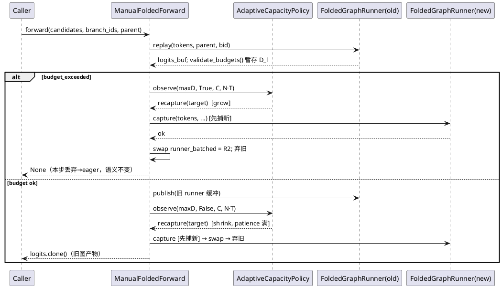

# AR017 设计文档：自适应发散容量重捕获 + 几何扫描基准

| 字段 | 内容 |
|------|------|
| srs | ./srs.md（req 门控两轮 PASS，ses_eca849cbaffex34TunrCeZAZgM） |
| 改动面 | 新模块 `actfold/core/adaptive_capacity.py`；`cuda_graph.py`（FR1 暂存，最小）；`architecture_utils.py`（两处钩子 + 重捕获生命周期）；`actfold/utils/config_manager.py`（6 字段）；`actfold/eval/benchmark_runner.py`（接线）；新脚本 + 新测试 + 文档 |
| 基线 | 838 passed / 3 skipped / 3 deselected；mypy 65 文件 clean；demo 85.5%/2.35e-03/93.75% |

## 1. 设计总览

### 1.1 机制

```
每步重放（既有）                          本 AR 新增（仅自适应开启时）
─────────────────                        ─────────────────────────────
replay()                                 ┌─ FR1：validate_budgets 内
  └ validate_budgets()  ────────────────┤   暂存 last_layer_divergences
      count_buf.tolist()（唯一同步）      │   （零新增同步）
                                         │
budget_exceeded? ──是──> 丢弃+eager       ├─ 钩子 A（超限分支内、丢弃前）：
      │                                  │   observe(max_d, exceeded=True,
      否                                  │         C, N·T) → 增长评估
      ├──> publish（消费旧 runner）        │   →〔重捕获：先捕新后弃旧〕
      └──> return logits.clone()          ├─ 钩子 B（发布后、返回前）：
                                          │   observe(max_d, exceeded=False,
                                          │         C, N·T) → 收缩评估
                                          │   →〔重捕获：先捕新后弃旧〕
```

策略是无副作用的确定性状态机（观测序列 → 动作序列确定），
**状态（窗口/计数/退役/事件表）全部在策略对象内**；
`ManualFoldedForward` 仅在两处钩子调用 `observe` 并执行返回的动作
（重捕获/一次性告警）——与 srs FR2"策略无副作用、告警由调用侧发"及
FR3"调用侧维护观测窗口"的对应关系：**append 条件由调用点结构保证**
（钩子只在 `replay()` 返回非 None 的两条路径上，prefill 失败步天然
不可达），**清空/冻结由策略的状态转移实现**（`note_recaptured` /
`retire`），窗口数据不散落到 mff 属性。

### 1.2 备选方案（已评估，取 B）

- **A（否决）：容量阶梯**——capture 时预捕多个容量档 {0.125, 0.25,
  0.5}，按观测选择重放。缺点：3× graph 内存常驻；换档仍需解决
  budget 语义；收益与 B 相同但内存线性放大，与 16GB 目标冲突。
- **B（采纳）：单图 + 观测驱动重捕获**——任意时刻至多双图（swap
  瞬间），稳态单图；策略纯逻辑可表驱动；失败模式退化回固定容量
  （永不劣于现状）。
- **C（否决）：不重捕获、只告警**——用户手调 ratio；不满足"自适应"
  需求，且基准证据（D≈0.13-0.16 vs 0.5）表明默认值系统性错。

### 1.3 证据 → 参数默认值

探针 v3：D_frac≈0.15 时 `ceil(1.25·D_max·N·T)/(N·T)≈0.19` 的容量
拿到 2.32-2.43× 加速（vs 0.5 容量的 1.36-1.41×）。故
`grow_factor=1.25`（收缩后容量 ≈ 1.25×观测最大 D，余量吸收 ~20%
的 D 波动）；`shrink_threshold=0.5`（容量浪费 >2× 才值得付一次
重捕获）；`patience=3`（3 步确认平稳，对冲单步抖动）；
`min_recapture_interval=2`（两次重捕获间隔 ≥2 步）；
`max_recaptures=8`（S 步验证循环内重捕获成本占比 <5% 对 S>~30 成立；
超限即退役，行为退化为固定容量）。

## 2. 新模块 `actfold/core/adaptive_capacity.py`

```python
@dataclass(frozen=True)
class AdaptiveCapacityConfig:
    """Knobs for the adaptive divergent-capacity policy (AR017)."""
    grow_factor: float = 1.25            # >= 1.0
    shrink_threshold: float = 0.5        # (0, 1)
    shrink_patience: int = 3             # >= 1
    min_recapture_interval: int = 2      # >= 1（observe 次数计）
    max_recaptures: int = 8              # >= 1（成功次数计）

    def __post_init__(self) -> None:     # 违反边界 → ValueError
```

```python
ActionKind = Literal["noop", "recapture", "retired"]

@dataclass(frozen=True)
class AdaptiveAction:
    kind: ActionKind
    target_capacity: int | None = None   # 仅 "recapture" 时非 None
```

```python
class AdaptiveCapacityPolicy:
    """Deterministic, side-effect-free capacity policy state machine."""
```

状态：`_window: list[tuple[int, bool]]`（(max_layer_D, exceeded)，
append 后即裁剪至最近 `shrink_patience` 条——`if len(_window) >
patience: del _window[0]`，内存有界且 `recent` 判定所需）；
`_steps_since_recapture: int`（**初始化为 `min_recapture_interval`**
——首次自适应不被节流；节流约束的是**重复**重捕获）；
`_recapture_count: int`；`_retired: bool`；`_observe_count: int`；
`events: list[dict]`（可观测性：`{"observe": i, "kind": "recapture",
"trigger": "grow"|"shrink", "target": C, "from": C_old}` 与
`{"observe": i, "kind": "retired"}`——基准读取；**不是副作用**，
不触系统状态）。

**决策算法（`observe(max_layer_divergence, exceeded, current_capacity,
num_tokens) -> AdaptiveAction`）：**

```
若 _retired: 返回 noop
_window.append((max_d, exceeded)); _observe_count += 1
_steps_since_recapture += 1
若 _recapture_count >= max_recaptures:
    _retired = True; events += retired; 返回 "retired"   # 调用侧一次性告警

若 exceeded:                                            # 钩子 A
    target = min(num_tokens, ceil(grow_factor * max_d))
    若 target <= current_capacity: 返回 noop             # 已到 N·T 上限
    若 _steps_since_recapture < min_recapture_interval: 返回 noop
    返回 ("recapture", target)

否则:                                                    # 钩子 B
    若 current_capacity <= 1: 返回 noop                   # clamp 空区间
    recent = _window[-patience:]
    若 len(recent) == patience 且全部 not exceeded
       且 max(d) <= shrink_threshold * current_capacity:
        target = clamp(ceil(grow_factor * max(d)), 1, current_capacity - 1)
        若 _steps_since_recapture < min_recapture_interval: 返回 noop
        返回 ("recapture", target)
    返回 noop
```

- **方向单调**（FR2）：增长 `target = ceil(1.25·max_d) > max_d > C`
  （超限时 max_d > C）；收缩 `target ≤ C-1 < C` 且
  `target = ceil(1.25·max_d) ≥ max_d`（恒 ≥ 观测需求）。
- `note_recaptured()`：`_window.clear()`、`_steps_since_recapture = 0`、
  `_recapture_count += 1`、events += recapture——**仅成功 swap 后调用**。
- `retire()`：`_retired = True`（重捕获失败时由调用侧调；events 不记
  ——失败事件由调用侧告警语义覆盖）。
- 退役后 `observe` 恒 noop 且**不再累积**（首个 observe 判
  `_retired` 直接返回——窗口冻结，FR3 契约）。

**mypy**：新模块全类型注解、`from __future__ import annotations`、
100 列、Google docstring——`--strict` 兼容。

## 3. `cuda_graph.py`：FR1 暂存（唯一改动，最小 diff）

```python
# __init__（:101 `self._capacity = 0` 附近）：
self._last_layer_divergences: list[int] | None = None

# validate_budgets（:298-313）——等价重构（:309 的
# self._require_captured() 与 # type: ignore[union-attr] 显式保留）：
self._require_captured()
counts = self._count_buf.tolist()
self._last_layer_divergences = [self._num_tokens - c for c in counts]
ok = all(d <= self._capacity for d in self._last_layer_divergences)
self._budget_exceeded = not ok
return ok

# property（capacity/budget_exceeded 旁）：
@property
def last_layer_divergences(self) -> list[int] | None:
    """Per-layer divergent counts from the last budget validation."""
    return self._last_layer_divergences
```

- 语义等价重构（`d ≤ C` 判定逐值不变）；读回仍恰一次；
  `_static_forward` 零触碰（#37 capture 体纪律）；
  超限步暂存为真值（`replay()` :295 无条件调用——req Major-1 前提）；
  prefill 失败步（`replay` 于 :288-289 提前返回 None）暂存为陈旧值，
  调用点结构保证不被消费（钩子不可达）。

## 4. `architecture_utils.py`：钩子 + 生命周期

### 4.1 `__init__` 新参数与属性（:396 `graph_capacity_ratio` 后）

```python
graph_adaptive_capacity: bool = False,
graph_adaptive_config: Any | None = None,   # AdaptiveCapacityConfig | None
```

```python
self.graph_adaptive_capacity = bool(graph_adaptive_capacity)
self._graph_adaptive_policy: Any = None     # AdaptiveCapacityPolicy | None
if self.graph_adaptive_capacity:
    from actfold.core.adaptive_capacity import (
        AdaptiveCapacityConfig, AdaptiveCapacityPolicy)
    cfg = graph_adaptive_config if graph_adaptive_config is not None \
        else AdaptiveCapacityConfig()
    self._graph_adaptive_policy = AdaptiveCapacityPolicy(cfg)
# 独立一次性告警标志（FR3：不走 _warn_graph_degraded_once 家族布尔，
# 也不复用 _graph_batched_* 任何标志）。
# srs 术语映射：req Major-3 修复文的"独立标志 graph_adaptive_retired"
# 落地为两半——退役**状态**在策略对象内（_retired，含冻结语义），
# 一次性**告警**标志在 mff 侧（下面两个布尔）；独立性意图
# （不触 _graph_batched_capture_failed）由两者共同保证。
self._graph_adaptive_retire_warned = False   # 达上限退役告警
self._graph_adaptive_fail_warned = False     # 重捕获 capture 失败告警
```

构造校验：`graph_adaptive_config` 非 None 时必须是
`AdaptiveCapacityConfig` 实例（`isinstance` 检查，否则
`ValueError`——mypy `Any` 边界上的运行时防线，沿 config 未知键
告警的防御先例）。

**只读公开探针**（基准/UT 读取合规路径，不触下划线私有属性）：

```python
@property
def graph_adaptive_policy(self) -> Any:   # AdaptiveCapacityPolicy | None
    """The adaptive-capacity policy (``None`` when disabled)."""
    return self._graph_adaptive_policy
```

### 4.2 `_graph_forward_batched_or_none` 两处钩子

**钩子 A**（:845-855 超限分支内，一次性告警之后、`return None`
之前——req Major-1）：

```python
if runner.budget_exceeded:
    ...既有一次性告警（不动）...
    self._observe_adaptive_capacity(
        runner, tokens, branch_ids, parent_branch_id,
        attention_mask, exceeded=True)
    return None
```

**钩子 B**（:856-858 发布之后、`return logits.clone()` 之前——
发布消费旧 runner 静态缓冲，swap 不得先于发布）：

```python
self._publish_graph_children(...)
self._observe_adaptive_capacity(
    runner, tokens, branch_ids, parent_branch_id,
    attention_mask, exceeded=False)
return logits.clone()
```

`logits` 局部变量引用旧 runner 缓冲，swap 后 `.clone()` 值不变
（本步结果由旧图产出，FR3）。

### 4.3 `_observe_adaptive_capacity`（新私有方法）

```python
def _observe_adaptive_capacity(self, runner, tokens, branch_ids,
        parent_branch_id, attention_mask, exceeded) -> None:
    policy = self._graph_adaptive_policy
    if policy is None:                     # 默认关闭：零开销零状态
        return
    divs = runner.last_layer_divergences
    if divs is None:                       # 防御：不应可达（钩子仅在
        return                             # replay 返回非 None 路径上）
    num_tokens = int(tokens.shape[0]) * int(tokens.shape[1])
    action = policy.observe(
        max(divs), exceeded, int(runner.capacity), num_tokens)
    if action.kind == "recapture" and action.target_capacity is not None:
        self._recapture_batched_runner(
            action.target_capacity, int(runner.capacity), tokens,
            branch_ids, parent_branch_id, attention_mask)
    elif action.kind == "retired":
        if not self._graph_adaptive_retire_warned:
            self._graph_adaptive_retire_warned = True
            warnings.warn(...达 max_recaptures 上限，容量固定于当前值...,
                UserWarning, stacklevel=2)
```

（无 `step_idx` 形参——策略以观测流计步，与调用方步语义解耦。）

### 4.4 `_recapture_batched_runner`（新私有方法，先捕新后弃旧）

```python
def _recapture_batched_runner(self, target_capacity, current_capacity,
        tokens, branch_ids, parent_branch_id, attention_mask) -> None:
    num_tokens = int(tokens.shape[0]) * int(tokens.shape[1])
    new_ratio = min(1.0, target_capacity / num_tokens)   # target>=1 → >0
    # 按"实际将得到的容量"决策（design 门控 Major-1）：target/n 的
    # IEEE 浮点积只会向上舍入（ceil ∈ {target, target+1}，从不下低于
    # target），收缩分支的 +1 上溢可能使实际容量 == 当前容量
    # （target == C-1 时）——此时跳过重捕获（noop，不付 capture 成本）。
    # N·T 为 2 的幂时除法精确、ceil == target 恒成立（本 AR 全部
    # in-scope 几何：UT n=64、基准 n∈{2048, 4096}）；一般 n 下该
    # 防御使行为对上溢免疫。（`import math` 于文件顶部补入——
    # design 门控复核 Minor-2）
    prospective = max(
        1, min(math.ceil(new_ratio * num_tokens), num_tokens))
    if prospective == current_capacity:
        return
    from actfold.core.cuda_graph import FoldedGraphRunner
    new_runner = FoldedGraphRunner(
        wrapped_layers=self._wrapped_layers,
        embed_fn=self.profile.embed_module,
        final_norm_fn=self.profile.final_norm,
        head_fn=self.profile.head_module,
        cache=self.cache,
        gate_tau=self.gate.tau,
        gate_eps=self.gate.eps,
        capacity_ratio=new_ratio,
        attention_mask_static=attention_mask,          # 与捕获时同对象
    )
    try:
        new_runner.capture(tokens, branch_ids[0], parent_branch_id)
    except RuntimeError as exc:
        # 旧 runner 在场继续服务；禁止置位 _graph_batched_capture_failed
        # （其语义是禁用整条批量 graph 路径，会连废旧 runner——req Major-3）
        if not self._graph_adaptive_fail_warned:
            self._graph_adaptive_fail_warned = True
            warnings.warn(f"Adaptive capacity re-capture failed ({exc}); "
                "adaptive capacity retired, keeping the current graph.",
                UserWarning, stacklevel=2)
        self._graph_adaptive_policy.retire()
        return
    # 先捕新成功 → swap → 弃旧（旧 runner 引用随重绑定交 GC；
    # _graph_batched_mask 同步维护）
    self.graph_runner_batched = new_runner
    self._graph_batched_mask = attention_mask
    self._graph_adaptive_policy.note_recaptured()
```

- **容量换算的正确性论证（修订，design 门控 Major-1）**：
  `ceil(new_ratio·num_tokens) ∈ {target, target+1}`——IEEE 乘积
  `target/n·n` 不小于 `target - ulp`，ceil 只可能等于 target 或
  target+1，**从不下低于 target**（故增长分支恒满足
  `实际容量 > C ≥ 需求`——方向单调不破坏；收缩分支的 +1 上溢
  被 `prospective == C` 防御拦截——行为退化为 noop，不浪费 capture，
  恒不增容）。精确等式 `ceil == target` 在 **N·T 为 2 的幂**时成立
  （二进制除法精确）——本 AR 全部 in-scope 几何满足（UT 夹具
  N·T=64、基准 N·T ∈ {2048, 4096}）；**§6 明文钉住 UT 夹具必须
  取 2 幂 N·T**。非 2 幂几何（真实用户合法可达，如 N=5, T=384）
  由防御行保证正确性，仅容量可能多 1 行（无害余量）。
- **不触碰**：`_graph_batched_capture_failed` / shape 标志 /
  `_graph_batched_budget_warned`（告警预算语义跨 runner 连续）/
  串行侧任何状态。
- 旧 runner 的释放：`graph_runner_batched` 重绑定后唯一强引用消失
  （钩子内局部 `runner` 存活至方法返回）；CUDA graph 池随对象 GC
  回收——基准/UT 不显式 empty_cache（设计决策：GC 语义足够，显式
  cache 清理会引入全局副作用）。

### 4.5 交互时序（PlantUML）



## 5. 配置接线

### 5.1 `actfold/utils/config_manager.py`（:84 后新增 6 字段）

```python
graph_adaptive_capacity: bool = False
graph_adaptive_grow_factor: float = 1.25
graph_adaptive_shrink_threshold: float = 0.5
graph_adaptive_shrink_patience: int = 3
graph_adaptive_min_recapture_interval: int = 2
graph_adaptive_max_recaptures: int = 8
```

`__post_init__`（:135-139 块后）校验：`grow_factor >= 1.0`、
`0 < shrink_threshold < 1`、`shrink_patience >= 1`、
`min_recapture_interval >= 1`、`max_recaptures >= 1`——违反
`ValueError`（沿 `graph_capacity_ratio` 先例）。

### 5.2 `actfold/eval/benchmark_runner.py`（:208-209 接线扩展）

顶部新增 `from actfold.core.adaptive_capacity import
AdaptiveCapacityConfig`（现 imports :13-29 无此模块——design 门控
Minor-2）；接线：

```python
use_cuda_graph=self.config.use_cuda_graph,
graph_capacity_ratio=self.config.graph_capacity_ratio,
graph_adaptive_capacity=self.config.graph_adaptive_capacity,
graph_adaptive_config=(
    AdaptiveCapacityConfig(
        grow_factor=self.config.graph_adaptive_grow_factor,
        shrink_threshold=self.config.graph_adaptive_shrink_threshold,
        shrink_patience=self.config.graph_adaptive_shrink_patience,
        min_recapture_interval=(
            self.config.graph_adaptive_min_recapture_interval),
        max_recaptures=self.config.graph_adaptive_max_recaptures,
    )
    if self.config.graph_adaptive_capacity
    else None
),
```

## 6. 测试设计：`tests/test_adaptive_capacity.py`

自包含夹具沿 `test_batched_graph_forward.py` 先例（L=2/H=32/T=16/
V=64/N=4 合成 LLaMA-layout 解码器 + `_build_model`/`_make_mff`
同构；同文件内复制不跨测试模块 import——仓库先例）。**N·T=64 为
2 的幂（§4.4 容量换算精确性所要求的夹具约束，design 门控 Major-1），
本 AR 新增任何夹具几何必须保持 N·T 为 2 的幂。** CUDA 门控机制：
**不用模块级 `pytestmark`**（会连带 skip CPU 可跑的 UT-1601），
改为模块级常量 `_cuda = pytest.mark.skipif(not
torch.cuda.is_available(), reason="CUDA required")`，UT-1602~
1609 逐函数 `@_cuda` 标记；UT-1601（策略纯逻辑）无标记、CPU 可跑。

| UT | 场景与关键断言 |
|----|--------------|
| 1601 | 策略表驱动（CPU）：增长 `ceil(1.25·maxD)`+clamp num_tokens、`target ≤ C` 时 noop（C=N·T 满）、收缩 patience 计数/β 触发/`target ∈ [1, C-1]`/C≤1 noop、**方向单调显式断言（每个 recapture 动作：grow 时 `target ≥ maxD`、shrink 时 `target < C`——srs FR2 点名面）**、interval 节流（`steps_since_recapture` 初始化=interval 首次不节流；`note_recaptured` 后归零再计）、达上限返回 "retired" 且此后恒 noop 窗口冻结、`AdaptiveCapacityConfig` 边界 ValueError、动作序列确定性（同输入重放两次序列相等） |
| 1602 | 收缩端到端：D_frac≈0.15 负载（中段分歧+suffix，AR016 场景族），ratio=0.5+自适应开（patience=2 压缩等待，**测试参数偏离默认已在用例 docstring 声明**）→ 首次调用捕获+observe；收缩重捕获实际发生于第 2 次调用（patience=2），断言放第 3 次调用后（宽松断言仍绿）：`graph_runner_batched` `is not` 旧对象、`capacity < ceil(0.5·N·T)`（初始容量，2 幂下精确值 32）、`capacity ≥ max_l D_l`（从 `last_layer_divergences` 读）；logits vs eager 批量 allclose(1e-4)+逐行 argmax；后续步预算恒通过（`budget_exceeded` False）；profiler 无污染 |
| 1603 | 增长端到端：ratio=0.02 → 首步 `pytest.warns(UserWarning)` + 结果 == eager 批量（逐位）；策略 events 含 grow 重捕获（target ≥ 实测 maxD）；第 2 步起重放预算通过 + logits 对拍；swap 后构造全发散候选再次超限 → 零**新**预算告警（`_graph_batched_budget_warned` 未复位；`warnings.catch_warnings` 计数） |
| 1604 | 抖动上限：patience=2/interval=1/max_recaptures=2 + 交替负载（低-低-高-低-低-高…）→ `len(policy.events 中 recapture) ≤ 2`；第 2 次成功后下一次 observe 返回 "retired" + 一次性告警（`pytest.warns` 恰一次）；退役后容量不再变（`runner.capacity` 恒定）；全部结果 vs eager 对拍 |
| 1605 | 重捕获失败安全网：首步正常捕获（ratio=0.5 自适应开）→ 低负载走到触发收缩的 observe 前，monkeypatch `FoldedGraphRunner.capture` 一次性 RuntimeError（side_effect 列表 `[None, RuntimeError]` 模式：首次 capture 已消费成功路径——patch 于首次捕获完成后置入、失败后立即还原，沿 UT-1507 时序）→ 一次性告警 + `graph_runner_batched` **`is` 旧实例** + `_graph_batched_capture_failed is False` + `policy._retired` 真 + 后续步 `runner.replay` spy 计数递增（`monkeypatch.setattr(R1, "replay", wraps=R1.replay)`）+ 结果对拍一致 |
| 1606 | 默认关闭零行为：`graph_adaptive_capacity=False`（缺省构造）→ 5 步重放后 `graph_runner_batched` 同一对象、`capacity` 不变、`_graph_adaptive_policy is None`（经公开探针 `graph_adaptive_policy` 读）、`warnings.catch_warnings` 零告警 |
| 1607 | 观测接缝：重放后 `last_layer_divergences` 长度 == L、逐值 `== num_tokens - count_buf.tolist()[l]`（测试内自行读回对拍，测试同步不限）、`max ≤ num_tokens`；两次不同负载（低/全发散）值不同（非陈旧）；构造未校验路径：直接 `FoldedGraphRunner.capture` 后未 replay → `last_layer_divergences is None` |
| 1608 | 串行零干扰：批量侧多次重捕获后，串行捕获（[1,T] `branch_id` 单数调用）重放正常、`graph_runner` 对象与 capacity 全程不变、串行结果 vs 批量行对拍（沿 UT-1503 传递性结构） |
| 1609 | mutation spot-check（每处验证后还原，全绿后 SHA256）：①删钩子调用（A+B 两处调用行）→ UT-1602 容量不变断言红；②删增长分支（`exceeded` 路径直接 noop）→ UT-1603 第 2 步预算通过断言红；③删上限退役判定 → UT-1604 "retired" 告警断言红；④改先弃旧后捕新（swap 提前到 capture 前）+ UT-1605 失败注入 → `is` 旧实例断言红（旧 runner 丢失） |

容差：沿 AR016——logits `allclose(atol=1e-4, rtol=1e-4)` + 逐行
argmax；cache ffn_out 1e-4；embedding 1e-6。全部既有测试文件零改动。

## 7. 基准脚本：`scripts/ar017_adaptive_bench.py`

沿 `ar016_batched_bench.py` 结构（`_Decoder` 可参数化 H/L、
`_make_candidates` 同负载族、`_timed_ms`、`TimingStats`/
`stats_from_samples` 复用、`--quick`/`--out` 参数）：

- **三路径**：`baseline_eager`（N 次全量前向）/ `graph_fixed`（
  ratio=0.5，自适应关——AR016 现状对照）/ `graph_adaptive`（初始
  ratio=0.5，自适应开，默认参数）；
- **配置扫描**：几何 (H=256, L=8) 与 (H=1024, L=16) × N ∈ {4, 8}
  × T=512——`_make_mff`/模型构造参数化 H/L（ar016 常量提为参数）；
- **交错**：每重复内三路径 round-robin；**warmup=5**（覆盖适配期：
  patience=3 下收缩重捕获发生于第 3 步 observe 后、稳态自第 4 步——
  warmup=5 保守富余一步；growth 场景 warmup 同覆盖）+ reps=10 取
  `samples[warmup:]`——p50 为稳态值；
- **适配事件表**：`graph_adaptive` 路径每步后经**公开探针**
  `mff.graph_adaptive_policy`（§4.1，不触下划线私有属性——design
  门控 Minor-4）读 `policy.events` + `runner.capacity` +
  `runner.last_layer_divergences` → 工件 **`adaptation_events`**
  字段（键名对齐 srs FR5——design 门控 Minor-3；内含 `events`
  列表 + `capacity_trajectory` + `observed_max_layer_divergence`
  的 min/p50/max）；事件发生在 warmup 期则不入稳态计时（时序天然
  如此：warmup 样本丢弃）；
- **假设判定**：`_verdict`（2σ）逻辑本地复制（8 行，不跨脚本 import
  私有函数——scripts 自包含先例）；
  - H1：`graph_adaptive` p50 < `graph_fixed` p50（逐几何逐配置）；
  - H2：`graph_adaptive` vs baseline 加速比 ≥ `graph_fixed` vs
    baseline（P1-7 重答，配对逐配置 + 总体）；
  - H3：H=1024 几何的自适应加速比 > H=256 几何的（逐 N 配对）；
  - H4：三路径 argmax 逐位一致 + 两 graph 路径 allclose(1e-4)；
- **meta**（沿 ar016 字段 + 补齐）：GPU 名称/驱动版本
  （`nvidia-smi --query-gpu=driver_version` 子进程探测，失败记
  null+注记——AR016 Minor-2 豁免收口）/运行日期/CUPTI 探测
  （预期 null+注记）/交错声明/复现命令/种子/容量参数与策略参数；
- **运行预算**：H=1024 配置 baseline ~146ms/步（N=8）× 15 × 3 路径
  × 2 配置 ≈ 13s + H=256 配置 ≈ 2s + 捕获/重捕获/对拍 ~10s → 全量
  < 2 分钟（<10 分钟预算富余）；`--quick` = 单配置 (H=1024, N=4)。

**预期与诚实性**：探针 v3 已示 0.1875 容量拿到 2.32-2.43×——但那是
**手工定容**；自适应版有 patience 等待期（warmup 吸收）与 1.25×
余量（容量略高于 0.1875），稳态加速比预期 2.1-2.4× 区间。判定只
认实测；若 <2σ 或方向反转，如实记 `inconclusive`/`refuted`。

## 8. 文档改动（T005）

- `docs/OPTIMIZATION_GUIDE.md`：:180 P1-7 行第三档追注 +
  **第二十四部分**（AR 记录表 + 几何扫描墙钟表 4 配置×3 路径 +
  H1-H4 判定 + P1-7 重答结论 + 策略语义要点：默认关闭/单读回/先捕新
  后弃旧/上限退役/增长不改本步语义）——**数字从工件逐值复算**
  （`'%.2f' % p50`，AR016 review 教训）；
- `CHANGELOG.md`：AR017 节置 Unreleased 最前（Added/Design/实验）；
- `AGENTS.md`：#37 扩注自适应容量契约；
- AR016 遗留收口注记：指南第二十三部分遗留清单的容量项标 ✅ AR017
  （宿主侧开销分解仍开放）。

## 9. 明确不做（srs §1.3 镜像）

串行 graph 自适应；变长/多 parent；Triton 批量 kernel；宿主侧
固定开销压缩；动态 shape 池；`folded_generate` 生长循环接入
（T 每步 +1 形状恒变，重捕获无收益，#20 同款结论）。

## 10. 风险与缓解（设计层补充）

| 风险 | 缓解 |
|------|------|
| 重捕获与 publish/replay 的缓冲竞态 | 钩子 B 在 publish 之后；`logits` 局部引用旧缓冲；钩子 A 无 publish——设计上无"发布读新图缓冲"路径 |
| `new_ratio` 浮点换算回整偏差 | **按实际容量决策（§4.4 防御行）**：`ceil(ratio·n) ∈ {target, target+1}` 只上溢不越需求（增长方向单调保持）；收缩上溢至 C 时 `prospective == C` 跳过 swap（noop，不付 capture 成本）；N·T 为 2 的幂时精确（本 AR 全部 in-scope 几何满足，UT 夹具 2 幂约束明文钉住）；UT-1602/1603 断言精确容量值仅在 2 幂夹具下有效 |
| 策略状态跨 `step_idx` 语义 | 策略以 observe 计数（`_observe_count`）计步，与调用方 `step_idx` 解耦——验证循环的步语义由调用方定义，策略只看观测流 |
| 多 mff 实例共享策略对象 | 策略由 `__init__` 私有构造（每 mff 独立实例）；`graph_adaptive_config` 传入的是**配置**（frozen dataclass 可共享）非策略 |
| capture 失败注入的 patch 时序（UT-1605） | `side_effect` 列表模式：首步真实 capture 已完成后 monkeypatch 置入 `[RuntimeError]`，失败即还原（沿 UT-1507"持续类级 patch 连带炸串行捕获"教训——还原后串行侧可继续捕获） |
| 基准三路径并存显存 | H=1024/L=16：模型 ~540MB + 单 runner ~570MB×2（fixed+adaptive）+ swap 瞬间 +570MB + 缓存发布 ~600MB → 峰值 < 3GB（16GB 富余） |
| 增长风暴（全发散负载步步超限步步重捕获） | interval=2 节流 + max_recaptures=8 上限 + target=N·T 后 noop（clamp 到顶即无意义）——UT-1604 极端交替负载覆盖 |
