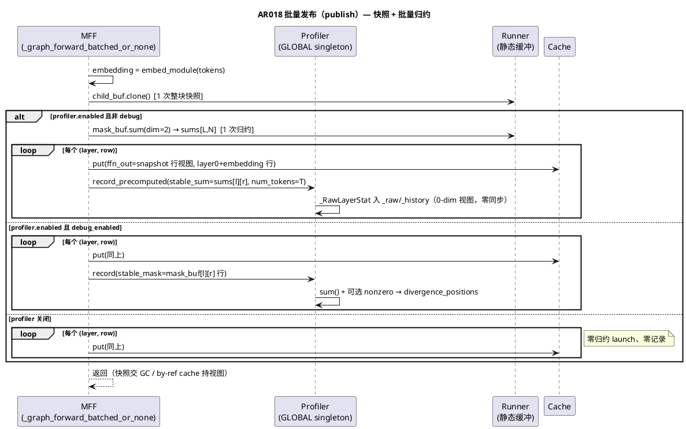

# AR018 设计文档：发布路径宿主侧成本压缩（批量稳定度归约 + 快照发布）

| 字段 | 内容 |
|------|------|
| AR 编号 | AR018 |
| 关联 srs | ./srs.md（req 门控 PASS：ses_ec812b2daffeHi3mXUhNyPHjr7，两轮） |
| 生产改动面 | `actfold/profiler/stability_profiler.py`（新增 `record_precomputed`，`record` 零改动）+ `actfold/models/architecture_utils.py`（`_publish_graph_children` 重构）+ 新基准脚本 + 文档；**`cuda_graph.py` 零改动** |
| 设计原则 | 纯实现优化：发布内容逐位不变、profiler 统计逐位不变、无新开关、无新语义；正确性论证面（by-reference 防别名 / 0-dim 消费面等价）全部以 UT 钉住 |

## 1. 设计总览

### 1.1 机制

两项正交机制压缩发布循环的宿主侧成本（探针实测占自适应全步
60.7%/71.2%/29.7%/31.5%）：

1. **批量稳定度归约（FR1）**：`mask_buf` 是 [L,N,T] 单张量——单次
   `sum(dim=2)` 产出 [L,N] 全部 (layer,row) 稳定计数（1 次归约 launch
   替代 L×N 次逐行 `stable_mask.sum()`）；双循环内 `sums[l][r]`
   （0-dim 视图，零 launch）经新入口 `record_precomputed` 入账；
2. **快照发布（FR2）**：`child_buf` 是 [L,N,T,H] 连续单张量——单次
   整块 `clone()` fresh 快照（1 次 launch 替代 L×N 次逐行 clone），
   `cache.put` 消费快照行视图（put 内部 `copy_` 自带拷贝，逐行 clone
   本是纯冗余中间拷贝）。

**launch 账本（每步发布路径，不含 embedding 前向；layer-0 embedding
行 put 拷贝两侧各 +N 未计入——同口径抵消，delta 结论不受影响）**：

| | clone | put 拷贝 | sum 归约 | 合计 |
|---|---|---|---|---|
| 现状 | L·N | L·N | L·N | 3·L·N |
| AR018 | 1 | L·N | 1 | L·N + 2 |

本 AR 探针配置 L·N ∈ {32, 64, 64, 128}：launch 3·L·N → L·N+2
（(256,8,4): 96→34；(1024,16,8): 384→130）；含 embedding put 拷贝
的精确值为 3·L·N+N → L·N+N+2。

### 1.2 备选方案（已评估，取 A）

- **方案 A（取）**：整块快照 + 批量归约——唯一同时满足 ①by-reference
  cache 安全（快照 fresh 私有，发布后本侧零写）②launch 最小 ③零语义
  变化的方案；
- **方案 B（排除）**：逐行视图直传 put（零 clone）——依赖"put 必拷贝"
  的协议假设；cache 协议是 duck-typed（ManualFoldedForward 可接任意
  实现），第三方 by-reference cache 会别名静态缓冲，下一次重放污染已
  发布条目——UT-1509 保护面（mutate child_buf → cache 不变）被削；
- **方案 C（不取）**：每层快照（L 次 [N,T,H] clone）——launch 数 L 而
  非 1，无任何相对 A 的优势；
- **方案 D（srs §1.3 已排除）**：惰性发布（验收后按需发布——cache
  时序语义变化）/ cache 批量 put API（put 的逐分支拷贝是协议事实，
  Python 开销在 A 之后已非主导）。

### 1.3 证据 → 设计决策

- 探针（n=30，AR017 稳态容量）：发布内 profiler 归约占 37-44%
  （(256,8,8) 仅归约 ~3.7ms）→ **归约批量化是发布内最大单项**；
- 探针 no-profiler 发布 2.72ms（32 对 clone+put，~85µs/对）+
  `ActivationCache.put` 源码 `buffer[:seq_len].copy_(transposed)`
  （自带拷贝）→ **逐行 clone 冗余、快照化**；
- `record` 现路径的 `stable_sum = stable_mask.sum()` 本身就是 0-dim
  张量，消费面（`_ratios` 的 `torch.stack([...]).float()`、
  `get_profile` 的 `.float().item()`）对 0-dim 视图语义等价
  （req 门控 1c 确认）→ **预求和入口无需任何消费面改动**；
- bool→int64 sum 是精确整数累加（结合律），整块 dim=2 归约与逐行
  sum 数学上逐位相等 → **UT-1701 的 bit-exact 对拍有硬保证**；
- `debug_enabled` 默认 False 且生产/基准路径不开启（现状事实）→
  debug 回退路径保留但以 UT-1707 钉住（正确性优先于性能）。

## 2. `stability_profiler.py`：`record_precomputed` 新入口（`record` 零改动）

`StabilityProfiler` 新增方法（置于 `record` 之后，`_ratios` 之前）：

```python
def record_precomputed(
    self,
    branch_id: Any,
    parent_branch_id: Optional[Any],
    layer_idx: int,
    step_idx: int,
    stable_sum: torch.Tensor,
    num_tokens: int,
    tau: float,
    metric: str = "cosine",
) -> None:
    """Record one layer's stability decision from a precomputed sum.

    Batched-publish counterpart of :meth:`record` (AR018): the caller
    owns the reduction (one ``mask_buf.sum(dim=2)`` per step serves every
    (layer, row) pair) and passes the 0-dim device tensor plus the token
    count explicitly. The stored ``_RawLayerStat`` is field-for-field
    identical to what ``record`` produces for the same data, so every
    downstream consumer (``_ratios``/``get_profile``/history) behaves
    identically. ``divergence_positions`` is never produced here (there
    is no mask to scan); callers needing debug positions must fall back
    to :meth:`record`.

    Args:
        branch_id: Identifier of the current branch.
        parent_branch_id: Identifier of the parent branch (if any).
        layer_idx: Layer index.
        step_idx: Diffusion step index.
        stable_sum: Precomputed 0-dim device tensor (a masked ``sum()``
            result or a 0-dim view into one).
        num_tokens: Token count the sum was taken over.
        tau: Similarity threshold used for the decision.
        metric: Similarity metric name.

    Raises:
        ValueError: If ``stable_sum`` is not a 0-dim ``torch.Tensor``.
    """
    if not self.enabled:
        return
    if not isinstance(stable_sum, torch.Tensor) or stable_sum.ndim != 0:
        raise ValueError(
            "stable_sum must be a 0-dim torch.Tensor (a masked sum "
            f"result); got {type(stable_sum).__name__} with "
            f"ndim={getattr(stable_sum, 'ndim', None)}"
        )
    raw = _RawLayerStat(
        branch_id=branch_id,
        parent_branch_id=parent_branch_id,
        layer_idx=layer_idx,
        step_idx=step_idx,
        stable_sum=stable_sum,
        num_tokens=num_tokens,
        tau=tau,
        metric=metric,
        divergence_positions=None,
    )
    self._raw.setdefault(branch_id, []).append(raw)

    history_key = (layer_idx, step_idx)
    self._history[history_key].append(raw)
    if len(self._history[history_key]) > self._max_history_len:
        self._history[history_key].pop(0)
```

**不变量：**
- `enabled=False` 早退与 `record` 一致；`_raw`/`_history` 的
  append/`move_to_end` 无（`record` 亦无）/`_max_history_len` 裁剪
  逻辑逐行镜像；
- `record` 原方法**零改动**（eager/串行路径 4 个调用方不受影响，
  req 门控 1f 清单：architecture_utils.py:770/:993、
  folded_transformer.py:295/:524）；
- 0-dim 视图消费面等价：`torch.stack` 把 0-dim 张量堆成 [n]、
  `.float()`/`.item()` 标准行为——`_RawLayerStat.stable_sum` 的类型
  契约（torch.Tensor）不变，仅来源从"每行 sum() 结果"变为"批量 sum
  结果的 0-dim 视图"，值逐位相等（整数累加）；
- 显式校验 `ndim == 0`：防调用方误传 [L,N] 整表（错记一层的值会
  被后续聚合放大）；宿主侧元数据检查，零同步。

## 3. `architecture_utils.py`：`_publish_graph_children` 重构

函数签名/调用点不变（`_graph_forward_batched_or_none` :914 唯一调用
方），实现体替换为：

```python
def _publish_graph_children(
    self,
    runner: Any,
    tokens: Any,
    branch_ids: Sequence[str],
    parent_branch_id: str,
    step_idx: int,
) -> None:
    """Publish a validated batched replay into the cache and the profiler.

    Row-sliced mirror of :meth:`_publish_graph_child`: each branch ``i``
    receives the ``[1, T, H]`` slice of the static child buffer plus the
    layer-0 embedding row, and a per-layer stability record. AR018 host-cost
    compression: (1) the whole ``[L, N, T, H]`` child buffer is cloned ONCE
    into a fresh snapshot -- ``cache.put`` copies into its own storage, so
    the snapshot's row views are safe against static-buffer reuse and
    against by-reference caches alike (the snapshot is private and never
    written by this side after the publish); (2) all (layer, row) stability
    sums come from ONE ``mask_buf.sum(dim=2)`` reduction recorded through
    ``StabilityProfiler.record_precomputed`` (0-dim views, zero extra
    launches, zero host readback). The debug path
    (``profiler.debug_enabled``) falls back to the per-row ``record``
    entry, which is the only one that can produce ``divergence_positions``.
    """
    from actfold.profiler.stability_profiler import GLOBAL_STABILITY_PROFILER

    embedding = self.profile.embed_module(tokens)
    num_layers = len(self._wrapped_layers)
    # FR2: one fresh snapshot clone of the whole child buffer replaces the
    # per-row clones (cache.put copies, so the intermediate per-row clone
    # was pure overhead).
    snapshot = runner.child_buf.clone()
    # FR1: one batched reduction serves every (layer, row) stability count.
    profiler = GLOBAL_STABILITY_PROFILER
    debug_path = profiler.enabled and profiler.debug_enabled
    sums: Any = None
    if profiler.enabled and not debug_path:
        sums = runner.mask_buf.sum(dim=2)  # [L, N], int64
    seq_len = int(tokens.shape[1])
    for layer_idx in range(num_layers):
        for row, branch_id in enumerate(branch_ids):
            activations: dict[str, Any] = {
                "ffn_out": snapshot[layer_idx][row : row + 1]
            }
            if layer_idx == 0:
                activations["embedding"] = embedding[row : row + 1]
            self.cache.put(
                branch_id=branch_id,
                layer_idx=layer_idx,
                activations=activations,
            )
            if debug_path:
                # Debug positions need the mask itself: per-row fallback to
                # the original entry (correctness over launch count).
                profiler.record(
                    branch_id=branch_id,
                    parent_branch_id=parent_branch_id,
                    layer_idx=layer_idx,
                    step_idx=step_idx,
                    stable_mask=runner.mask_buf[layer_idx][row : row + 1],
                    tau=self.gate.tau,
                    metric="cosine",
                )
            elif sums is not None:
                profiler.record_precomputed(
                    branch_id=branch_id,
                    parent_branch_id=parent_branch_id,
                    layer_idx=layer_idx,
                    step_idx=step_idx,
                    stable_sum=sums[layer_idx][row],
                    num_tokens=seq_len,
                    tau=self.gate.tau,
                    metric="cosine",
                )
```

**要点：**
- **三态分派**：profiler 关→零归约 launch、零记录（与现状 `record`
  早退等价）；debug 开→逐行 `record` 原入口（divergence_positions
  保留，行为与现状逐位一致）；常态→1 次批量归约 +
  `record_precomputed`；
- `sums[layer_idx][row]` 是 [L,N] 张量的 0-dim 视图——零 launch、零
  同步；`num_tokens=seq_len` 与现状 `stable_mask.numel()`（[1,T] 行）
  逐值相等；
- **防别名论证**：快照每步 fresh `clone()`、发布后本侧零写、函数返回
  后零保留引用；默认 cache 的 put 拷贝（activation_cache.py:152-154）
  与 by-reference cache 的视图存储都安全（后者持有的是私有快照的行
  视图，不与静态缓冲/后续重放共享存储）；
- put 调用参数/形状/键集合（layer 0 双键）逐位不变——UT-1502 完备性
  与 cache 协议零触碰；
- 瞬态显存：快照 ≈1×child_buf（(1024,16,8) ≈268MB）；torch caching
  allocator 对固定几何固定尺寸 freed block 即时复用（稳态 ≈ 常驻一个
  额外块）；基准工件记录 `max_memory_allocated`（§6）。

## 4. 交互时序（PlantUML）



## 5. 测试设计：`tests/test_publish_cost.py`（UT-1701~1709）

**夹具（沿 AR016/AR017 先例，模块内自包含复制，禁止跨测试模块导入）**：
合成 LLaMA-layout decoder L=2/H=32/T=16/V=64，N=4（N·T=64 保持 2 幂，
沿 AR017 §6 惯例）；`_build_model`/`_make_mff`（`use_cuda_graph=True`、
`graph_capacity_ratio=0.5`、自适应关闭——本 AR 与容量策略正交）/
candidates 构造复刻自 `tests/test_batched_graph_forward.py`。

**CUDA 门控**：逐函数 `@_cuda` 标记（模块级 pytestmark 会连带 skip
CPU 可跑用例——AR017 design Minor-8 教训）；UT-1701 的纯 profiler 部分
可 CPU 跑，但同 UT 内夹具混用 CUDA 发布——统一 `_cuda`，CPU 部分
（profiler 等价性）单列 CPU 用例子块。

**spy 设计（UT-1702/1704 的计数窗口）**：monkeypatch
`torch.Tensor.sum`/`torch.Tensor.clone`/`torch.Tensor.item`/
`torch.Tensor.tolist`/`torch.Tensor.cpu` 为计数包装器，窗口 = 单次
`_publish_graph_children` 调用（发布前 set、发布后 restore）：
- sum 计数过滤 `self.dtype is torch.bool`（mask 专属，排除其它 sum）；
- clone 计数过滤 `self is runner.child_buf`（identity）；
- host-sync 计数（item/tolist/cpu）不过滤——窗口内恰 0。

**GLOBAL 单例卫生**：每个用例 save/restore
`GLOBAL_STABILITY_PROFILER.enabled`/`debug_enabled` 与 `_raw`/`_history`
（或 fixture 级 reset + 还原），杜绝跨用例状态泄漏。

逐 UT 断言面：

| UT | 场景 | 关键断言 | Red 面 |
|---|---|---|---|
| 1701 | profiler 等价（CPU 子块 + CUDA 子块）：同一 mask 集合，`record`（逐行）vs `record_precomputed`（`m.sum()` 0-dim）双实例记录 | `_raw` 逐条全字段相等（branch/parent/layer/step/num_tokens/tau/metric；stable_sum 经 `.item()` 比较）；`_history` 键集与长度相等；`get_profile().to_dict()` 相等；**聚合面全对拍：`mean_stable_ratio()`/`all_profiles()`/`get_mean_stable_ratio()` 相等（srs FR1 验收明列）**；history 超 `_max_history_len` 时裁剪行为一致；`enabled=False` 双入口都零记录 | `record_precomputed` 不存在（AttributeError） |
| 1702 | 发布路径归约/同步计数（CUDA）：捕获+重放+发布一步，spy 窗口=发布 | bool-sum 恰 1；`enabled=False` 时 bool-sum 恰 0 且零记录；item/tolist/cpu 恰 0 | bool-sum = L·N（8）超额红 |
| 1703 | 快照发布逐位一致（CUDA）：同一重放状态，先快照发布入 cache A，再以测试本地复刻的**旧逐行 clone 发布参考实现**入 cache B | 每 (branch,layer) 键 `torch.equal`（ffn_out + layer0 embedding） | 生产路径仍是旧实现→与参考实现一致而 clone 计数在 1704 红；本 UT 对新旧实现都绿（内容一致是双侧不变量），Red 依赖 1702/1704 |
| 1704 | clone 计数（CUDA）：同 1702 场景 | child_buf identity 的 clone 恰 1；窗口内总 clone 恰 1（无逐行 clone） | child_buf clone = L·N（8）超额红 |
| 1705 | by-reference 防别名（CUDA）：真 cache 构造+捕获后，把 `mff.cache` 属性替换为最小 RefCache（put 存引用 dict），**直接调用 `_publish_graph_children`**（绕过 revalidate 的 fetch——发布体内 cache 唯一用法是 put，design §3 已核） | 发布后 `runner.child_buf.add_(123)` →RefCache 全部条目 `torch.equal` 不变；再重放+二次发布 → 新值正确写入 | **双侧绿 UT**（旧实现逐行 clone 同样隔离）：Green 后防回归钉——快照改回 child_buf 视图直传时红（mutation ③ 观测面）；Red 价值由 1702/1704 承担 |
| 1706 | 既有契约回归（CUDA）：发布完备性（每分支全 L 层 ffn_out + embedding 行形状/数值）+ 发布隔离（mutate child_buf 后 cache 不变 + 二次重放不覆写首发）——本地重断言 UT-1502/1509 核心面；**UT-1602（收缩端到端输出 vs eager）与 UT-1606（默认配置端到端）由全量套件零改动全绿承载（srs FR3 列四项的映射：1502/1509 本地重断言 + 1602/1606 套件承载，T002/T004 验收）** | 与 UT-1502/1509 同款断言 | 对新旧实现都应绿（双侧不变量）；真正的回归证据来自全量套件零改动全绿（T002/T004） |
| 1707 | debug 回退（CUDA）：`debug_enabled=True` 发布 → 逐行 record（bool-sum=L·N、有 mask 的层产 divergence_positions）；False → 批量（bool-sum=1、无 positions） | 路径切换 spy 计数 + `_raw` 中 `divergence_positions` 有无 | 新实现未上→debug 路径下 bool-sum=L·N 与现状一致→**Red 面在常态分支**：现状常态 bool-sum=L·N≠1（与 1702 重叠）；本 UT 的独立 Red 面为 debug 分支下现状也走逐行（一致绿）——取"False 态断言 positions 为 None 且 sums 路径生效"作 Red |
| 1708 | eager/串行零干扰（CUDA）：串行 graph 路径发布（`branch_id` 单数）+ 批量 eager 路径各跑一步 | 两路径 profiler 统计正常（stable_ratio ∈ (0,1]）；`inspect.signature(StabilityProfiler.record)` 与 srs 钉住的签名一致（关键字集合不变） | 对新旧实现都绿（双侧不变量）；回归证据=全量套件 |
| 1709 | mutation spot-check（T002 阶段） | 见 tasks.md T002 五变异 | — |

**UT-1705 设计说明**：by-reference mock 无独立 Red 面（新旧实现都
隔离）——UT-1705 的验收价值在**新实现的防别名论证钉住**（Green 后防
回归：若未来有人把快照改回 child_buf 视图直传，RefCache 存静态缓冲
视图 → mutate child_buf → 条目被污染 → 红）。Red 期本 UT 预期绿。
**测试文件 docstring 必须明记"双侧不变量 UT"清单**（1703/1705/1706/
1708，及其 Red 价值归属 1702/1704），避免 Red 期子代理误判测试 bug。
**UT-1703 参考实现**：测试本地复刻旧发布循环（逐行
`child_buf[l][r:r+1].clone()` + put，**不调 record**——cache 内容对拍
与 profiler 无关，profiler 面由 1701/1702/1707 承担，亦避免 GLOBAL
污染），作为 bit-exact 基准——新旧实现内容一致性的直接证据。

## 6. 基准脚本：`scripts/ar018_publish_bench.py`

结构沿 `ar017_adaptive_bench.py`（复用其 `_Decoder`/`_make_candidates`/
`_timed_ms`/`_verdict`/`_overall`/`_gpu_driver_version`/
`_cuda_profiler_supported`——模块导入，不复制）：

1. **三路径**：baseline eager / graph_fixed(C=0.5) / graph_adaptive
   （`_make_mff` 亦自 `scripts.ar017_adaptive_bench` 导入——固定/自适应
   两 MFF 构造复用，不复制）；
2. **配置矩阵**：(256,8)×(1024,16) × N∈{4,8} × T=512（与 AR017 工件
   完全一致——跨工件对照前提）；
3. **计时**：每重复三路径 round-robin，warmup=5（覆盖 capture+收缩
   适配），**reps=30**（`--reps` 可调，默认 30；n=10 欠功效先例直接
   预承诺 30）；`TimingStats` mean/std/p50/n；
4. **相位分解随行**（路径 c 专属，计时窗口外）：复刻探针方法——稳态
   后以私有 API 驱动六相（revalidate_host/prefill/replay/readback/
   publish/clone）各 n=30，p50/std 入工件
   `phase_decomposition`；`phase_sum_ms` 与 `full_step_p50_ms` 实测值
   **同时入工件**，注记偏差双向性（sync 相位边界串行化的正向偏差与
   相位间宿主工作遗漏的负向偏差并存——探针实测 4 配置中 3 个
   phase_sum < 全步，不预设方向、不写固定布尔）；
5. **跨工件锚点（H1/H2）**：运行时加载
   `results/optimization/ar017_adaptive_bench.json`（缺文件 →
   `anchor_available: false`，H1/H2 判 `no_anchor`，不阻断运行）；
   逐配置取 AR017 的 adaptive/baseline TimingStats：
   - **H1**：AR018 adaptive p50 < AR017 adaptive p50（`_verdict`
     两样本 2σ 判据照用，样本=两工件各自的 30 次重复）；
   - **H2**：AR018 加速比（baseline/adaptive）≥ AR017 加速比（对齐
     srs FR4 的"不回退"语义；相等即 supported 的边界判定）；
6. **H3**：AR018 publish 相位占全步比例 < 探针参照常量
   （`_PROBE_PUBLISH_SHARE = {("256",4): 0.607, ...}` 模块常量，
   provenance 注记：`ar018_hostcost_probe`，2026-10-14，n=30）；
7. **H4**：正确性随行——三路径 argmax 精确一致 + folded 两路径
   allclose(1e-4) + profiler 一致性（adaptive 路径分支的 stable_ratio
   vs 独立重算 `mask_buf` 行 sum/T 对拍，采样于计时窗口外）；
8. **峰值显存**：每配置 adaptive 计时段前
   `torch.cuda.reset_peak_memory_stats()`，段后读
   `torch.cuda.max_memory_allocated()` 入工件（快照瞬态峰值的量化
   证据，承 srs §6 风险表承诺）；
9. **meta**：seed=2026/`--reps 30` 复现命令/run_date/driver/
   CUPTI 探测（预期 null+注记）/interleaving 声明/warmup/
   `cross_artifact_anchor` 声明（对照性质+前提字段清单）/torch·cuda
   版本；
10. **工件**：`results/optimization/ar018_publish_bench.json`；
    `--quick`：单配置 (256,8,4) 冒烟；全量预算 < 10 分钟。

## 7. 文档改动（T005）

- 指南：P1-7 行（:180）第四档追注 + **第二十五部分**（AR 记录表 +
  相位分解表 + 跨工件对照表 + 语义要点：三态分派/快照 fresh 契约/
  0-dim 消费面等价/debug 回退/launch 账本）+ AR017 Part 24 遗留收口
  注记（宿主侧分解项 ✅ AR018：分解已做（探针）+ 主项已压（发布）；
  prefill/读回实测 <5% 记录在案）；
- CHANGELOG：AR018 节置 Unreleased 最前；
- AGENTS #37 扩注（AR018 句）：批量发布契约——快照 fresh 性
  （by-reference cache 安全的依据）、put 自带拷贝下逐行 clone 的
  消除、`record_precomputed` 与 `record` 双入口并存（debug 回退）、
  发布路径零 host 同步纪律。

## 8. 明确不做（srs §1.3 镜像）

惰性发布；cache 批量 put API；prefill N× 读放大（capture 语义风险，
占比 2.3-3.9%）；读回异步化（<1%）；串行 `_publish_graph_child` 与
eager 折叠路径的 record 调用（P1-7 负载在批量侧，AR016/17 先例保持
零干扰）；`revalidate_host` fetch 次数（0.3-1.4%）。

## 9. 风险与缓解（设计层补充）

| 风险 | 缓解 |
|------|------|
| spy monkeypatch `torch.Tensor.sum/clone` 影响测试隔离 | monkeypatch fixture 自动还原；窗口最小化（单次发布调用）；UT 文件 docstring 声明 spy 窗口语义 |
| UT-1703/1705/1706/1708 对新旧实现都绿（无独立 Red 面） | 文件 docstring 明记"双侧不变量 UT"清单及其 Red 价值归属（1702/1704）；T001 Red 验收以"红因=生产缺失"逐 UT 核对，允许指定 UT 预期绿 |
| `record_precomputed` 的 `ndim` 校验在热路径加宿主开销 | 0-dim 属性检查是纯元数据（纳秒级）；相对消除的 launch（~10-20µs/个）可忽略 |
| 相位分解驱动私有 API（`runner._graph` 等） | 脚本层（非生产），沿探针先例；工件注记方法与双向偏差（串行化正向 vs 相位间宿主遗漏负向，不预设方向） |
| AR017 工件被后续提交改动导致锚点漂移 | 锚点为 git 内工件（只增不改）；bench 运行时读取并嵌入快照值入 AR018 工件（锚点值被固化，可审计） |
| 跨工件对照受当日机器状态影响 | 同日连续运行优先（本 AR 基准与探针同日）；工件记 run_date；2σ 判据含两样本 std；判 inconclusive 诚实照收 |
