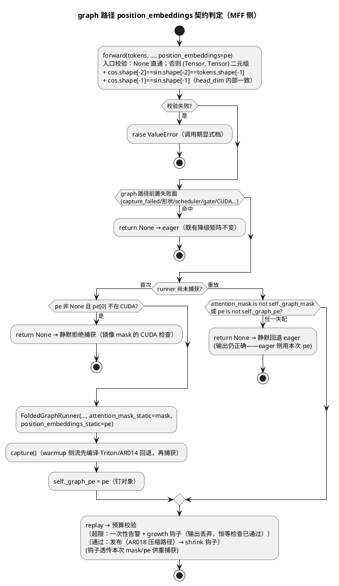

# 1 AR概述

| 组件名称 | ActFold（actfold 折叠引擎 / scripts 基准 / specs 文档） |
| --- | --- |
| AR系统流水号 | AR019 |
| AR描述 | 真实 checkpoint 端到端墙钟（P1-7 第五档）：①生产代码 `position_embeddings` 上下文线程化（四个构建面：串行 eager / 批量 eager / graph 捕获静态体 / AR017 自适应重捕获），使综合框架可在真实 HF/remote 模型（rotary 必需）上运行；②Fast-dLLM-v2-1.5B 真实块验证工作负载三路径墙钟基准（baseline_eager / graph_fixed / graph_adaptive），H1-H4 假设-判定分离，给 P1-7 在真实 checkpoint 上的最终论点 |
| 需求门控 | req 门控 PASS（2 轮，审查代理 ses_ec75107a4ffeB1MEbbRsCHaNWh；必修项：重放期对象恒等契约 + 四构建面含重捕获，均已修入 srs.md） |

# 2 动态行为

## 交互时序图

基准一步（稳态，T=256、N 分支、三路径 round-robin）的上下文供给与判定链：

```plantuml
@startuml
title AR019 基准一步：position_embeddings 上下文供给链（三路径）
participant B as bench 脚本
participant M as ManualFoldedForward
participant R as FoldedGraphRunner
participant L as 原始层(Fast_dLLM_QwenDecoderLayer)

== 初始化（每配置一次，不计时） ==
B -> B : arange(T) → block-causal mask\nrotary_emb(hidden, pos_ids) → pe=(cos,sin)
B -> M : mff(parent_ids, branch_id="parent",\nattention_mask=mask, position_embeddings=pe)
M -> L : wrapped(x, ..., position_embeddings=pe)\n[eager kwargs 通道]
L --> M : parent cache [L,1,T,H] 逐层 put

== 稳态每步（计时窗口内） ==
alt baseline_eager
  B -> L : model(cands[i:i+1]) × N 次\n[raw forward 自建 mask/rotary——语义同一]
else graph_fixed / graph_adaptive
  B -> M : mff(cands, branch_ids=…, parent_branch_id="parent",\nattention_mask=mask, position_embeddings=pe)
  alt 首次（捕获）
    M -> R : FoldedGraphRunner(…, attention_mask_static=mask,\nposition_embeddings_static=pe)
    M -> M : self._graph_batched_pe = pe（钉对象）
    R -> L : _static_forward 捕获体\n[warmup 侧流编译 Triton/回退，随后捕获]
  else 重放（每步）
    M -> M : pe is self._graph_batched_pe ?\nmask is self._graph_batched_mask ?
    M -> R : replay(tokens, parent, branch_ids[0])
    R -> L : [图内] _recompute_all(x, mask_static,\nposition_embeddings=pe_static)
    alt 预算超限
      M -> M : 一次性告警 + growth 钩子\n(超限分支内,恒等检查已通过)
    else 预算通过
      M -> M : 发布（AR018 压缩路径）\n→ shrink 钩子（发布后）
    end
  end
end
@enduml
```

# 3 功能点分解

| 序号 | 功能点名称 | 功能点描述 | srs 追溯 |
| --- | --- | --- | --- |
| 1 | pe 入口与结构校验 | `ManualFoldedForward.forward` 新增 `position_embeddings` 可选参数 + 入口结构校验（ValueError 档） | FR1 |
| 2 | 串行/批量 eager 透传 | 经 wrapped 层 `**kwargs` 通道 → `_recompute_all` accepted/varkw 过滤，仅当非 None 时透传 | FR1 面①② |
| 3 | graph 捕获烘焙与重放恒等 | `FoldedGraphRunner` 新增 `position_embeddings_static`（by-reference，镜像 `attention_mask_static`）；MFF 钉 `_graph_pe`/`_graph_batched_pe` 对象，重放期 `is` 恒等检查失败静默回退 eager | FR1 面③ + 重放契约 |
| 4 | 自适应重捕获烘焙 | `_observe_adaptive_capacity` / `_recapture_batched_runner` 透传 pe，新 runner 同烘焙 + 重钉对象 | FR1 面④ |
| 5 | 真实块验证基准脚本 | `scripts/ar019_real_e2e_bench.py`：模型/上下文/工作负载构造 + 三路径计时 + 侧车 + H1-H4 + 工件 | FR2/FR3 |
| 6 | 环境与复现文档 | RERUN_CHECKLIST AR019 节（venv/权重/命令）+ OPTIMIZATION_GUIDE 第二十六部分 + CHANGELOG + AGENTS.md 契约注记 | FR4 |
| 7 | README 全方位中文更新 | 创新总览表第 9 行 + 机理详解 + 最新结果置顶 + 质量基线 + 限制路线图 | FR4（AGENTS.md 新规） |

# 4 实现设计

## 4.1 功能实现思路（方案对比）

**方案 A：forward 参数 + 捕获烘焙 + 重放期对象恒等（推荐，本设计采用）**
`position_embeddings` 作为 `forward` 的可选参数（与 `attention_mask` 完全同路）：eager 路径经
`**kwargs` 通道透传（仅非 None 时）；graph 捕获时 by-reference 烘焙进 runner（镜像
`attention_mask_static` 先例）；重放期以 `is` 对象恒等检查镜像 `_graph_mask` 契约，失败静默
回退 eager。
优点：与既有 mask 契约完全对偶（零新概念）、重放期零拷贝、最小侵入（层 forward 已有
`**kwargs` 通道，`_recompute_all` 的 accepted/varkw 过滤天然支持）。
缺点：调用方须复用同一 tuple 对象（契约负担，与 mask 相同，可接受）。

**方案 B：forward 参数 + 每次重放 `copy_` 进静态缓冲（否决）**
值语义消除对象恒等要求，但重放期新增 2 次 D2D 拷贝（对常量 pe 纯浪费），且与 mask 的
恒等契约形成两套语义（认知混乱）。srs 已按对象恒等收口（req 门控 Major-1 修复项）。

**方案 C：构造期固定上下文（否决）**
`ManualFoldedForward.__init__` 传 pe：构造早于形状已知（捕获时才知道 T），同一实例无法
服务不同形状，且与 `attention_mask` 的 forward 参数风格不一致。

**推荐理由**：A 满足全部 Must 级约束——`pe=None` 默认时零语义变化（透传仅在非 None 时
发生，合成层与既有 855 基线零扰动）；捕获体零新增 host sync（by-reference 无拷贝）；
与 #37 前置条件清单自然对偶扩展。

## 4.2 功能实现设计

### 4.2.1 流程图

graph 路径 pe 契约判定流（串行/批量共用逻辑，批量版以 `_graph_batched_*` 命名）：



### 4.2.2 流程说明

1. **入口校验（ValueError 档）**：`forward` 开头一次性校验 `position_embeddings`：
   `None` 直通；否则必须为二元组、两个元素均为 `torch.Tensor`、
   `cos.shape[-2] == sin.shape[-2] == tokens.shape[-1]`（seq 维一致性——纯宿主元数据，
   零同步；`[B, T]` tokens 对应 `[·, T, head_dim]` cos/sin）且
   `cos.shape[-1] == sin.shape[-1]`（cos/sin 内部 head_dim 一致性，同为纯元数据），
   任一不满足 → `ValueError`。**head_dim 期望值不校验**（MFF 无从得知模型层内部期望的
   head_dim）：调用方契约是 pe 由模型自身 `rotary_emb` 产出（基准脚本遵守）；head_dim
   与层内期望失配属调用方错误，在 warmup 内以层内广播错误暴露 → capture-failed 可见档
   （一次性告警 + 禁用，不静默）——宽捕获异常以转静默档会违反 srs 自身"不吞其他错误"
   约束，故该子句归属可见档（srs 已补对齐句）。入口的 seq 维校验使首捕获的 pe seq
   失配**不可能**到达 capture（消除了 srs"拒绝捕获"档与 capture-failed 硬降级的
   冲突面：失配在入口即 `ValueError`）。
2. **eager 透传（面①②）**：`forward` 的 wrapped 层循环（architecture_utils.py:558-566，
   串行/批量共用的**唯一 MFF 侧附加点**；批量分支的层内 `_forward_batched` 经 `**kwargs`
   自动承载）在 `position_embeddings is not None` 时附加
   `position_embeddings=position_embeddings` 到 wrapped 层调用——层 `forward(**kwargs)` →
   `_recompute_all(**kwargs)` → `layer_kwargs`（`_ACTFOLD_KWARGS` 之外全保留；无 varkw
   层按 accepted 过滤）。真实 Qwen 层（命名参数 `position_embeddings`）收到；合成层
   （签名不含、无 varkw）自动丢弃。**None 时不附加任何 kwarg**——既有路径逐字节不变
   （零语义变化的强保证）。
3. **graph 烘焙（面③）**：`FoldedGraphRunner.__init__` 新增
   `position_embeddings_static: tuple[torch.Tensor, torch.Tensor] | None = None`，存
   `self._pe_static`（by-reference，镜像 `attention_mask_static` 不 clone——内存归调用方
   持活，恒等契约排除换对象）。`_static_forward` 在 `self._pe_static is not None` 时向
   `layer._recompute_all(x, self._attention_mask_static, position_embeddings=self._pe_static)`
   附加该 kwarg（捕获体零新增 host sync：无拷贝无读回）。
4. **重放恒等（重放契约）**：MFF 新增 `_graph_pe` / `_graph_batched_pe`（初值 None），捕获
   成功时钉住当时对象；重放前置检查在既有 `attention_mask is not self._graph_mask` 旁
   增加 `position_embeddings is not self._graph_pe`（批量侧同理），任一失配 `return None`
   静默回退 eager（**不告警**——与 mask 对象失配同款；语义安全：eager 侧用本次 pe 计算
   正确输出）。
5. **重捕获烘焙（面④）**：`_graph_forward_batched_or_none` 把本次 `attention_mask` /
   `position_embeddings` 传入 `_observe_adaptive_capacity` → `_recapture_batched_runner`；
   新 `FoldedGraphRunner` 构造附加 `position_embeddings_static=position_embeddings`，成功
   后 `self._graph_batched_mask/_graph_batched_pe` 重钉。该 pe 必为已过恒等检查的钉定
   对象：两个钩子都只在**恒等检查已通过的重放路径**上触发——growth 钩子在预算超限分支
   内（该次重放的输出被丢弃，但恒等检查在其之前已通过）、shrink 钩子在发布之后。
6. **发布/预填充零改动**：`_publish_graph_child(ren)` 与 `_prefill_parent` 不调用原始层，
   与 pe 无关；AR018 压缩发布路径零扰动。
7. **基准工作负载构造**（详见 4.3 脚本接口）：T=256（8 块）；parent = 224 真实 prompt
   token + 32×`MASK_ID`(151665)；children = parent forward 在末块位置的 top-10 logits 中
   按种子选 token 填充（N 个不同填充）。block-causal mask =
   `(arange[:,None]//32) >= (arange[None,:]//32)`（bool `[T,T]`，与 remote
   `eval_block_diff_mask` 逐元素同值）；pe = `model.model.rotary_emb(zeros[1,T,H_bf16],
   arange(T)[None])`。mask/pe 各构造一次、全程复用同一对象（恒等契约）。
8. **baseline 侧语义同一**：baseline 调 raw `model(cands[i:i+1])`，模型自身 eval 前向构建
   同款 mask/rotary（`eval_mask` + `rotary_emb`）——两侧上下文语义同一，parity 可比。

### 4.3 接口描述

**生产接口变更（`actfold/models/architecture_utils.py`）**：

```python
class ManualFoldedForward(nn.Module):
    def forward(
        self,
        tokens: Any,
        branch_id: str | None,
        parent_branch_id: str | None = None,
        attention_mask: Any | None = None,
        step_idx: int = 0,
        branch_ids: Sequence[str] | None = None,
        position_embeddings: tuple[torch.Tensor, torch.Tensor] | None = None,  # AR019 新增（末位，向后兼容）
    ) -> Any
```

内部方法签名追加 `position_embeddings` 形参（keyword 传递）：
`_graph_forward_or_none` / `_graph_forward_batched_or_none` /
`_observe_adaptive_capacity` / `_recapture_batched_runner`。

**runner 接口变更（`actfold/core/cuda_graph.py`）**：

```python
class FoldedGraphRunner:
    def __init__(self, ..., attention_mask_static: torch.Tensor | None,
                 position_embeddings_static: tuple[torch.Tensor, torch.Tensor] | None = None)
```

**层接口零变更**：`FoldedTransformerLayer` / `SplitFoldedTransformerLayer` 的 `**kwargs`
通道天然承载 `position_embeddings`（构造期签名反射已含该参数的 accepted 收集），不新增
命名参数。

**基准脚本接口（`scripts/ar019_real_e2e_bench.py`）**：

```
python -m scripts.ar019_real_e2e_bench [--quick] [--reps 30] [--warmup 8]
    [--model-path PATH] [--out PATH] [--hf-endpoint …] [--hf-home …]
```
`--model-path` 默认取环境变量 `FASTDLLM_MODEL_PATH`；两者皆缺 → `FileNotFoundError`
（#10：不回退合成模型）。`--quick`：reps=3、warmup=2、仅 (256,4)。

### 4.4 代码设计

| 文件 | 改动 |
| --- | --- |
| `actfold/models/architecture_utils.py` | `forward` 新参 + 入口校验 + 四构建面透传 + `_graph_pe`/`_graph_batched_pe` 钉对象 + 重放恒等检查 + 钩子/重捕获透传（约 8 处定点改动，全部镜像 attention_mask 模式） |
| `actfold/core/cuda_graph.py` | `__init__` 新参 `position_embeddings_static` + `_static_forward` 附加 kwarg（2 处） |
| `actfold/core/folded_transformer.py` | **零改动**（kwargs 通道已有；docstring 补 `position_embeddings` 说明一句） |
| `scripts/ar019_real_e2e_bench.py` | 新增（模型加载/上下文/工作负载/三路径计时/侧车/H1-H4/工件，约 600 行，沿 AR017/18 谱系） |
| `tests/test_position_embeddings.py` | 新增（UT-1901~1908，见 6.1） |
| `docs/RERUN_CHECKLIST.md` / `docs/OPTIMIZATION_GUIDE.md` / `CHANGELOG.md` / `AGENTS.md` / `README.md` | 文档收口（功能点 6/7） |

**基准脚本结构**（模块节，`apply_hf_env()` 顶部先行的 #31 约定）：

1. `_load_model(path)`：`AutoModelForCausalLM.from_pretrained(local, trust_remote_code=True,
   torch_dtype=bfloat16).cuda().eval()` + tokenizer；权重 sha256 入 meta。
2. `_build_context(model, T)`：返回 `(mask, pe)`（各一份，全程复用）。
3. `_make_workload(model, tok, T, N, seed)`：返回 parent_ids / cands `[N,T]` /
   base_children（baseline 参考 logits，不计时）。prompt 取固定长文本（algo_experiments
   PROMPTS 拼接），tokenize 后截断/循环填充到 224。
4. `_make_mff(model, adaptive)`：沿 AR017 `_make_mff`（`split_layers=True,
   split_min_tokens=1, use_cuda_graph=True, graph_capacity_ratio=0.5,
   graph_adaptive_capacity=adaptive, graph_adaptive_config=AdaptiveCapacityConfig()`）。
5. 配置矩阵：`(T=256, N=4)`、`(T=256, N=8)`、`(T=512, N=4)`（显存算术见 srs 风险表：
   logits 静态 ≤622MB、child/parent 静态 ≤352MB、模型 3.1GB，峰值预算 <10GB/16GB）。
6. 计时：`_timed_ms`（perf_counter + synchronize 边界）、round-robin、warmup=8（覆盖
   捕获 + shrink 耐心 3 + 节流 2 + 稳态观测）、reps=30、p50/std。
7. 侧车（不计时）：parity（argmax 一致率 + maxdiff + `allclose(rtol=1e-2, atol=1e-1)`
   ——bf16 1-ULP 相对量级 2⁻⁷≈0.0078，rtol 1e-2 覆盖；探针实测逐位一致为更强实证记录）、
   stable ratio（profiler 末步 profile）、容量轨迹（`graph_adaptive_policy.events`）、
   预算违例计数、pe 恒等回退计数（**机制**：脚本层私有探针——每次图路径步后断言
   `mff._graph_batched_pe is pe`，失配计 1；AR018 探针先例允许脚本层触私有面；预期 0）、
   峰值显存、Triton `_TRITON_FAILED_KEYS` 快照。
8. H1-H4 判定（纯数据输入函数）：H1 `_verdict(adaptive, baseline)`（2σ 双样本，沿
   AR017）；H2 argmax==1.0 且 allclose 过；H3 `|stable_mean − K_PROMPT/T| ≤ 0.02` 且
   `stable_min ≥ K_PROMPT/T − 0.02`（224/256=0.875；探针 P3 实测完美二分，容差防 bf16
   边界偶发）；H4 捕获成功 + 形状 `[N,T]` + 轨迹收敛（末事件后稳态无新事件）+ 稳态违例
   0 + **right-sizing**（`final_capacity ≥ max_observed_divergence` 且
   `< fixed_capacity`——AR017 H4 口径；期望末容量 ≈ N·32 的需求量级而非固定 C=0.5·N·T）。
9. meta：torch/transformers/driver 版本、模型路径+sha256、CUPTI 探测（沿
   `_cuda_profiler_supported`，预期 null+注记）、venv 标记、种子 2026。

# 5 重构设计

无。全部改动为新增可选参数与镜像既有模式的透传，不移动既有代码。

# 6 测试设计

## 6.1 单元测试（UT）

`tests/test_position_embeddings.py`（T001 Red 子代理编写；CPU 可跑，stub 层不依赖
transformers）。stub：`_ContextLayer`（签名含 `position_embeddings`，记录每次调用并消费
cos 使其影响输出）、`_PlainLayer`（签名不含 pe——合成层钉子）、极小 embed/head stub。

| ID | 用例 | 断言要点 | srs 验收映射 | Red 期预期 |
| --- | --- | --- | --- | --- |
| UT-1901 | 串行 eager pe 透传 | 层收到供给的 pe（`is` 同对象）；输出 = 手工焊 pe 对照 | 标准 1 | 红（forward 不收 pe → TypeError） |
| UT-1902 | 批量 eager pe 透传 | branch_ids 路径每层收到 pe；各分支输出正确 | 标准 1 | 红 |
| UT-1903 | graph 捕获烘焙 | capture 后 replay，层收到的 pe 值与供给 bit-equal；重放 3 次稳定；捕获体无新增同步（spy 断言 pe 来自静态引用） | 标准 1/4 | 红 |
| UT-1904 | 自适应重捕获烘焙 | 构造持续过配触发 shrink 重捕获后，新 runner replay 层收到正确 pe | 标准 2 | 红 |
| UT-1905 | 重放期对象恒等 | pe_a 捕获 / pe_b（同形不同对象）重放 → 静默回退 eager（无告警）且输出 = pe_b 语义 | 标准 5 | 红（**现状红因** = forward 不收 pe → TypeError；**mutation-② 态红因** = 恒等检查被删后 pe_b 走图、输出用烘焙值语义错——两种红因分开记录） |
| UT-1906 | None 默认 + 合成层零变化（三子断言，Red 价值归属分开标注） | a) `_PlainLayer` 不传 kwarg 调用 → 与现状逐位一致；b) 显式 `position_embeddings=None` 传参 → 与 a) 逐位一致；c) pe 非 None + `_PlainLayer`（签名不含、无 varkw）→ 被过滤忽略、输出与 a) 一致 | 标准 3 | a) **绿**（现状钉子——不传 kwarg 即现状）；b) **红**（现签名收不到该参数 → TypeError，实现后绿）；c) **红**（同 b），实现后绿） |
| UT-1907 | 结构校验 ValueError | 非二元组 / 元素非张量 / 长度≠2 / cos 的 seq 维 ≠ tokens 的 T / cos 与 sin 的 head_dim（shape[-1]）不一致 / cos 或 sin 为 1-D（无 seq 维——review N-2 补，须落 ValueError 档不得漏 IndexError） → `ValueError` | FR1 异常处理 | 红 |
| UT-1908 | 捕获期 CUDA 拒绝 | pe 在 CPU → 静默拒绝捕获、eager 输出正确（CUDA gate 下跳图） | FR1 异常处理 | 红（无检查则捕获行为不可控） |

mutation 面（T002，全红后 SHA256 还原）：①删 eager 循环 pe 附加（1901/1902 红）；
②删重放恒等检查（1905 红——pe_b 重放走图、输出用烘焙值语义错）；③重捕获不透传 pe
（1904 红）；④`_static_forward` 不附加 pe（1903 红）。入口校验（1907）与捕获期 CUDA
检查（1908）无独立 mutation：二者的守卫缺失即其 Red 期红因，Red 期验证与 mutation 验证
等价（守卫代码的变异 = 删守卫 = Red 态重现）。

## 6.2 接口测试

`--quick` 冒烟（T003）：venv + 本地权重，(256,4) reps=3 走通三路径 + 工件落盘 +
`--model-path` 缺失时 `FileNotFoundError`。

## 6.3 业务场景测试

T004 全量（reps=30，三配置）：H1-H4 判定齐全；工件结构与 AR018 谱系一致（configs[]/
timings_ms/speedups/parity/stable_ratios/capacity_trajectory/peak_memory/hypotheses/meta）；
单次运行 <15 分钟。

## 6.4 异常场景测试

- 预算违例：末块填充若致某层发散超容量 → 一次性告警 + eager 回退，计数入工件（基准
  工作负载预期不触发：D=N·32 ≤ C）。
- 捕获失败：bf16 Triton 门核编译失败经 AR014 键记录 + warmup 期回退 PyTorch 路径（探针
  P7 已证 merge 同机制工作）；真实捕获失败 → 一次性告警 + 路径基准失败可见（H4 如实
  refuted/inconclusive）。
- pe 恒等失配：基准全程复用同一对象不触发；计数器（预期 0）入工件证伪。
- 模型路径缺失/权重不全：显式 `FileNotFoundError`，不回退合成模型（#10）。
