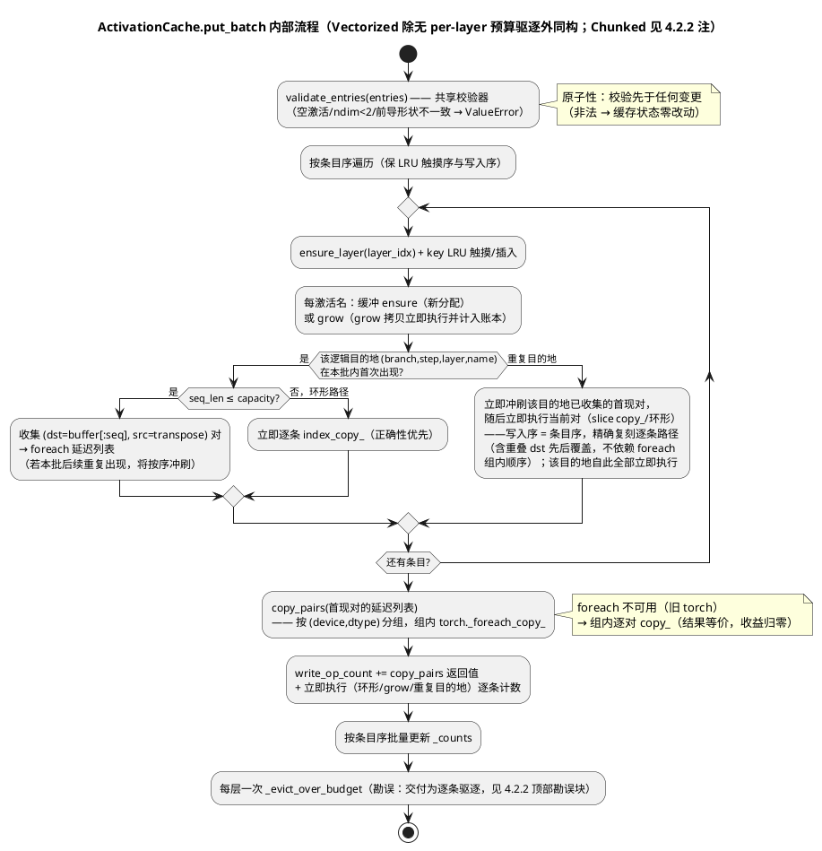

# 1 AR概述

| 组件名称 | ActFold core（activation caches）+ architecture_utils 发布路径 |
| --- | --- |
| AR系统流水号 | AR020 |
| AR描述 | 发布路径 cache put 批量化：三 cache `put_batch` 能力（语义与逐条 put 逐位等价、批量前置校验原子性、`(device,dtype)` 分组 `torch._foreach_copy_` 合并 copy）、发布路径能力探测分流（无能力 cache 原循环逐位不变）、真实 checkpoint 发布窗口 A/B 基准与 H1-H4 假设-判定工件（P1-7 第六档） |

# 2 动态行为

## 交互时序图

```plantuml
@startuml
title 批量图发布：put_batch 能力探测分流（AR020）
participant MFF as ManualFoldedForward
participant Probe as 能力探测（每次发布）
participant Cache as cache（三选一）
participant BW as batched_write.copy_pairs
participant Prof as StabilityProfiler

MFF -> Probe : _publish_graph_children（每次发布）
Probe -> Cache : isinstance(BatchedPutCapable)
Probe --> MFF : 方法存在性检查（O(1)，零 sync）\n探测不缓存于实例——cache 可被外部替换\n（基准 A/B 即依赖换 cache 后重探）
alt 具备 put_batch（三 cache）
  MFF -> Cache : snapshot = child_buf.clone()（AR018，不变）
  MFF -> Cache : put_batch(L×N 条 CachePutEntry)\n（ffn_out=快照行视图；layer 0 附 embedding 行视图）
  Cache -> Cache : 前置校验全部条目（任一非法→ValueError，零写入）
  Cache -> Cache : ensure/LRU 触摸（条目序）+ 缓冲分配/grow
  Cache -> BW : copy_pairs(pairs)——(device,dtype) 分组
  BW -> BW : torch._foreach_copy_（每组 1 次宿主调用）\n或逐对降级（foreach 不可用）
  Cache -> Cache : _counts 批量更新 + 每层一次 eviction\n（勘误：交付为逐条驱逐，见 4.2.2 顶部勘误块）
else 无 put_batch（duck-typed 外部 cache）
  MFF -> Cache : 原双循环逐条 put（既有代码，逐位不变）
end
MFF -> Prof : record_precomputed（sums）/ debug record（逐行）\n（AR018 语义，零变化）
MFF --> MFF : 返回（零 host-sync 契约保持）
@enduml
```

# 3 功能点分解

| 序号 | 功能点名称 | 功能点描述 | 追溯 |
| --- | --- | --- | --- |
| 1 | CachePutEntry / BatchedPutCapable 协议 | 条目 NamedTuple + runtime-checkable 可选能力协议（结构化，无继承要求） | FR1 |
| 2 | copy_pairs 单点写助手 | (device,dtype) 分组 foreach 合并；返回宿主写操作数；foreach 不可用逐对降级 | FR1 |
| 3 | 三 cache put_batch | 前置校验原子性 + 等价写入（LRU/eviction/grow/环形全语义保持）+ write_op_count 探针 | FR1 |
| 4 | 发布路径能力分流 | 每次发布能力探测（零实例缓存）+ 批量分支 + 无能力回退原循环；profiler 面零变化 | FR2 |
| 5 | 基准脚本 + 工件 | 发布窗口 A/B（宿主 perf_counter+sync 夹逼）+ 端到端四路径 + 主机调用账本 + 正确性门 + H1-H4 | FR3 |
| 6 | 文档收口五件 | GUIDE 第二十七部分 / CHANGELOG / AGENTS 新条目 / RERUN_CHECKLIST / README 全量中文重写 | FR4 |

# 4 实现设计

## 4.1 功能实现思路（方案对比）

**方案 A（否决）：发布形专用 API** `put_publish_rows(snapshot, branch_ids, ...)`——融合上限略高，但把发布路径结构（L×N 行视图、layer-0 embedding）泄漏进 cache 层，不可复用，等价性难独立陈述。

**方案 B（采纳）：通用 `put_batch(entries)` + `copy_pairs` 单点写助手**。要点：
- **分层**：cache 层只懂"批量条目写入"；发布路径负责把 L×N 行视图组装为条目。
- **等价性可陈述**（H1）：合法条目序列下，put_batch 终态 == 逐条 put 终态（缓冲 bit-equal、
  `_counts`、LRU 键序、eviction 结果）；原子性（非法序列零写入）是**额外的更强保证**，
  与等价性分属两断言（srs FR1 修 M-4 措辞）。
- **既有 `put` 体零扰动**：put_batch 镜像 put 的 ensure/grow/环形逻辑而不复用其函数体，
  保证 loop 变体 == 现状代码（A/B 公平 + 既有 UT 零改动风险的消除面）。
- **机制依据（本机探针 `ar020_probe_foreach.py`，2026-10-14，torch 2.5.1+cu121）**：
  - P1-P6：`torch._foreach_copy_` 存在；非连续 transposed 源（`[1,T,H].transpose(0,1)`）+
    组内混合形状，CPU 与 CUDA bf16 全部正确（与逐对 `copy_` bit-equal）；
  - P7（L·N=224 条 `[256,1,1536]` bf16 copy，RTX 5000/WDDM）：同步墙钟 loop 3.676ms vs
    foreach 1.061ms（3.5×）；**宿主入队（不 sync）3.343ms vs 0.120ms（27.8×）——成本为
    宿主侧主导，与 AR018 发布窗口宿主侧结论同因**。foreach 是正确机制。

**方案 C（否决）**：cache 存储布局重构（分支共享连续块）——改变 LRU/eviction 语义与全部
读路径，srs Out of Scope 明确排除。

## 4.2 功能实现设计

### 4.2.1 流程图



### 4.2.2 流程说明

> **勘误（2026-10-14，Green 修正记录）**：本节以下四处描述与最终交付实现不符，以
> tasks.md T002 的 Green 修正记录与 AGENTS.md #42 为准：①"每层一次终态修剪"（下文
> :31 流程图、:102 活动图及 §4.2.2(1) 的等价性论证）已被 UT-2001 随机化测试**否证**
> （evict-then-recreate 键集分叉），交付实现为**逐条驱逐**（put 的精确修剪点，等价性
> 由构造保证）；②§4.2.2(4) 发布条目 `step_idx` 透传草案被 Green 修正 #1 否决——交付
> 条目**省略 step_idx**（NamedTuple 默认 0，镜像逐条版与折叠栈全 step-0 存储；跨步
> 链接用 #26 每 step 新 branch id，而非 step 序号）。另见 §4.4/§5 勘误（put 体仅新增
> 账本一行，语义零改动）。

**（1）等价性不变量（H1 的设计论证）**：
- **等价比较面（精确定义）**：对每个 `(branch, step, layer, name)`，比较
  `buffer[:最终 _counts 值]` 的 `torch.equal` + `_counts` 全等 + 各层 `OrderedDict`
  键序一致 + `num_entries` 一致。**不含** count 之外的缓冲行——缓冲由 `torch.empty`
  分配，未初始化行在两条路径下（乃至两次逐条运行间）本就不可比；亦不含缓冲
  capacity（见下条 grow 时序）。UT-2001 的随机化性质测试按此面比较（fetch 面作
  伴生断言）。
- LRU 触摸序：逐条 put 对每个 `(branch, step)` key `move_to_end`；put_batch 按同一
  条目序触摸——各层 `OrderedDict` 内的相对序 = 条目序在该层的子列，两者一致。
- **重复目的地规则（冲刷语义，取代"去重"）**：同一逻辑目的地
  `(branch, step, layer, name)` 首现对进入 foreach 延迟列表；检测到该目的地**第二次**
  出现时，**先立即冲刷其已收集的首现对，随后立即执行当前对**（此后该目的地在本批内
  全部立即执行、不再进延迟列表）——写入序恒等于条目序，精确复刻逐条路径的写入序
  （含重叠 dst 切片的先后覆盖），不依赖 `torch._foreach_copy_` 组内执行顺序这一未
  文档化不变量（探针 P1-P6 未覆盖重叠目的地场景，故设计上直接消除该依赖）。跨逻辑
  目的地的写入互不相交（不同目的地必不同 buffer），冲刷不破坏其余目的地的顺序。
  发布用例中逻辑目的地恒唯一（每 `(layer, row)` 一条目），冲刷零触发、收益不受影响。
  冲刷对 dst 为**收集时**的切片；若中途 grow 已替换 buffer，冲刷写入落在被弃 buffer
  上、无害（grow 仅当 seq 超容量时发生 ⇒ 当前对的写入行域是首现对的超集、完全覆写；
  逐条路径同位置亦被覆写——UT-2001 随机化"重复 key×grow"覆盖该路径）。
- grow 时序：ensure/grow 按条目序即时执行（与逐条路径相同的分配/增长点），故两条
  路径的缓冲 capacity 轨迹一致；grow 拷贝立即执行并计入 write_op_count。grow 后的
  主 slice copy 按首现/重复规则处理（首现 → 延迟列表）。
- eviction（ActivationCache）：`_evict_over_budget` 为"最旧优先修剪，永不驱逐最新组"
  的纯序+预算驱动操作；逐条路径的逐次修剪与批量路径的**每层一次终态修剪**给出相同
  幸存集（触摸序相同 ⇒ 各中间态的最旧键与批量终态的最旧键逐一对应；中途被驱逐又被
  后续条目重建的 key，在两条路径下都等价于 move_to_end + count 覆写）。该论证由
  UT-2001 的**随机化性质测试**（种子固定，eviction 密集配置：小预算×多分支×重复 key）
  钉死，不依赖人工枚举。
  **（勘误（2026-10-14）：上述"每层一次终态修剪"等价论证在 Green 阶段被 UT-2001 的
  随机化测试否证——evict-then-recreate 键集分叉（如 `{'a'}` vs `{'a','b'}`）；
  交付实现改为逐条 `_evict_over_budget`（put 的精确修剪点），等价性由构造保证。
  见本节顶部勘误块与 tasks.md T002 Green 修正记录 #2。）**
- VectorizedActivationCache：`_ensure_layer` 在**新 key 插入时**触发
  `_evict_old_branch_steps`——put_batch 按条目序调用 `_ensure_layer`，驱逐触发点与
  逐条路径一致，无需额外论证；无 per-layer 预算驱逐机制。
- ChunkedActivationCache：put 为"分块 `.contiguous()` **按引用**存储 + 逐条
  `len(cache) > max_chunks` 驱逐"——put_batch 按条目序走完全相同的分块构建与插入
  （内部抽 `_store_chunks` 供 put/put_batch 共用，语义面无差异）；其收益面仅为
  Python 校验/字典开销的均摊（无 copy 融合机会——`.contiguous()` 是分配而非既有
  缓冲写入，foreach 不适用），设计如实记录：**H4 的 O(L+N) 账本仅对
  ActivationCache/VectorizedActivationCache 成立**（基准使用的即 ActivationCache，
  见（5）；srs §3.3 H4 行已注记测量对象）。

**（2）原子性与校验档位**：共享校验器 `validate_entries`（batched_write.py）复刻三
cache 现有 put 校验（空 dict / `ndim < 2` / 前导形状不一致），在**任何变更前**跑完全部
条目；非法 → `ValueError`（消息含条目序号与原因），缓存零改动。设备/dtype 混批合法
（按 `(device,dtype)` 分组执行）；与 AR019 入口校验档位纪律一致：纯宿主元数据校验，
零 device sync。

**（3）write_op_count 探针（H4 的免 monkeypatch 账本）**：三 cache 新增实例属性
`write_op_count: int`（构造为 0，单调递增）：
- `put`：`+= len(activations)`（每名恰一次写操作——slice copy 或环形 index_copy，代码
  结构由 UT 钉死；**grow 内部拷贝有意不计**——loop 账本镜像"发布循环可见的逐条 put
  粒度"，与批量侧"foreach 组 + 立即执行逐条"的计数粒度对称性不追求逐项对齐，探针
  只服务 H4 的量级判定）；
- `put_batch`：`+= copy_pairs 返回值 + 立即执行（环形/grow/重复目的地）逐条数`；
- Chunked：`+= 实际物化数`（`.contiguous()` 返回新张量时 +1，返回 self 时 +0）。
探针**不参与 H1 状态等价**（等价比较面 =（1）所定义面，探针显式排除，防循环论证）。
AR017/18 先例：`last_layer_divergences`/`budget_exceeded` 同为宿主态零同步读探针。

**（4）发布路径分流（architecture_utils.py）**：
- 探测：**每次发布时** `isinstance(self.cache, BatchedPutCapable)`（runtime_checkable
  → 方法存在性检查，O(1) 零 sync；发布为 ms 级窗口，该检查成本可忽略）。**探测结果
  不缓存于 MFF 实例**——cache 为可替换属性（本设计的基准 A/B 即依赖换 cache 后重探；
  缓存会令两变体走同一分支，H2 测量失效）。
- 批量分支：`entries = [CachePutEntry(branch_id, layer_idx, {"ffn_out": snapshot[layer][row:row+1],
  **({"embedding": embedding[row:row+1]} if layer==0)}, step_idx) for layer, row]`——
  负载与逐条版**逐字段相同**（快照行视图，非 clone——AR018 论证：快照私有且发布后
  本侧零写入，by-reference 消费安全）；`cache.put_batch(entries)` 一次调用；异常原样
  上抛（不吞不改档）。
  （勘误（2026-10-14）：交付条目**省略 `step_idx`**（NamedTuple 默认 0）——透传会使
  发布子代被 step-0 消费者孤立（#26 跨步链接用每 step 新 branch id 而非 step 序号），
  Green 修正 #1 否决本草案；见 4.2.2 顶部勘误块与 tasks.md T002。）
- profiler 面零变化：`record_precomputed`（sums）与 debug `record`（逐行）保持 AR018
  双入口语义，批量分支沿用同一循环结构（profiler 记录是 0-dim/字典操作，非成本主体）。
- 回退分支：无能力 cache → 现有双循环**逐字节不变**（含 debug 路径）。
- 零 host-sync 契约：批量分支全程无 `.item()`/`.tolist()`/`.cpu()`/隐式同步；
  `num_tokens` 仍取自 `tokens.shape[1]`。

**（5）基准设计（scripts/ar020_publish_put_bench.py）**：
- **导入顺序纪律**：`scripts.ar019_real_e2e_bench` 模块顶层执行 `apply_hf_env()`（扫
  `sys.argv`，进程级先于一切导入填充，flags 安全）并顶层导入 transformers/actfold；
  ar020 必须在**自身导入 transformers 之前**先导入 ar019（即 `from
  scripts.ar019_real_e2e_bench import ...` 置于其他 transformers 导入前）或先自调
  `apply_hf_env()`——保证 HF endpoint/cache 环境先于 transformers 初始化。
- 复用 AR019 脚本（namespace 包导入）：模型加载、块验证工作负载构建、MFF/runner
  捕获助手；配置矩阵冻结为 AR019 同款 **(T=256,N=4)/(T=256,N=8)/(T=512,N=4)**，
  **最小配置（H3 严格改善判定对象）冻结为 (256,4)**（N·T=1024，三配置最小）。
- A/B 变体（**对称包装**，消除委托开销不对称）：`loop` = `_NoBatchCache` 包装（委托
  全部既有方法到内层 `ActivationCache`、不暴露 `put_batch` → 生产发布代码走原循环）；
  `batch` = `_BatchCache` 包装（同样委托全部方法、**暴露** `put_batch` 为内层同名
  方法的直 delegation）——两侧每次调用均多一跳 Python 委托，A/B 唯一差异 = 发布
  分支；内层同类同参（max_entries_per_layer=8192）。
- 三层测量（全部宿主 `perf_counter` + 前后 `torch.cuda.synchronize()` 夹逼——AR019
  工件 meta 明注 CUDA-event 排除宿主侧发布成本，本 AR 测量对象恰以宿主侧为主体；
  warmup + 变体 round-robin 交错 + reps=30 + p50/std）：
  1. **put 微基准**：真实形状条目（bf16 `[1,T,H]` 行视图 + embedding），逐条 put vs
     put_batch——**条目/参数构建在计时区外**（层 1 隔离 cache 写入成本本身）；
     write_op_count 账本同步读取（H4）；
  2. **发布窗口微基准**：单次 replay 后直接计时 `_publish_graph_children`（发布窗口
     自然包含条目构建——H2 以本层为准；A/B 通过换 `mff.cache` 属性实现——bench
     局部私有面探测，AR018/19 先例；探测每次发布执行，换 cache 后必然重探；runner
     状态不受 cache 替换影响，两变体间静态缓冲不重写，负载一致）；
  3. **端到端宏基准**：baseline / fixed / adaptive(loop) / adaptive(batch) 四路径逐步
     墙钟（前两者沿用 AR019 口径，后两者唯一差异 = cache 包装）。
- 正确性门（H1 真实模型面）：两变体发布后逐 (branch, layer) `fetch` bit-equal。
- 工件 `results/optimization/ar020_publish_put_bench.json`：meta（torch 版本、#39 CUPTI
  null 注记、**c=2 预承诺冻结**、最小配置指认、判定式全文）、逐配置数字、H1-H4 三态
  判定（srs §3.3 冻结式）、正确性门结果。**预承诺单次纪律**：reps=30 单次运行定案。
- srs §3.1"整体降级为内部逐条 put 循环"的**机制定案**：降级点为 `copy_pairs` 组内
  逐对 copy_（校验/ensure 已完成，逐对 copy 即逐条 put 的写入动作）——与 srs 措辞
  功能等价，为细化口径。

## 4.3 接口描述

新增公共接口（actfold/core/cache_protocol.py）：

```python
class CachePutEntry(NamedTuple):
    """One cache write: mirrors ``cache.put``'s four arguments."""
    branch_id: str
    layer_idx: int
    activations: dict[str, torch.Tensor]
    step_idx: int = 0

@runtime_checkable
class BatchedPutCapable(Protocol):
    """Optional batched-write capability (structural, no inheritance)."""
    def put_batch(self, entries: Sequence[CachePutEntry]) -> None:
        """Store all entries; state-equivalent to sequential ``put`` calls.

        Raises ValueError before any mutation when any entry is invalid.
        """
        ...
```

三 cache 实现签名一致：`put_batch(self, entries: Sequence[CachePutEntry]) -> None`。

新增内部模块（actfold/core/batched_write.py）：

```python
def validate_entries(entries: Sequence[CachePutEntry]) -> list[CachePutEntry]
    # 复刻三 cache put 校验；任一非法 → ValueError（含条目序号）；零变更。

def copy_pairs(pairs: list[tuple[torch.Tensor, torch.Tensor]]) -> int
    # 按 (device, dtype) 分组执行 torch._foreach_copy_；foreach 不可用
    # （hasattr 探测，结果记录于模块级 flag `_FOREACH_AVAILABLE`，UT-2009 直接
    # patch 该 flag 以测试降级路径——事后 patch torch 属性不再生效属预期）。
    # 返回宿主写操作数（foreach 组数 + 逐对数）——write_op_count 计数源。
```

无对外网络/第三方 SDK 接口；`torch._foreach_copy_` 为 torch 私有 API，使用点**单点
隔离**于 `copy_pairs`（版本依赖 + 降级路径写入 AGENTS 新条目，srs 约束落实）。

## 4.4 代码设计

```
actfold/core/cache_protocol.py      +CachePutEntry, +BatchedPutCapable（协议层）
actfold/core/batched_write.py       +validate_entries, +copy_pairs（新模块，唯一 foreach 点）
actfold/core/activation_cache.py    +put_batch, +write_op_count（put 体仅新增账本一行，语义零改动）
actfold/core/vectorized_cache.py    +put_batch, +write_op_count（put 体仅新增账本一行，语义零改动）
actfold/core/chunked_cache.py       +_store_chunks（自 put 抽出，语义不变），
                                    +put_batch, +write_op_count
actfold/models/architecture_utils.py _publish_graph_children 能力分流（每次发布 isinstance 探测，零实例缓存）
scripts/ar020_publish_put_bench.py  新基准脚本（复用 ar019_real_e2e_bench 助手）
tests/test_batched_put.py           UT-2001~2009（新文件）
results/optimization/ar020_publish_put_bench.json   工件（T004 产出）
```

模块化要点：cache 层（数据结构 + 写入语义）/ 协议层（能力声明）/ 发布路径（消费面）
三层解耦；发布路径对 cache 的全部新依赖 = `BatchedPutCapable` 一个 isinstance。

# 5 重构设计

- ChunkedActivationCache.put 内部分块构建逻辑抽为 `_store_chunks`（put/put_batch 共用，
  行为不变）——唯一既有代码整理点，既有 UT 钉死零语义变化。
- 其余既有函数：`_publish_graph_children` loop 分支**逐字节不变**；三 cache `put`
  仅新增账本一行 `write_op_count += len(activations)`（语义零改动，账本显式排除于
  等价比较面）。

# 6 测试设计

## 6.1 单元测试（UT）

`tests/test_batched_put.py`（UT-2001~2009；红因全 = 生产缺失：`put_batch` 属性不存在 /
协议不存在 / 发布无分流——与 AR019 Red 同纪律：pytest.raises(AttributeError) 或探测
返回 False 为红，不得出现"断言通过但原因错"）：

| UT | 名称 | 断言要点 | 红/绿 |
| --- | --- | --- | --- |
| UT-2001 | ActivationCache 批量等价性 | 固定用例 + **随机化性质测试**（固定种子；混合 batch/seq/step/重复 key/重复条目/小预算 eviction 密集配置）：put_batch vs 逐条 put → **4.2.2(1) 等价比较面**（各 `(branch,step,layer,name)` 的 `buffer[:最终 count]` `torch.equal` + `_counts` 全等 + 各层 `OrderedDict` 键序一致 + `num_entries` 一致；fetch 面伴生断言）；CPU + CUDA | 红 |
| UT-2002 | VectorizedActivationCache 批量等价性 | 同 UT-2001 口径（含 `_evict_old_branch_steps` 触发点等价：批内新 key 插入驱逐） | 红 |
| UT-2003 | ChunkedActivationCache 批量等价性 | 同口径（chunk 数据、键序、`num_tokens`；含跨 chunk 边界 seq_len） | 红 |
| UT-2004 | 原子性 | 批中段非法条目（空 dict / ndim<2 / 前导形状不一致 × 三 cache，非法条目置于首/中/尾）→ `ValueError` 且缓存状态与调用前**全部内部容器逐字节一致**（零写入下全量深比较天然成立，强于 4.2.2(1) 面）；合法条目零部分写入 | 红 |
| UT-2005 | 环形与 grow 路径 | `max_entries < seq_len` 环形条目、触发缓冲 grow 的条目、简单+环形混合批、同逻辑目的地不同 seq_len 的重叠 dst 批（含冲刷序断言：首现对先于后续对写入）→ 与逐条 put 终态等价（按 4.2.2(1) 面） | 红 |
| UT-2006 | 能力协议 + 发布消费分流 | ①三 cache `isinstance(BatchedPutCapable)`；②无能力包装 cache → 发布走原循环（put 计数 = L·N，子类 spy）；③有能力 → `put_batch` 恰一次、条目数 L·N、逐条目负载与 loop 版逐字段相同（ffn_out 行视图 `is` 快照行、layer-0 embedding）；④探测每次发布执行（换 cache 后重探——spy 断言两次发布间替换 cache 分支随之切换）；⑤profiler 面不变（`record_precomputed` 次数/参数同 loop）；⑥发布异常原样上抛 | 红 |
| UT-2007 | write_op_count 账本 | loop：每 put += 名数（发布 = L·N+N）；batch：≤ foreach 分组数 + 立即执行逐条数；**发布批量分支增量 ≤ c·(L+N)，c=2 冻结**；探针不参与等价比较（UT-2001 断言其可不同） | 红 |
| UT-2008 | 零 host-sync + 新鲜度 | 批量发布窗口无 `.item()`/`.tolist()`/`.cpu()`（沿用 UT-17xx spy 模式）；发布后篡改 `runner.child_buf` → cache 内容不变（AR018 快照新鲜度在批量分支保持）；debug 路径逐行 record 不变 | 红 |
| UT-2009 | foreach 不可用降级 | 直接 patch `batched_write._FOREACH_AVAILABLE = False` → put_batch 仍与逐条等价（copy_pairs 组内逐对降级）、write_op_count = 逐对数；发布分流不受影响 | 红 |

既有测试零改动约束：UT-1703（发布内容 parity 口径）在批量分支下天然兼容（内容等价）；
`test_publish_cost.py`/`test_adaptive_capacity.py` 全部断言为内容/次数（clone/profiler）
面，无生产 `cache.put` 调用计数钉子（已逐一核实）——T002 Green 后全量回归验证。

## 6.2 接口测试

`put_batch`/`CachePutEntry`/`BatchedPutCapable`/`copy_pairs` 签名与类型（mypy
`--ignore-missing-imports` clean）；`put_batch` 返回 None；NamedTuple 字段序 =
`put` 参数序（位置兼容）。

## 6.3 业务场景测试

真实模型端到端（基准脚本内建，非 UT）：(256,4)/(256,8)/(512,4) 三配置 × 四路径
（baseline/fixed/adaptive-loop/adaptive-batch），reps=30，正确性门 = 两变体发布后
逐分支 fetch bit-equal + 前向 logits 与 AR019 口径一致（parity 探针复用）。

## 6.4 异常场景测试

- 批量校验失败（UT-2004）：零部分写入，ValueError 消息含条目序号；
- foreach 运行期抛错（UT-2009 附加）：`copy_pairs` 降级路径下结果仍等价——降级是
  **机制**层面的（可用性探测），非异常处理层面；foreach 执行中的真实异常原样上抛
  （不吞——与发布"异常原样上抛"契约一致）；
- 无能力 cache（UT-2006②）：发布回退原循环，行为与 AR018 交付态逐位一致；
- 混合设备/dtype 批（UT-2001/2005 变体）：分组执行，终态等价。
