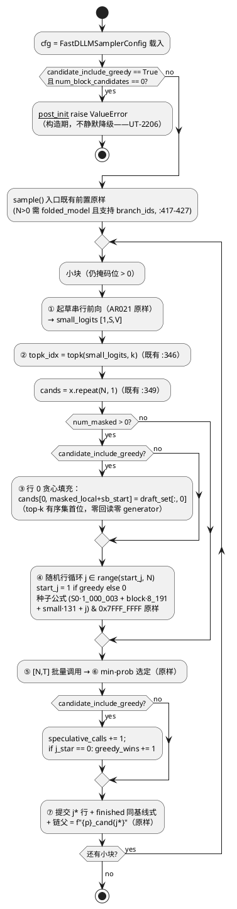

# 1 AR概述

| 组件名称 | actfold 批量投机质量对齐（贪心锚定候选机制：FastDLLMSampler 候选集行 0 = 贪心假设 + 四模式质量基准） |
| --- | --- |
| AR系统流水号 | AR022 |
| AR描述 | folded-batched 批量投机的提交区质量面缺口修复：候选集新增 candidate 0 = 贪心假设（仍掩码位全填 draft logits argmax，确定性、零回读、无 generator），经 `[N,T]` 批量验证后以真实后验 logits 参与 min-prob 公平竞争（可能落败）；`candidate_include_greedy` 默认 False 与 AR021 末态逐字节；四模式真实 generate() 级基准（baseline / folded-serial / folded-batched / folded-batched-greedy 对齐模式）——质量硬门 H1（位置级一致率 >0.5 主门）+ 速度不回退 H2 + 早停恢复 H3 + 全栈行使 H4，reps=30 预承诺单次定案 |
| srs 依据 | ./srs.md rev 2（req 门控 PASS；FR1-FR5 / H1-H4 判定式 / N 语义定案 / H1(a) 口径全部冻结——本设计为 HOW 层，冲突处如实上报不改 srs） |

# 2 动态行为

## 2.1 贪心锚定投机小块时序图（FR1/FR2，greedy on；含贪心胜出/落败两分支）

```plantuml
@startuml
title FR1/FR2 贪心锚定：贪心行构建 → [N,T] 批量验证 → min-prob 公平选定
participant Sampler as FastDLLMSampler
participant Cfg as FastDLLMSamplerConfig\n(candidate_include_greedy=True)
participant MFF as ManualFoldedForward (MFF_C)
participant Pool as 批量 runner 池\n(键 (N,T,prompt_len))
participant Probe as greedy_win 观测面\n(实例级累计计数器)

Sampler -> Sampler : ① 起草前向（= baseline 迭代1 前向，链父 p，\n#26 链照常——AR021 ④ 前流程原样）\n→ small_logits [1,S,V]
Sampler -> Sampler : ② topk(small_logits, k) → topk_idx [1,S,k]\n（既有算子 :346，sorted=True 有序性）
Sampler -> Sampler : ③ 贪心行 0：draft_set[:, 0] 填入仍掩码位\n（= top-k 有序集首位 = srs 冻结定义的 argmax；\n纯设备索引，零 .item/.tolist/.cpu，零 generator）
Sampler -> Sampler : ④ 随机行 j=1..N-1：冻结种子公式原样\n（j 保持行号 ⇒ 画布一致前提下与 greedy off\n同 seed 运行的行 1..N-1 逐位相同——首个投机\n小块内由构造成立——A/B 可观测性）
Sampler -> MFF : ⑤ 单次 [N,T] 批量调用（形状/掩码/pe/forced/\nbranch_ids 命名与 greedy off 完全相同）\nbranch_ids=[f"{p}_cand{j}"], parent=p
MFF -> Pool : 键 (N,T,prompt_len) 命中（warmup 预捕获）→ replay\n未命中 → 捕获入池；前置失配/预算超限 →\nAR016 矩阵 eager 批量回退（既有矩阵）
MFF --> Sampler : logits [N,T,V]（真实后验）
Sampler -> Sampler : ⑥ min-prob 选定（:373-379 冻结式原样，\n贪心行无豁免/加权——公平竞争）
alt 贪心行胜出（j* == 0）
  Sampler -> Sampler : 提交区 = 贪心假设（构造级，确定可复现）\nstop ∈ 提交位 → finished 同基线式（:381）\n——早停恢复是效果非新机制
  Sampler -> Probe : speculative_calls += 1\n greedy_wins += 1
else 贪心行落败（j* > 0，A2：后验随候选内容可变，\n非构造保证）
  Sampler -> Sampler : 提交区 = 随机候选 j* 行\n（投机多样性不退化——UT-2203 钉死）
  Sampler -> Probe : speculative_calls += 1
end
Sampler -> Sampler : ⑦ 链父切换 _folding_parent = f"{p}_cand{j*}"\n（:382 同式，贪心/随机胜出两分支同构）\n→ 跳过该小块剩余迭代 → AR 步照旧
note right
  N 语义（srs §3.1 定案）：候选总数 = 配置 N
  不变，贪心占据 0 号位，随机候选数 = N-1
  ⇒ [N,T] 形状不变 ⇒ 批量池键/AR017 容量
  ⌈ratio·N·T⌉/账本/canary 全部 AR021 契约
  面零改动；对齐模式与 folded-batched 同形状
  A/B，速度变量被构造性归零（H2 判定有效性
  根基）。greedy on + N=1 ⇒ 单行纯贪心（合法
  退化，UT-2207）。
end note
@enduml
```

# 3 功能点分解

| 序号 | 功能点名称 | 功能点描述 | 追溯 |
| --- | --- | --- | --- |
| 1 | 贪心锚定候选构建 | `_speculative_small_block` 候选行 0 = 贪心假设（draft top-k 有序集首位填充，确定性、零设备回读、无 generator）；随机行 j=1..N-1 种子公式原样（j 保持行号）；`branch_ids` 命名/`[N,T]` 形状/堆叠方式不变 | FR1 |
| 2 | 选定与质量观测 | min-prob 选定规则原样（贪心公平竞争、可能落败）；实例级 greedy_win 累计计数器 + 只读探针；链延续/停止语义不变（早停恢复为效果非新机制） | FR2 |
| 3 | 配置与零扰动 | `FastDLLMSamplerConfig.candidate_include_greedy: bool = False` + True&N=0 构造期 `ValueError`；`ActFoldConfig` YAML 消费面（AGENTS #5 / srs FR3 验收）；默认关与 AR021 末态逐字节 | FR3 |
| 4 | 四模式基准与工件 | `scripts/ar022_speculative_quality_bench.py`（复用 ar021 助手，导入式）：MFF_C 对齐模式 + 四模式 round-robin（r%4）+ 双粒度 exact-match/greedy_win_rate/解码长度质量面 + folded-batched 复现自检 + H1-H4（判定式冻结）+ reps=30 单次定案工件 | FR4 |
| 5 | 文档收口五件 | GUIDE 第二十九部分 / CHANGELOG / AGENTS 新条目（贪心锚定候选契约）/ RERUN_CHECKLIST / README 全量中文重写 | FR5（文档任务，本设计不展开） |

# 4 实现设计

## 4.1 功能实现思路（方案对比定案）

### 4.1.1 贪心行算子来源（FR1 核心）

- **方案 A（选定）：复用既有 `topk_idx` 首位——`draft_set[:, 0]`**。
  `topk_idx = torch.topk(small_logits, k_eff, dim=-1).indices`（fast_dllm_sampler.py:346）
  为既有算子，`torch.topk` 默认 `sorted=True` ⇒ `indices[..., 0]` 即该位有序 top-k
  集首位——**srs §3.1 冻结定义的 argmax 就是"top-k 有序集首位"**（"argmax（即
  top-k 有序集首位——topk 有序性保证）"），方案 A 是该冻结定义的**逐字实现**。
  张量形状流水（全程纯设备算子，零 `.item()`/`.tolist()`/`.cpu()`、零 generator、
  零额外 kernel）：
  `small_logits [1,S,V]` →（既有 :346）`topk_idx [1,S,k]` →（既有 :351）
  `draft_set = topk_idx[0, masked_local, :] [M,k]` →（**新增**）
  `greedy_tokens = draft_set[:, 0] [M]`（列切片，纯视图级设备算子）→（**新增**）
  `cands[0, masked_local + sb_start] = greedy_tokens`（与既有随机行填充 :360 同式
  的高级索引赋值，纯设备 index_put）。`k_eff = max(1, min(k, vocab)) ≥ 1`
  （:345）⇒ 首位恒存在（含 `candidate_top_k=1` 边界）。确定性：同输入 → 同
  topk → 同行 0，跨运行 bit-exact（UT-2202）。
- 方案 B（否决）：独立 `small_logits.argmax(dim=-1)` 再按 `masked_local` 索引。
  缺点一：**并列值（tie）次序无契约**——`argmax` 取首个最大值索引，`topk` 对
  相等值的内部排序是实现定义的，两者在 tie 上可给出**不同 token**，产生与 srs
  冻结定义（"top-k 有序集首位"）不一致的第二种"argmax"；缺点二：多一次
  `[1,S,V]` 归约 kernel（贪心行信息已含于既有 topk 结果中，纯浪费）。

**既有同步面澄清（如实记录）**：候选**构建段**（:346-361）零设备回读（UT-2202
  的 spy 窗口即此段——draft 串行前向之后到批量调用之前）；**选定段** :379 的
  `j_star = int(min_scores.argmax())` 含一次 `int()` 设备读回同步——这是 AR021
末态既有行为（批量前向之后、提交之前），不在 FR1 零回读验收面内，本 AR 不改。
`masked_local` 来源于 :347 的 `nonzero()`（隐式同步）同为 AR021 末态既有面，
不在 spy 禁止清单（srs FR1 验收面 = `.item`/`.tolist`/`.cpu` 三算子）。

### 4.1.2 greedy_win 观测面载体（FR2）

- **方案 A（选定）：sampler 实例级累计计数器 + 只读 property `greedy_win_stats`**
  （AR021 `graph_pool_stats` 先例：architecture_utils 的实例级只读探针 + 基准
  快照差分）。载体：`FastDLLMSampler.__init__` 初始化
  `self._greedy_wins = 0` / `self._greedy_spec_calls = 0`；`_speculative_small_block`
  尾段（:379 `j_star` 计算后）gated 递增：`candidate_include_greedy=True` 时
  `speculative_calls += 1`，且 `j_star == 0` 时 `greedy_wins += 1`——per-small-block
  greedy_win 判定即 `j_star == 0`（行号语义：0 号位 = 贪心行）。探针 schema：
  `{"greedy_wins": int, "speculative_calls": int}`，实例累计、跨 `sample` 调用
  存续（基准 sidecar 用前后快照差分，同 AR021 池计数先例）；
  `greedy_win_rate = greedy_wins / speculative_calls` 由基准脚本计算入工件。
  仅 `candidate_include_greedy=True` 的投机路径递增 ⇒ 默认关两计数恒 0、
  零扰动由构造成立（不开启则整条观测代码不执行）。
- 方案 B（否决）：per-block 记录列表（`list[bool]`）随 history 暴露。缺点：与
  `return_history` 调试特性耦合（关 history 则观测丢失）；基准需跨 prompt/rep
  聚合，列表载体无累计语义。
- 方案 C（否决）：`_speculative_small_block` 返回判定值。缺点：无跨块累计，
  调用方仍需自行聚合；为纯观测改内部函数签名，扰动面大于实例属性。

**双粒度 exact-match 观测出口的归属（同节定案）**：**基准 sidecar 侧算**
（方案 A）。位置级/块级一致率需要**两模式序列**（对齐模式 vs baseline）对拍，
sampler 单侧永远只见自己的画布；AR021 sidecar 已有 `_block_exact_match`
（scripts/ar021_generation_loop_bench.py:480-509）对拍结构，扩展即可（§4.2.2(5)）。
sampler 侧只出 greedy_win（方案 A 载体）——观测面最小知识分布：sampler 只知
"谁胜出"，两模式比对知识在基准。备选（sampler 侧缓存对拍序列）否决：基准
模式构造知识（baseline 序列来源、prompt 元数据）不在 sampler，且会把观测
面耦合进生产热路径。

### 4.1.3 配置字段落点（FR3）

- **方案 A（选定）：双面——操作旋钮在 `FastDLLMSamplerConfig`，YAML 消费面在
  `ActFoldConfig`**。
  (i) `FastDLLMSamplerConfig.candidate_include_greedy: bool = False`（srs §3.3
  描述明文命名）：操作旋钮与 `True + num_block_candidates == 0 → ValueError`
  构造期校验都在 N 所在的 dataclass（`__post_init__` 既有校验先例
  fast_dllm_sampler.py:80-86）——循 AR021 先例（`num_block_candidates` /
  `candidate_top_k` 均为 sampler config 级，actfold/config_manager.py 中无其
  镜像）。
  (ii) `ActFoldConfig.candidate_include_greedy: bool = False`（纯 YAML 入口面）：
  srs FR3 验收冻结为"Given YAML 含 `candidate_include_greedy` 键，When
  `load_config` 载入，Then 字段被程序化消费（无未知键告警路径）"——
  `load_config`（config_manager.py:211-235）构造的是 `ActFoldConfig`，未知键
  走 :227-233 的 UserWarning 过滤；**该验收可满足的唯一途径是键入
  `ActFoldConfig.__dataclass_fields__`**（AGENTS #5 原则的字面落地）。裸 bool
  字段无本层校验可做（N 不在 `ActFoldConfig`，跨层校验不可能）。
  **如实注记（设计诚实面）**：`ActFoldConfig` 面当前无生产线程化消费点
  （生产栈无 ActFoldConfig → FastDLLMSamplerConfig 的构造路径；AR022 基准
  直接构造 sampler config）——其消费点是 load_config 程序化消费本身（验收面）
  与后续 eval 接线（srs Out-of-Scope 的"eval 适配器"后续 AR 的既有锚点）。
- 方案 B（否决）：仅 `FastDLLMSamplerConfig`。srs FR3 验收的 `load_config`
  面不可满足（YAML 键触发未知键 UserWarning，"无未知键告警路径"失败）——
  设计不可与冻结验收相抵。
- 方案 C（否决）：仅 `ActFoldConfig`。与 srs §3.3 描述"新字段入
  `FastDLLMSamplerConfig` dataclass"直接冲突；且 `True+N=0` 校验需要 N，
  N 在 sampler config——校验落点必须跟着 N 走。

### 4.1.4 基准脚本复用方式（FR4）

- **方案 A（选定）：新建 `scripts/ar022_speculative_quality_bench.py`，**导入**
  `scripts.ar021_generation_loop_bench` 的可复用助手**。AR021 的先例即导入式
  （`from scripts._hf_env import ...`、`from scripts.algo_experiments import
  stats_from_samples`——scripts/ar021_generation_loop_bench.py:88/:109）；本设计
  将先例推进到脚本级助手：`_BlockTimer` / `_BenchDiffusionLLM` / `_BenchMFF` /
  `_load_model` / `_prepare_prompts` / `_sampler_config` / `_make_mff` /
  `_token_agreement` / `_compare_logits_slices` / `_block_exact_match` /
  `_posthoc_confidence` / `_snapshot_pool` / `_window_label` /
  `_window_forwards` / `_serialize_windows` / `_verdict_p50` / 环境探针 /
  `write_results` / `_resolve_model_path` / 常量（`BLOCK`/`TAU`/`POOL_SIZE`/
  `SEED`/`NUM_CANDIDATES`/`CANDIDATE_TOP_K`/`LEDGER_C`/`CACHE_BUDGET` 等）全部
  导入。ar022 本地新增：四模式 `_MODES` 元组、MFF_C 构造、
  `_ar022_sampler_config`（`dataclasses.replace(_sampler_config(...),
  candidate_include_greedy=True)` 组装对齐模式配置）、`_position_match` /
  `_merged_block_exact_match`（双粒度质量面）、greedy_win 快照差分、H1-H4
  判定函数（判定式冻结映射，§4.2.2(5)）、复现自检（`_AR021_PRIORS` 常量 +
  严格相等比对 + 阻断语义）、工件装配。**三处导入耦合注记**（如实）：
  (a) `_serialize_windows`（:599-645）读 ar021 模块级全局 `_snapshot_events`
  （:131-132，键 `id(mff)`）——ar022 在 timed 段前**赋值该全局 dict**（跨模块
  安全：键为实例 id）；(b) `_ctx_mask_map`（:553-560）硬编码 ar021 两模式名
  ——ar022 本地整函数副本（~8 行，与 ar021 版的实质差异仅为模式名元组一行：
  两折叠模式名 → 三折叠模式名）；(c) 导入 ar021 模块即在模块级执行
  `apply_hf_env()`（:90）与 torch/transformers 重型导入——幂等良性（#31
  纪律本就要求 `apply_hf_env()` 先于 transformers 导入，ar022 自身的
  apply 先行时二次执行为 no-op），如实注记。
- 方案 B（否决）：复制 ar021 助手到 ar022 脚本。~1400 行重复；后续修复双份
  漂移；违背"复用 ar021 助手"的 srs §3.4 触发条件表述。
- 方案 C（否决）：原地扩展 ar021 脚本（加 `--modes4` 旗标）。AR021 已归档，
  其脚本是其工件复现性的载体（RERUN_CHECKLIST 指向 `python -m
  scripts.ar021_generation_loop_bench`）——原地改动使归档工件的复现命令语义
  漂移；且 srs 冻结了新脚本路径 `scripts/ar022_speculative_quality_bench`。

### 4.1.5 对齐模式 MFF_C 实例（FR4）

srs §3.4 已冻结：MFF_C 与 MFF_B 同构（`use_cuda_graph=True`、
`graph_runner_pool_size=8`、`graph_adaptive_capacity=True` + `AdaptiveCapacityConfig()`、
`split_layers=False`、独立 cache/gate）、**独立实例**（池计数/canary/AR017 事件
按模式隔离——三模式 A/B 的 H4 面各自独立可判）。设计层面无方案空间，唯一
实现注意点：三 MFF 共享同一模型实例 ⇒ `split_layers=False` 必须显式（AR021
先例：Split 层 resident hooks 叠加，bench `_make_mff` :376-390 已内建）。

## 4.2 功能实现设计

### 4.2.1 流程图（`_speculative_small_block` 改造总控）



### 4.2.2 流程说明

**（1）FR1 贪心行构建**（`_speculative_small_block` :312-384 内，gated 增量）：

- 改造点（精确到既有行）：:349 `cands = x.repeat(num_candidates, 1)` 之后、
  :350 `if num_masked > 0:` 块内、:351 `draft_set = ...` 之后 :352
  `base_seed = ...` 之前插入贪心填充（贪心行消费 `draft_set`，:351 既有算子）；
  :353 `for j in range(num_candidates):` 改为
  `for j in range(1 if cfg.candidate_include_greedy else 0, num_candidates):`
  ——**greedy off 时 `range(0, N)` 与原式逐字节等价**（Python 整数三元，无
  运行时差异面）。
- 贪心填充算子（方案 §4.1.1 A）：
  `cands[0, masked_local + sb_start] = draft_set[:, 0]`——与既有随机行填充
  `cands[j, masked_local + sb_start] = cand_tokens`（:360）同式高级索引赋值；
  `masked_local + sb_start` 为设备张量与 host 整数广播加（无回读）。
- **top-k 有序性断言的利用**：不引入独立 argmax，直接取 `draft_set[:, 0]`
  （= `topk_idx[0, masked_local, 0]`）——`torch.topk` `sorted=True` 保证首位
  即 srs 冻结定义的 argmax（§4.1.1 A/B 论证）。
- **`branch_ids` 命名不变**：`cand_branch_ids = [f"{draft_branch_id}_cand{j}"
  for j in range(num_candidates)]`（:361）原样——行 0 = 贪心行仍名 `_cand0`，
  **`_cand{j}` 的语义自 AR021 起即为"行号"而非"随机序号"**（发布键/链父/池
  前置全按行号），本 AR 在 docstring 与 AGENTS 新条目中显式声明该语义延续。
- **确定性论证**：贪心行输入 = draft logits（确定性前向，seeded）+ 仍掩码位
  集合（画布状态确定）⇒ 行 0 跨运行 bit-exact；无 generator 消费 ⇒ 全局
  RNG 状态不受构建影响（UT-2202 spy 双面：`torch.Generator` 构造计数 = N−1
  + RNG 状态快照相等）。
- **mask-token argmax 边界（设计层再确认）**：draft argmax 位为 mask token
  时贪心行照填（无过滤/无特殊处理）——baseline `sample_tokens`
  temperature=0（sampling_utils.py:317 `probs.max(dim=-1)`）同样可提交
  argmax==mask 的位，两路径语义自洽（srs §3.1 已声明）；且随机候选行自
  AR021 起即可从 top-k 抽中 mask token，非本 AR 新边界。真实 checkpoint 上
  masked 位预测 mask token 为实测零概率面；UT-2201 以 constant-mask head
  断言 greedy on/off 均无异常完成（家族一致面）。

**（2）FR1 随机行不变 + N 语义**：

- 种子公式 `(S0·1_000_003 + block_idx·8_191 + small_block_idx·131 + j) &
  0x7FFF_FFFF`（:354-356）**逐字原样，j 保持行号**：greedy on 时 j ∈
  {1, …, N−1} 与 greedy off 时同 j 行使用同一 seed ⇒ **行 1..N−1 在两模式间
  逐位相同，唯一差异 = 行 0**。**该等价性的前提 = 两模式画布状态一致**：
  首个投机小块内构造性成立（两侧画布 = 同一初始 prompt 填充，draft 前向
  与种子均同源）；但若该块 j* 或提交内容分叉（两模式行 0 得分不同 ⇒ j*
  可不同），后续小块 draft logits 随画布分叉，同 seed 的行 1..N−1 不再
  逐位相同——**A/B 对拍断言仅在画布一致区（首个投机小块）内可作**
  （UT-2202 fixture 钉死单小块配置，§6.1）；srs §3.1 的 A/B 可观测性
  （"唯一差异 = 行 0"）指候选构建算子的对照面，非全程轨迹等价。
- N 语义（srs 定案，设计落地）：候选总数 = 配置 N 不变（`cands` 仍
  `x.repeat(N, 1)`）⇒ `[N,T]` 批量形状、池键 `(N, T, prompt_len)`、AR017
  容量 `⌈ratio·N·T⌉`、发布事件数、`branch_ids` 长度全部与 greedy off 一致
  ——**贪心只是行 0 的内容变化，非结构变化**。
- **N=1 退化（合法）**：greedy on + N=1 ⇒ `range(1, 1)` 空 ⇒ 无随机行，
  单行 = 纯贪心假设，`[1,T]` 批量调用照常，选定平凡（`min_scores` 单元素
  argmax = 0 ⇒ 恒"贪心胜出"——greedy_win rate 在 N=1 模式恒 1.0，工件注记）；
  UT-2207。

**（3）FR2 选定与观测**：

- 选定规则 :373-379 逐字原样（right-shift → 切片 → softmax → gather →
  `min(dim=-1)` → `argmax`）；贪心行以批量验证后的真实后验 logits 参与竞争，
  **无豁免/加权**。非退化性（贪心可落败）的构造机理（设计论证，UT-2203 落地）：
  **纯位置函数头（logits 只依赖位置）下贪心不可击败**——draft 与验证前向在
  仍掩码位同分布，贪心行每位取 argmax ⇒ 逐位点概率 ≥ 任何 top-k 替代 ⇒
  min-prob 逐点占优（srs A2 的理论面）；**落败必需输入依赖**（后验分布随
  候选填充内容可变）——UT-2203 fixture 以"后验表"构造（§6.1）。
- 胜出语义：贪心胜出 ⇒ 提交区 = 贪心假设（构造级）；与 baseline 的对齐范围
  按 srs §1.2 精确陈述（迭代 1 提交位构造性一致 / 低置信位经验面），全轨迹
  parity 不预设——H1/H3 仲裁，设计不做任何预设。
- greedy_win 观测（载体 §4.1.2 A）：`__init__` 计数器初始化 + :379 后 gated
  递增 + `greedy_win_stats` 只读 property。schema 冻结：
  `{"greedy_wins": int, "speculative_calls": int}`（实例累计；默认关恒
  `{"greedy_wins": 0, "speculative_calls": 0}`）。
- 链延续/停止：:380-384 原样——`finished |= (stop ∈ 提交位)`（:381 基线同式）、
  `_folding_parent = cand_branch_ids[j_star]`（:382）、history append
  （:383-384）。贪心/随机胜出两分支同构（UT-2205 双分支断言）。

**（4）FR3 配置与默认零扰动**：

- `FastDLLMSamplerConfig.candidate_include_greedy: bool = False` +
  `__post_init__` 追加（既有 :81-86 校验后）：
  ```python
  if self.candidate_include_greedy and self.num_block_candidates == 0:
      raise ValueError(
          "candidate_include_greedy=True requires num_block_candidates > 0 "
          "(greedy anchoring is defined only on the speculative path; "
          f"got num_block_candidates={self.num_block_candidates})"
      )
  ```
  精确条件：**仅 True ∧ N==0 触发**（True ∧ N>0 合法、False ∧ 任意 N 合法）；
  不静默降级（srs §3.3 异常处理，UT-2110 风格）。`N>0` 的既有 sample() 入口
  前置（folded_model / branch_ids，:417-427）原样叠加生效。
- `ActFoldConfig.candidate_include_greedy: bool = False`（§4.1.3 (ii)；字段
  位置毗邻 `diffusion_sampler`，config_manager.py:107 一带）。
- **默认零扰动的字段级论证**（False 时逐面）：dataclass 新字段带默认值 ⇒
  不传参构造路径无任何值变化；`__post_init__` 新校验短路于 False；候选循环
  `range(0, N)` 等价原式；贪心填充 gated off；计数器递增 gated off（两计数
  恒 0）；property 为惰性只读面。raw 路径 / N=0 / 投机 N=4 greedy-off 三面
  输出与 AR021 末态 bit-exact（UT-2201 + 既有 UT-2108/2109/2109c/2110 冻结面
  零改动通过）。

**（5）FR4 四模式基准设计**（`scripts/ar022_speculative_quality_bench.py`，
导入面 §4.1.4 A；墙钟纪律 #39 全沿：宿主 `perf_counter`+`sync`、CUPTI 探测
null 注记、reps=30 预承诺单次定案不重跑）：

- **四模式构造（srs 冻结的落地）**：`baseline`（raw）/ `folded-serial`
  （MFF_A，`adaptive=False`）/ `folded-batched`（MFF_B，`adaptive=True`，
  sampler N=4/top_k=10/greedy off）/ `folded-batched-greedy`（**MFF_C** 与
  MFF_B 同构独立实例 + sampler `N=4, candidate_top_k=10,
  candidate_include_greedy=True`）。`_MODES = ("baseline", "folded-serial",
  "folded-batched", "folded-batched-greedy")`；对齐模式 sampler config 经
  `dataclasses.replace(_sampler_config(num_tokens, NUM_CANDIDATES),
  candidate_include_greedy=True)` 组装（同 seed/同 num_tokens/同常数——
  **同形状 A/B**：同 N/同 top-k/同 prompt 集/同 seed/同 `[N,T]`，速度变量
  构造性归零）。
- **协议（AR021 全沿 + 第四模式扩展）**：seed 2026、P=2 prompt（pre-pad 32/64，
  `_prepare_prompts` 导入复用）、num_tokens=128（W=4）；warmup 每模式每
  prompt 完整一轮丢弃（MFF_C 池预捕获 + Triton/JIT + AR017 过渡期）；逐 rep
  **四模式 round-robin**：`order = _MODES[rep % 4 :] + _MODES[: rep % 4]`
  （ar021 :883 的 %3 → %4）；逐块锚点（`_BlockTimer`）+ 整代墙钟双层；池
  快照差分（`_snapshot_pool`/`_serialize_windows` 导入 + ar021 模块全局
  `_snapshot_events` 赋值，§4.1.4 注记）；per-shape-window 序列化含 MFF_C
  （`_ctx_mask_map` 本地三模式版）。
- **质量面（sidecar，untimed）**：每 prompt 顺序 baseline（录制）→
  folded-serial（H1-serial 面，AR021 沿用：argmax 逐位一致 + logits allclose
  仲裁）→ folded-batched（`_block_exact_match` + `_posthoc_confidence` 同
  口径重测 = **复现自检面**）→ 对齐模式（greedy_win 快照差分 +
  `greedy_win_rate` + vs baseline 双粒度 exact-match + posthoc + 解码长度）。
- **双粒度 exact-match 的算法实现**：
  - 块级（粗粒度）：`_block_exact_match`（ar021 :480-509）原样复用（对齐模式
    vs baseline；块网格 = 画布块网格，`block_size==small_block_size==32` 冻结
    常数下对齐模式自身经历的小块划分与画布块网格重合——srs H1(a)"小块划分
    以对齐模式自身经历为准"由该重合性满足）。
  - **位置级（细粒度，H1(a) 主门，冻结口径的实现映射）**：本地
    `_position_match(base_seq, other_seq, padded_len)`——解码行（decode_final
    输出：首行起点 = 画布位置 0，行内 [0, padded_len) = prompt+对齐填充、
    [padded_len, len) = 生成区）逐位比对：**比对位集合 = [padded_len,
    min(len_baseline, len_aligned))**——该区间内两行均为真实生成 token，
    构造依据：baseline 每迭代至少 unmask 1 位（confidence-greedy 语义 ⇒
    画布 mask 在 max_iters = 2·S 内必清空），投机模式候选全填仍掩码位，
    stop 之后的 pad 尾被 decode_final 首次 stop 修剪（承 AR021
    `_block_exact_match` 同族假设，AR021 工件实证该面成立），即冻结口径"min(len_aligned, len_baseline) 范围内两模式均
    生成 token 的位集合"的精确实现；返回 `{matched, compared, rate}`
    （`compared == 0` 时 rate = None，该 prompt 不计入合并聚合）。**合并聚合**
    = Σmatched / Σcompared（两 prompt 全部比对位单一均值——非 per-prompt
    均值的均值）。
  - posthoc 置信度：`_posthoc_confidence`（ar021 :512-547）原样，对齐模式/
    baseline/folded-batched 三列；解码长度 = 解码行长度（`len(seq[0])`，
    与 `_block_exact_match` 的 `len_*` 同源）。
- **H1-H4 判定式实现**（srs §3.4 冻结式 → 代码判定函数，逐字映射）：
  - `_h1_verdict`：三面全过 → supported，任一不过 → refuted（确定性输出无
    inconclusive）。(a) `merged_position_rate > 0.5`；(b) 对齐模式 vs
    baseline 的块级聚合率（Σmatched/Σcompared over prompts，本地
    `_merged_block_exact_match`）**>** folded-batched 同口径**本次实测**聚合率
    （AR021 先验 0.0 ⇒ 严格为正即过）；(c) 每 prompt 对齐模式 posthoc
    `overall_mean` > folded-batched 同 prompt 本次实测值（先验
    0.289692/0.106418 为参照锚，比对对象是本次实测）。numbers 携带：
    per-prompt position/block/posthoc 明细 + compared 计数（小样本可见性）+
    greedy_win_rate 与 vs baseline 置信度差距（机理报告面）。
  - `_h2_verdict`（方向性不回退门，无 inconclusive）：
    `sigma = max(sigma_greedy, sigma_batched)`；
    `supported ⇔ p50(batched) − p50(greedy) ≥ −2σ`；否则 refuted。
    vs baseline 加速比（`greedy_vs_baseline`）为报告面（README 头条候选）。
  - `_h3_verdict`：两 prompt 对齐模式解码长度均 == baseline 同 prompt 本次
    实测长度 → supported，否则 refuted；vs folded-batched（先验 160/77）的
    改善幅度为 numbers 报告子字段。
  - `_h4_verdict`：(i) 对齐模式每个含批量调用的形状窗批量捕获
    （captures_cumulative）>0 且 timed 重放 >0（ar021 H4 口径，作用于
    MFF_C）；(ii) 降级类 canary timed == 0，**三折叠模式全真**；(iii) 发布
    账本 ≤ 4·(L+N)（c=4 冻结，三折叠模式 sidecar 逐 prompt）；(iv) AR017
    事件仅触发时核验（未触发 = 中性；MFF_B 与 MFF_C 各自独立判定）。
- **folded-batched 复现自检面**：sidecar 的 folded-batched 质量面（同 seed
  确定性轨迹）与 `_AR021_PRIORS` 常量**严格相等**比对：
  `{"prompt0": {"block_exact_match": 0.0, "len_other": 160,
  "posthoc_mean": 0.289692, "posthoc_min": 5e-06}, "prompt1":
  {"block_exact_match": 0.0, "len_other": 77, "posthoc_mean": 0.106418,
  "posthoc_min": 0.0}}`（源：results/optimization/ar021_generation_loop_bench.json
  `quality.h3_batched_vs_baseline[*]`）。严格相等的可满足性依据：投机路径
  全程确定性（种子公式专用 generator、temperature=0 argmax、无全局 RNG
  消费）⇒ 同机同权重同 prompt 同 seed 下逐位复现，派生浮点同 rounding；
  同池状态前提（folded-batched 在 sidecar 中的运行与 AR021 工件录制同处
  warmup 后 replay 态，无捕获差异混入）。**不符 → 工件
  `reproduction_anomaly` 记录 expected/actual 逐字段 + H1-H4 四个 verdict
  全部置 "blocked"（作用域 = 全部四 H，非仅受先验参照的判定面——复现失配
  ⇒ 同环境确定性假设整体失效，任何单面判定均不可信；阻断字面载体为本
  设计定案——srs 冻结"阻断 H 判定"行为而未定载体；不静默取先验值，
  不伪造判定）**。环境限定注记入 meta：
  自检有效范围为同 GPU/驱动/venv 重跑（RERUN_CHECKLIST 语境）；异机运行
  不符即如实 blocked。
- **工件 schema**（`results/optimization/ar022_speculative_quality_bench.json`，
  AR021 schema 全字段沿用 + 扩展，逐字段）：
  - `meta`：AR021 全字段（reps/seed/prompts/block_constants/warmup/
    interleaving(r%4)/timing_method/mode_configs(四模式，对齐模式含
    `candidate_include_greedy: true`)/forced 与 pool 声明/use_cuda_graph/
    a5 注记延续/pool_cap/ledger_c/ledger_normalization/sigma_convention/
    h4_scope_note/canary_note/vram_peak_mb_per_mode(四模式)/device/driver/
    torch/transformers/cuda/platform_note/kernel_count(null+#39)/
    single_run_discipline/model/venv/run_date/command）+ 新增：
    `greedy_anchor_declaration`（行 0 = 贪心假设、N 语义定案、随机行 j=1..N-1
    种子公式延续声明、branch_ids 行号语义声明）、
    `reproduction_selfcheck_declaration`（先验值、严格相等口径、blocked
    语义、环境限定）。
  - `hypotheses_declared` / `hypotheses_verdicts`（H1-H4 判定式全文冻结 +
    supported/refuted（/blocked 异常态）+ numbers）。
  - `mode_comparison`（四模式 whole_gen_ms mean/std/p50 + per_prompt_ms +
    per_block_ms + stable_ratio_timed）。
  - `per_shape_window`（三折叠模式：池捕获/重放/驱逐 + 两类 eager + AR017
    事件 + sidecar_forwards_per_window，AR021 口径）。
  - `quality`：`aligned_vs_baseline`（per prompt：block_exact_match +
    position_match{matched, compared, rate} + posthoc_confidence{baseline,
    folded-batched-greedy} + len_baseline/len_aligned + greedy_win{wins,
    calls}）+ `merged_position_match`{matched, compared, rate} +
    `batched_vs_baseline`（AR021 h3 面同构重测）+ `h1_serial_vs_baseline`
    （AR021 H1 面沿用）+ `reproduction_selfcheck`{expected, actual, pass}。
  - `ledger`（c=4；per_prompt 三折叠模式；within_bound 三模式）。
  - `batch_canary`（三折叠模式）。
  - `speedups_p50`：serial_vs_baseline / batched_vs_serial /
    batched_vs_baseline / **greedy_vs_batched** / **greedy_vs_baseline**。
- **`--quick` 冒烟**：reps=3、单 prompt、num_tokens=64（W=2）、≤5min、独立
  工件路径 `ar022_speculative_quality_bench_quick.json`（H 判定允许 quick 期
  非定案）；全量 ≤60min（四模式整代 p50 先验 2840/2948/1194/~1194ms × 2
  prompt × 30 rep ≈ 12min + warmup/sidecar，裕量充足）。VRAM quick 实测校准
  入 meta。

**（6）边界与风险（设计侧核算，如实）**：

- **三 MFF 并存 VRAM 峰值**：AR021 实测峰值 baseline/folded-serial
  4947.1MB、folded-batched 5374.5MB（`meta.vram_peak_mb_per_mode`）——
  MFF_B 池+缓存+workspace 增量实测 ≈ 427MB。MFF_C 同构（批量条目 W·P=8、
  串行 (W−1)·P=6、cap=8 容纳零驱逐）⇒ 增量同量级：三 MFF 并存峰值估算
  ≈ 5374.5 + 427 ≈ **5.8GB 量级 + 交互余量 ≤ 6.5GB**，16GB 卡大裕量
  （模型本体+缓存合计 ≈4.9GB 先验）。三实例均构造于 warmup 前（AR021 先例），
  池在 warmup 期填满，timed 段峰值即稳态。`--quick` 实测校准钉死后入
  meta；实测超界则如实记录并以降 P/W 预案重定，不伪造。
- **贪心行对池键/AR017 容量的影响**：`[N,T]` 不变（§4.2.2(2)）⇒ 批量池键
  `(N, T, prompt_len)`、AR017 容量 `⌈ratio·N·T⌉`、图捕获/重放/发布事件数、
  canary 两类计数、账本 O(L+N) 全部与 greedy off 逐面相同——**零影响由构造
  成立**（行 0 内容经 `tokens_static.copy_` 流入既有图路径，无结构变化）。
- **greedy on + N=1 退化路径**：合法显式路径（srs §3.1），单行纯贪心、选定
  平凡、greedy_win rate 恒 1.0（工件注记——非竞争性胜出）；UT-2207。
- **H1(a) 小样本面**：比对位计数 = Σ_p(min(len_b, len_c) − padded_len)——
  AR021 先验下 baseline 解码长度 34/66（生成区仅 2 token/prompt），若对齐
  模式早停恢复成立则合并计数可能仅 ~4 位。0.5 门在极小样本上仲裁是 srs
  §3.4 已冻结并论证的面（"过半提交位对齐"的最低可辩护门槛）；设计义务 =
  numbers 携带 per-prompt compared 计数与明细（读者可见样本量），判定式
  不放宽。
- **复现自检的环境限定**：严格相等绑同机同环境重跑（§4.2.2(5)）；异机/
  异驱动不符即 blocked（如实，RERUN_CHECKLIST 复行时按新环境先验重锚）。
- **选定段既有同步**：:379 `int(argmax)` 为 AR021 末态（§4.1.1 澄清），
  非 FR1 零回读验收面。

## 4.3 接口描述

```python
# actfold/models/fast_dllm_sampler.py
@dataclass
class FastDLLMSamplerConfig(SamplerConfig):
    ...  # 既有字段不变（:71-78）
    candidate_include_greedy: bool = False
    # True：候选行 0 = 贪心假设（draft top-k 有序集首位填充，确定性无
    # 种子/零设备回读/零 generator）；随机候选数 = N-1（j=1..N-1，冻结
    # 种子公式 j 保持行号）。[N,T] 批量形状、branch_ids 命名、min-prob
    # 选定、链延续/停止语义全部不变。默认 False 与 AR021 末态逐字节。

    def __post_init__(self) -> None:
        ...  # 既有校验原样（:81-86：N<0 / candidate_top_k<1）
        if self.candidate_include_greedy and self.num_block_candidates == 0:
            raise ValueError(
                "candidate_include_greedy=True requires num_block_candidates"
                " > 0 (greedy anchoring is defined only on the speculative"
                f" path; got num_block_candidates={self.num_block_candidates})"
            )


class FastDLLMSampler(DiffusionSampler):
    @property
    def greedy_win_stats(self) -> dict[str, int]:
        """只读 greedy_win 观测面（AR022 FR2）。

        Returns:
            {"greedy_wins": int, "speculative_calls": int}——实例级累计、
            跨 ``sample`` 调用存续（AR021 ``graph_pool_stats`` 先例）；
            仅 ``candidate_include_greedy=True`` 的投机路径递增（默认关
            恒 {0, 0}）。per-small-block greedy_win 判定 = 胜者是否行 0；
            ``greedy_win_rate`` 由基准脚本据差分计算入工件。
        """

# _speculative_small_block 内部改造（:312-384，gated 增量，签名不变）：
#   :349 后 num_masked>0 块内、:352 前：
#       if cfg.candidate_include_greedy:
#           cands[0, masked_local + sb_start] = draft_set[:, 0]
#   :353 循环界：range(1 if cfg.candidate_include_greedy else 0, num_candidates)
#   :379 后计数递增（gated）+ :381-384 原样

# actfold/utils/config_manager.py（ActFoldConfig，YAML 消费面）
candidate_include_greedy: bool = False
# AR022：load_config 程序化消费面（AGENTS #5 / srs FR3 验收——YAML 键不入
# 未知键 UserWarning 过滤，config_manager.py:227-233）。操作旋钮与
# True+N=0 构造期校验在 FastDLLMSamplerConfig（N 所在层，AR021 先例）；
# 本字段为 YAML 入口面，无本层校验（N 不在 ActFoldConfig，跨层校验不可
# 能——设计 §4.1.3）。

# scripts/ar022_speculative_quality_bench.py（新建；导入面见 §4.1.4）
_MODES = ("baseline", "folded-serial", "folded-batched", "folded-batched-greedy")
_AR021_PRIORS: dict[str, dict[str, float]] = {...}   # §4.2.2(5) 复现自检常量
def _position_match(base_seq, other_seq, padded_len) -> dict[str, Any]: ...
def _merged_block_exact_match(base_seq, other_seq, padded_len, num_tokens) -> dict: ...
def _h1_verdict(quality_faces) -> dict[str, Any]: ...   # 三面：位置级/块级/posthoc
def _h2_verdict(stats_greedy, stats_batched) -> dict[str, Any]: ...  # 方向性 ≤2σ
def _h3_verdict(lengths_greedy, lengths_baseline, lengths_batched) -> dict: ...
def _h4_verdict(windows_greedy, canaries, ledgers, ar017) -> dict[str, Any]: ...
def run_bench(model_path: Path, reps: int, quick: bool) -> dict[str, Any]: ...
```

外部接口（服务器/第三方）：无新增；对 HF transformers 的依赖面不变。

## 4.4 代码设计

```
actfold/models/fast_dllm_sampler.py        config +1 字段（candidate_include_greedy，
                                           :71-78 区）+ __post_init__ +1 校验
                                           （:80-86 区）；__init__ +2 计数器
                                           （:120-130 区）+ greedy_win_stats
                                           property（新）；_speculative_small_block
                                           gated 增量（:349 后贪心填充 / :353 循环界 /
                                           :379 后计数，§4.2.2(1)(2)(3)）；模块
                                           docstring +AR022 段（:15-31 区）
actfold/utils/config_manager.py            ActFoldConfig +candidate_include_greedy
（YAML 消费面）                            : bool = False（:107 diffusion_sampler
                                           毗邻区；无本层校验，§4.1.3）
scripts/ar022_speculative_quality_bench.py 新基准脚本（导入 scripts.ar021_
                                           generation_loop_bench 助手，§4.1.4；
                                           四模式/MFF_C/双粒度质量面/H1-H4/
                                           复现自检/工件 schema §4.2.2(5)）
tests/test_speculative_greedy_alignment.py UT-2201~2207（新文件，T001 红/
                                           T002 绿；fixture 复用
                                           test_generation_loop_folding.py 样式
                                           + _PosteriorTrapFixture，§6.1）
results/optimization/ar022_speculative_    工件（T004 产出，schema §4.2.2(5)）
  quality_bench.json
```

模块化要点：改动集中在 sampler 单文件主面（贪心为 gated 纯增量行——种子
公式/选定准则/`branch_ids` 命名/链/停止全部不动）；配置双面各自最小（操作
旋钮 + 校验跟 N 走，YAML 面跟 load_config 走）；基准脚本零复制（ar021 助手
单源导入 + 四模式扩展本地化）；观测面最小知识分布（sampler 只知"谁胜出"，
两模式比对在基准 sidecar）。

# 5 重构设计

无既有代码整理点。全部改动为纯增量：config 新字段带默认值（不传参路径零
变化）；`_speculative_small_block` 改造点均为 gated 增量行（greedy off 逐字节，
§4.2.2(4) 字段级论证）；`ActFoldConfig` 新字段带默认值；新脚本/新测试文件。
不触达 MFF/层/runner/cache 任何文件。

# 6 测试设计

## 6.1 单元测试（UT，tests/test_speculative_greedy_alignment.py，UT-2201~2207）

> fixture 基建复用 tests/test_generation_loop_folding.py 样式（自包含
> LLaMA-layout 双形态掩码 mini decoder、`_MiniDiffusionLLM`、`_SpyMFF`、
> `_sampler_config` helper、autouse seed/profiler fixture）。红因全 = 生产缺失
> （`candidate_include_greedy` 字段 / 贪心行构建 / `greedy_win_stats` 观测面
> 不存在——TypeError/AttributeError），零测试自有 bug。

- **UT-2201（FR3 默认零扰动）**
  `test_ut2201_default_off_zero_disturbance`：
  - fixture：mini model（linear/spike/constant 三 head 变体）。
  - 断言面：(a) raw 路径——默认配置 vs 显式 `candidate_include_greedy=False`
    输出 bit-exact；(b) N=0 + 显式 False vs 默认 bit-exact；(c) 投机 N=4
    显式 False vs 默认 N=4（字段缺省 = False）bit-exact——"与 AR021 末态
    逐字节"的运行时操作化为：greedy-off 全部输出与现行（AR021 末态）代码
    路径一致 + 既有 UT-2108/2109/2109c/2110 冻结面零改动通过（回归面）；
    (d) stop-token 场景（constant-stop head）同面；(e)
    `greedy_win_stats == {"greedy_wins": 0, "speculative_calls": 0}`（默认关
    观测面不触达）；(f) **mask-token argmax 边界**：constant-mask head
    （argmax ≡ mask_id）下 greedy on 与 baseline 均**无异常完成**（无特殊
    处理面，家族一致性——srs §3.1 边界声明的设计层钉死）。
- **UT-2202（FR1 贪心行构建）**
  `test_ut2202_greedy_row_construction`：
  - fixture：spike head（top-1/top-2 概率已知）+ `_SpyMFF`；greedy on N=4 +
    同 seed greedy off 对照运行。
  - 断言面：批量调用形状 `[4, T]` 不变；`branch_ids ==
    [f"{p}_cand{j}" for j in range(4)]`（命名沿用，行 0 = 贪心行亦名
    `_cand0`）；**行 0 == 仍掩码位 `topk(spied draft 前向 small_logits)[..., 0]`**
    （测试从 spied 串行前向输出重算期望填充——冻结定义的直接断言）；
    **行 1..3 与 greedy off 同 seed 运行的行 1..3 逐位相同**（两次 `_SpyMFF`
    对拍 `cands[1:]`——j 保持行号的构造性 A/B 面；**前提钉死**：fixture
    `num_tokens ≤ block_size` ⇒ 恰一个小块/一次批量调用（画布一致区 = 首个
    投机小块，§4.2.2(2) 前提声明——多小块下提交分叉会使后续小块行 1..N−1
    失去逐位等价，断言只对首块/画布一致区有效）；跨运行确定性（两个独立
    sampler 实例同 seed → 行 0 bit-exact）；**无 generator 消费**：
    monkeypatch `torch.Generator` 为计数 spy → 候选构建窗口内构造次数 ==
    N−1 = 3（greedy off 为 4）+ 全局 RNG 状态快照（`torch.get_rng_state`）
    跨构建窗口相等；**零设备回读 spy**：`_ReadbackSpyMFF`——draft 串行前向
    返回后安装 `torch.Tensor.item/.tolist/.cpu` 的 raising wrapper，批量调用
    到达时卸载并断言零触发（spy 窗口 = 候选构建段，§4.1.1 澄清；
    UT-2112 先例手法）。
- **UT-2203（FR2 竞争非退化）**
  `test_ut2203_greedy_loses_to_random` /
  `test_ut2203_greedy_wins_commit`：
  - **落败 fixture 构造机理（设计定案，`_PosteriorTrapFixture`）**：
    (i) **零混合层**——mini model 全部层权重置零（`_DualFormLayer` 残差链
    ⇒ hidden ≡ embed，逐位可控前提）；(ii) **正交嵌入**——`embed_tokens.
    weight[v] = s·t_v + c·1`，其中 t_v 为构造的零均值单位方差两两正交向量
    ⇒ `LayerNorm(embed(v)) == t_v`（γ=1/β=0）——head 输入即构造正交基；
    (iii) **右移表头** `_ShiftedTableHead`——`logits[:, q, :] = W @ t_
    {input[q+1]}`（末位回绕首位，确定性），`W = Σ_v T_table[v] ⊗ t_v` ⇒
    raw logits `[q, v'] = T_table[input[q+1]][v']`——**精确抵消 sampler 的
    `right_shift_logits`**（commit 位 p 的得分 = softmax(raw[p−1])[fill_p]
    = T_table[fill_p][fill_p]，后验概率逐位任意可控）；(iv) 表设计：
    `T[mask]`：A=3.0 / C=1.0（draft top-2 = {A, C}，argmax=A ⇒ 贪心行填 A）；
    `T[A]`：全 0（均匀 ⇒ P(A) ≈ 1/V，低）；`T[C]`：C=3.0（P(C) 高）；
    (v) **small_block_size=1**（block_size=8 可整除）⇒ 每次投机调用 M=1 ⇒
    任何抽中 C 的随机行即"全 C 行"（M>1 时混合行含 A 位与贪心平局、argmax
    平局取首索引贪心胜——全 C 行是唯一可胜行，M=1 使构造对 seed 稳健）；
    N=2、k=2、seed 经冻结公式离线推导钉死（row 1 抽中 C）。
    **设计论证（必须钉死的机理）**：纯位置函数头下贪心逐点占优不可击败
    （§4.2.2(3)）⇒ 输入依赖 + 右移抵消是落败场景的两个必要构件——此为
    UT-2203 与 UT-2109c（`_GradedSpikeHead` 位置分级手法）的本质差异。
  - 断言面（落败）：j* == 1（非贪心胜出）；提交区 == `cands[1]` 行逐位、
    ≠ 贪心行；从 spied 批量 logits 重算 `min_scores[0] < min_scores[1]`
    （构造性实证，防"恒选贪心"退化）；`greedy_win_stats`：
    speculative_calls ≥ 1 且 greedy_wins == 0。
  - 断言面（胜出）：同 fixture 换 seed 使 row 1 抽中 A（或 N=1）→ j* == 0、
    提交区 == 贪心假设逐位、greedy_wins ≥ 1。
- **UT-2204（FR2 观测面自洽）**
  `test_ut2204_greedy_win_stats_consistency`：
  - fixture：spike head + greedy on N=4 + `_SpyMFF`；跑两次 `sample`（跨调用
    累计面）。
  - 断言面：`speculative_calls` == `_SpyMFF` 批量调用总数（两次 sample 累加）；
    逐块从 spied 批量 logits 重算 j*（UT-2109c 手法）⇒ `greedy_wins` ==
    Σ(j* == 0)；greedy off 对照运行 → 两计数恒 0；property 返回 dict 且
    不受外部修改影响（只读面——返回副本或断言外部 mutate 不影响内部计数）。
- **UT-2205（FR2 停止/链延续）**
  `test_ut2205_stop_and_chain_semantics`：
  - 贪心胜出 + 停止：constant-stop head + greedy on + `candidate_top_k=1`
    （全行同构 = stop ⇒ j*==0 平凡胜出）→ `finished`/pad 修剪与 baseline
    bit-exact（UT-2109 stop 面同式）；`_folding_parent == f"{p}_cand0"`
    （贪心胜出分支）；贪心假设含 stop 且胜出 ⇒ 早停语义自然对齐（效果面）。
  - 随机胜出 + 链延续：`_PosteriorTrapFixture`（j*==1）→
    `_folding_parent == f"{p}_cand1"`（随机胜出分支）；后续 draft 串行前向
    的 `parent_branch_id` == 该胜者分支 id（UT-2109 链延续探针同式）；两
    分支同构断言（同一 :382 代码路径）。
- **UT-2206（FR3 构造校验/配置）**
  `test_ut2206_config_validation_and_yaml`：
  - `FastDLLMSamplerConfig(candidate_include_greedy=True,
    num_block_candidates=0)` → `pytest.raises(ValueError, match=...)`（消息
    文案断言——§4.3 冻结文本）；True + N>0 合法；默认 False；
    `dataclasses.replace` 面（程序化构造可消费）。
  - YAML：`tmp_path` 写 `candidate_include_greedy: true` → `load_config` 载入
    → `catch_warnings(record=True)` 断言**零 UserWarning**（无未知键告警
    路径，config_manager.py:227-233 面）且 `cfg.candidate_include_greedy
    is True`；False 缺省面（YAML 无键 → False）。
- **UT-2207（FR1 N=1 退化）**
  `test_ut2207_n1_pure_greedy`：
  - fixture：spike head + greedy on N=1 + `_SpyMFF`。
  - 断言面：每小块恰一次 `[1, T]` 单行批量调用（形状 `[1, T]`）；行 0 ==
    仍掩码位 argmax 填充（UT-2202 同式重算）；无随机行（`torch.Generator`
    spy 计数 == 0）；选定平凡 j* == 0；链延续 `_folding_parent ==
    f"{p}_cand0"` 且后续前向以其为父；生成完成无异常；
    `greedy_win_stats`：speculative_calls == 小块数、greedy_wins ==
    speculative_calls（平凡胜出注记面）。

## 6.2 接口测试

既有调用方零改动面：`_speculative_small_block` 签名不变（内部 gated 增量）；
`FastDLLMSamplerConfig` 既有字段/校验零变化（全量回归覆盖 UT-2108/2109/
2109c/2110 + 既有 sampler/eval/config UT）；`ActFoldConfig` 新字段 YAML 载入
（UT-2206）；`greedy_win_stats` 只读探针 schema 冻结（UT-2204）。

## 6.3 业务场景测试

真实 checkpoint 四模式生成（FR4 基准 = 业务场景级，设计全文 §4.2.2(5)）：
同一 prompt 集/seed/模型实例，四模式构造冻结（MFF_A/B/C）；warmup 覆盖每
形状窗捕获（三 MFF）+ AR017 过渡期（MFF_B/MFF_C）；逐 rep 四模式
round-robin（r%4）；逐块 + 整代墙钟（#39 纪律）；质量面（H1 三面：位置级
0.5 主门 + 块级 + posthoc per prompt；sidecar 确定性单次测量无 σ）+
greedy_win_rate + 解码长度 + 复现自检 + 按形状窗计数器 + 账本（c=4）+
canary（三折叠模式）入工件（H1-H4 判定式全文冻结）；`--quick` ≤5min /
全量 ≤60min；VRAM quick 实测校准。

## 6.4 异常场景测试

- `candidate_include_greedy=True + N=0` → 构造期 `ValueError`（UT-2206，不
  静默降级）；
- `True + N>0` 但无 folded_model / folded_model 不支持 branch_ids → 既有
  `sample()` 入口前置 `ValueError` 原样叠加（回归面覆盖，不新增路径）；
- greedy on + N=1 → 合法退化非异常（UT-2207，§4.2.2(2)）；
- mask-token argmax → 无特殊处理、无异常（UT-2201(f) 边界）；
- 基准失败（捕获失败/显存不足）→ 工件记录失败配置与原因，不伪造数字
  （srs §3.4 异常处理；bench 运行时面）；
- folded-batched 复现面不符 → `reproduction_anomaly` + H 判定 blocked
  （§4.2.2(5)；bench 运行时面）。

# 7 实现澄清（post-gate，T002/T003 落地追记，文档级）

> T002 Green 落地时由冻结 UT 面收敛的实现载体/细化点，追记于此供 T007
> review 与 ST 对照；不改变 §4.2.2 门控定案的任何判定式。

1. **ar022 基准脚本实际导入清单与 §4.1.4 指示性枚举的差异（T003 落地）**：
   实际 from-import 共 **30 符号 + 模块别名 `_ar021`**（`import
   scripts.ar021_generation_loop_bench as _ar021`——`_snapshot_events`
   全局赋值面经别名达成）；§4.1.4 枚举中的 `_BlockTimer`/`_window_label`/
   `_verdict_p50` 未逐名导入——`_BlockTimer` 经 `_generate` 间接使用、
   `_window_label` 由 `_serialize_windows` 内部消费、H 判定为本地实现
   （`_h1_verdict` 等，非 `_verdict_p50` 复用），语义与设计意图等价；
   该枚举为指示性清单（"可导入面"），非逐字契约。
2. **`greedy_win_stats` 无 setter 面（T007 review Nit-2 硬化）**：property
   仅定义 getter——外部赋值 `AttributeError`（UT-2204 追加断言钉死），
   与"只读探针"语义完全一致。

