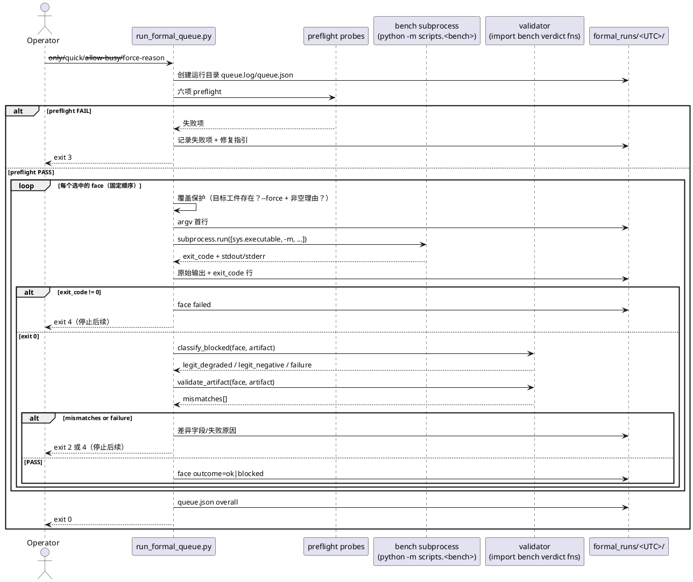

# 1 AR概述

| 字段 | 内容 |
| --- | --- |
| 组件名称 | ActFold 实验基础设施（scripts/ 层，不改 actfold 核心包） |
| AR系统流水号 | AR027 |
| AR描述 | 服务器正式跑执行器：固定七面队列、preflight 硬阻塞、子进程隔离执行、工件 schema/判定重算校验、结构化日志与区分退出码；落实「预承诺单次、绝不 rerun-until-pass」纪律 |

# 2 动态行为

## 交互时序图



# 3 功能点分解

| 序号 | 功能点名称 | 功能点描述 | srs |
| --- | --- | --- | --- |
| 1 | 队列定义与选择 | 七面 FaceSpec 冻结；`--only`/`--list`；models-root 可选透传 | FR1 |
| 2 | preflight | transformers/CUDA/显存/权重/probe/GPU 静默硬阻塞；`--allow-busy` | FR2 |
| 3 | 子进程执行 | `sys.executable -m`；face log 结构；`--quick`；`--timeout-hours` | FR3 |
| 4 | 工件校验 | schema 表；h1/h2 重算；h4/reproduction/ar025 结构自洽 | FR4 |
| 5 | 失败语义 | blocked 来源分类；失败即停；覆盖保护 + `--force-reason` | FR5 |
| 6 | 日志与退出码 | `formal_runs/<UTC>/queue.log|queue.json`；0/2/3/4 | FR6 |
| 7 | CPU 合同测试 | 注入探针/runner；夹具工件；FR→用例映射表 | FR7 |

# 4 实现设计

## 4.1 功能实现思路

单模块 `scripts/run_formal_queue.py`（约 1000 行），全部副作用通过**可注入依赖**隔离。

**方案对比与取舍：**

| 方案 | 思路 | 优点 | 缺点 | 结论 |
| --- | --- | --- | --- | --- |
| A 单模块 + 注入 | 一个脚本内做完队列/preflight/执行/校验，探针与 runner 可注入 | CPU 全可测；与仓库 scripts 风格一致；单文件合同测试 | 单文件较大（~600 行） | **选定** |
| B 子包拆分 | `scripts/formal_runner/{queue,preflight,validate}.py` | 职责更细 | 多文件、与既有 scripts 平铺风格不一致，导入面变大 | 拒绝 |
| C shell 编排 + 独立校验脚本 | bash/ps1 跑命令，python 只校验 | 最少代码 | 平台不通用、无可注入测试、日志结构难保证 | 拒绝 |

- `FaceSpec`（frozen dataclass）：面 ID、bench 模块、**正式 argv 与 quick argv 两套完整参数**（quick 不是简单追加：AR026-llada quick 必须省略正式 `--out`）、正式/quick 工件路径、期望 schema 表、校验器种类。
- `Probes`（dataclass，默认实现读真实环境）：transformers 版本、CUDA/显存、模型文件、probe 工件、GPU 状态；测试注入假实现。
- `Runner`（默认 `subprocess.run`）：测试注入假 runner 记录 argv 与返回码。
- `validate_artifact(face, artifact)`：纯函数，import 各 bench 的冻结判定函数重算比对。
- `classify_blocked(face, artifact)`：纯函数，返回 `legit_degraded` / `legit_negative` / `failure` / `None`。
- `main(argv)`：编排 + 日志 + 退出码。

## 4.2 功能实现设计

### 4.2.1 流程图

```plantuml
@startuml
start
:parse args（--only/--list/--quick/--models-root/--allow-busy/--force/--force-reason/--timeout-hours）;
if (--list?) then (yes)
  :print queue;
  stop (exit 0)
endif
:resolve faces（--only 校验未知 ID/空串 → exit 3）;
:preflight（六项）;
if (除 GPU 静默外的任一项失败?) then (yes)
  :打印 PASS/FAIL 表 + 修复指引;
  stop (exit 3)
endif
if (GPU 静默失败?) then (yes)
  if (--allow-busy?) then (yes)
    :记录覆盖事实;
  else (no)
    :打印 PASS/FAIL 表 + 修复指引;
    stop (exit 3)
  endif
endif
:创建 formal_runs/<UTC>/;
:写 queue.json 初稿;
while (还有 face)
  :target = quick_artifact if --quick else formal_artifact;
  if (target 存在?) then (yes)
    if (--force 且 非空 --force-reason?) then (yes)
      :记录覆盖事实 + 理由;
    else (no)
      if (--force 且 理由缺失/空串?) then (yes)
        :参数错误; stop (exit 3)
      else (no)
        :覆盖保护拒绝; stop (exit 4)
      endif
    endif
  endif
  if (--quick) then (yes)
    :argv = [exe, -m, module] + quick_argv; 目标=quick 工件
  else (no)
    :argv = [exe, -m, module] + formal_argv; 目标=正式工件
  endif
  :写 argv 首行;
  :subprocess.run（可注入）;
  :写原始输出 + exit_code 行;
  if (exit != 0 或 超时?) then (yes)
    :face failed; stop (exit 4)
  endif
  if (工件缺失/JSON 错?) then (yes)
    :validation mismatch; stop (exit 2)
  endif
  :classify_blocked;
  if (failure?) then (yes)
    :face failed; stop (exit 4)
  endif
  :validate_artifact;
  if (mismatches?) then (yes)
    :打印差异; stop (exit 2)
  endif
  :face outcome=ok|blocked;
endwhile
:queue.json overall;
stop (exit 0)
@enduml
```

### 4.2.2 流程说明

1. **参数与面选择**：`--only` 按逗号切分并校验（空串/未知 ID → exit 3，列合法 ID）；`--list` 打印所选队列（应用 `--only` 过滤）后退出 0；`--timeout-hours <= 0` → exit 3。
2. **preflight**：逐项 `(name, ok, detail)`；显存阈值：正式 ≥24 GiB、`--quick` ≥16 GiB；`--allow-busy` 只覆盖 GPU 静默项并写 `allow_busy=true` 与 detail。
3. **执行**：每面 argv = `[sys.executable, "-m", spec.module] + (spec.quick_argv if quick else spec.formal_argv)`；`--models-root` 仅在显式传入时追加到末尾。
4. **blocked 分类**（先于结构校验）：
   - ar023/ar024/ar026：`reproduction.note == "degraded family per probe conclusion"` → `legit_degraded`；其余 `status=="blocked"`（note 缺失或不等）→ `failure`。
   - ar025（**仅 `status=="blocked"` 进入分类**；`status!="blocked"` → `None`）：
     `blocked_reason` 前缀 `family degraded per probe` → `legit_degraded`；`real-face run failed:` → `failure`；
     无 `blocked_reason` 且含完整 `verdicts` → 看 `verdicts.reproduction.ok`：
     `False` → `failure`（复现异常，ar025 将其并入 overall=blocked 但仍含完整 verdicts）；
     `True` → `legit_negative`；其余 → `failure`。
   - 非 blocked → `None`。
   - **`status=="ok"` 但 `reproduction.ok == False`**（ar023/ar024/ar026）→ `failure`（exit 4，停止队列），
     不交给结构校验（避免 exit 2/4 歧义）。
5. **校验**：见 4.3 `validate_artifact`。任何 mismatch → exit 2。
6. **日志**：运行目录新建；`queue.log` 逐行 `[UTC ISO8601] msg`；`face-<id>.log` 结构 = `argv: ...` + 原始输出 + `exit_code=<n>`。`queue.json` 增量落盘，固定字段见 4.3。
7. **覆盖保护**：以**目标工件**为准（`quick_artifact` 或 `formal_artifact`）——quick 永不检查/覆盖正式工件。目标工件存在时，必须 **`--force` 且 `--force-reason` 非空** 才允许覆盖；`--force` 缺理由/空串 → exit 3；无 `--force`（即使给了 reason）→ exit 4。理由与覆盖事实写入 queue.json。
8. **退出码**：0/2/3/4（见 4.3）。

## 4.3 接口描述

### CLI（`python -m scripts.run_formal_queue`）

| 参数 | 类型 | 默认 | 语义 |
| --- | --- | --- | --- |
| `--only` | str | None | 逗号分隔面 ID 子集（保持队列序） |
| `--list` | flag | False | 打印队列后退出 0 |
| `--quick` | flag | False | 每面加 `--quick`，工件走 quick 路径 |
| `--models-root` | Path | None | 显式传入才追加给子进程 |
| `--allow-busy` | flag | False | 仅覆盖 GPU 静默检查（记录事实） |
| `--force` | flag | False | 允许覆盖已存在的**目标工件**（quick 或正式；须配非空 `--force-reason`） |
| `--force-reason` | str | None | 非空理由，写入 queue.json |
| `--timeout-hours` | float | None | 单面子进程超时（小时） |

### 数据结构

```python
@dataclass(frozen=True)
class FaceSpec:
    face_id: str
    module: str                  # "scripts.ar023_cross_family_bench"
    family: str                  # "llada" | "dream"（preflight 权重检查用）
    formal_argv: tuple[str, ...] # 正式模式完整附加 argv（含 --out 者已含）
    formal_artifact: Path
    quick_argv: tuple[str, ...]  # quick 模式完整附加 argv（替换而非追加）
    quick_artifact: Path
    schemas: dict[str, tuple[str, int | None]]    # state -> (schema, version|None)
    validator: str               # "ar023" | "ar024" | "ar025_real" | "ar026"
```

`FACE_QUEUE: tuple[FaceSpec, ...]` 冻结七面（顺序即执行顺序）。

**正式 argv 冻结表**（reps=30；`--models-root` 由执行器按需追加）：

| 面 ID | module | family | 正式 argv（除 -m） | 正式工件 |
| --- | --- | --- | --- | --- |
| ar023-llada | scripts.ar023_cross_family_bench | llada | `--family llada --reps 30` | results/optimization/ar023_llada_bench.json |
| ar023-dream | scripts.ar023_cross_family_bench | dream | `--family dream --reps 30` | results/optimization/ar023_dream_bench.json |
| ar024 | scripts.ar024_granularity_bench | llada | `--family llada --reps 30` | results/optimization/ar024_llada_granularity_bench.json |
| ar025-real-llada | scripts.ar025_multi_parent_bench | llada | `--mode real --family llada --reps 30` | results/optimization/ar025_real_bench_llada.json |
| ar025-real-dream | scripts.ar025_multi_parent_bench | dream | `--mode real --family dream --reps 30` | results/optimization/ar025_real_bench_dream.json |
| ar026-llada | scripts.ar026_real_graph_bench | llada | `--family llada --reps 30 --out results/optimization/ar026_real_graph_bench.json` | 同左 |
| ar026-dream | scripts.ar026_real_graph_bench | dream | `--family dream --reps 30 --out results/optimization/ar026_real_graph_bench_dream.json` | 同左 |

**期望 schema 表**（与 srs §3.4 一致；`state`：ok / blocked_degraded / blocked_exception）：

| 面 ID | ok | blocked_degraded | blocked_exception |
| --- | --- | --- | --- |
| ar023-* | (`ar023_cross_family_bench`, 1) | (`ar023_cross_family_bench`, 1) | (`ar023_cross_family_bench`, 1) |
| ar024 | (`ar024_granularity_bench`, 1) | (`ar023_cross_family_bench`, 1) | (`ar024_granularity_bench`, 1) |
| ar025-real-* | (`ar025_real_bench`, None) | (`ar025_real_bench`, None) | (`ar025_real_bench`, None) |
| ar025-real-*（blocked_negative） | — | (`ar025_real_bench`, None) | — |
| ar026-* | (`ar026_real_graph_bench`, 1) | (`ar023_cross_family_bench`, 1) | (`ar026_real_graph_bench`, 1) |

**quick 参数表**（完整替换）：

| 面 ID | quick_argv（完整） | quick 工件 |
| --- | --- | --- |
| ar023-* | `--family <f> --reps 30 --quick` | `ar023_{family}_bench_quick.json` |
| ar024 | `--family llada --reps 30 --quick` | `ar024_llada_granularity_bench_quick.json` |
| ar025-real-* | `--mode real --family <f> --reps 30 --quick` | `ar025_real_bench_{family}_quick.json` |
| ar026-llada | `--family llada --reps 30 --quick`（无 `--out`） | `ar026_real_graph_bench_quick.json` |
| ar026-dream | `--family dream --reps 30 --quick --out results/optimization/ar026_real_graph_bench_dream_quick.json` | 同左 |

> AR026 的 `--out` 优先于 quick，故 quick_argv 必须用**完整替换**表达；
> 测试用记录 argv 的 runner 断言 quick 路径不含正式 `--out`。

`<root>` 解析顺序（与 bench 默认一致）：`--models-root` > probe 工件
`meta.models_root` > `"ar023_models"`（相对仓库根）；只有 `--models-root`
显式传入时才向子进程追加该 flag。

```python
@dataclass
class Probes:
    transformers_version: Callable[[], str]
    cuda: Callable[[], tuple[bool, int]]                 # (available, count)
    total_vram_gb: Callable[[], float]
    model_files_ok: Callable[[Path, str], bool]
    probe_artifact_ok: Callable[[Path], bool]
    gpu_state: Callable[[], tuple[float, float] | None]  # (util%, usedMiB)
```

### 校验函数

```python
def validate_artifact(face: FaceSpec, artifact: dict) -> list[str]: ...
def classify_blocked(face: FaceSpec, artifact: dict) -> str | None: ...
def recompute_verdicts(face: FaceSpec, artifact: dict) -> list[str]: ...
def validate_structure(face: FaceSpec, artifact: dict) -> list[str]: ...
```

- **status 值域**：只接受 `ok` 与 `blocked`，其余（含缺失）记 mismatch（阻断
  “未知状态静默放行”）。
- **执行范围**：`recompute_verdicts` 与判定结构校验**仅对含 `verdicts` 的工件执行**（status=ok，或 ar025 的 overall=blocked 负结果）；无 verdicts 的 `blocked_degraded` 只做 schema + blocked 来源分类（不进入 ar025 键集合校验）。
- `recompute_verdicts`：
  - **h1 输入映射层（必须）**：工件 `quality.per_prompt[*]` 的真实字段是
    `posthoc_confidence[mode].overall_mean`，冻结算法的入参名是
    `posthoc_overall_mean`。映射函数按 bench 组装方式重建：
    `{"prompt_index": e["prompt_index"], "posthoc_overall_mean": {m: e["posthoc_confidence"][m]["overall_mean"] for m in modes}, "decode_length": e["decode_length"], "block_exact": e["block_exact"]}`
    （`quality` 顶层只含 `per_prompt`）。
  - ar023/ar024：`h1_quality_verdict({"per_prompt": mapped})`、
    `h2_speed_verdict(p50b, p50a, p50a_placeholder)`（第三个参数传
    `p50_aligned_ms` 占位；只比对 `verdict` 与 `speedup_p50_vs_baseline`；
    `aligned_vs_batched_ratio` 不比对）。
  - ar026：`h1_graph_parity_verdict(mapped_per_prompt, engagement)`，其中
    `engagement = {mode: artifact["modes"][mode]["engagement"]}`（顶层原始捕获
    记录，含 `captures/replays/evictions`；缺失/非 dict → 该 mode 记 `{}`，
    重算因零捕获判 `inconclusive` 而与记录不符）；参与度门由冻结函数从
    `captures` 推导，`verdicts.h1_graph_parity.modes[*].numbers` 仅作为
    **被比对**的落盘面，不参与重算输入。
    h2 同上。ar026 的映射条目**必须携带 `block_exact_vs_anchor`**（原样
    传入、不回填 `block_exact`），其余键与 ar023 映射一致。
  - 比对口径：verdict/布尔/计数严格相等；未取整浮点 `isclose(1e-9,1e-6)`；已取整派生字段 `round(值, 记录小数位)` 后严格相等（h2 speedup 4 位；h1 ratio 6 位；h1 gap 6 位）。
- `validate_structure`：
  - ar023/ar024/ar026：`reproduction` 含布尔 `ok`；降级 blocked 含 `skipped: true` 与非空 `note`；`verdict` 值域合法；blocked 时不得出现 `supported`（**仅**对 verdict 字符串字段，ar025 布尔面不适用）。成功工件不在此强制 `ok: true`（该失败由失败语义以 exit 4 处理）。
  - ar025 real：精确键集合 `H1_token_parity` / `H2_speed` / `delivery_line` /
    `H4_ledger_strictly_smaller` / `canary_structural_eager_fallback` /
    `overall` / `blocked_reasons` / `reproduction`；
    前三者与 H4 含布尔 `pass`；`overall` ∈ {supported, blocked}；
    blocked 时 `blocked_reasons` 非空；`reproduction` 含布尔 `ok`；
    canary 允许 `timed_count: null` + 非空 `note`（不要求 `pass`）。

### 退出码

| 码 | 含义 |
| --- | --- |
| 0 | 全通过（overall ∈ {ok, blocked}） |
| 2 | 工件校验不一致（含缺失/JSON 错误） |
| 3 | preflight 阻塞或参数错误（含未知/空 `--only`、`--force` 缺理由、`--timeout-hours<=0`） |
| 4 | 实验失败（非 0 退出/超时/异常 blocked/status ok 但 reproduction 失败）或覆盖保护拒绝 |

### queue.json 固定字段

| 字段 | 类型 | 说明 |
| --- | --- | --- |
| `run_id` | str | `<UTC>` 目录名 |
| `argv` | list[str] | 执行器自身参数 |
| `quick` / `allow_busy` | bool | 模式与覆盖事实 |
| `force_reason` | str \| None | 覆盖理由；仅当本次运行**实际发生**覆盖时写入，否则 `null` |
| `preflight` | list[`{name, ok, detail}`] | 六项 |
| `faces` | list[face] | 见下 |
| `overall` | `ok` \| `blocked` \| `failed` | 汇总 |

`faces[i]`：`id`、`argv`、`start`、`end`、`duration_s`、`exit_code`、
`artifact`、`validation`（`pass`/`mismatch`/`missing`/`null`=未执行校验）、
`outcome`
（`ok`/`blocked`/`failure`/`not_run`）、`overwrite`（bool，本次是否实际覆盖了已存在目标）。

## 4.4 代码设计

```
scripts/
  run_formal_queue.py        # 新增：队列/preflight/执行/校验/日志
tests/
  test_ar027_formal_queue_contract.py   # 新增：CPU 合同测试（注入探针与 runner）
docs/RERUN_CHECKLIST.md      # §0/§7 执行器入口 + AR026 双面工件命名
AGENTS.md                    # 运维条目：执行器纪律（preflight 硬阻塞/禁重试）
README.md                    # 复现段引用执行器
```

模块内分区（顺序）：常量与 FaceSpec 队列 → 数据结构 → 队列解析 → preflight → 执行 → 校验 → 日志 → main。所有 bench 判定函数在函数内 import（`scripts.*`），保持模块顶层 stdlib-only（与 ar023/ar026 的子进程隔离先例一致，便于测试收集）。

# 5 重构设计

不适用（新增文件，无既有代码重构）。

# 6 测试设计

## 6.1 单元测试（UT）

| 用例 | 覆盖点 | 断言 |
| --- | --- | --- |
| UT-2701 | 队列冻结 | 7 面 ID/顺序/module/family；逐面完整 formal_argv（--reps 30、--family、ar025 `--mode real`、ar026 各自 `--out`）与正式工件 |
| UT-2702 | `--list` | 输出 7 行、runner 未被调用 |
| UT-2703 | `--only` 子集 | 子集顺序正确 |
| UT-2704 | `--only` 未知 ID | exit 3，错误信息列合法 ID |
| UT-2705 | models-root 未传 | argv 不含 `--models-root` |
| UT-2706 | models-root 传入 | argv 含该 flag 与值 |
| UT-2707 | quick AR026-llada | 记录 argv 不含 `--out`；正式工件 sha256 不变 |
| UT-2708 | quick AR026-dream | argv 仅含 `_dream_quick.json` 的 `--out`；正式工件 sha256 不变 |
| UT-2709 | quick 其他面 | ar023/ar024/ar025 argv 含 `--quick` 且无正式 `--out` |
| UT-2710 | preflight 版本 | transformers≠4.53.1 → exit 3，runner 未调用 |
| UT-2711 | preflight CUDA | 不可用 → exit 3，runner 未调用 |
| UT-2712 | preflight 显存 | 正式：23.9 GiB → exit 3，24.0 GiB PASS；quick：15.9 GiB → exit 3，16.0 GiB PASS |
| UT-2713 | preflight 权重 | 缺 config.json 或缺 safetensors → exit 3 |
| UT-2714 | preflight probe | probe 工件缺失 → exit 3（全部 7 面） |
| UT-2715 | preflight GPU 静默 | util=10%（边界 PASS）/11% 或 used>1024MiB → exit 3 |
| UT-2716 | `--allow-busy` | GPU 忙时放行；queue.json `allow_busy=true` + detail |
| UT-2717 | 执行成功日志 | face log 首行 `argv:`、末行 `exit_code=0`；queue.json 每条 face 字段齐全 |
| UT-2718 | 失败即停 | 第 1 面 exit 1 → 其余 not_run；exit 4 |
| UT-2719 | 覆盖保护（无 force） | 正式工件存在且无 `--force` → exit 4 |
| UT-2720 | 覆盖保护（空理由） | `--force --force-reason ""` → exit 3 |
| UT-2721 | 覆盖保护（完整） | `--force --force-reason "理由"` → 覆盖且理由入 queue.json |
| UT-2722 | schema 表（ok） | 7 面 ok 夹具按表 PASS |
| UT-2723 | schema 表（降级 blocked） | ar023/ar024/ar026 用 ar023 schema；ar025 无 version → PASS |
| UT-2724 | schema 表（异常 blocked） | ar023/ar024/ar026 各自 schema → PASS |
| UT-2725 | 重算篡改 | 篡改 h1 或 h2 记录 → mismatch、exit 2，日志含差异字段 |
| UT-2726 | 重算正常 | 已提交 `ar023_llada_bench.json`（复制到 tmp）→ 无 mismatch（含 h1 映射层） |
| UT-2727 | h1 映射正确性 | `posthoc_confidence→posthoc_overall_mean` 映射后 h1 重算等于记录值（防止系统性 none_mean） |
| UT-2728 | blocked 分类（降级） | ar023/024/026 note 命中；ar025 前缀命中 → legit_degraded |
| UT-2729 | blocked 分类（异常） | `<ExcType>:` / `real-face run failed:` → failure（停止队列） |
| UT-2730 | blocked 分类（ar025 复现异常） | verdicts.reproduction.ok=False → failure；ok=True → legit_negative |
| UT-2731 | 结构自洽 | 缺 `reproduction.ok` / `verdicts.blocked_reasons` → mismatch |
| UT-2732 | status ok + repro fail | reproduction.ok=False → exit 4（非 2），停止队列 |
| UT-2733 | 超时 | 注入 runner 超时 → exit 4，停止队列 |
| UT-2734 | 启动异常 | 注入 runner 抛 OSError → exit 4，日志含异常 |
| UT-2735 | 工件缺失/坏 JSON | exit 2 |
| UT-2736 | 无写工件 | 校验前后工件 sha256 相等 |
| UT-2737 | 运行目录隔离 | 连续两次运行生成不同 `<UTC>` 目录，互不覆盖 |
| UT-2738 | quick 不被正式工件误杀 | 正式工件存在 + `--quick` → 正常执行；正式工件 sha256 不变 |
| UT-2739 | reason 无 force | `--force-reason` 非空但无 `--force` → exit 4，不覆盖 |
| UT-2740 | blocked 兜底 | status=blocked 且 note 不等于降级文案 → failure（停止队列） |
| UT-2741 | `--only` 空串 | exit 3 |
| UT-2742 | timeout 非法 | `--timeout-hours 0` / 负数 → exit 3 |
| UT-2743 | ar025 结构键 | 夹具含精确键集合 → PASS；缺 `H4_ledger_strictly_smaller` → mismatch |
| UT-2744 | ok 无 verdicts | status=ok 且 verdicts 缺失 → mismatch、exit 2 |
| UT-2745 | allow-busy 边界 | 版本失败 + GPU 忙 + allow-busy → 仍 exit 3 |
| UT-2746 | face log 首行 | 首行严格等于 `argv: ` + 执行 argv |
| UT-2747 | list+quick | 预览 quick argv 与 `_dream_quick.json` |
| UT-2748 | status 值域 | 非 ok/blocked/缺失 → mismatch |
| UT-2749 | 非对象 JSON | `[]` 工件 → exit 2、validation=missing |
| UT-2750 | h4 非 dict | verdict 条目非 dict → mismatch |
| UT-2751 | ar025 多余键 | 精确键集合外的键 → mismatch |
| UT-2752 | 全绿七面 | 无 --only 七面全绿 → exit 0、overall=ok、7 条 face |
| UT-2753 | 混合 blocked | 降级面 + 正常面 → exit 0、overall=blocked、后续继续 |
| UT-2754 | GPU 不可测 | `gpu_state() == None` + `--allow-busy` → 仍 exit 3（不可豁免） |
| UT-2755 | 嵌套容器畸形 | verdicts/quality/per_prompt/posthoc_confidence/modes 畸形 → mismatch 不崩溃 |
| UT-2756 | 探针异常 | `model_files_ok` 抛异常 → preflight FAIL、exit 3、runner 0 次 |
| UT-2757 | 无 CUDA 的 VRAM 探针 | `total_vram_gb` 抛异常 → exit 3、runner 0 次 |
| UT-2758 | force 但无目标 | 目标不存在时 `force_reason=null`、`overwrite=false` |
| UT-2759 | probe JSON 形态畸形 | 顶层非 dict / meta 非 dict / models_root 非 str → 回退默认根 |
| UT-2760 | 降级面 reproduction.ok | 缺失或非 bool → mismatch |
| UT-2761 | ar025 诚实负结果前置 | 缺 `reproduction.ok is True` 或 `overall != blocked` → failure |
| UT-2762 | blocked/supported 矛盾 | status=blocked 且 overall=supported → exit 4 |
| UT-2763 | 降级理由 + 判定并存 | blocked_reason 为降级文案但含 verdicts → failure、exit 4 |
| UT-2764 | ar026 参与度篡改 | 顶层 `modes[*].engagement` 改 0 / 删 modes → mismatch |

## 6.2 接口测试

参数边界/返回值/错误码矩阵：

| 参数 | 正常 | 边界 | 非法 | 断言 |
| --- | --- | --- | --- | --- |
| `--only` | 单个/多个已知 ID | 全部 7 个 | 未知 ID / 空串 | exit 0 / 3 |
| `--list` | 单独使用 | 与 `--only` 同用（只列所选） | — | exit 0，runner 0 次 |
| `--quick` | 与正式/quick 工件 | — | — | argv 见 UT-2707..2709 |
| `--models-root` | 传入/不传 | 相对路径 | 不存在目录 | preflight 权重检查 exit 3 |
| `--allow-busy` | GPU 忙 | util=10% 边界 | — | exit 0 + 记录 |
| `--force` | 带非空 reason | reason 含空格 | 缺 reason / 空串 | exit 0 / 3 |
| `--timeout-hours` | 0.001（触发超时） | 与默认（None） | 负数/0 | exit 4 / 3 |

注入 Probes 六项独立失败，逐项断言 preflight 报告行（name/ok/detail）。

## 6.3 业务场景测试

- 全绿队列（假 runner + 夹具工件）→ exit 0、overall=ok、queue.json 7 条 face。
- 混合 blocked（一面 probe 降级、一面正常）→ exit 0、overall=blocked、后续面继续。
- 两次运行 → 两个不同 `<UTC>` 目录互不覆盖（UT-2737）。

## 6.4 异常场景测试

- 子进程非 0（UT-2718）、超时（UT-2733）、启动异常（UT-2734）→ exit 4 并停止。
- 工件缺失/JSON 损坏（UT-2735）→ exit 2。
- 正式工件已存在（UT-2719）、`--force-reason` 空串（UT-2720）、preflight 阻塞（UT-2710..2715，runner 0 次）。
- **边界条件矩阵**：

| 类别 | 条件 | 期望 |
| --- | --- | --- |
| 正常 | 6 项 preflight 全过、工件合规 | exit 0 |
| 边界 | 显存恰 24.0 GiB（正式）；util=10%；used=1024MiB；reps=30；`--timeout-hours` 恰好到期 | 通过/超时二选一按 `>=` 定义 |
| 边界 | `--quick` 显存 15.9 GiB → exit 3；16.0 GiB → PASS | 16 GiB 阈值 |
| 异常 | 版本不符、无 CUDA、权重缺失、probe 缺失、GPU 忙、非 0 退出、超时、启动失败、工件缺失、坏 JSON、schema 不符、判定篡改、覆盖保护 | exit 2/3/4 并停止后续 |

> 覆盖率目标：新增脚本的每条分支（含流程图 if/异常分支）至少一个用例；
> FR1-FR7 每条 srs 验收标准在测试文件 FR→用例映射表中登记，UT-2701..2764
> 与映射表一一对应（UT-2703..2753 为主合同面，UT-2754..2764 为 T010 审查回归面）。
