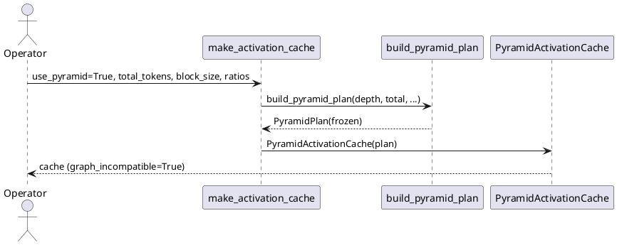
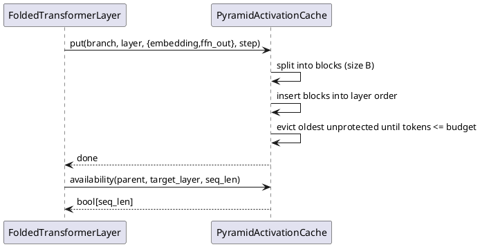
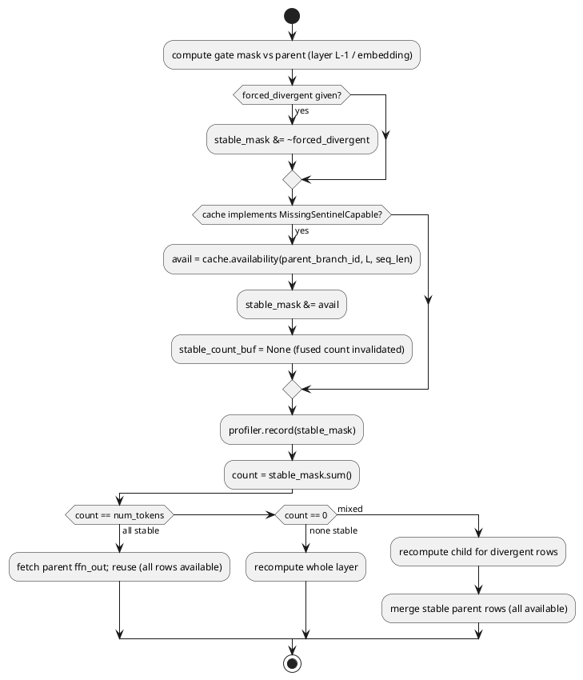
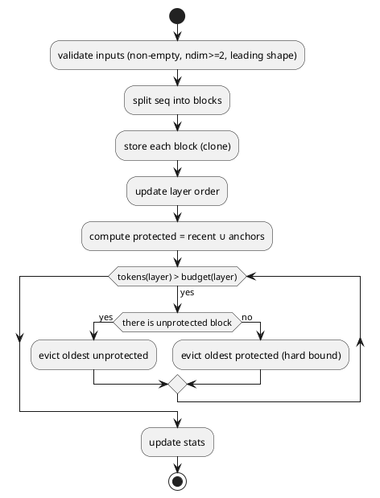

# 1 AR概述

| 组件名称 | ActFold 激活缓存子系统（Activation Cache Subsystem） |
| --- | --- |
| AR系统流水号 | AR029 |
| AR描述 | 端侧长程 Agent 的有界内存金字塔激活缓存：块级分页、逐层预算、plan/run 分离、目标层可用性守卫 |

**问题陈述。** 折叠复用依赖 parent FFN 激活缓存。现有三种缓存共用「每层同预算 +
整组 LRU」策略：长程 Agent 的分支/步数增长时，缓存按层数×组数线性膨胀；逐层
复用价值差异未被利用；缺失 token 的语义在「门读 L-1、合并读 L」的错配下可能静默
复用错误值。

**解决思路。** 新增 `PyramidActivationCache`：plan 阶段把计划级总预算归一化到
逐层（浅多深少）；run 阶段以 block page 存储、按保留集（锚点 + 近期窗口）淘汰；
读路径对缺失 token 返回 NaN，并暴露 `availability`；折叠层在门之后把目标层
可用性 AND 进 `stable_mask`，保证「宁可重算，不可错用」。机制不改变折叠数学，
默认关闭。

**参考思想。** PyramidInfer 的逐层金字塔保留；FlashInfer 的 plan/run、分页与
显式掩码；RWKV 类结构的常数内存动机。只吸收机制，不复制实现、不引用未复现数字。

**范围裁定。** 用户授权本阶段不做大型实验：AR029 为机制/基础设施 AR，
`baseline_claim=false`，不进入 superiority ladder；真实 checkpoint 协议在 RERUN
以 `BLOCKED-DEFERRED` 记录，未来执行前必须先加 `run_formal_queue` FaceSpec。

# 2 动态行为

## 2.1 部署期：计划构建与缓存创建



## 2.2 运行期：写入与淘汰



## 2.3 运行期：门 → 可用性守卫 → 合并



# 3 功能点分解

| 序号 | 功能点名称 | 功能点描述 | 需求 |
| --- | --- | --- | --- |
| 1 | 金字塔计划 | 归一化逐层预算、保留布局、参数校验 | FR1 |
| 2 | 块页缓存 | 块切分、逐层硬预算、保留集淘汰、统计 | FR2 |
| 3 | 可用性安全 | NaN 缺失、`availability`、MFF 三路径守卫、graph 互斥 | FR3 |
| 4 | 协议兼容 | 协议方法、`MissingSentinelCapable`、put_batch、账本/计数 | FR4 |
| 5 | 可观测性 | `stats()`、计划上界、确定性 | FR5 |
| 6 | 接入 | 工厂/配置/导出、默认关闭、优先级 | FR6 |
| 7 | 机制基准 | 真实小模型、E1-E4、quick 工件、服务器协议 | FR7 |

# 4 实现设计

## 4.1 功能实现思路

### 4.1.1 方案对比

**方案 A（采纳）：块页 + 目标层可用性守卫。**
- 缓存内部以 block 为存储/淘汰单元，逐层预算来自 `PyramidPlan`；
- 缺失 token 返回 NaN，并暴露 `availability` 查询；
- 折叠层在门后 AND 目标层可用性；graph 模式禁用。
- 优点：安全可证明（门与合并使用同一目标层可用性）；内存硬上界；块级淘汰
  向量化。
- 缺点：需要三处核心守卫；与 AR028 同文件；graph 不可用。

**方案 B：只靠 NaN，不改折叠层。**
- 门读 L-1 看到 NaN 才失效；但逐层预算不同会造成 L-1 存在、L 缺失的错配，
  合并静默取 NaN。**正确性不成立，拒绝。**

**方案 C：逐层预算强制相同（放弃金字塔）。**
- 各层写入序列相同 → 缺失集一致，NaN 足够；但失去 PyramidInfer 的逐层分配，
  且仍无法覆盖「批量/多父写序差异」。**收益不足，拒绝。**

**推荐 A。** 理由：唯一同时满足「硬上界 + 逐层差异 + 静默复用零容忍」的方案；
守卫是局部、可单测的，且不改变折叠数学。

### 4.1.2 预算公式（冻结）

给定 `depth`、计划级 `total_tokens`、`block_size`：

```
w_l = max_ratio + (min_ratio - max_ratio) * l / (depth - 1)        # linear
w_l = max_ratio * (min_ratio / max_ratio) ** (l / (depth - 1))     # geometric
budget_l = max(block_size, floor(total_tokens * w_l / Σw / block_size) * block_size)
```

- `depth == 1`：`budget_0 = floor(total/block)*block`（至少 1 块）。
- 若 `Σ budget_l > total_tokens`：从最深层向上，对 `budget_l > block` 的层逐块
  减 1，直到满足或全部到 1 块下限；`depth*block <= total` 由参数校验保证可行。
- `total_budget_tokens = Σ budget_l`（回填后的实际上界，**不是**请求值）。
- `retained_blocks(layer, seq_len)`：返回锚点集合
  `{0..min(anchor_blocks,n_blocks)-1} ∪ {k*anchor_stride | k*anchor_stride < n_blocks}`
  其中 `n_blocks = ceil(seq_len / block_size)`；越界锚点必须被过滤；
  近期窗口是运行期状态，不在 plan 中。

### 4.1.3 块页存储

每个 `(branch_id, step_idx, layer_idx)` 保存：

```
Entry:
  seq_len: int
  batch: int
  blocks: dict[block_idx -> dict[name -> Tensor[block_len, batch, ...]]]
  block_len: dict[block_idx -> int]
```

层级顺序 `OrderedDict[(branch_id, step_idx, block_idx), None]` 维护全局最旧顺序。
`put` 按 `block_size` 切分，逐块 clone；写入后：

1. 标记保护：该 entry 的最后 `recent_blocks` 块 + `plan.retained_blocks(...)`；
2. 从层顺序头部淘汰未保护块，直到 `tokens ≤ budget_l`；
3. 若只剩保护块仍超预算：继续淘汰最旧块（硬上界优先）。

`bytes` = 所有保留块 `numel*element_size` 之和；`tokens` = 保留块实际长度之和；
`blocks` = 保留块数。

### 4.1.4 读路径与可用性

- `fetch/get_all`：为每个 token 组装 `[T]` 行；存在→真实值，缺失→`nan`；
  返回独立张量（不暴露内部 buffer）。
- `get/fetch_masked`：先组装，再把未请求位置置 0；请求但缺失保持 NaN。
- `availability(branch, layer, seq_len, step_idx=0, name)`：
  - **折叠栈固定 `step_idx=0`**：`_store_activations` 与所有 `fetch` 都省略
    `step_idx`（默认 0），可用性查询必须使用与读路径完全相同的 key，否则
    `step_idx != 0` 时会把存在的 token 误报为缺失；
  - entry 不存在 → 全 False；
  - 返回 `[T]`（stored batch==1）或 `[B,T]`；
  - `True` iff 该 token 所在块存在、含 `name`，且
    `pos - block_idx*block_size < block_len`（最后一块的部分长度必须计入，
    防止查询长度大于已写入长度时误报可用）。
- 折叠层 helper（rank 合同：1-D mask 永不扩维；仅 2-D 且 `avail` 为 1 行时广播）：

```python
def _apply_cache_availability(layer, parent_branch_id, stable_mask):
    fn = getattr(layer.cache, "availability", None)
    if fn is None:
        return stable_mask, False
    # 与 put/fetch 的默认 key 一致：折叠条目固定在 step 0。
    avail = fn(parent_branch_id, layer.layer_idx, stable_mask.shape[-1], 0)
    if avail is None:
        return stable_mask, False
    avail = avail.to(device=stable_mask.device)
    if stable_mask.ndim == 1:
        # AR028 逐行有效长度面：1-D mask 保持 1-D，绝不扩成 [T,T]。
        if avail.ndim != 1:
            avail = avail.reshape(-1)
        return stable_mask & avail, True
    if avail.ndim == 1:
        avail = avail.view(1, -1)
    if avail.shape[0] == 1 and stable_mask.shape[0] > 1:
        avail = avail.expand(stable_mask.shape[0], -1)
    return stable_mask & avail, True
```

调用点（三处，均在 `forced_divergent` AND 之后、profiler/计数之前）：

| 路径 | 位置 | parent id |
| --- | --- | --- |
| 串行 | `FoldedTransformerLayer.forward` 的 `stable_mask` 成形后 | `parent_branch_id` |
| 同父批量 | `_forward_batched` | `parent_branch_id`（单父，广播） |
| 多父逐行 | `_forward_batched_multi` | 每行 `parent_branch_ids[i]`，`row_valid=False` 行直接 False |

守卫返回 `True` 时设置 `stable_count_buf = None`，使 fused 计数失效。
1-D（AR028 逐行）路径的后续有效长度切片必须写 `mask[..., :v_r]`，不得写
`mask[:v_r]`（后者会切掉 token 维）。

### 4.1.5 graph 互斥（init + setter 双保险）

`PyramidActivationCache.graph_incompatible = True`。`ManualFoldedForward`：

```python
def _validate_cache_graph_compat(self, value: Any) -> None:
    if self.use_cuda_graph and getattr(value, "graph_incompatible", False):
        raise ValueError(
            "PyramidActivationCache is not CUDA-graph compatible; "
            "use use_cuda_graph=False or a dense cache."
        )

def __init__(...):
    ...
    # 现有代码先 self.cache = cache、后 self.use_cuda_graph；必须把
    # use_cuda_graph 赋值与校验前移，否则 setter 校验读到未定义属性。
    self.use_cuda_graph = bool(use_cuda_graph)
    self._validate_cache_graph_compat(cache)
    self.cache = cache
    ...

@cache.setter
def cache(self, value):
    self._validate_cache_graph_compat(value)      # 先校验，再传播
    ... propagate to wrapped layers and graph runners/pools ...
```

理由：图静态父缓冲只在捕获期拷贝形状有效的父张量，运行期淘汰不会刷新；
AGENTS #42 的 `cache` setter 可把金字塔缓存换入已启图的实例，必须同样拒绝。
换入失败时不得留下半传播状态（校验在赋值/传播之前）。

> 已知边界（非阻塞）：`use_cuda_graph` 仍是普通可写属性，属主可在事后直接置
> True 绕过校验；AGENTS #42 只要求 `cache` setter 面，本 AR 不额外封装该开关。
> 文档在 `BenchmarkRunner` 与 MFF docstring 中注明「graph 开关仅在构造期有效」。

### 4.1.6 条目生命周期、统计与写失败语义

- **条目删除**：某 entry 的最后一块被淘汰后，立即删除该 `(branch, step, layer)`
  entry（含 lengths/name 映射）。因此 `contains` 返回 False，`fetch` 抛
  `KeyError`，与 `ActivationCache` 的「整组淘汰」语义一致；`stats()["tokens"]`
  与 `num_entries` 同步归零。
- **统计口径**（冻结）：
  - `stats()["tokens"]` / `stats()["blocks"]` 是**逐层 dict**（`{layer: int}`），
    另有 `bytes`（int 总量）、`evictions`、`requests`、`missing_tokens`；
  - `requests`：读调用次数（`fetch`/`get_all`/`get`/`fetch_masked` 各计 1）；
  - `missing_tokens`：累计返回的缺失 token 位置数；`fetch/get_all` 计全部缺失，
    `get/fetch_masked` 只计「被请求且缺失」；
  - `tokens/blocks/bytes/evictions` 均为当前保留值的快照，单调非负；
  - `write_op_count`：每次 `put` 增加 `len(activations)`；`put_batch` 按逐条
    `put` 展开累计（与 `ActivationCache` 同口径，无 foreach 融合）。
- **put_batch 原子性（与 AGENTS #42 一致）**：先对所有条目做形状/类型预校验，
  再逐条 `put`；预校验失败不写任何内容。**不承诺**预校验通过后设备拷贝异常的
  回滚（与现有缓存的原子性定义一致）。同一 `(branch, step, layer)` 重复写入时，
  `put` 按新写入重建该 entry 的块与名字集合（旧名字集合被替换），并移动 LRU
  位置；重复目标按逐条 `put` 顺序执行，不做 foreach 融合。

### 4.1.7 复用路径审计（为什么守卫是充分条件）

| 路径 | 是否读取 parent 值 | 守卫是否权威 |
| --- | --- | --- |
| 串行 all-stable 快速路径 | `fetch` → `ffn_out` | 是：守卫已把缺失行置 False，不可能 all-stable |
| 串行 slow path / split | `merge_stable_divergent` / 稳定行 gather | 是：只读 stable 行 |
| 同父批量 | `where(stable_mask, parent, child)` | 是 |
| 多父逐行 | 逐行 `where` | 是：每行用各自的 parent id |
| `gather_select`/`fetch_flat` | 直接读 vectorized buffer | **金字塔缓存不实现 `fetch_flat`**，回退 `fetch` + merge；若未来实现，必须同时实现可用性过滤 |
| CUDA graph | 静态父缓冲 | 否：**构造期/setter 拒绝** |
| `_store_batched` | 只写 | 不适用 |

### 4.1.8 预算回收的可行性

归一化后 `Σ budget_l` 可能因逐层 floor 仍高于 `total_tokens`。回收循环必须
**重复扫层直到满足**：从最深未到 1 块下限的层开始逐块减 1，循环直至
`Σ ≤ total_tokens`。参数校验 `depth*block_size <= total_tokens` 保证最坏情况
（每层 1 块）可行。`total_budget_tokens` 是回收后的实际和。

## 4.2 功能实现设计

### 4.2.1 流程图（写入/淘汰）



### 4.2.2 流程说明

1. **校验先于变更**：`put`/`put_batch` 在任何写入前完成形状与类型校验；
   `put_batch` 逐条校验后再逐条执行；预校验失败零写入，设备拷贝异常不承诺回滚
   （与 AGENTS #42 的原子性定义一致）。
2. **块内连续**：块张量保持 `[block_len, batch, ...]`，`fetch` 以
   `index_select/cat` 组装，避免逐 token Python 循环。
3. **保护集**：锚点是层内位置集合；近期窗口只保护**刚写入的 entry** 的最后
   `recent_blocks` 块，旧 entry 只保留锚点保护（避免近期标记永久钉住旧数据）。
   两者并集为本次写入后的保护集；预算压力下保护集可被最旧优先回收（上界优先）。
4. **读后无状态副作用**（除 LRU touch）：`fetch/get` 不修改块内容。
5. **失败语义**：无 entry → `KeyError`；NaN 是正常返回值；最后一块淘汰后删除
   entry（`contains=False`）。

### 4.2.3 FR7 机制基准设计（冻结）

**真实计算栈。** 脚本自建 `TinyDecoder`（2 层，hidden=32，4 heads，真实
`nn.Linear`/softmax attention/FFN；非 mock），用
`actfold.models.architecture_utils.detect_architecture` 可识别的
`model.layers` 布局，交给 `ManualFoldedForward`。输入 token 张量真实前向；
不使用随机伪造指标。

**序列。** root（T=64）→ child1..child3（同 T，逐步扰动 suffix），每次写入
缓存；最后再跑一个子步测量复用。全量面用 `ActivationCache`；金字塔面用
统一比例计划（`max_ratio=min_ratio=1.0`，`total=depth×per_layer_tokens`），
保证各层缺失集一致，从而 E1 的全局 `forced_divergent` 参考可执行。
额外逐层面：构造仅目标层缺失的缓存状态，用「每层独立 forced 掩码」的
手工参考（在测试内逐层调用 layer 前向）验证。

**冻结判定（脚本常量，运行前固定）：**

```python
# 设备固定 CPU：E1 要求逐位相等，跨 GPU 后端不做浮点等价承诺。
# availability_mask 在每次压力 forward 之前从压力缓存快照；
# forced 参考复用相同的 branch ids/tokens，仅把 missing_mask 作为 forced_divergent。
full_diff = max_abs_diff(pyramid_full_out, activation_cache_out)
# forced_reference_out 由 forced_divergent=missing_mask 运行得到，
# missing_mask = ~availability_mask（缺失=强制重算）。
pressure_diff = max_abs_diff(pyramid_pressure_out, forced_reference_out)
E1_exact = (full_diff == 0.0) and (pressure_diff == 0.0)

stats = cache.stats()                      # 绑定一次
cache_tokens = {layer: stats["tokens"].get(layer, 0) for layer in range(plan.depth)}
cache_bytes = cache.bytes_used             # 独立属性
block_bytes = sum(t.numel() * t.element_size() for t in cache.iter_block_tensors())
E2_bound = all(
    cache_tokens[layer] <= plan.budget_tokens(layer)
    for layer in range(plan.depth)
) and cache_bytes == block_bytes and cache_bytes == stats["bytes"]

# reuse_tokens = Σ 每次被测 forward 的 guarded stable_mask.sum()
# valid_tokens = Σ 每次 forward 的 stable_mask.numel()
# reuse_ratio = reuse_tokens / max(valid_tokens, 1)
E3_reuse = reuse_tokens > 0 and reuse_ratio >= 0.01

# outputs = [pyramid_full_out, pyramid_pressure_out, forced_reference_out]
# stat_values = 摊平后的数值叶子：tokens.values() + blocks.values()
#               + [bytes, evictions, requests, missing_tokens]
E4_honest = all(torch.isfinite(x).all() for x in outputs) \
            and all(math.isfinite(v) and v >= 0 for v in stat_values)

# 判定优先级（冻结）：
if not E4_honest:
    overall = "blocked"          # 先判诚实性，绝不把 NaN 面包装成 refuted
elif E1_exact and E2_bound and E3_reuse:
    overall = "supported"
else:
    overall = "refuted"
```

- E1 的比较对象：**全量预算**面 vs `ActivationCache`（后者只提供比较输出；
  full/reference 的 `cache_bytes` 等指标来自金字塔全量实例或独立计算）；
  **预算压力**面 vs 逐层缺失的 `_HoleMaskedDense` oracle（见下方勘误）。
- **两面计划配置（冻结 + 2026-10-20 实现勘误）**：
  - full：`total_tokens = depth × T × 4`、`max_ratio=min_ratio=1.0`（无淘汰）；
  - pressure：**线性金字塔** `total_tokens = 6 × block_size`、
    `max_ratio=1.0`、`min_ratio=0.25`（depth=2 时为 `[4·block, 1·block]`）。
  - **勘误原因**：原冻结的「统一预算 `depth × max(block, T//2)`」不可执行且
    自相矛盾——（a）各层缺失集一致时门读的 L-1 已缺失，门本身把该行判为不稳定，
    守卫冗余（第 414 行已承认无法翻转判定）；（b）统一预算下子分支写 L0 会先淘汰
    父 L0，L1 门直接拿不到父激活而整层重算，单层 `forced_divergent` 参考无法复现
    该状态（实现期实测 3.04 偏差）。线性金字塔（浅层宽、深层窄）才是本 AR 的真实
    作用域：父 L0 常驻、目标 L1 尾部缺失，唯一需要 `availability` 守卫的场景。
- **压力参考（勘误）**：单个 `forced_divergent` mask 会作用于**所有层**，无法表达
  「L0 可用、L1 尾部缺失」的逐层洞；改用 `_HoleMaskedDense`——把真实
  `ActivationCache` 的完整父激活按金字塔的**逐层** `availability` 注入 NaN 哨兵，
  并暴露同一 availability。它与块页存储实现无关，却在门/守卫输入上逐位等价
  （E1 要求 CPU 非 split 路径 `diff == 0.0`）。守卫关闭面（UT-2978）把洞集合
  改为全可用后必须产生非零偏差。
- **测量公式（冻结）**：
  - `tokens_stored = Σ_layer stats()["tokens"][layer]`；
  - `missing_ratio = missing_tokens / max(requests_tokens, 1)`，其中
    `requests_tokens = Σ 每次读返回的 token 位置数`；
  - `stable_ratio = replay 窗口内 guarded stable_mask.sum() / numel`；
  - `wall_ms` = 该面所有 forward 的墙钟毫秒（perf_counter，warmup 不计）。
- 工件 schema `ar029_pyramid_cache_bench` v1：
  `{"schema","schema_version","evidence_level":"mechanism","baseline_claim":false,
  "config":{...},
  "measurements":{
    "full":    {cache_bytes,tokens_stored,reuse_ratio,missing_ratio,wall_ms,stable_ratio},
    "pressure":{cache_bytes,tokens_stored,reuse_ratio,missing_ratio,wall_ms,stable_ratio,
                reuse_tokens,valid_tokens},
    "reference":{...same keys...}},
  "verdicts":{"E1":bool,"E2":bool,"E3":bool,"E4":bool},
  "overall":"supported|refuted|blocked","meta":{...},"status":"ok|blocked"}`。
- E2 对 full 与 pressure 两面分别求值；`tokens_stored` 使用
  `stats["tokens"].get(layer, 0)`。
- 守卫关闭篡改（UT-2978）必须使用「仅目标层缺失」的逐层面；统一预算压力面上
  门本身已排除缺失行，守卫冗余，无法翻转判定。
- `--quick` 写 `results/optimization/ar029_pyramid_cache_bench_quick.json`；
  正式路径 `ar029_pyramid_cache_bench.json` 未生成（BLOCKED-DEFERRED）。
- 篡改测试：把预算调大、关闭可用性守卫、注入非有限值，三者的判定翻转都有 UT
  （UT-2960/2961/2963b）。

**RERUN 文本。** 服务器真实 checkpoint 协议以 `BLOCKED-DEFERRED` 记录：
环境（AR019 venv，transformers 4.53.1）、模型目录、资源表占位、命令形状与
「未来必须新增 `run_formal_queue` FaceSpec」的约束；不填任何未测量数字。

### 4.2.4 AR028 合并锚点（同文件协作）

AR028 会把 `_forward_batched_multi` 改为逐行循环，顺序为：
pad 构造 → `s = gate(...)` → `s &= ~forced[r]` → `profiler.record(..., s[..., :v_r])`
→ 计数/合并。AR029 的守卫**必须插在 `s &= ~forced[r]` 之后、
`profiler.record` 之前**：

- 若 AR028 使用整画布 mask `[T]`：调用
  `_apply_cache_availability(self, parent_branch_ids[r], s_full)`，再切
  `s[..., :v_r]`（1-D 时等价于 `s[:v_r]`，但统一写 `[..., :v_r]`）；
- 若 AR028 已切到有效长度：调用同一 helper 后按 `avail[..., :v_r]` 对齐；
- 两种情况都要求 helper 只依赖 `stable_mask.shape[-1]`、mask rank 与 parent id，
  不读取 AR028 的长度元数据；1-D mask 绝不扩维。

合并顺序：AR028 先合入；AR029 rebase 后跑冻结面（AR015 串行、AR021 forced、
AR025 多父、AR026 图静态体）**以及 AR028 自身的变长/多父功能套件**
（至少其 UT-2804/2805/2814/2816），并额外断言「无 `availability` 的缓存下
守卫是 no-op」，确认插入点未改变 AR028 语义。

## 4.3 接口描述

### 4.3.1 新增公开接口

```python
@dataclass(frozen=True)
class PyramidPlan:
    depth: int
    block_size: int
    layer_budgets: tuple[int, ...]
    recent_blocks: int
    anchor_blocks: int
    anchor_stride: int
    schedule: str

    def budget_tokens(self, layer: int) -> int: ...
    def budget_blocks(self, layer: int) -> int: ...
    @property
    def total_budget_tokens(self) -> int: ...
    def retained_blocks(self, layer: int, seq_len: int) -> frozenset[int]: ...

def build_pyramid_plan(
    depth: int, total_tokens: int, *, block_size: int = 16,
    max_ratio: float = 1.0, min_ratio: float = 0.25,
    schedule: str = "linear", recent_blocks: int = 2,
    anchor_blocks: int = 1, anchor_stride: int = 2,
) -> PyramidPlan: ...

class PyramidActivationCache:
    graph_incompatible: bool = True
    missing_value: float = float("nan")
    def __init__(self, plan: PyramidPlan, device: str = "cuda") -> None: ...
    # ActivationCacheProtocol: put/fetch/fetch_masked/get_all/contains/clear_*
    # 兼容: get(token_mask)=fetch_masked; clear_layer; num_entries
    def put_batch(self, entries: Sequence[CachePutEntry]) -> None: ...
    def availability(self, branch_id, layer_idx, seq_len, step_idx=0,
                     name="ffn_out") -> torch.Tensor: ...
    def stats(self) -> dict[str, Any]: ...
    def iter_block_tensors(self) -> Iterator[torch.Tensor]: ...
    @property
    def bytes_used(self) -> int: ...
```

### 4.3.2 协议扩展（`cache_protocol.py`）

```python
@runtime_checkable
class MissingSentinelCapable(Protocol):
    missing_value: float
    def availability(self, branch_id, layer_idx, seq_len, step_idx=0,
                     name="ffn_out") -> torch.Tensor: ...
```

文档修订：零填充只约束**不实现**该能力的缓存；实现者缺失位置返回
`missing_value`，调用方必须用 `availability` 判定可复用性。

### 4.3.3 工厂与配置

```python
make_activation_cache(
    ..., use_pyramid: bool = False,
    pyramid_plan: PyramidPlan | None = None,
    pyramid_depth: int | None = None,   # 显式深度；None 且无 plan → ValueError
    pyramid_total_tokens: int = 4096,
    pyramid_block_size: int = 16,
    pyramid_max_ratio: float = 1.0,
    pyramid_min_ratio: float = 0.25,
    pyramid_schedule: str = "linear",
    pyramid_recent_blocks: int = 2,
    pyramid_anchor_blocks: int = 1,
    pyramid_anchor_stride: int = 2,
)
```

优先级：`use_pyramid > use_vectorized > use_chunked`。`pyramid_plan` 提供时忽略
其余 `pyramid_*` 参数。**深度来源（禁止猜 32）**：`pyramid_plan.depth` 或显式
`pyramid_depth`；`BenchmarkRunner` 使用**单一共享 resolver**
`_resolve_pyramid_depth(config)` 供两处构建点调用：

```python
def _resolve_pyramid_depth(self) -> int:
    if self.config.pyramid_depth > 0:
        return int(self.config.pyramid_depth)
    candidates = []
    for owner in (getattr(self, "_diffusion_model", None), getattr(self, "model", None)):
        if owner is None:
            continue
        candidates.append(owner)
        raw = getattr(owner, "model", None)
        if raw is not None:
            candidates.append(raw)
    for owner in candidates:
        depth = getattr(owner, "num_layers", None)
        if not depth:
            depth = getattr(getattr(owner, "config", None), "num_hidden_layers", None)
        if isinstance(depth, int) and depth > 0:
            return depth
    raise ValueError(
        "use_pyramid_cache requires a real layer count: set pyramid_depth "
        "or expose num_layers/num_hidden_layers"
    )
```

`_build_folded_model` 与 `_build_engine` 都调用同一 resolver；全部缺失且
`use_pyramid=True` → `ValueError`。

**BenchmarkRunner 接线（必须实现）：**

- `_build_folded_model`（`benchmark_runner.py:183-189`）与 `_build_engine`
  （`:244-250`）的两处 `make_activation_cache` 都传入 `use_pyramid`、
  `pyramid_total_tokens/block_size/ratios/schedule/recent/anchor/stride` 与
  真实 `pyramid_depth`；
- `use_pyramid_cache=True` 与 `use_cuda_graph=True` 同时出现时，
  `BenchmarkRunner` **在构建任何缓存前抛出 `ValueError`**（显式配置错误，
  不静默关图）；MFF 的 init/setter 校验作为第二道防线。UT-2958 断言该错误；
- `ActFoldConfig` 新增字段：`use_pyramid_cache=False`、`pyramid_depth=0`
  （0=自动）、`pyramid_total_tokens=4096`、`pyramid_block_size=16`、
  `pyramid_max_ratio=1.0`、`pyramid_min_ratio=0.25`、`pyramid_schedule="linear"`、
  `pyramid_recent_blocks=2`、`pyramid_anchor_blocks=1`、`pyramid_anchor_stride=2`。

## 4.4 代码设计

```
actfold/
  core/
    pyramid_plan.py        # 新增：PyramidPlan / build_pyramid_plan
    pyramid_cache.py       # 新增：块页存储 / 预算淘汰 / availability / stats
    cache_protocol.py      # 修改：MissingSentinelCapable + 零填充裁免文档
    cache_factory.py       # 修改：use_pyramid 分支 + 类型 union
    folded_transformer.py  # 修改：三处 _apply_cache_availability 调用 + helper
    __init__.py            # 修改：导出
  models/
    architecture_utils.py  # 修改：MFF graph×pyramid init + cache setter 双校验
  eval/
    benchmark_runner.py    # 修改：两处 cache 构建接金字塔 + 强制关图 + 真实深度
  utils/
    config_manager.py      # 修改：pyramid_* 字段
scripts/
  ar029_pyramid_cache_bench.py  # 新增：机制基准 + quick 工件
tests/
  test_ar029_pyramid_plan.py    # 新增：UT-2901~2910
  test_ar029_pyramid_cache.py   # 新增：UT-2911~2958
  test_ar029_bench_verdicts.py  # 新增：UT-2959~2966
docs/
  RERUN_CHECKLIST.md           # 修改：服务器协议 BLOCKED-DEFERRED
  OPTIMIZATION_GUIDE.md        # 修改：AR029 机制篇
AGENTS.md / README.md / CHANGELOG.md / docs/ALGORITHM.md / docs/EXPERIMENTS.md
```

**模块边界。** `pyramid_plan.py` 只依赖 stdlib+dataclasses；`pyramid_cache.py`
依赖 `pyramid_plan` 与 `cache_protocol`，不依赖模型/折叠栈；`folded_transformer`
只通过鸭子能力（`availability`）感知缓存，不 import 金字塔模块（避免循环依赖
与默认路径影响）。`architecture_utils` 只读属性 `graph_incompatible`。

# 5 重构设计

不适用（新增为主，核心改动为三处守卫与一个构造期校验，均保持既有行为）。

# 6 测试设计

## 6.1 单元测试（UT）

| ID | 场景 | 期望 |
| --- | --- | --- |
| UT-2901 | 计划不可变/字段 | frozen dataclass，修改抛错 |
| UT-2902 | depth=8 linear 预算 | 每层 16 倍数，浅≥深，总和≤total |
| UT-2903 | geometric 预算 | 等比下降，总和≤total |
| UT-2904 | depth=1 | floor(total/block)*block |
| UT-2905 | total<depth*block | ValueError |
| UT-2905b | depth<=0 / block<=0 | ValueError（参数化） |
| UT-2906 | ratio 非法（min>max、max>1、≤0） | ValueError |
| UT-2907 | schedule 非法 | ValueError |
| UT-2908 | recent/anchor/stride 非法 | ValueError |
| UT-2909 | retained_blocks | 锚点集合正确、与 layer/seq 相关 |
| UT-2910 | 确定性 | 两次构建相等 |
| UT-2911 | 块切分/最后不整块 | 读回一致、无越界 |
| UT-2912 | 逐层硬上界 | 每层 tokens≤budget |
| UT-2913 | 总上界 | Σtokens≤total_budget_tokens |
| UT-2914 | 保留集（锚点） | 锚点块在预算内保留 |
| UT-2915 | 保留集（近期） | 仅刚写入 entry 的最后 recent 块受保护 |
| UT-2916 | 淘汰计数 | 超预算递增、最旧先出 |
| UT-2917 | 硬上界优先 | 保护集也超时仍回收 |
| UT-2918 | bytes 精确 | 等于保留块张量字节和 |
| UT-2919 | 确定性 | 相同序列 stats 相同 |
| UT-2920 | 空/低维/形状不一致 | ValueError |
| UT-2921 | 未写入查询 | KeyError |
| UT-2922 | put_batch 等价 | 与逐条 put 值/计数一致 |
| UT-2923 | put_batch 原子性 | 非法批不写任何块 |
| UT-2924 | 2-D 激活 | 接受（与 ActivationCache 一致） |
| UT-2925 | 多层独立预算 | 深层更小、互不影响 |
| UT-2926 | fetch 缺失 NaN | isnan 精确、其余相等 |
| UT-2927 | get 请求/缺失 | 未请求 0、请求缺失 NaN |
| UT-2928 | fetch_masked 同义 | 与 get 一致 |
| UT-2929 | availability 存在/缺失 | True/False 精确 |
| UT-2930 | availability parent 语义 | 用 child id → 全 False |
| UT-2931 | cosine 缺失不稳定 | sim False |
| UT-2932 | l2 缺失不稳定 | sim False |
| UT-2933 | pearson 缺失不稳定 | sim False |
| UT-2934 | 全量预算逐位 | 与 ActivationCache 值相等 |
| UT-2935 | 逐层缺失 vs forced 参考 | 仅目标层缺失 → 输出等于同层 forced |
| UT-2936 | 统一保留集 vs forced | 各层同缺失 → 与 forced mask 逐位 |
| UT-2937 | tau=0.9/0.0 | 缺失始终不稳定 |
| UT-2938 | profiler 守卫后统计 | 记录比例等于守卫后 mask |
| UT-2939 | split 路径继承 | 稳定行不取缺失值 |
| UT-2940 | 串行守卫 | 目标层缺失→重算 |
| UT-2940b | layer 0 守卫 | 门读 embedding、守卫查目标层 ffn_out |
| UT-2941 | 同父批量守卫 | 广播正确 |
| UT-2942 | 多父逐行守卫 | 每行 parent 独立 |
| UT-2943 | graph×pyramid | 构造期 ValueError |
| UT-2944 | 无能力缓存 no-op | 现有缓存行为不变 |
| UT-2945 | 串行全量预算 vs 现有缓存 | 逐位 |
| UT-2946 | 批量全量预算 vs 现有缓存 | 逐位 |
| UT-2947 | write_op_count | put 每次 +len(activations) |
| UT-2948 | num_entries | token 数 |
| UT-2949 | stats blocks | 块数 |
| UT-2950 | clear_branch/layer/all | 行为正确 |
| UT-2951 | contains | 正确 |
| UT-2952 | 冻结面 no-op | 无 availability 的旧缓存守卫恒等，AR015/AR021/AR025 行为不变 |
| UT-2953 | 工厂默认 | 返回 ActivationCache |
| UT-2954 | use_pyramid | 返回金字塔且预算正确 |
| UT-2955 | 优先级 | pyramid>vectorized>chunked |
| UT-2956 | YAML 字段 | 无 unknown 警告 |
| UT-2957 | BenchmarkRunner __init__/resolver | 显式深度优先、model/config 回退、缺失则 ValueError |
| UT-2957b | 包导出 | 金字塔符号可导入 |
| UT-2958 | graph×pyramid 经配置 | ValueError/文档替代 |
| UT-2959 | E1 判定 supported | 精确参考 |
| UT-2960 | E1 篡改 refuted | 注入差异 |
| UT-2961 | E2 上界判定 | 正常/超预算 |
| UT-2962 | E3 复用判定 | 正常/零复用 |
| UT-2963 | E4 非有限 → blocked | NaN/负统计；blocked 优先于 refuted |
| UT-2961b | E2 缺层读取 | stats 缺层按 0 计，不抛 KeyError |
| UT-2963b | 关闭守卫 → blocked/refuted | 守卫恒等后输出非有限 → E4 false、E1 false |
| UT-2964 | quick 路径 | `_quick.json`、不碰正式 |
| UT-2965 | 工件字段 | evidence_level/baseline_claim=false；verdicts 含 E1-E4 |
| UT-2966 | 判定不可变 | 常量在脚本内冻结 |
| UT-2967 | cache setter 换入金字塔 | 已启图 MFF → ValueError，且不半传播 |
| UT-2967b | 哨兵能力协议 | 缓存声明 MissingSentinelCapable |
| UT-2968 | availability step key | 折叠固定 step 0；step!=0 查询为空不误报复用 |
| UT-2969 | 条目删除语义 | 最后一块淘汰后 contains=False、fetch=KeyError |
| UT-2970 | 统计六键 | requests/missing_tokens/tokens/blocks/bytes/evictions 非负且语义正确 |
| UT-2971 | 最小可行预算边界 | depth=2,total=60,block=16 → 总和≤60 |
| UT-2972 | 无 fetch_flat | 金字塔缓存不暴露 fetch_flat；merge 走 fetch 路径 |
| UT-2973 | BenchmarkRunner 接线 | use_pyramid 生效、深度真实、both-flags → ValueError |
| UT-2974 | 1-D 行 mask 守卫 | `[T]` 保持 `[T]`，不扩成 `[T,T]` |
| UT-2975 | 2-D `[1,T]` 守卫 | 广播到 `[N,T]`；有效长度切 `[..., :v]` |
| UT-2976 | 部分最后块 availability | 查询长度 > 已写入长度时末块越界位置为 False |
| UT-2977 | E3 公式 | reuse_tokens/valid_tokens 计算与阈值判定 |
| UT-2978 | 守卫关闭对照 | 关闭可用性守卫 → E1 refuted |

## 6.2 接口测试

- 协议方法逐项（fetch/fetch_masked/get_all/contains/clear_*/num_entries）；
- `MissingSentinelCapable` 的 `runtime_checkable` 结构判定；
- `build_pyramid_plan` 参数矩阵（合法/边界/非法）；
- `make_activation_cache` 开关组合矩阵（8 种）；
- `availability` 形状（[T] / [B,T]）与 parent-id 语义。

## 6.3 业务场景测试

- 端侧 Agent 长会话：同一上下文连续 6 个分支，固定预算下缓存不增长；
- 父子折叠 3 步：全量预算与现有缓存逐位一致；
- 预算压力：淘汰后输出与 forced 参考一致，且 reuse_ratio>0；
- 批量候选：同父 4 行 + 多父逐行，缺失行重算、其余复用。

## 6.4 异常场景测试

- 计划非法（6 类）→ ValueError；
- 输入非法（空/ndim<2/形状不一致）→ ValueError；
- 查询不存在 → KeyError；
- 非法 put_batch → 原子失败；
- graph×pyramid → ValueError；
- 基准脚本异常 → blocked 工件（零伪造）；
- 所有异常路径不得留下半写缓存。
