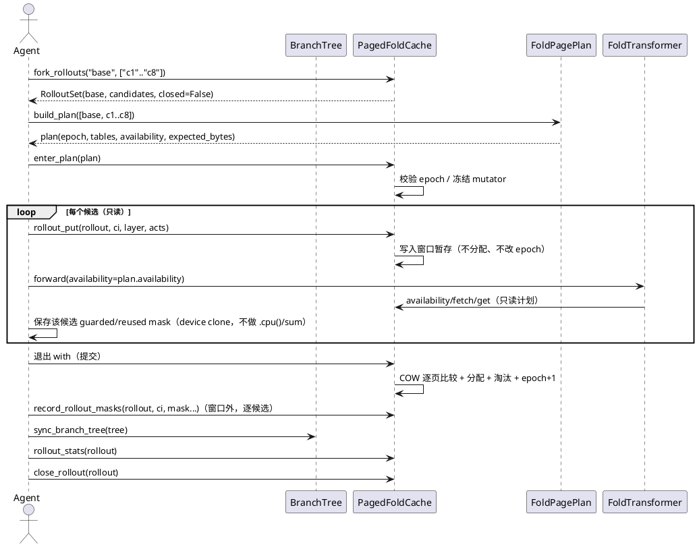
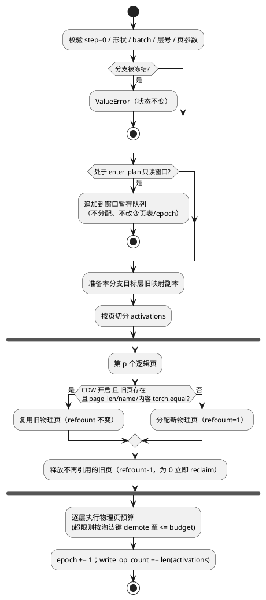
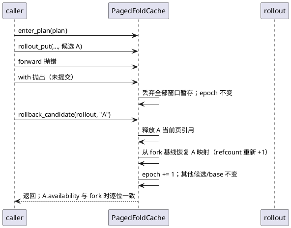
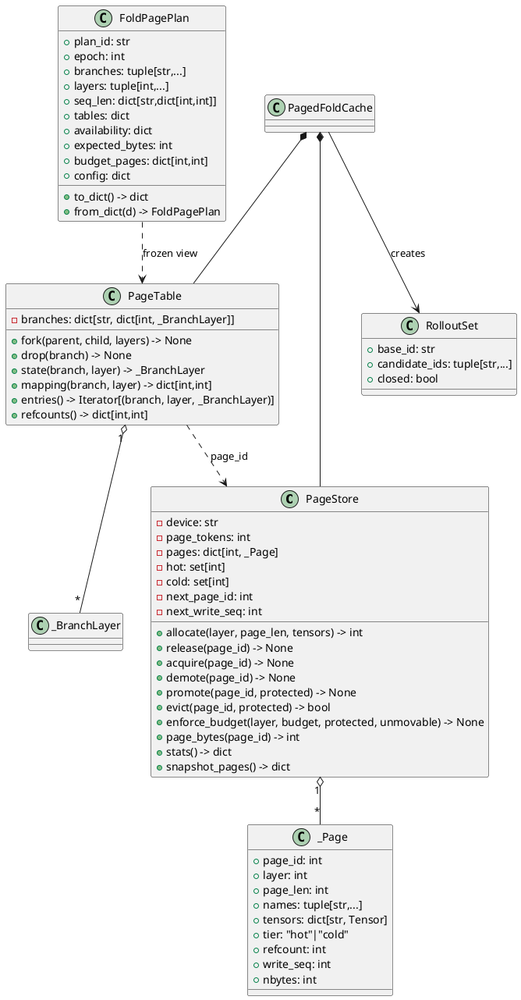
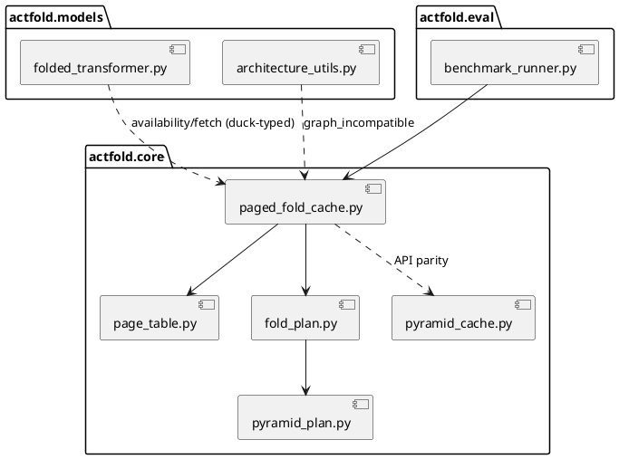

# 1 AR概述

| 字段 | 内容 |
|------|------|
| 组件名称 | ActFold 折叠激活缓存栈（`actfold.core`） |
| AR 系统流水号 | AR030 |
| AR 描述 | 端侧 Agent/RSI 页共享折叠内存（PSFM）：在 AR029 逐层预算与缺失哨兵之上，引入页表寻址、逐页内容去重 COW、共享引用计数、共享预算淘汰、冷热精确分层、host 计划/device 执行窗口；为同一 base context 上的 N 路候选 rollout 提供 O(1) fork、原子回滚与可恢复快照。 |

**设计输入（srs draft-12，req 门控第 6 轮 PASS）**

- FR1 页表/写时复制分支层；FR2 物理页预算与淘汰；FR3 host 计划 / device 执行窗口；FR4 冷热精确分层与会话恢复；FR5 rollout 生命周期与可靠回滚；FR6 机制基准与复现协议；FR7 工厂/配置/接线（默认关闭）。
- NFR：精确性逐位一致；hot 硬上界按物理页；cold 上界 `U×max_page_bytes`；fork 复制字节为 0；restore+promote 全部 cold 页<50 ms（quick；计时小缓存每层物理页≤预算）；AR 套件<30 s、quick 基准<60 s；默认零回归。
- 约束：不改折叠数学；cold 在执行期一律不可用；无 mock，基准为真实张量与真实 `ActivationCache` 参照；paged 与 CUDA graph 互斥；AR028 并行改同文件，本 AR 不修改 `folded_transformer.py`。

**既有组件契约（只读复用）**

- `PyramidPlan`（`pyramid_plan.py`）：`block_size`/逐层 `budget_tokens`/`retained_blocks` 锚点；AR030 以 `page_tokens == block_size` 映射，直接复用预算与锚点语义。
- `ActivationCache`/`PyramidActivationCache`：读 API 形状（`fetch/get_all/get/fetch_masked/availability/contains/num_entries/stats`）与 `MissingSentinelCapable` 哨兵语义。
- `folded_transformer._apply_cache_availability`：只读 `availability` 与 `stable_mask` 做 AND，本 AR 不改。
- `BranchTree`：`branch_id`、`root_id`、`get`、`children`；本 AR 仅做一致性校验，不写树。

## 1.1 设计目标与边界

1. **共享即省内存**：前缀页只有一份物理实体；仅在候选写入差异时分配新页（COW）。
2. **预算按物理页**：共享页只计 1 份，避免 AR029 “每分支各自预算” 的线性放大。
3. **执行与规划分离**：只读窗口内不读回显存（无 `.item()/.tolist()/.cpu()`），提交期才做 COW 比较与一次性原子提交。
4. **失败可回滚**：任何失败路径 epoch 不变、refcount 不泄漏、可用性不变。
5. **不做大实验**：基准为 CPU quick 机制验证；真实 checkpoint 正式面 `BLOCKED-DEFERRED`（SRS Out of Scope），不伪造数字。

# 2 动态行为

## 2.1 端侧 Agent rollout 全链路



## 2.2 写路径（put / rollout_put 提交）



## 2.3 失败回滚时序



# 3 功能点分解

| 序号 | 功能点 | 对应 FR | 设计落点 |
|------|--------|---------|----------|
| 1 | 页表/物理页/逐页 COW/fork/drop/reclaim | FR1 | `page_table.py`、`paged_fold_cache.py` |
| 2 | 物理页预算、锚点/recent 保护、确定性淘汰 | FR2 | `PageStore.enforce_budget`、`FoldPagePlan` |
| 3 | host `FoldPagePlan` + `enter_plan` 只读窗口/暂存提交/stale | FR3 | `fold_plan.py`、`paged_fold_cache.py` |
| 4 | 冷热分层、snapshot/restore、11 键 stats | FR4 | `PageStore`、`PagedFoldCache` |
| 5 | rollout 生命周期、回滚、统计、BranchTree 校验 | FR5 | `paged_fold_cache.py`、`RolloutSet` |
| 6 | E1–E4 quick 基准、COW-off/stale/failure mutation | FR6 | `scripts/ar030_paged_agent_bench.py` |
| 7 | 工厂/配置/导出/runner/图形互斥 | FR7 | `cache_factory.py`、`config_manager.py`、`benchmark_runner.py`、`actfold/core/__init__.py` |

# 4 实现设计

## 4.1 功能实现思路

### 4.1.1 方案比较

**方案 A：增强 AR029 的逐分支块列表（不做物理共享）**

- 思路：每分支各自持有 `blocks`，仅靠 AR029 的预算和锚点控制内存。
- 优点：实现最小，与 AR029 完全同构。
- 缺点：N 路候选的前缀被复制 N 份；fork 元数据 O(页数)，内存随候选数线性增长；无法满足 FR1/FR2 的物理页共享与 E2。
- 结论：不满足 Must 级 NFR（共享预算、fork 零复制），**不采用**。

**方案 B：页表 + 逐页内容去重 COW + 共享引用计数（推荐）**

- 思路：物理页由 `PageStore` 统一持有；`PageTable[branch][layer][logical] = page_id`；写时只比较并替换差异页，其余页引用计数 +0（同分支复用）或 +1（fork）。
- 优点：前缀只存一份；fork 仅复制表元数据；预算按唯一物理页计；snapshot 可精确恢复 tier 与映射；COW 比较在提交期完成，适合 host plan/device run。
- 缺点：页表与 refcount 不变量多；需要显式 reclaim 与失败原子性；逐页 `torch.equal` 在提交期有比较成本。
- 对 NFR：精确性由“复用/新页内容均来自写入张量”保证；hot 上界可直接按物理页断言；cold 上界按 live 页定义。

**方案 C：全局内容哈希去重（不依赖页表父子关系）**

- 思路：每次写入对页内容做 sha256，全局字典按内容哈希复用。
- 优点：跨分支、跨层任意去重，命中率可能更高。
- 缺点：每次写都需哈希+同步读回，违背“只读窗口零回读”；哈希碰撞/误差需额外校验；无法表达逻辑页覆盖与 COW 语义。
- 结论：与 FR3 零回读和确定性要求冲突，**不采用**（仅快照校验用 sha256）。

### 4.1.2 关键设计决策

| 决策 | 结论 | 理由 |
|------|------|------|
| 页大小 | `page_tokens = plan.block_size`，全层固定 | 复用 AR029 预算/锚点；`availability` 按页对齐 |
| 预算口径 | `budget_pages(layer)=max(1, budget_tokens//page_tokens)`；热页 = 该层唯一 hot 物理页 | 共享页只算 1；与 E2 物理页口径一致 |
| 淘汰键 | `(protected_any, refcount, write_seq, page_id)` 升序（protected 为软优先级，仅排序加权） | 先淘汰非保护页、单引用页、旧写入；hard bound 无豁免，全部为保护页时仍按后三项继续淘汰 |
| COW 比较 | 提交期逐页 `torch.equal`（同 name/同 page_len）；`refcount==1` 命中则**原地写**（不改 id/write_seq），否则分配新页 | 独占页零分配；共享页严格写时复制；只读期零回读 |
| cold 语义 | 执行期 `availability=False`，无隐式 promote | 与 AR029 哨兵/重算路径一致，避免执行期状态漂移 |
| promote | 显式 host 操作；目标页硬钉住预算并在成功后计数（失败恢复 tier/不计数） | 保证 promote 后立即可 fetch，且 `promotions` 只记成功 |
| 结束迭代 | `mid = seq_len - recent_pages*page_tokens` 的页 + 锚点页受保护 | recent 窗口与 AR029 一致；保护是“任一引用分支”的并集 |
| 窗口写 | `put/put_batch/rollout_put` 暂存，退出合并提交 +1 | 无 N 次 epoch 抖动；失败 0 |
| 快照 step | 仅 `step_idx=0`，snapshot 无 step 维 | 折叠固定 step 0；所有带 `step_idx` 的入口统一 `ValueError` |
| 索引 | `logical_page` 从 0 递增；仅末页可短 | `availability` 按页长精确到 token |
| 事件计数 | `evictions` 仅预算触发；`demotions`/`promotions` 全量 | 与 SRS 定义一致，避免口径混淆 |

## 4.2 功能实现设计

### 4.2.1 数据结构



**字段与不变量**

- `_Page.tensors[name]` 形状 `[batch, page_len, *feat]`，同层所有页的 `batch/feat/dtype` 一致；hot 页在 `device`，cold 页在 CPU（`torch.device("cpu")`）。
- `PageTable[branch][layer]` 存 `seq_len`、`page_ids: dict[logical,int]`、`page_lens: dict[logical,int]`、`names: tuple[str,...]`（首次写入登记）。
- **refcount 精确**：`page.refcount == #{(b,l,p) | PageTable[b][l].page_ids[p] == page.id}`，恒非负。
- **覆盖连续**：`logical_page` 从 0 连续；`page_lens[p] == page_tokens` 除最后一个逻辑页外；`seq_len == sum(page_lens)`；`1 <= last_len <= page_tokens`。
- **tier 互斥**：`hot ∪ cold == pages.keys()`，`hot ∩ cold == ∅`。
- **零引用即回收**：`release` 后 `refcount==0` 的页在同一事务内立即从 `pages/hot/cold` 移除（仅 `_PutTransaction.reclaimed` 保留完整张量备份用于失败复活）；`enforce_budget`、`hot_pages/hot_bytes/physical_pages/refcount_leaks` 一律只统计仍 live 的页，死页不参与淘汰/计数/trace。
- **max_page_bytes（NFR 定义）**：`max_page_bytes = max_{layer,name}(page_tokens × batch × prod(feat) × element_size)`，取自已登记元数据；`U = live 唯一物理页数`，故 `cold_bytes <= U × max_page_bytes` 为形式上界。

`_BranchLayer` 记录 `seq_len`、`page_ids`、`page_lens`、`names` 与 `batch/feat/dtype` 元数据；fork 时深拷贝这些 host 元数据即可（O(页数)，不含张量）。

### 4.2.2 核心流程说明

**（1）`put(branch, layer, activations, step_idx=0)`**

1. **前置校验**（全部在任何变更之前）：`step_idx==0`；`isinstance(activations, dict)` 且非空；各张量 3 维以上、同 `batch/dtype/device`，且**所有 name 的 `shape[1]` 一致**；`batch==表中登记 batch`；`layer` 在 `[0, depth)`；页参数与 plan 一致。**分支不存在时自动登记空分支**（与 AR029 首次写入语义一致）；仅 `fork_branch` 要求父分支已存在。
2. **冻结检查**：若 `branch` 是活跃 rollout 的 base → `ValueError`。
3. **窗口检查**：若 `_active_plan is not None`：`put/put_batch/rollout_put` 一律把写入追加到 `_staged`（`put_batch` 逐条展开，`rollout_put` 额外记录候选归属），不改变任何状态；其余 mutator 抛 `RuntimeError`（见 4.2.2(7)）。
4. **目标映射**：取旧 `_BranchLayer`（可能不存在，视为空）；`T=activations[任一 name].shape[1]`；若旧 `names` 存在则要求集合一致，否则登记排序后的 name 元组；`names` 顺序固定（sorted）。
5. **按页切分**：对 `p in range(ceil(T/page_tokens))`，`start=p*page_tokens`，`len_p=min(page_tokens, T-start)`，切片 clone。
6. **COW 判定**（仅当 `enable_cow=True` 且旧 `page_ids[p]` 存在）：
   - 旧页 `page_len == len_p`、`names` 相同、逐 name `torch.equal(old.tensors[n], new[n])` 全真 → 复用旧 `page_id`（refcount 不变）。
   - 内容不同且旧页 `refcount == 1` → **原地写**：先把旧数据 clone 备份（回滚用），再逐 name 写入旧页张量；页 id/refcount/`write_seq` 不变；仅当 `enable_cow=True`。
   - 内容不同且旧页 `refcount >= 2` → 分配新页（写时复制），旧页 `refcount -= 1`；新页 `refcount=1`、`write_seq=next++`。
   - 若旧页为 cold，比较前把新切片搬到 CPU；命中原地写则写回 CPU 页（保持 cold），否则新页按请求写入 device（提交期预算可能立即 demote）。
   - `enable_cow=False`（mutation 面）时跳过比较与原地写，逐页强制分配新页。
7. **引用替换**：旧映射中不在新范围/未被复用的 `page_id` 逐一 `release`（0 即 reclaim）；新映射写回。原地写不触碰 refcount。
8. **预算**：对 `layer` 调 `PageStore.enforce_budget(layer, budget_pages, protected, unmovable=frozenset())`；有活跃 rollout 时 `unmovable=base∪候选页`（见 (1b)）；`protected` 由 plan 锚点页 ∪ 每个引用该页的分支 recent 窗口页计算。
9. **提交**：`epoch += 1`；`write_op_count += len(activations)`；`demotions/evictions` 计数已在 store 内累加；失败异常向上抛且不改变 epoch（校验先行；原地写有备份可恢复；预算淘汰确定且 budget>=1）。

**（1b）写事务日志（失败原子性与回滚保真）**

- 每个 `put`/`put_batch`/窗口提交/`rollout_put` 都在 `_PutTransaction` 中执行；日志记录：
  - `allocated`（新页 id，失败时删除）；
  - `refcount_delta`（每页增减，失败时逆序恢复）；
  - `tier_before`（demote/promote 前 tier，失败时恢复 hot/cold 与设备位置）；
  - `content_backup`（独占页原地写前的旧张量，失败时写回）；
  - `branch_before`（目标分支层的浅拷贝映射/长度/names）；
  - `reclaimed`（refcount 归零的页 id + 完整张量/tier/meta/nbytes）与 `ids_before`（`next_page_id/next_write_seq`）。
- **两阶段回收**：事务内 `refcount==0` 的页先移出页表并进入 `reclaimed`（不立即物删）；事务成功后才真正释放物理页，失败则原样复活。`next_page_id/next_write_seq` 在失败时回退到事务前值；`eviction_trace` 记录失败事务的条目并标记 `failed=True`（不参与状态等值）。
- 成功：日志丢弃；失败：`journal.rollback()` **不递增 epoch、不递减统计计数**（计数记录已发生事件），页表/refcount/tier/内容/已回收页/next ids 逐项复原，随后抛出原异常。
- 窗口提交失败用同一日志回滚整个窗口（一次恢复），`epoch` 保持窗口前值。
- **fork 基线**：`fork_rollouts` 为每个候选记录分支表基线（映射/长度/names）。**rollout 隔离预算约束**：活跃 rollout 期内对**任意分支**的写（候选或第三方），预算淘汰都把 base 与全部活跃候选引用的页加入 `unmovable`（硬不可淘汰）；若该层 hot 页中可淘汰页不足以回到预算，则本次写失败（`RolloutBudgetError(ValueError)`），事务日志回滚，其他分支/base 的 tier/availability/内容逐位不变。候选写因此永远不会 demote 共享页；`rollback_candidate` 只需恢复表/refcount 并移除候选独占页（共享页 tier 由硬保护保证不变）。显式 `rollback_candidate` 计 `epoch += 1`；`rollout_put` 的**单次操作失败**只回滚该次操作（日志），`epoch` 0，不丢弃此前已成功的候选写；窗口提交失败回滚整个窗口（epoch 0）。

**（2）`fork_branch(parent, child, layers=None)`**

- 校验 parent 存在、child 不存在且非空、`layers` 子集且存在；基准（base）冻结时禁止从 base fork。
- `child[l] = deepcopy(parent[l])`（只复制 int 字典/元组）；对每个被映射页 `acquire`（refcount+1）。
- `epoch += 1`；无张量复制（E3）。

**（3）`enforce_budget(layer, budget, protected, unmovable)`**

- 统计该层 `hot` 中的唯一页；当数量 `> budget`：
  - 可淘汰集 = 该层 hot 页 − `unmovable`；若为空/不足以降到 budget → 抛 `RolloutBudgetError`（无活跃 rollout 时 `unmovable=∅`，不会发生），事务回滚，**从不突破 hard bound**；
  - 可淘汰页按 `(protected_any, refcount, write_seq, page_id)` 升序排序（`protected_any ∈ {0,1}` 软优先）；
  - 取第一页 `demote(page)`：tensors→CPU，`hot→cold`，`demotions += 1`，`evictions += 1`，页 id/refcount/write_seq 不变；`availability` 自然变 False；
  - 循环直至 `<= budget`。
- 普通写（无活跃 rollout）`unmovable=∅`：即使全部 hot 页均为 protected，也按 refcount/write_seq/page_id 继续淘汰，hard bound 无例外。
- 活跃 rollout 期对任意分支写：`unmovable` = base ∪ 全部活跃候选引用的页；不可淘汰页不足时写失败（`RolloutBudgetError`），其他分支/base 的 availability 逐位不变。
- `promote(page)`：先把数据搬到 device，**临时计入 hot**（`hot` 集合加入目标页，使其参与 hot 计数），记录原 tier/CPU 副本；再以 `unmovable ∪ {page.id}` 调 `enforce_budget`（目标页**硬钉住**，不会被打回 cold），因此预算检查看到的是 promote 后的真实 hot 数。预算满足后提交 hot 并 `promotions += 1`；若不可淘汰页不足（活跃 rollout 期可能）→ 恢复原 cold/tier/data、**不增加** `promotions`、抛 `RolloutBudgetError`。非 rollout 期目标页只有 1 页且 `budget>=1`，其他页均可软淘汰，故 promote 必成功且 `hot_pages<=budget`。promote 引发的预算 demote 计入 `evictions`。

**（4）`evict(page_id)`**

- 页不存在/非 hot/在任一引用分支的锚点或 recent 窗口，或（活跃 rollout 期）被 base/任一候选引用 → 返回 `False`，状态不变。
- 否则 `demote(page_id)`：**只** `demotions += 1`（显式淘汰不计 `evictions`），`epoch += 1`，返回 `True`。
- `demote(page_id)` 公共入口：cold/不存在 → `ValueError`；操作先完整构造 CPU 副本再原子切换 tier，搬移/构造失败时恢复原张量位置（不部分写入）；活跃 rollout 期页被 base/任一候选引用 → `ValueError`（unmovable，状态不变）；成功只 `demotions += 1`，不增 `evictions`。预算触发的 demote 在 `enforce_budget` 内额外 `evictions += 1`（见 (3)）。
- `promote(page_id)` 在活跃 rollout 期以 `unmovable=base∪候选页` 执行预算（目标页本身也硬钉住）；若不可淘汰页不足以容纳本次 promote → 恢复原 tier/data、不计数、抛 `RolloutBudgetError`。非 rollout 期目标页硬钉住后必成功；仅成功后才 `promotions += 1`。

**（5）`eviction_trace()`**

- 返回 `list[dict]`：每项 `{seq, layer, page_id, logical, branch, shared, refcount, write_seq, reason, failed}`；共享页的 `branch/logical` 取最小 `(branch, logical)` 代表并置 `shared=True`；`reason ∈ {"budget","explicit"}`；`failed=True` 仅标记失败事务的已发生淘汰，确定性回放/状态等值排除 failed 条目；顺序为实际发生顺序；只读、epoch 0。

**（6）`build_plan(branch_ids, layers=None, seq_len=None)`**

- 校验分支存在、`layers` 合法；`seq_len` 为 `None` 时取各分支**各层**现有 `seq_len`（缺表视为 0）；显式 `seq_len` 映射为 `{branch: {layer: int}}`，仅允许 ≤ 现有长度（不能凭空规划不存在的页）。
- 冻结：`tables`/`seq_len`/`budget_pages`/`config` 在构造时深拷贝并包装为 `MappingProxyType`（嵌套层同样只读），`availability` 用元组；外部修改原对象不影响 plan；窗口读路径只读 plan 快照。
- `availability[branch][layer] = (words, seq_len)`，`words` 为 token 位图（32-bit word 元组），仅对 hot 且被映射的页置 1；cold/缺页为 0。
- `expected_bytes = Σ_layer Σ_name (page_tokens × batch × prod(feat) × element_size(name)) × budget_pages(layer)`；name 取该层**已登记**的并集（首次 put 的 sorted names），未写入的层/name 计 0，末页仍按整页计（上界）。
- `plan_id = sha256(canonical_json(payload))[:16]`；`fold_plan` 的 `from_dict` 复用同一冻结器（深拷贝 + `MappingProxyType`/元组）；`build_plan` 不改变 epoch（0），并记录 `plan_build_count`。

**（7）`enter_plan(plan, allow_plan_fallback=False)`**

- 上下文管理器；进入时：
  - 若已有活跃窗口 → `RuntimeError`；
  - 若 `cache.epoch != plan.epoch`：`allow_plan_fallback=False` → `PlanStaleError`；否则重建 plan（当前缓存的分支/层/长度；`plan.branches/layers` 以重建结果为准，可覆盖请求集合的子集/超集），`plan_fallback_count += 1`，记录 `last_plan_fallback_reason="epoch_mismatch"`，使用新 plan；
  - `_active_plan=plan`，`_staged=[]`，`_plan_sync_count=0`。
- **只读期**：`fetch/get_all/get/fetch_masked/availability/contains/num_entries` 使用 plan 映射与位图；`put/put_batch/rollout_put` 仅暂存（暂存前仍做全量只读校验，任一非法 → `ValueError` 且不落任何状态；`rollout_put` 还必须属于活跃句柄的候选，写 base → `ValueError`）；`fork_*/drop_*/clear_*/evict/demote/promote/restore/rollback_*/close_*/snapshot` → `RuntimeError`；嵌套窗口 → `RuntimeError`；`stats/page_stats/eviction_trace/sync_branch_tree/build_plan/rollout_stats/assert_invariants` 允许（只读）；`record_rollout_masks` 在窗口内 → `RuntimeError`（它需要 host 侧 sum；调用方在窗口外记账）。
- **提交期（退出 with）**：若正常退出且有暂存，按加入顺序执行 `_put_locked`（真正分配/COW/淘汰）。窗口提交是**全或无**：只有全部暂存写成功才 `epoch += 1` 一次；任一写失败（含预算不足 → `RolloutBudgetError`）→ 用事务日志回滚**整个窗口的全部候选暂存写**，`epoch` 保持窗口前值，其他窗口外已成功的写不受影响；不做候选级部分提交。若执行中异常或提交异常：丢弃暂存、回滚已写入的暂存、保持 `epoch` 不变、抛出原异常；`_active_plan` 清空。
- **检查顺序冻结**：先判只读窗口状态（命中 → `RuntimeError`），再判 rollout 冻结/候选归属（命中 → `ValueError`），最后做参数校验；因此窗口内 `clear_all`/`restore` 即使与 rollout 冲突也抛 `RuntimeError`。
- 只读路径内部禁止 `.item()/.tolist()/.cpu()` 与任何 `__int__/__float__` 隐式同步：可用性位图与页长均为 host int，窗口内 `fetch_masked` 不做缺失计数。验收不用自证常量：UT 用包装 `Tensor.item/tolist/cpu/__int__/__float__` 的探针（AR029 `_Trace` 先例）包住被测读调用并断言 0 次；内部 `_plan_sync_count` 仅作辅助定位，不作为验收证据。
- `PlanStaleError(ValueError)` 携带 `plan_epoch`/`cache_epoch`，供上层重建。

**epoch 表（与 SRS FR3 逐行一致，所有失败路径恢复操作前 epoch）**

| 操作 | epoch 变化 |
|------|------------|
| `put` / `rollout_put` | +1 |
| `put_batch` | +1（不是 +N） |
| `evict` / `demote` / `promote` | +1 |
| `fork_branch` / `drop_branch` / `clear_branch` / `clear_all` | +1 |
| `fork_rollouts` | +N（N=候选数，每个 fork 一次） |
| `rollback_candidate` / `close_candidate` | +1（每次调用） |
| `close_rollout` | +1（原子关闭全部候选） |
| `enter_plan` 退出提交（有暂存写时） | +1（合并一次；失败 0） |
| `restore`（无分支/无活跃 plan/rollout） | `max(当前 epoch, 快照 epoch) + 1` |
| `snapshot` / `build_plan` / `sync_branch_tree` / `stats` / `page_stats` / `eviction_trace` | 0 |
| 失败操作 + 自动回滚 | 0（恢复操作前 epoch） |

- `put` 内部的预算淘汰/demote 属于该 `put` 的一部分，不额外 +1；`put_batch` 同理只 +1。
- 窗口内暂存写不单独计 epoch；退出提交合并 +1（无论条数），提交失败为 0。
- `put_batch` **原子性**：先对全部 entries 完成与 `put` 相同的前置校验（step/形状/batch/层/name/页参数），任一条失败 → `ValueError` 且缓存完全不变；全部通过后按顺序执行，若执行期异常则用事务日志恢复并保持 epoch 不变；窗口内同样**先全量只读校验**再逐条暂存（校验不落状态）。

**（8）读路径**

- `fetch(branch, layer, step_idx=0)`：无该分支/层或空映射 → `KeyError`（与 AR029 `_entry` 完全一致）；存在 → 用 `_BranchLayer` 的 `batch/feat/dtype` 构造 `torch.full(..., nan)`，逐页把 hot 页数据拷入对应 token 区间；cold/未映射区间保持 NaN。成功计 `requests += 1`，`missing_tokens += (seq_len - present_tokens) * batch`（与 AR029 口径一致）。
- `get_all = fetch`；`get(branch, layer, token_mask, step)` = `fetch_masked`；`fetch_masked` 以 `seq_len = int(mask.shape[1])` 构造同长 NaN 全量（`_assemble(entry, seq_len)` 语义：短掩码截断、长掩码尾部 NaN），再 `masked_fill(~mask, 0)`；`mask` 必须 `[batch, seq_len]`，允许与 `entry.seq_len` 不同。**窗口内** `fetch_masked` 只 `requests += 1`，不计算 `missing_tokens`（避免 device→host 同步）；窗口外按 AR029 口径 `(mask & ~availability).sum()` 统计。
- `availability(branch, layer, seq_len, step_idx=0, name="ffn_out")`：无 entry → 1-D `zeros(seq_len, bool)`（AR029 缺失语义）；有 entry 且 `batch>1` → `mask.unsqueeze(0).expand(batch, -1)`，`batch==1` → 1-D；按 hot 且被映射的页把 `[start, start+len)` 置 True；`name` 仅为兼容签名，不要求存在；执行期 cold 一律 False。
- `contains(branch, layer, step)`：分支层存在且至少有一个逻辑页（cold-only 仍为 `True`，与 AR029 `contains` 的“条目存在”一致）；`num_entries(layer)`：该层所有分支 `seq_len` 之和（`layer=None` 时全层；AR029 为 token 数口径）。
- 计划窗口内读路径使用 `plan.tables/plan.availability` 而非实时页表（两者在窗口内一致；提交后 plan 过期）。

**（9）snapshot / restore**

- `snapshot()`：返回纯 host 结构（schema 严格按 SRS FR4）：
  - `version, epoch, next_page_id, next_write_seq, checksum_alg="sha256"`；
  - `plan{depth,page_tokens,total_tokens,max_ratio,min_ratio,schedule,recent_pages,anchor_pages,anchor_stride,layer_budgets}`（`layer_budgets` 为 draft-8 补充的权威预算键；比率字段在显式自定义 plan 下仅信息性）；
  - `pages[id]`: `{tier, refcount, write_seq, page_len, names{name:{shape,dtype,bytes,sha256}}, data{name: CPU tensor}}`（**不含 layer**，层号由 tables 反推，保持 SRS 字段冻结）；
  - `entries`: `{branch:{layer:{seq_len, logical_page:page_len}}}`；`tables`: `{branch:{layer:{logical_page:page_id}}}`。
  - `sha256`：每页的 name 排序后，将各 name 的连续字节依次拼接后哈希（不混入 name 字符）。
- `restore(snapshot)`：要求目标实例**无任何分支、无活跃 plan 窗口、无活跃 rollout**（允许 epoch>0 的空实例）；否则 `ValueError`。
  1. schema/version/必需键校验；
  2. 在临时 `PageStore/PageTable` 中重建，逐页校验 `shape/dtype/bytes/sha256`、id 唯一、`page_len` 范围、`names` 集合；页的 `layer` 由引用它的 tables 唯一确定（同一页被不同层引用 → `ValueError`；零引用页在合法快照中不存在）；`_BranchLayer` 的 `batch/feat/dtype` 从该层首个引用页张量推导，并校验同层所有页一致；
  3. 由 `tables` 重算 refcount 必须等于 `pages.refcount`；`entries` 的逻辑页必须与 `tables` 键一致、`page_len` 等于页长、`seq_len == sum`；校验 `page_id < next_page_id`、`write_seq < next_write_seq`；
  4. `plan.layer_budgets` 必须与当前缓存逐层 `budget_pages` 完全一致（同时校验 depth/page_tokens；比率字段不参与判定）；不一致 → `ValueError`；
  5. 全部通过后原子替换 `_store/_tables`，`epoch = max(当前 epoch, snapshot.epoch) + 1`（保证严格递增，旧 plan 永不重新有效），`next_*` 使用快照值（保证再次快照可复现）；`evictions/demotions/promotions/requests/missing_tokens` 属于缓存实例，restore **保留目标实例计数**（不清零、不回退），以维持单调计数语义。
  - 任一失败 → `ValueError`，**目标缓存实例状态不变**。
- `snapshot` 不改变 epoch/tier/统计；快照与 restore 后的 `availability`（含末页长度与 cold 位）逐位一致。

**（10）rollout**

- `fork_rollouts(base, candidates)`：校验 base 存在、未被冻结、不在其他 rollout 中；candidates 非空、无重复、不等于 base、均不存在；对每个候选 `fork_branch(base, c)`（epoch 各 +1 → 共 +N）；记录 `_rollout_baselines[id(handle)][c] = deepcopy(base state)`（映射/长度/seq_len/names）；`_frozen_bases.add(base)`；返回 `RolloutSet(base, tuple, False)`；以 `id(handle)` 注册句柄（`RolloutSet` 字段严格为 SRS 的三个）。
- 冻结 base 的**所有**变更入口（`put/rollout_put/put_batch/clear_branch/drop_branch/fork_branch` 中的 base 写）→ `ValueError`；活跃 rollout 期间 `clear_all`/`restore`（全局替换）同样 `ValueError`；`close_rollout` 只解除冻结、不删除 base。句柄注册表持有 `RolloutSet` 强引用并以 `id(handle)` 为键，调用时校验对象身份，避免 id 复用别名。
- `rollout_put(handle, candidate, layer, acts, step=0)`：句柄关闭/候选不在集合 → `ValueError`；写 base → `ValueError`；`step!=0` → `ValueError`；窗口内 → 暂存并关联 `(candidate)`；窗口外 → `_put_locked`；**单次操作失败**由事务日志只回滚该次操作（此前成功的候选写保留，`epoch` 0），`failures += 1` 后重抛；窗口内**只读校验**失败只丢弃该候选暂存并 `failures += 1`；窗口**提交期**失败则按上条整窗回滚（所有候选回到窗口前状态，`epoch` 0），这是全或无语义，候选级隔离只在窗口外保证。
- `rollback_candidate(handle, c)`：候选必须活跃；从 fork 基线恢复候选表与 refcount、释放候选独占页（共享页 tier 由 rollout 硬保护保证不变）；`epoch += 1`；原子（失败不改状态）。
- `close_candidate(handle, c)`：等价“回滚并释放该候选引用”——恢复基线后 `drop_branch(c)`（内部 release，0 立即 reclaim），从活跃集合移除；`epoch += 1`；其他候选/base 不受影响。
- `close_rollout(handle)`：对全部活跃候选执行无 epoch 的批量 drop，释放 base 冻结标记；`epoch += 1`（原子一次）；`closed=True`；从注册表移除句柄与基线；此后任何写/关闭 → `ValueError`。`RolloutSet` 对外只读（`closed` 由内部 `object.__setattr__` 更新；构造后外部改写不影响注册表判定）。
- **统计生产者** `record_rollout_masks(handle, candidate_id, valid_mask, reused_mask)`：只读记账入口，**只能在窗口退出（提交）后调用**；调用方在只读窗口内保存各候选的真实 guarded/reused mask 的 **device clone**（`reused_mask = valid_mask & availability` 的 device 位运算；不 `.cpu()`、不 `.sum()`，零回读），退出后逐候选补记并执行 host sum；`valid_mask` 取 `_apply_cache_availability` 的 guarded `stable_mask`（MFF 本身不改；基准记录每次调用来源）；`valid_mask/reused_mask` 为 `[batch,T]` 或 `[T]` 的 bool，要求 `reused_mask` 是 `valid_mask` 子集（否则 `ValueError`）；按候选累加 `valid_tokens += int(valid_mask.sum())`、`reused_tokens += int(reused_mask.sum())`；epoch 0、不改页/可用性；`fetch_masked` 不自动记账（避免重复计数）。
- `rollout_stats(handle)`：返回 `{candidate_id: {...}}`（“每候选映射”，与 SRS 字段一一对应），字段 `hot_bytes/cold_bytes/shared_bytes/reused_tokens/valid_tokens/reuse_ratio/recompute_ratio/failures`；`hot/cold/shared_bytes` 由候选当前表引用页实时计算（`shared_bytes` = `refcount>=2` 页字节）；`reuse_ratio = reused_tokens / max(valid_tokens,1)`，`recompute_ratio = 1 - reuse_ratio`；`failures` 为 `rollout_put` 失败次数；统计只读。
- `record_rollout_masks` 对已关闭句柄/非本句柄候选 → `ValueError`；`RolloutSet.base_id/candidate_ids` 在注册后以 canonical 副本作为判定依据，外部改写句柄字段不影响所有权判断；`closed` 由内部维护。
- `sync_branch_tree(tree)`：从 `root_id` 经 `get`/`children` 遍历（防环）；要求树中每个 `branch_id`（`str()` 规范化）都能在缓存找到，且缓存每个分支都在树中；否则 `ValueError`；只校验，epoch 0。

**（11）工厂/配置/runner**

- 工厂优先级：`use_paged > use_pyramid > use_vectorized > use_chunked > dense`；`use_paged=True` 时：
  - `paged_depth=0` → 从 `num_layers` 或 `config.num_hidden_layers` 解析，无法解析 → `ValueError`（绝不默认 32）；
  - 用 `build_pyramid_plan(depth=resolved, total_tokens=paged_total_tokens, block_size=paged_page_tokens, max_ratio=..., min_ratio=..., schedule=..., recent_blocks=paged_recent_pages, anchor_blocks=paged_anchor_pages, anchor_stride=...)` 得到 frozen plan，再建 `PagedFoldCache(plan, page_tokens=paged_page_tokens, device=..., plan_config={...原始 kwargs...})`；
  - 构造时校验 `page_tokens == plan.block_size`；直接以 `PyramidPlan` 构造而未给 `plan_config` 时，从 plan 派生 `{depth,page_tokens,total_tokens=plan.requested_total,layer_budgets=plan.layer_budgets,recent_pages,anchor_pages,anchor_stride}`，比率记 1.0、schedule="explicit"（信息性；restore 以 `layer_budgets` 为准）；
  - `ActivationCacheType` Union 增加 `PagedFoldCache`（及 `FoldPagePlan` 导入），工厂 docstring 更新优先级；
  - `use_cuda_graph=True` → 构造前 `ValueError`（工厂/runner 双检；MFF setter 已有 `graph_incompatible` 通用校验，paged 置 True 即被拒绝）。
- `config_manager`：dataclass 增加 10 个字段与默认值；YAML 读取映射；维持既有 `load_config` 行为（未知键 `UserWarning` + 过滤，#5）；10 个新键已被消费，**不得**产生 unknown-key 警告；`use_paged=False` 时忽略其余字段（不构造缓存）。
- runner：`_build_activation_cache` 增加 paged 分支并复用同一优先级；`use_paged+graph` 在构造前拒绝；失败不写回初始配置。
- `actfold/core/__init__.py` 导出 `PagedFoldCache/FoldPagePlan/PageTable/RolloutSet/PlanStaleError/RolloutBudgetError`。
- 默认关闭：`use_paged=False` 路径与原实现字节级不变。

## 4.3 接口描述

### 4.3.1 新增公共接口（`actfold.core`）

```python
class PlanStaleError(ValueError): ...
class RolloutBudgetError(ValueError): ...

class PagedFoldCache(MissingSentinelCapable):
    graph_incompatible = True
    missing_value = float("nan")

    def __init__(self, plan: PyramidPlan, page_tokens: int,
                 device: str = "cuda", *, enable_cow: bool = True,
                 plan_config: Mapping[str, Any] | None = None) -> None: ...
    @property
    def epoch(self) -> int: ...
    @property
    def write_op_count(self) -> int: ...
    @property
    def page_tokens(self) -> int: ...
    @property
    def plan(self) -> PyramidPlan: ...

    # FR1/AR029 兼容
    def put(self, branch_id: str, layer_idx: int,
            activations: dict[str, torch.Tensor], step_idx: int = 0) -> None: ...
    def put_batch(self, entries: Sequence[CachePutEntry]) -> None: ...
    def fetch(self, branch_id: str, layer_idx: int, step_idx: int = 0) -> dict[str, torch.Tensor]: ...
    def get_all(self, branch_id: str, layer_idx: int, step_idx: int = 0) -> dict[str, torch.Tensor]: ...
    def get(self, branch_id: str, layer_idx: int, token_mask: torch.Tensor,
            step_idx: int = 0) -> dict[str, torch.Tensor]: ...
    def fetch_masked(self, branch_id: str, layer_idx: int, token_mask: torch.Tensor,
                     step_idx: int = 0) -> dict[str, torch.Tensor]: ...
    def availability(self, branch_id: str, layer_idx: int, seq_len: int,
                     step_idx: int = 0, name: str = "ffn_out") -> torch.Tensor: ...
    def contains(self, branch_id: str, layer_idx: int, step_idx: int = 0) -> bool: ...
    def num_entries(self, layer_idx: int | None = None) -> int: ...

    # 分支/页
    def fork_branch(self, parent_id: str, child_id: str,
                    layers: Sequence[int] | None = None) -> None: ...
    def drop_branch(self, branch_id: str) -> None: ...
    def clear_branch(self, branch_id: str) -> None: ...
    def clear_all(self) -> None: ...
    def demote(self, page_id: int) -> None: ...
    def promote(self, page_id: int) -> None: ...
    def evict(self, page_id: int) -> bool: ...

    # 计划
    def build_plan(self, branch_ids: Sequence[str], layers: Sequence[int] | None = None,
                   seq_len: Mapping[str, Mapping[int, int]] | None = None) -> FoldPagePlan: ...
    def enter_plan(self, plan: FoldPagePlan,
                   allow_plan_fallback: bool = False) -> AbstractContextManager[None]: ...

    # 会话
    def snapshot(self) -> dict[str, Any]: ...
    def restore(self, snapshot: Mapping[str, Any]) -> None: ...

    # rollout
    def fork_rollouts(self, base_id: str, candidate_ids: Sequence[str]) -> RolloutSet: ...
    def rollout_put(self, rollout: RolloutSet, candidate_id: str, layer_idx: int,
                    activations: dict[str, torch.Tensor], step_idx: int = 0) -> None: ...
    def rollback_candidate(self, rollout: RolloutSet, candidate_id: str) -> None: ...
    def close_candidate(self, rollout: RolloutSet, candidate_id: str) -> None: ...
    def close_rollout(self, rollout: RolloutSet) -> None: ...
    def rollout_stats(self, rollout: RolloutSet) -> dict[str, dict[str, float | int]]: ...
    def record_rollout_masks(self, rollout: RolloutSet, candidate_id: str,
                             valid_mask: torch.Tensor, reused_mask: torch.Tensor) -> None: ...
    def sync_branch_tree(self, tree: BranchTree) -> None: ...

    # 内省
    def stats(self) -> dict[str, int]: ...
    def page_stats(self) -> dict[str, int]: ...
    def eviction_trace(self) -> list[dict[str, Any]]: ...
    def assert_invariants(self) -> None: ...
    @property
    def plan_build_count(self) -> int: ...
    @property
    def plan_fallback_count(self) -> int: ...
    @property
    def last_plan_fallback_reason(self) -> str | None: ...
```

`_fail_after_staged` 语义：实例级一次性整数私有属性（仅供基准/测试），在下一次 `enter_plan` 正常退出提交时消费；设 `k>=0` 表示**已成功应用 k 条暂存写之后**抛出 `RuntimeError("injected commit failure")`，随后清零并回滚全部窗口（含已 reclaim 页/原地写/淘汰），状态与 epoch 回到窗口前；`k=0` 即第一条前失败。仅在该窗口**有暂存写**时消费（空窗口不消费）；无窗口时置位无效且不消费。E4 用 `k=1` 验证中途回滚，另有 `k=0` 用例。

### 4.3.2 数据类

```python
@dataclass(frozen=True)
class FoldPagePlan:
    plan_id: str
    epoch: int
    branches: tuple[str, ...]
    layers: tuple[int, ...]
    seq_len: Mapping[str, Mapping[int, int]]
    tables: Mapping[str, Mapping[int, Mapping[int, int]]]
    availability: Mapping[str, Mapping[int, tuple[tuple[int, ...], int]]]
    expected_bytes: int
    budget_pages: Mapping[int, int]
    config: Mapping[str, int | float | str]

    def to_dict(self) -> dict[str, Any]: ...
    @classmethod
    def from_dict(cls, payload: Mapping[str, Any]) -> "FoldPagePlan": ...

@dataclass
class RolloutSet:
    base_id: str
    candidate_ids: tuple[str, ...]
    closed: bool = False
```

### 4.3.3 与既有接口的兼容

- `CachePutEntry` 复用 AR029 定义（字段名与顺序不变）。
- `folded_transformer` 只依赖 `availability/fetch/get/...` 与 `missing_value`，无需修改；`_apply_cache_availability` 对 paged 的 NaN 行为与 AR029 相同。
- `graph_incompatible=True` 已由 `architecture_utils._validate_cache_graph_compat` 通用检查；MFF setter 行为不变（SRS FR7 的“拒绝”由既有通用机制满足）。本 AR 把该处错误文案由 “PyramidActivationCache …” 泛化为 “Activation cache … is not CUDA-graph compatible”（**保留 `CUDA-graph` 子串**，AR029 现有 `match="CUDA-graph"` 用例不变）；异常类型/触发条件不变。
- `PyramidActivationCache`、`ActivationCache` 不受影响；paged 与它们可同时导入。

### 4.3.4 统计口径（9 键 `page_stats` / 11 键 `stats`）

| 键 | 所属 | 定义 |
|----|------|------|
| `branches` | page_stats | 分支数（有任意层表） |
| `physical_pages` | page_stats | 唯一 live 物理页数（hot+cold） |
| `shared_pages` | 两者 | `refcount >= 2` 的页数 |
| `hot_pages` / `cold_pages` | 两者 | 各 tier 的 live 页数 |
| `hot_bytes` / `cold_bytes` | 两者 | 各 tier 页张量字节和（按 `tensor.numel()*element_size`） |
| `metadata_entries` | page_stats | `Σ_branch Σ_layer len(page_ids)` |
| `refcount_leaks` | 两者 | `#page: page.refcount != 实际引用数`（含负值/零值残留），恒应为 0 |
| `evictions` | stats | **仅预算触发**的 demote 次数（显式 `evict` 不计） |
| `demotions` | stats | 全部 demote（显式 + 预算）次数 |
| `promotions` | stats | 成功 promote 次数（已 hot 调用 → `ValueError`，不计数） |
| `requests` | stats | 成功 `fetch` 次数（`fetch_masked` 按其 AR029 口径也 +1） |
| `missing_tokens` | stats | `fetch`：`(seq_len - present_tokens) * batch`；`fetch_masked`：**窗口外** `(mask & ~availability).sum()`，**窗口内不累计**（只 `requests+1`，零同步豁免；不追溯） |

- `page_stats` 固定 9 键、`stats` 固定 11 键（`hot_pages/cold_pages/shared_pages/hot_bytes/cold_bytes/evictions/demotions/promotions/refcount_leaks/requests/missing_tokens`），键集合与 SRS 完全一致；`page_stats` 额外含 `branches/physical_pages/metadata_entries`。
- `eviction_trace` 的 `reason`：预算触发的 demote 为 `"budget"`，显式 `evict`/`demote` 为 `"explicit"`；仅预算项计 `evictions`。

### 4.3.5 异常契约

| 场景 | 异常/返回 | 状态保证 |
|------|-----------|----------|
| 任意入口 `step_idx != 0` | `ValueError` | 不变 |
| 重复分支/未知父/层越界/页大小非法 | `ValueError` | 不变 |
| 重复 demote / 已 hot 页 promote | `ValueError` | 不变 |
| `demote(page_id)` 页不存在 | `ValueError` | 不变 |
| `evict(page_id)` 页不存在或非 hot | 返回 `False` | 不变 |
| cold 页 `fetch`/执行 | NaN / `availability=False` | 不变 |
| plan epoch 过期（默认） | `PlanStaleError` | 不变 |
| 只读窗口内非暂存 mutator / 嵌套窗口 | `RuntimeError` | 不变 |
| 窗口提交失败 | 原异常（回滚） | epoch 不变 |
| 快照损坏/校验失败 | `ValueError` | 不变 |
| 活跃 rollout 写 base / 写非本句柄候选 / 关闭后写 | `ValueError` | 不变 |
| 候选写导致预算不足（共享页不可淘汰） | `RolloutBudgetError(ValueError)` + 自动回滚 | 其他分支/base 逐位不变 |
| `sync_branch_tree` 不一致 | `ValueError` | 不变 |
| 全部 hot 页均 protected 且超预算 | 正常淘汰（无异常） | hard bound 满足 |
| `put_batch` 任一条非法 | `ValueError` | 全量校验先行，完全不变 |

## 4.4 代码设计

### 4.4.1 目录与模块边界

```text
actfold/core/
├── page_table.py          # _Page / PageStore / PageTable / 不变量
├── fold_plan.py           # FoldPagePlan / PlanStaleError / 可用性位图
├── paged_fold_cache.py    # PagedFoldCache / RolloutSet / 计划窗口 / 读路径 / 快照
├── cache_factory.py       # use_paged 创建 + 优先级
├── __init__.py            # 导出
pyramid_plan.py            # 复用（不改）
pyramid_cache.py           # 参照/兼容（不改）
actfold/utils/config_manager.py
actfold/eval/benchmark_runner.py
actfold/models/architecture_utils.py   # 仅泛化 graph 拒绝文案（保留 "CUDA-graph"）
scripts/ar030_paged_agent_bench.py
tests/test_ar030_*.py
```



### 4.4.2 实现要点与顺序

1. `page_table.py` 先行：纯数据结构 + 不变量 + 单测，不依赖缓存。
2. `fold_plan.py`：纯 host 计算，复用 `PyramidPlan`；位图编码/解码与 `to_dict/from_dict`。
3. `paged_fold_cache.py`：写路径→读路径→分层/快照→计划窗口→rollout；每步附 UT。
4. 接线：工厂/配置/导出/runner；默认关闭回归。
5. 基准脚本最后：只调用公共 API；mutation 使用 `enable_cow=False`、`_fail_after_staged=k`（真实提交中途异常）、真实内部状态破坏（直接改 `refcount` 后由 `stats/assert_invariants` 检出）与真实 stale 构造（提交后重入旧 plan）；不替换/打桩被测实现。
6. 文档六件套与质量门；`folded_transformer.py` 不改，规避 AR028 冲突；AR028 合入后 rebase 跑冻结面（UT-2804/2805/2814/2816）。

### 4.4.3 并发/线程与设备

- 缓存非线程安全（与 AR029 一致），文档明确“单读写者”。
- `hot_bytes/cold_bytes/physical_pages` 为**提交后稳态**上界；事务进行中 `reclaimed` 备份可能短暂持有额外张量（失败回滚所需），不计入稳态 NFR；实现上备份优先放 CPU，降低峰值显存。
- cold 页在 CPU；`promote` 搬到 `device`；`demote` 搬回 CPU。`device` 为构造参数，测试用 `cpu`。
- 无 CUDA graph；无异步流/事件；`torch.equal` 只出现在提交期（host 计划提交），读路径不比较。

# 5 重构设计（可选）

- **不重构** AR029 `PyramidActivationCache` 与折叠数学；只在 `cache_factory`/`config_manager`/`benchmark_runner` 增加分支，并把 `architecture_utils` 的 graph 拒绝文案泛化（保留 `CUDA-graph` 子串，行为不变）。
- `folded_transformer.py` 零改动：paged 与 AR029 共享 `availability`/哨兵契约，避免与并行 AR028 冲突。
- 若后续需要统一“缓存后端协议”，另立 AR；本 AR 不做跨模块大重构。
- 组件详设：仓库无 `specs/component-detail-design/`，按 skill 规则跳过，无需更新组件级详设。

# 6 测试设计

## 6.1 单元测试（UT）

| 文件 | 覆盖 | UT 编号 |
|------|------|---------|
| `tests/test_ar030_page_table.py` | 页 id/页长/层校验、fork 元数据、refcount 增减与 fork 隔离、零引用 reclaim、`step_idx` 拒绝、不变量 | UT-3001~3012 |
| `tests/test_ar030_budget.py` | 物理页预算、共享页计 1、锚点/recent 软优先级、protected 全覆盖仍满足 hard bound、淘汰键确定性、显式 evict（不计 evictions）、逐页 COW（复用/独占原地写/共享新页）、demote/promote 字节与 id 不变、`eviction_trace` 回放 | UT-3013~3028 |
| `tests/test_ar030_plan.py` | `FoldPagePlan` frozen/id/序列化、每层 seq_len、可用性位图、`build_plan` 只读、stale/fallback、只读窗口 mutator、暂存提交 +1、失败 0、零同步计数 | UT-3029~3038 |
| `tests/test_ar030_tiering.py` | cold 不可用、promote 与预算交互、snapshot schema/sha256、restore 全等/损坏拒绝/非空拒绝/空实例 epoch>0/活跃 plan 或 rollout 拒绝/epoch 严格递增（旧 plan stale）、promote 失败不计数且 tier/data 逐位恢复、promote 后 `hot_pages<=budget`、epoch 规则、9/11 键统计口径、`cold_bytes ≤ U×max_page_bytes`、restore+promote 计时（warmup+5 次中位数 <50 ms） | UT-3039~3048 |
| `tests/test_ar030_rollout.py` | fork N、base 全入口冻结、候选隔离、rollback、close_candidate/close_rollout 原子性、`record_rollout_masks`+`rollout_stats` 边界（valid=0/子集校验）、BranchTree 校验 | UT-3049~3062 |
| `tests/test_ar030_integration.py` | 工厂优先级、深度解析（非法深度/页大小半初始化失败）、graph 互斥（工厂/runner/setter）、YAML 10 键无警告、导出、默认关闭回归 | UT-3063~3068 |
| `tests/test_ar030_bench_verdicts.py` | E1–E4 判定函数、优先级 blocked>supported>refuted、COW-off/stale/failure/refcount 破坏 mutation、quick JSON schema、指标有限非负、无 `--quick` → formal `exit 3` | UT-3069~3078 |

**每个 UT 必须断言“失败后状态不变”**（异常契约表逐项至少一例），并覆盖末页短页、batch>1、多 name、cold/hot 混合；另需覆盖 `put_batch` 全量校验失败零变更、执行期异常回滚（含已 reclaim 页与原地写备份）、`seq_len` 缩短/增长、`fetch_masked` 请求长度大于/小于 `entry.seq_len`、`_fail_after_staged=0/1`。6.4 新增场景按 FR 归入对应区间（窗口/plan→3029~3038，冷热/统计→3039~3048，rollout/显式操作→3049~3062，基准 mutation→3069~3078）。覆盖率以“FR/验收点/异常分支逐项映射”为准，不以百分比作为门禁。

## 6.2 接口测试

- 公共 API 签名/默认值：`fetch/get/get_all/fetch_masked/availability/contains/num_entries/put/put_batch` 与 AR029 对齐（同一输入形状/掩码语义）；`fetch` 缺失 `KeyError`、`availability` 缺失 1-D 零向量、`batch>1` 扩展 2-D。
- `FoldPagePlan.to_dict()→from_dict()` 往返：映射、位图、`expected_bytes`、`epoch`、`budget_pages`、每层 `seq_len` 全等；JSON 可序列化。
- `snapshot()→restore()` 往返：schema 键与 SRS 完全一致、tier/availability/末页全等；`page_stats` 派生键（`physical_pages/hot_pages/cold_pages/shared_pages/hot_bytes/cold_bytes`）全等（计数器不在快照 schema，不做等值断言）；恢复后 `epoch == max(恢复前 epoch, 快照 epoch)+1`；另测 `max_ratio != min_ratio` 的工厂 plan 与直接 `PyramidPlan`（`layer_budgets` 权威）均可往返；错配 `layer_budgets` → `ValueError`。
- 工厂/配置：10 个 YAML 键映射正确且无 unknown-key 警告；非法值 `ValueError`；其他未知键仍按既有行为警告+过滤。
- 导出：`from actfold.core import PagedFoldCache, FoldPagePlan, PageTable, RolloutSet, PlanStaleError, RolloutBudgetError` 成功。

## 6.3 业务场景测试

1. **端侧 Agent 并行候选**：base 128 token，8 候选各改**最后 8 token**；真实 CPU 张量；断言候选输出逐位一致、前缀共享、fork 字节 0、淘汰不越界。
2. **会话恢复**：写入→demote 部分页→snapshot→新建同构缓存 restore→promote→与未 demote 路径逐位一致；quick 计时满足 NFR。
3. **失败候选隔离**：窗口外候选 3 单次写失败 → 仅该次回滚，其他候选/base 逐位不变；另测显式 `rollback_candidate` 回到 fork 状态；窗口提交失败 → 全部候选回窗口前（全或无）。
4. **计划执行**：host 构建 plan→只读窗口内 forward 风格读取→提交暂存→新 plan 重新构建，availability 与执行路径全等。
5. **内存上界**：随机写/淘汰序列后断言每层 hot 页 ≤ budget、`hot_bytes ≤ plan_expected_bytes`、`cold_bytes ≤ U×max_page_bytes`、`hot+cold == 唯一页字节和`。

## 6.4 异常场景测试

| 场景 | 断言 |
|------|------|
| 非零 `step_idx`（put/rollout_put/fetch/get/availability/contains） | `ValueError`，页/refcount/epoch 不变 |
| 未知分支/层越界/重复 fork/删除 base | `ValueError`，不变量 PASS |
| 只读窗口内 `fork/evict/demote/snapshot/restore` / 嵌套窗口 | `RuntimeError`，epoch 不变；窗口内 `put/put_batch` 仅暂存 |
| plan 过期（默认/fallback） | `PlanStaleError` / fallback 计数+1，availability 正确 |
| 窗口提交失败（`_fail_after_staged=1` 已写 1 条后异常） | 原异常，epoch/页表/refcount/tier/内容/availability 与窗口前全等 |
| snapshot 篡改 sha256/refcount/seq_len | `ValueError`，目标实例状态不变 |
| rollout 写 base/已关闭句柄/非本候选 | `ValueError`，其他候选不受影响 |
| rollout 期 `clear_all`/`restore`/base `drop`/`fork` | `ValueError`，候选/base/基线不失效 |
| 只读窗口 `.item/.tolist/.cpu/__int__/__float__` | UT 包装探针计数为 0（内部计数器仅辅助） |
| 只读窗口 `record_rollout_masks` | `RuntimeError`（需 host sum；窗口外调用才允许）；`valid` 非 `reused` 超集 → `ValueError` |
| `sync_branch_tree` 多/少节点、环 | `ValueError`，缓存状态不变 |
| 全部 hot 页均 protected 且超预算 | 正常 demote，`hot_pages <= budget`，无异常 |
| COW-off | 物理页 == 非共享页，E2 refuted；E1/E4 仍独立判定 |
| `refcount` 破坏 | `refcount_leaks > 0` / `assert_invariants()` 抛错；真实内部状态破坏后可检出 |
| rollout 预算不足（共享页不可淘汰） | `RolloutBudgetError`，写前状态/其他分支 availability 全等 |
| 窗口提交在已写 1 条后失败 | 含已 reclaim 页/原地写/淘汰全部回滚，epoch 不变，旧 plan 仍有效 |
| 窗口提交期候选预算超限 | 整窗全或无回滚（所有候选回到窗口前状态，epoch 0）；候选级隔离仅在窗口外保证 |
| 活跃 rollout 期显式 `evict/demote/promote` 共享页 | `evict`→False；`demote`→ValueError；`promote` 预算不足→`RolloutBudgetError`，tier/availability 不变 |
| 事务内 refcount 归零后失败 | `reclaimed` 页完整复活（内容/tier/id/refs），不变量 PASS |

## 6.5 基准与判定（FR6）

- 入口：`python -m scripts.ar030_paged_agent_bench --quick`；无 `--quick` → 打印 `BLOCKED-DEFERRED` 并 `exit 3`（不写正式路径）。
- 几何：`T_base=128, page_tokens=16, depth=2, hidden=32, candidates=8`；每候选**改最后 8 token**（`seq_len` 保持 128）；`total_tokens=512`；`max_ratio=min_ratio=1.0`；CPU、固定 seed、float32；折叠门冻结为 `SimilarityGate(tau=0.9)`，并对最后 8 token 施加 `forced_divergent`，确保其确为差异页且与独立参考一致。
- E1（端到端）：对每个候选，用真实 `ManualFoldedForward` + paged cache（同一 gate/forced mask）跑一次折叠前向，与独立全量路径（真实 `ActivationCache` + 同 `availability` 的 `_HoleMaskedDense` 等价 oracle，AR029 方法）`torch.equal`；同时断言可用位置无 NaN、不可用位置 NaN。仅用 `fetch` 掩码对比不足以通过 E1。
- E2：`paged_physical_pages=唯一物理页`；`nonshared_physical_pages` 由**独立逐分支真实 `ActivationCache`** 的实际条目数复算（`Σ_entry ceil(entry.seq_len/page_tokens)`，几何公式 9×2×8=144 仅作预期值并断言相等）；`sharing_ratio=1-paged/nonshared`（几何下 paged=base 16 + 8 候选×2 = 32，ratio≈0.778；实际值由本次表计数计算）；`paged_hot_bytes=stats()["hot_bytes"]`；`nonshared_hot_bytes`=逐分支真实 `ActivationCache` 保留字节和；supported 需 `ratio>=0.5` 且 `paged_hot_bytes<=plan_expected_bytes` 且 `paged_hot_bytes<=nonshared_hot_bytes` 且 `hot+cold == 唯一页字节和`，并断言 `paged_physical_pages < nonshared_physical_pages`。
- E3：fork 前后 `hot+cold` 字节差为 0；每候选元数据条目 == Σ_layers(该层页数)；写差异页后**新增物理页数 == 独立测得的差异页数**（独立测量：写入前后逐候选、逐层比较新增/替换的物理页 id 集合；本几何下每候选每层 1 个新页；断言该集合非空且与 per-layer 差异页集合相等）。
- E4：`refcount_leaks==0`、snapshot/restore tier+availability 全等、demote/promote 字节与内容一致、plan/executor availability 全等、stale 检测有效（提交后重入旧 plan → `PlanStaleError`）、失败原子回滚（`_fail_after_staged=1`）、所有计数/字节指标有限且非负；任一 false → `blocked`。
- 判定优先级：`blocked > supported > refuted`；overall supported 需 E1/E2/E3/E4 全 true；COW-off 时 E2 必须 false（`ratio==0`），overall refuted；stale 注入失败时 E4 blocked。
- 输出：`results/optimization/ar030_paged_agent_bench_quick.json`，含 `mode/geometry/verdicts/metrics/duration`；全部为本次真实运行结果，不预填。
- NFR 断言：脚本自身计时并断言 quick 单次 <60 s（超时 → 失败，不重跑）；`tests/test_ar030_tiering.py` 用 warmup+5 次中位数断言 `restore + promote 全部 cold 页 <50 ms`（计时用小缓存：每层物理页 ≤ `budget_pages`，确保全部 cold 可同时 hot；CPU 机制面）；AR030 套件单次 `pytest` 墙钟 <30 s（CI 计时断言，超时失败；记录实际值）；`cold_bytes <= U*max_page_bytes` 与 `hot_pages<=budget` 在 6.3 场景 5 中断言。

## 6.6 质量门

- `black --line-length 100`、`isort`、`pyflakes` 零告警、`mypy --ignore-missing-imports`（actfold 全部涉及文件 + scripts 全部）。
- AR030 套件与全量套件（`pytest -q`，默认 `-m 'not slow'`）通过；默认关闭零回归。
- 单次墙钟纪律：基准只跑一次 quick，记录真实耗时；不重跑到“好看”。


