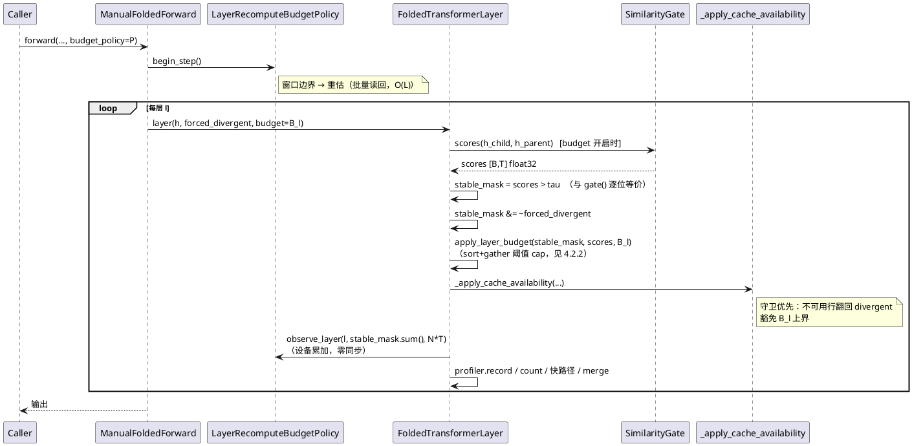
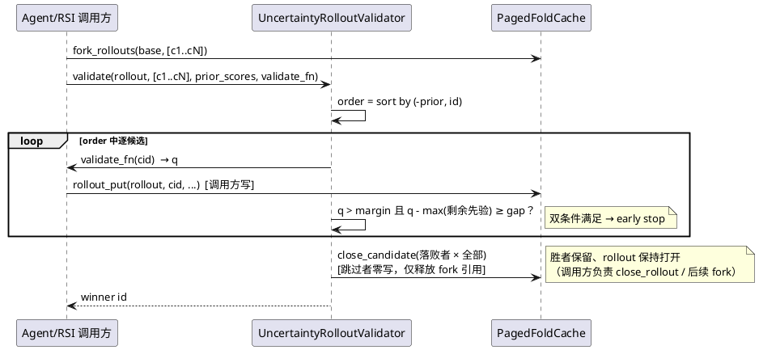
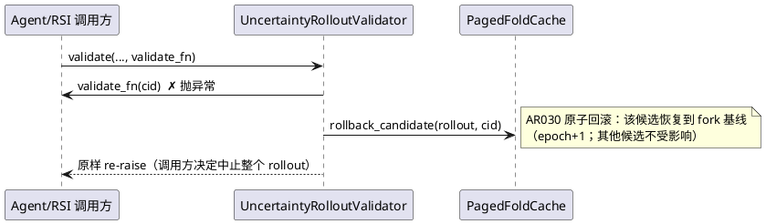
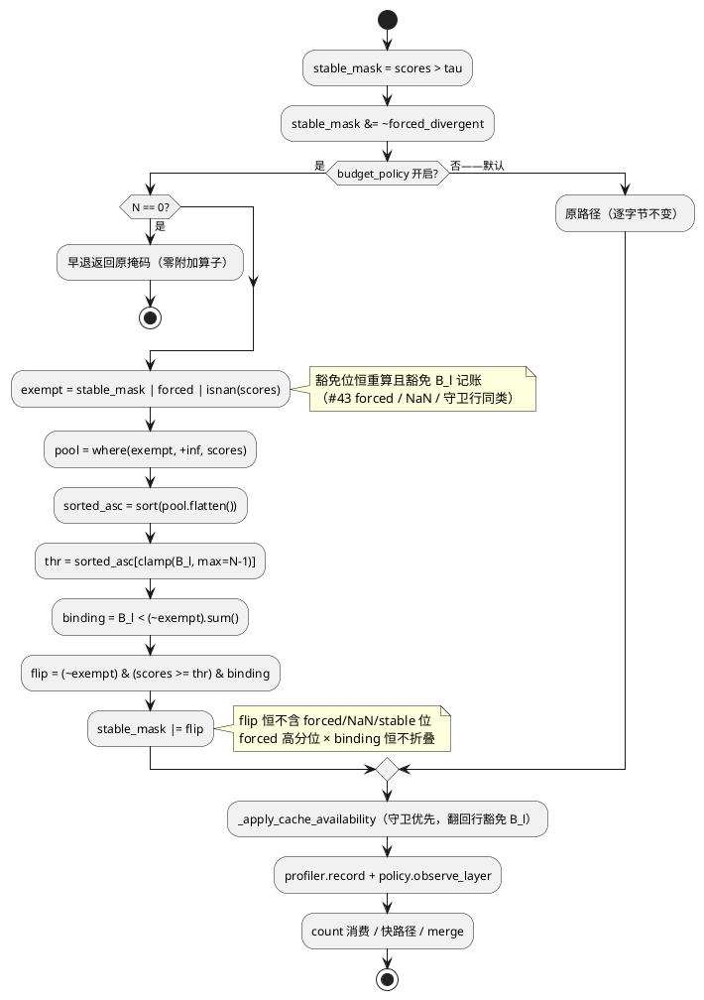

# [AR031] 详细设计

# 1 AR概述

| 组件名称 | ActFold 折叠核心（`actfold/core` + `actfold/speculative` + `actfold/models`） |
| --- | --- |
| AR系统流水号 | AR031 |
| AR描述 | 层自适应重算预算（`LayerRecomputeBudgetPolicy`：逐层稳定率驱动的全局重算预算层间分配 + 窗口式重估 + 精确计数 cap）+ 不确定性感知候选验证（PSFM `UncertaintyRolloutValidator` + 三 samplers 评分段 opt-in 早停）；Fast-dLLM v2-1.5B 三臂真实面基准（baseline 超越型）。 |

## 1.1 项目与边界

**改动面（新增 2 模块 + 1 bench 脚本 / 修改 12 文件；review 修复轮 E10 补记 `architecture_utils.py`）：**

| 文件 | 类型 | 改动 |
| --- | --- | --- |
| `actfold/core/layer_budget.py` | 新增 | `LayerRecomputeBudgetPolicy` + `apply_layer_budget`（冻结 cap 算法） |
| `actfold/speculative/uncertainty_validator.py` | 新增 | `UncertaintyRolloutValidator`（PSFM 面） |
| `actfold/core/similarity_gate.py` | 修改 | 新增只读公共面 `SimilarityGate.scores()`（`_compute_similarity` 的公开包装，形状校验共享） |
| `actfold/core/folded_transformer.py` | 修改 | **三处 eager 掩码序**（串行 / 批量同父 / 批量多父 AR025）插入预算 cap + 观测 + 预算面 exact-type `SimilarityGate` 校验（勘误 E9）；#49 谨慎原则（最小侵入） |
| `actfold/models/architecture_utils.py` | 修改 | `ManualFoldedForward` 新增 `budget_policy` 参数 + `begin_step` 每前向推进 + `budget_table` 回填层 kwargs + 串行/批量/graph 三构造点 `budget_static` 接线 + 发布循环 `observe_layer` 回填（E10 补记：MFF 位于本文件，非 `folded_transformer.py`） |
| `actfold/core/cuda_graph.py` | 修改 | **graph 捕获体落点**（r2 补入）：`FoldedGraphRunner` 构造面接收 `budget_static`（每层 0-dim int64 列表）；`_static_forward` 在 forced AND 后、count 重导出前插入 A1 cap（fused 旁路：预算开启时捕获体走 scores 路径） |
| `actfold/models/speculative_core.py` | 修改 | 共享纯函数 `plan_uncertainty_order` / `should_early_stop` + `_speculative_score_commit` 评分段 opt-in 早停 |
| `actfold/models/fast_dllm_sampler.py` | 修改 | inline speculative 路径接入同一共享 helper（否则 FR5 真实面测不到该机制）+ 配置字段 |
| `actfold/models/llada_sampler.py` / `dream_sampler.py` | 修改 | 配置字段 + `__post_init__` 校验（机制经共享核自动生效） |
| `actfold/utils/config_manager.py` | 修改 | `ActFoldConfig` 7 新键（consumption-only 模式，#44 先例） |
| `actfold/eval/benchmark_runner.py` | 修改 | `BenchmarkRunner` 构建面：实例化 `LayerRecomputeBudgetPolicy`（config 驱动）+ 深度 resolver 接线（AR029 `_resolve_pyramid_depth` 同型，FR6/F12） |
| `actfold/core/__init__.py` / `actfold/speculative/__init__.py` | 修改 | 导出 |
| `scripts/ar031_adaptive_uncertainty_bench.py` | 新增 | 三臂基准（FR5） |

**不动面（契约冻结清单）：**

| 契约 | 状态 |
| --- | --- |
| #29 门控互斥（AdaptiveQuantileGate × FoldingScheduler） | 不动；预算与 `FoldingScheduler` 组合合法；与 `AdaptiveQuantileGate`（top-k 门）组合在预算面前向显式 `ValueError`——cap 语义（`scores > tau`）对 top-k 掩码不可定义（勘误 E9，UT-3168 钉住） |
| #37 图捕获零主机同步 | 不动；捕获体内新增算子全部为设备算子（where/sort/clamp/gather/sum） |
| #44/#45 冻结种子公式、min-prob 胜者、`greedy_win_stats`、`LEDGER_C` | 不动；早停只影响**评分顺序与跳过**，胜者规则原语义 |
| #41 批量分支契约 / #42 put_batch / #43 forced_divergent / #47 segment A/B 拆分 | 不动；FR4 在 segment B 内部 opt-in 分支 |
| #48/#49 可用性守卫（`_apply_cache_availability` 顺序） | 顺序不变；预算 cap 插在 forced AND 之后、守卫之前（守卫优先于预算，翻回行豁免 `B_l`） |
| AR030 PSFM 页预算/淘汰/COW/rollout 语义 | 不动；验证器是纯消费者 |
| AR017 `AdaptiveCapacityPolicy` 本体 | 零修改；预算经既有 observe 数据流自然联动（需求漂移 → shrink/growth 钩子） |

# 2 动态行为

## 2.1 层预算前向时序（eager 与 graph 重放共用掩码序）



## 2.2 验证器时序（PSFM 面，FR3）



## 2.3 失败回滚时序（FR3 异常面）



# 3 功能点分解

| 序号 | 功能点名称 | 功能点描述 | srs 追溯 |
| --- | --- | --- | --- |
| F1 | 预算策略状态机 | 权重向量窗口重估（warmup 均匀 → (1-s_l) 加权）、设备累加观测、逐调用绝对预算派生 | FR1 |
| F2 | 精确计数 cap 算法 | sort+gather 阈值：重算数 ≤ B_l（无并列 ==）；branch-free；eager/graph 统一 | FR1/FR2 |
| F3 | 掩码序插入 | 三处 eager（串行/批量同父/批量多父 AR025）+ graph 捕获体（A4，落 `cuda_graph.py`）：forced AND → cap → 可用性守卫 → profiler/count | FR1 |
| F4 | 可用性守卫优先 | 不可用行翻回 divergent 且豁免 B_l（守卫后置不变） | FR1 |
| F5 | graph 预算重放面 | `budget_static[l]` 0-dim int64 捕获期分配、重放期体外 copy；捕获体内零主机同步 | FR2 |
| F6 | AR017 联动 | 预算 cap 改变 divergence 需求 → 既有 observe/growth/shrink 钩子自然重捕获（零修改本体） | FR2 |
| F7 | PSFM 验证器 | 先验降序 + id tie-break；margin/margin_gap 双条件早停；落败者 close、胜者保留 | FR3 |
| F8 | 验证器异常面 | validate_fn 异常 → rollback_candidate + re-raise；N==0/参数/id 校验 | FR3 |
| F9 | samplers 评分段早停 | 先验（draft min-prob）降序逐行评分；早停跳过剩余行 softmax/gather/min；前向批不变 | FR4 |
| F10 | fast_dllm inline 接入 | 共享 helper（plan_uncertainty_order/should_early_stop）双侧消费；UT 钉 parity | FR4 |
| F11 | 三臂基准 | baseline / adaptive-off（均匀权重 cap + 全量验证）/ 全开；H1-H4 冻结判定；reps=30 预承诺 | FR5 |
| F12 | 配置/导出/接线 | ActFoldConfig 7 键、sampler 3 字段、BenchmarkRunner 构建面、公共导出 | FR6 |
| F13 | 零回归钉住 | 默认关 = AR030 末态逐位一致（全仓 + 定向 sentinels） | NFR |

# 4 实现设计

## 4.1 功能实现思路

### 4.1.1 设计原则

1. **门控后分配**：预算不改门控判定，只在门控产出的 `stable_mask` 上做「超预算强制 stable」的收口；#29 语义安全网（divergent 恒可重算）方向永不反转——cap 只会把 divergent 翻成 stable（多折叠），永远不会把 stable 翻成 divergent。
2. **精确计数、branch-free、捕获安全三合一**：cap 算法用 `+inf` 填充 + 升序 sort + 动态索引 gather + `binding` 门控，eager 与 graph 共用同一实现；无宿主分支、无 `.item()`、无动态 k 的 topk（topk 的 k 是宿主整数，捕获体内不可变——这是本设计选择 sort+gather 的根因）。
3. **评分段早停、前向批不变**（samplers 面）：`[N,T]` 批量验证前向保持单次调用（与关闭态逐位一致，BLAS 批形不变）；早停只重排并跳过**评分段**（逐行 softmax/gather/min）——收益来源诚实记录：省的是被跳过行的 `[R,V]` softmax 与评分，不省前向。
4. **PSFM 面承担前向级节省**：rollout 候选天然逐个前向（调用方 `validate_fn`），早停直接省掉被跳过候选的整次前向——这是不确定性机制真正的开销节省面；samplers 面提供机制语义一致性 + H4 真实面等价证据。
5. **opt-in 全默认关**：`budget_policy=None` 不附加任何 kwarg（AR021 `forced_divergent` 模板）；`uncertainty_validation_order=False` 走原路径逐字节不变；零回归由 sentinels 钉住。

### 4.1.2 关键设计决策

| 决策 | 选择 | 备选与否决理由 |
| --- | --- | --- |
| cap 算法 | sort+gather 阈值（4.2.2 A1） | topk：k 需宿主整数，graph 捕获体内不可行；阈值近似面：精确计数不可保证，eager/graph 语义分叉 |
| 预算表示 | 权重向量 `w_l`（窗口冻结）+ 逐调用绝对派生 | 绝对预算表：变长 T（folded_generate 增长步）下表失效 |
| samplers 面前向 | 单批不变 | 分组前向（先验 top-G 先验）：未早停时双批形破坏逐位等价（#41 gemv/gemm 1-ULP 先例），预承诺单次跑风险不可控 |
| FR3 收口 | 关闭落败者、保留胜者、rollout 保持打开 | 直接 `close_rollout`：释放胜者页，破坏 Agent/RSI 续跑语义（srs 勘误 E2，见 §5） |
| 早停判定 | 双条件（margin + margin_gap vs 剩余先验最大值） | 单条件 margin：先验不构成严格占优，gap 是诚实风险控制；等价由预承诺集硬门验收 |
| 不确定性先验（samplers） | draft 分布 min-prob（`draft_logits_region` softmax + gather + min） | 与 #45 后验度量同源（同一 min-prob 族），先验-后验相关性的假设由 H4 实测验收 |
| fused gate（#38）与预算 | 预算开启时旁路 fused kernel（用 scores 路径） | fused kernel 不产出逐 token 分数；预算是 opt-in 优化面，fused 是另一优化面，二者互斥可接受（默认关=fused 不受影响） |

## 4.2 功能实现设计

### 4.2.1 数据结构

**`LayerRecomputeBudgetPolicy`（`actfold/core/layer_budget.py`，模块顶层 stdlib+torch）：**

```python
@dataclass
class LayerRecomputeBudgetPolicy:
    budget_ratio: float          # (0, 1]
    num_layers: int              # >= 1
    warmup_steps: int = 5        # >= 1（srs layer_budget_warmup）
    window_steps: int = 10       # >= 1（srs layer_budget_window）
    adaptive: bool = True        # False = 永久均匀权重（adaptive-off 臂/bench 内部；非 YAML 键）
    # —— 状态（init=False）——
    # _step_count: int                     已开始的 forward 步数
    # _weights: tuple[float, ...] | None   长度 L 的权重（None = 无数据均匀）
    # _acc_stable: list[Tensor | None]     每层 0-dim 设备累加器（惰性建，float32）
    # _acc_tokens: list[int]               每层累计 token 数（宿主）
    # _window_events: list[dict]           重估事件（探针：step/weights 来源）
```

构造期校验（全部 `ValueError`）：`budget_ratio ∉ (0,1]`；`num_layers < 1`；`warmup_steps < 1`；`window_steps < 1`。深度与模型层数一致性由接线方（`ManualFoldedForward.__init__`）校验：`policy.num_layers != len(wrapped_layers)` → `ValueError`（绝不静默截断）。

**`UncertaintyRolloutValidator`（`actfold/speculative/uncertainty_validator.py`）：**

```python
class UncertaintyRolloutValidator:
    def __init__(self, cache: PagedFoldCache, margin: float = 0.9,
                 margin_gap: float = 0.05) -> None
    # _stats: {"validated_count": int, "skipped_count": int,
    #          "early_stops": int, "winner_scores": list[float]}  # 上限 100 条，FIFO 截断
```

构造期校验：`margin ∉ [0,1]` / `margin_gap ∉ [0,1]` → `ValueError`。

**`ManualFoldedForward` 新增（`folded_transformer.py`）：**

```python
def __init__(..., budget_policy: LayerRecomputeBudgetPolicy | None = None)
# self._budget_policy; 深度一致性校验；graph 开启时额外分配
# self._budget_static: list[Tensor] | None   # 每层 0-dim int64 设备标量（捕获期建，重放期 copy_）
```

**配置字段（`fast_dllm_sampler.py` + `llada_sampler.py` + `dream_sampler.py`）：**

```python
uncertainty_validation_order: bool = False
uncertainty_margin: float = 0.9
uncertainty_margin_gap: float = 0.05
# __post_init__：True 且 num_block_candidates == 0 → ValueError（#44 同型）
#               margin/margin_gap ∉ [0,1] → ValueError
```

**`ActFoldConfig` 7 新键（consumption-only，#44 `candidate_include_greedy` 模式）：**
`layer_budget_enabled=False` / `layer_budget_ratio=0.15` / `layer_budget_warmup=5` / `layer_budget_window=10` / `uncertainty_validation_order=False` / `uncertainty_margin=0.9` / `uncertainty_margin_gap=0.05`。运行字段在 sampler config 与 policy 构造参数上；`load_config` 无 unknown-key 告警（#5）。

### 4.2.2 流程说明

**（A1）精确计数 cap 算法（冻结——eager/graph 统一；r2 修订：forced/NaN 豁免 + N==0 早退）：**

```
输入：stable_mask [B,T] bool（已 AND ~forced_divergent）、scores [B,T] float32
      （= gate.scores(h_child, h_parent)）、forced [B,T] bool（forced_divergent
      原掩码，预算开启时随掩码序一并传入）、B_l（0-dim int64 设备标量或宿主 int）
N = stable_mask.numel()
if N == 0: return stable_mask                    # 显式早退（空批/零长；无 clamp 依赖）
exempt = stable_mask | forced | isnan(scores)    # 豁免位：stable / forced / NaN 分数
                                                       # 三类恒不参与折叠与预算记账
pool = where(exempt, +inf, scores)               # 豁免位 +inf 填充（升序沉底）
sorted_asc = sort(pool.flatten()).values          # 升序；捕获安全
idx  = clamp(B_l, max=N-1)                        # gather 界内（binding=False 时仅防越界）
thr  = sorted_asc[idx]                            # 动态索引取阈值（0-dim）
binding = (B_l < (~exempt).sum())                 # 设备 0-dim bool：预算是否约束非豁免位
flip = (~exempt) & (scores >= thr) & binding      # 仅非豁免位可被强制 stable
stable_mask = stable_mask | flip
```

性质（设计不变量，UT 逐条钉住）：
- **豁免位恒重算**：forced 位（#43/AR021 构造性重算语义——刚提交块的保守超集，分数高但必须重算）与 NaN 分数位（NaN 比较为 False → divergent）**永不参与折叠**，且**豁免 `B_l` 记账**（与可用性守卫行同类豁免）。P1 漏洞（forced 位以高分最先被折叠）由 `exempt` 构造性排除。
- **非豁免重算数 ≤ B_l**（上界语义）；分数无并列时 **== B_l**；`thr` 处并列时 `< B_l`（并列 token 全部折叠——安全方向，不破上界）。
- `B_l ≥ 非豁免 divergent 数`（binding=False）→ 强制集合为空（**不得为凑预算把 stable 翻 divergent**）。
- 总重算数 ≤ B_l + 豁免数（forced + NaN + 守卫翻回）——豁免是语义安全面，`B_l` 只约束可折叠面。
- 全零长/空批：显式早退，零附加算子。
- 掩码序（插入点）：`gate scores/mask → AND ~forced_divergent →（新）cap → _apply_cache_availability → profiler.record → count 消费 → 快路径/merge`。守卫翻回的行**不再回灌 cap**（豁免 `B_l` 上界；`B_l` 是可用性满足前提下的软上限）。
- 开销：每层一次 `[N]` sort（O(N log N) 设备）+ 常数个逐元素核；预算关闭时零附加。
- **预算开启时旁路 fused gate（#38）**：fused kernel 只产出 mask+count 无逐 token 分数；预算路径用 `gate.scores()` + `scores > tau`（与 `gate.forward` 逐位等价——同一 `_compute_similarity` 输出、同一比较式；NaN 语义同型：NaN 比较为 False → divergent）。

**（A2）分配公式与窗口状态机（冻结；r3 修订：分域规则 + 盈余再分配 + 下限抬升扣回）：**

```
每步：begin_step() → _step_count += 1
重估时机：_step_count == warmup_steps 或
         (_step_count > warmup_steps 且 (_step_count - warmup_steps) % window_steps == 0)
重估（原子替换 _weights；批量读回，每窗口一次同步）：
  s_l = _acc_stable[l] / max(_acc_tokens[l], 1)      # tokens_l == 0 → 该层无数据
  有数据的层集合 S；无数据层 → 均匀权重参与
  u_l = (1 - s_l + 1e-6) if l ∈ S else (1/L + 1e-6)  # 无数据层退化均匀（绝不猜，#48）
  w_l = u_l / Σ_j u_j                                  # ε=1e-6 防全稳定除零
  _weights = (w_0, ..., w_{L-1})；_acc_* 清零；_window_events.append(...)
  adaptive=False → w_l = 1/L 永久（不重估权重，仍重置累加器）
逐调用绝对预算（宿主 O(L)，确定性；tokens_l == 0 的层恒 B_l = 0，不参与分配，
  w 在 L' = 有 token 层数 上重新归一）：
  域 1（B_total < L'，安全下限域）：tokens_l > 0 的层 B_l = 1（Σ == L' 平凡成立，
      加权分配不适用——每层至少重算 1 token 的安全下限优先，勘误 E5）
  域 2（B_total ≥ L'）：
    a. floor + 最大余数：B_l = floor(B_total × w'_l)（w' = L' 层归一权重）；
       r = B_total - Σ B_l ≥ 0（floor 性质）；按 w' 降序（并列取层号小者）前 r 层 +1
    b. 上界 clamp：B_l > tokens_l 的层截到 tokens_l；盈余 C = Σ 截断量
    c. 盈余再分配：按 w' 降序（并列层号小者）round-robin、跳过无 headroom
       （B_l == tokens_l）的层，逐层 +1 至 C 耗尽
       （可达性：B_total = round(ratio·Σ tokens) ≤ Σ tokens ⇒ headroom 必存在）
    d. 下限抬升：若有 tokens_l > 0 层 B_l == 0：该层 +1（取层号最小者），
       同时从当前 B_l 最大层扣 1（并列取层号大者，下限 1）；循环至全部 ≥ 1
       （可达性：Σ == B_total ≥ L' 且存在 0 层 ⇒ 鸽笼保证存在 B_l ≥ 2 的扣回层）
  最终不变量（两域统一）：Σ_l B_l == max(B_total, L')（tokens_l > 0 的层上）
```

`budget_for(layer_idx, tokens_l) -> int` 为上式的 O(1) 查表包装（每次 forward 入口计算一次全表，层循环查表）。**窗口内 `_weights` 冻结**（重估仅在窗口边界原子替换）→ 同输入同预算（可复现 NFR）。

**（A3）观测（零同步累加）：** 每层掩码定稿后（守卫之后、count 消费同源）：

```
policy.observe_layer(layer_idx, stable_count_device_0dim, num_tokens)
  # _acc_stable[l] 不存在 → 惰性建（同 device/dtype float32 的 0-dim zeros）
  # _acc_stable[l] += stable_count_device_0dim.to(float32)   （设备加，零同步）
  # _acc_tokens[l] += num_tokens（宿主 int）
```

graph 面：观测数据源与 AR018 `record_precomputed` 同源——发布循环的 `mask_buf.sum(dim=2)`（逐 (layer,row)）；policy 逐行 `observe_layer`（N 次设备加，与 profiler 同一数据流，无额外规约）。**观测点 = eager 掩码序内 + graph 发布循环内（捕获体外，每次重放执行——与 AR018 发布路径同型）；捕获体 static forward 零观测**（捕获体内禁止累加副作用）。

**（A4）graph 重放面（FR2；r2 修订：落点 = `cuda_graph.py` 捕获体）：**

- **改动落点（勘误配套 P2）**：graph 捕获体的掩码序在 `FoldedGraphRunner._static_forward`（`actfold/core/cuda_graph.py`：fused gate → forced AND → count 重导出），**不在** `folded_transformer.py` 的批量路径（967 行为多父 eager，AR025）。FR2 的 cap/`budget_static`/fused 旁路全部落 `cuda_graph.py`：`FoldedGraphRunner` 构造面新增 `budget_static: list[Tensor] | None`（每层 0-dim int64）；`_static_forward` 在 forced AND 之后、count 重导出之前插入 A1 cap（同一 `apply_layer_budget`，豁免语义一致）；**cap 后掩码写回 `mask_buf[layer_idx]`**（count 重导出、merge、发布循环同源——漏写会使 AR018 profiler 与 policy 观测静默记录 pre-cap 数据，由 UT-3118 钉住）；count 重导出改为对 cap 后掩码规约（forced 位计入 divergent 预算的既有语义不变——cap 不触碰 forced 位，A1 豁免构造性保证）。
- 捕获期：`budget_static[l]`（0-dim int64，`torch.zeros((), dtype=int64, device)`）随捕获分配；捕获体内 cap 用 `budget_static[l]` 作 `B_l`（动态 gather 索引合法）。
- 重放期（捕获体外）：`budget_static[l].copy_(policy.budget_for(l, N*T))`——宿主 int → 设备标量，一次 H2D copy，零同步（copy_ 非阻塞语义与既有 static buffer 回填同型，AR021 `forced_divergent_static` 先例）。
- **捕获体内零 `.item()/.tolist()/.cpu()`**（FR2 AC1；UT 探针 = monkeypatch 三个方法计数）。
- AR017 联动（零修改本体）：cap 降低实际 divergence → `runner.last_layer_divergences` 随之降低 → 既有 `validate_budgets`/`AdaptiveCapacityPolicy.observe` 数据流自然触发 shrink（需求下降）或避免 growth（超限减少）——`max_recaptures`/`min_recapture_interval` 语义不变。UT 构造：预算重估降低 `B_l` → 重放 divergence 下降 → `shrink_patience` 次后 shrink 钩子 recapture（`policy.events` 出现 `{"trigger":"shrink"}`）。
- 容量冲突（`Σ last_layer_divergences > C`）按既有语义回退 eager + degradation-fallback 计数 +1（canary 不变；预算只会降低 divergence，冲突面只会减少——AC 验证既有语义未被削弱）。
- 不携带 policy：全部新代码不激活（`budget_policy is None` → runner 不接收 budget_static、不附加 kwarg），与 AR030 末态逐位一致。

**（A5）验证器（FR3，冻结）：**

```
validate(rollout, candidate_ids, prior_scores, validate_fn) -> str:
- 校验：rollout 属于本 cache（经公共探针 `cache.rollout_stats(rollout)`——`ValueError`
       即归属不符，同 `_rollout_state` 语义；**不直探 `_rollouts` 私有字典**）
       candidate_ids 非空（N==0 → ValueError）、无重复、均 ∈ rollout 候选（否则 ValueError）
       prior_scores 覆盖全部候选且可 float()（否则 ValueError）
  order = sorted(candidate_ids, key=lambda c: (-float(prior[c]), c))   # 先验降序、id 升序 tie-break
  q_best = -inf; cid_best = order[0]      # 首候选默认成 best（全 NaN 时保持 order[0]，与 UT-3130 一致）
  validated = []; remaining = order 的拷贝
  for cid in order:
    q = float(validate_fn(cid))          # 调用方前向 + rollout_put + 后验评分
    validated.append(cid); remaining.remove(cid)
    if q > q_best or (q == q_best and cid < cid_best): q_best, cid_best = q, cid
        # NaN q：所有比较为 False → 永不替换当前 best；全 NaN → cid_best 保持 order[0]
    if q_best >= margin and remaining and (q_best - max(prior[c] for c in remaining)) >= margin_gap:
        early_stop = True; break
    # remaining 为空 → 循环自然结束（不计 early_stop）
  for cid in validated + remaining if cid != cid_best: cache.close_candidate(rollout, cid)
      # 跳过者：零 rollout_put（validate_fn 未被调用）→ close 仅释放 fork 页引用
      # 验证过的落败者：close 丢弃其写页
  stats 更新：validated_count += len(validated)；skipped_count += len(remaining)；
             early_stops += 1 if early_stop；winner_scores.append(q_best)（FIFO 100）
  return cid_best                        # 胜者保留：rollout 保持打开、base 仍冻结
```

- **失败面**：`validate_fn(cid)` 抛异常 → `cache.rollback_candidate(rollout, cid)`（AR030 原子回滚到 fork 基线，epoch+1）→ **原样 re-raise**；stats 不计该候选；调用方决定中止整个 rollout（`close_rollout` 由调用方负责）。
- **预算不足**：`validate_fn` 内 `rollout_put` 抛 `RolloutBudgetError` → 同上回滚路径原样上抛（不部分验证——已验证候选的写保留在其分支内，语义由 AR030 事务保证）。
- **不变量**：`validated_count + skipped_count == N`（每次 validate）；被跳过候选的页表/availability/`rollout_stats` 与 fork 后完全一致（零写）；胜者等价 = 调用方/bench 硬门（H4），理论边界（先验不构成严格占优）诚实记录于工件 meta。

**（A6）samplers 评分段早停（FR4，冻结；`speculative_core.py` + `fast_dllm_sampler.py` 双侧）：**

共享纯函数（`speculative_core.py` 模块级，fast_dllm import 消费——UT parity 钉住）：

```python
def plan_uncertainty_order(prior: Tensor,        # [N] float
                           ) -> list[int]:        # 降序、index 升序 tie-break
def should_early_stop(q_best: float, remaining_max_prior: float,
                      margin: float, margin_gap: float) -> bool:
    return q_best >= margin and (q_best - remaining_max_prior) >= margin_gap
```

`_speculative_score_commit`（segment B）内的 opt-in 分支（`getattr(cfg, "uncertainty_validation_order", False)` 解析——attribute-less 宿主不破）：

```
开启时：
  # 先验（冻结）：prior_j = min over M of softmax(draft_logits_region)[pos, cands[j, pos]]
  draft_probs = softmax(draft_logits_region, -1)                  # [1, R, V]
  cand_fill   = cands[:, fill_positions]                          # [N, M]（canvas 坐标列）
  prior       = draft_probs[0, masked_local, :].gather(
                  -1, cand_fill.t()).min(dim=0).values            # [N]，gather 维 = 候选行
  order = plan_uncertainty_order(prior)
  逐行 j ∈ order：
    probs_row = softmax(batched_logits[j, region_slice], -1)      # [R, V]
    q_j = gather(probs_row, committed_row).min()                  # 行后验 min-prob
    track best: q_j > q_best or (q_j == q_best and j < j_best)    # 与向量化 argmax 首现一致
    should_early_stop(q_best, max(prior[未验证]), margin, gap) → break
  j_star = j_best；跳过行不计算 softmax/gather/min（评分段节省，前向批不变）
  提交段（full / refill）原样复用 j_star
关闭时（默认）：原向量化路径逐字节不变
```

- **前向不变**：`forward_fn` 的单次 `[N,T]` 批量调用（segment A → forward → segment B 结构不动，#47 拆分不破）；全量验证时（未早停）逐行 softmax 与批 softmax 在 **CPU 上逐位一致**（softmax 无跨行规约）；**CUDA 上 softmax kernel 按形状分发可能差 1-ULP**（#41 gemv/gemm 同类先例）→ FR4 AC2「开启未早停 = 逐位一致」由 **CPU UT 构造性钉住 + CUDA UT（可用时）双面钉住**（UT-3135），不作为跨设备断言。
- **先验计算**：一次 `[1, R, V]` softmax + gather + min（设备，[N, M]）；仅在开启时计算。
- **胜者规则不变**：`j_star` 仍按 #45 min-prob 后验最大者（tie → 最小行号 = 向量化 argmax 首现语义）；`_greedy_spec_calls` 每次 speculative 调用 +1（非逐行）、`j_star == 0` 判 greedy win——全部原语义。
- **被跳过行的状态突变**：无。批量前向对各行的分支激活发布（graph 发布/`_store_batched`）是既有语义（所有行都要前向）；跳过仅发生在评分段——被跳过行不进 commit、不触 `_folding_parent`、不改 `finished`/`history`。
- **探针**：宿主 samplers 新增实例计数器 `_unc_validated_rows/_unc_skipped_rows/_unc_early_stops`（宿主 `__init__` 初始化——mixin 无 `__init__` 契约不破），只读属性 `uncertainty_stats`（#44 `greedy_win_stats` 先例；默认关恒 `{0,0,0}`）。
- **joint 路径**：`sample_joint` 逐链调 segment B → 机制逐链自然生效（每链独立 order/早停/计数）。
- **fast_dllm inline 面**：`fast_dllm_sampler.py` 的 inline speculative commit 消费同一 `plan_uncertainty_order`/`should_early_stop` + 同一先验公式；UT 钉 inline 与 core 的 order/决策/先验逐位一致（parity）。

**（A7）三臂基准（FR5，`scripts/ar031_adaptive_uncertainty_bench.py`）：**

结构沿 `ar022_speculative_quality_bench.py`（stdlib-only 模块顶、subprocess-pinned 环境、共享模型实例/prompt 集/seed、round-robin 交错、#39 计时、`--quick` 独立工件）。

- **三臂（冻结）**：
  - `baseline`：官方 Fast-dLLM v2 recipe，`folded_model=None`；
  - `actfold-adaptive-off`：MFF + `num_block_candidates=4` + `candidate_include_greedy=True` + **`LayerRecomputeBudgetPolicy(adaptive=False)`**（永久均匀权重，cap 生效）+ `uncertainty_validation_order=False`（全量验证）；
  - `actfold-full`：同 ② 配置 + **`adaptive=True`** + `uncertainty_validation_order=True`（margin/margin_gap = 预承诺冻结常数）。
  ②③ 差异仅为两机制开关（`adaptive` 权重 + 验证顺序）——机制归因臂。
- **冻结判定（脚本内先于数据收集；`--quick` 同一判定）**：
  - `verdict_h1(quality_faces)`：③ vs ① posthoc overall confidence gap ≤ 1e-3（绝对阈值，AR023 `_H1_RATIO_EPS` IEEE 噪声余量口径用于边界比较）；每 prompt decode length 恢复；merged block exact-match ③ ≥ ②；任一 posthoc 均值 `None` → refuted；`gap_bat == 0` 哨兵 0.0/inf 沿 AR023。
  - `verdict_h2(p50_base, p50_full, std_merged)`：`p50(①)/p50(③) > 1.0` 严格 且 delta > 2×merged std（AR017 两样本口径）。
  - `verdict_h3(p50_off, p50_full, ...)`：`p50(②)/p50(③) > 1.0` 严格（同 2σ 口径）；report-only：逐臂 stable ratios、`uncertainty_stats` 跳过率、`policy.window_events`。
  - `verdict_h4(equiv_rate, budget_violations, ledger_ok, repro_ok)`：等价率 == 100%（**逐 speculative 单元实测**：早停单元同时全量评分取 argmax 比对 `j_star`——评分便宜，可全测）；预算上界零突破（逐层重算 ≤ `B_l`，探针聚合）；canary/ledger 沿 #45 `LEDGER_C` 口径；reproduction 双跑行严格相等（不一致 ⇒ 全部 verdicts `blocked`）。
- **仲裁**：任一硬标准 refuted/inconclusive → honest negative 原样写入工件（绝不 rerun-until-pass、绝不调参）。
- **工件**：`results/optimization/ar031_adaptive_uncertainty_bench.json`（quick → `..._quick.json`）；schema：`meta`（env/dtype/reps/geometry/limitation 注记：eager 主声明、真实 graph 面 BLOCKED-DEFERRED）+ `arms`（三臂全指标 + 逐样本记录）+ `h1..h4` + `reproduction`。每个数字可由工件重算。
- **环境门（构造期）**：transformers==4.53.1、权重存在、显存检查（quick ≥ 16GB）；不满足 → 显式报错退出，不写部分工件。单臂失败 → blocked 工件 + 探针交叉引用 + 零伪造。
- **计时**：`perf_counter` + `synchronize`、warmup 丢弃、逐 rep round-robin、`TimingStats`（#39/#32）。

### 4.2.3 流程图（预算 cap 分支；r3 同步冻结 A1 豁免语义）



## 4.3 接口描述

### 4.3.1 新增公共接口（`actfold.core` / `actfold.speculative`）

| 接口 | 签名 | 返回 | 异常 |
| --- | --- | --- | --- |
| `LayerRecomputeBudgetPolicy.__init__` | `(budget_ratio: float, num_layers: int, warmup_steps: int = 5, window_steps: int = 10, adaptive: bool = True)` | — | `ValueError`（ratio∉(0,1]/L<1/W<1） |
| `LayerRecomputeBudgetPolicy.begin_step` | `() -> None` | — | — |
| `LayerRecomputeBudgetPolicy.observe_layer` | `(layer_idx: int, stable_count: Tensor, num_tokens: int) -> None` | — | `ValueError`（layer_idx 越界） |
| `LayerRecomputeBudgetPolicy.budget_for` | `(layer_idx: int, tokens_l: int) -> int` | 该层绝对预算 | `ValueError`（layer_idx 越界） |
| `LayerRecomputeBudgetPolicy.budget_table` | `(tokens: Sequence[int]) -> list[int]` | 全层预算表（勘误 E7：A2「forward 入口计算一次全表」的显式公共面；MFF 每次前向调用一次，层循环查表） | `ValueError`（长度 != num_layers） |
| `LayerRecomputeBudgetPolicy.weights` | property `-> tuple[float, ...] \| None` | 当前权重（只读快照） | — |
| `LayerRecomputeBudgetPolicy.window_events` | property `-> list[dict]` | 重估事件日志（只读） | — |
| `apply_layer_budget` | `(stable_mask: Tensor, scores: Tensor, budget: Tensor \| int, forced: Tensor \| None = None) -> Tensor` | cap 后掩码（正常路径新张量；N==0 早退返回**原张量**，与 UT-3161 一致） | `ValueError`（形状不一致） |
| `SimilarityGate.scores` | `(h_child: Tensor, h_parent: Tensor) -> Tensor` | `[B,T]` float32 分数（只读面；与 `forward` 同源同校验） | `ValueError`（形状/非 3-D） |
| `UncertaintyRolloutValidator.__init__` | `(cache: PagedFoldCache, margin: float = 0.9, margin_gap: float = 0.05)` | — | `ValueError`（margin/gap∉[0,1]） |
| `UncertaintyRolloutValidator.validate` | `(rollout: RolloutSet, candidate_ids: Sequence[str], prior_scores: Mapping[str, float], validate_fn: Callable[[str], float]) -> str` | 胜者 id | `ValueError`（N==0/重复/未知候选/先验缺失/rollout 不属于本 cache） |
| `UncertaintyRolloutValidator.stats` | property `-> dict[str, Any]` | 四键计数（只读、跨调用存活） | — |
| `plan_uncertainty_order` | `(prior: Tensor) -> list[int]` | 降序索引（tie → 小索引） | `ValueError`（空/非 1-D） |
| `should_early_stop` | `(q_best: float, remaining_max_prior: float, margin: float, margin_gap: float) -> bool` | 早停判定 | — |

### 4.3.2 修改接口

| 接口 | 改动 | 兼容性 |
| --- | --- | --- |
| `ManualFoldedForward.__init__` | 尾参 `budget_policy: LayerRecomputeBudgetPolicy \| None = None` | 默认 None 逐字节不变；深度不一致 `ValueError` |
| `ManualFoldedForward.forward`（三路径） | 掩码序插入 cap + 观测；`budget_policy is None` 不附加任何 kwarg | AR021 模板 |
| `FoldedTransformerLayer.forward`（串行/批量） | 同上插入 | 同上 |
| `SpeculativeCore._speculative_score_commit` | 入口 opt-in 分支（getattr 解析） | attribute-less 宿主不破（AR024 模板） |
| `FastDLLMSamplerConfig`/`LLaDASamplerConfig`/`DreamSamplerConfig` | +3 字段 + 校验 | 默认值 = AR023 末态 |
| `fast_dllm_sampler.py` inline commit | 消费共享 helper | 默认关逐字节不变 |
| `ActFoldConfig` | +7 键 | `load_config` 无 unknown-key 告警 |
| `BenchmarkRunner` | `layer_budget_enabled` → 构建 `LayerRecomputeBudgetPolicy`（深度 resolver 沿 AR029 `_resolve_pyramid_depth` 先例：显式 > `num_layers`/`config.num_hidden_layers`，不可解析 → **raise 不猜**） | 默认关不构建 |
| `actfold/core/__init__.py` / `actfold/speculative/__init__.py` | 导出新符号 | — |

### 4.3.3 冻结语义不变清单（review 对照面）

#29（门控互斥不新增组合限制）/ #37（捕获体零同步：新增算子全设备）/ #38（fused gate 仅预算关时使用）/ #39（计时）/ #41–#43（批量/put_batch/forced 掩码序）/ #44/#45（种子公式、min-prob 胜者、greedy_win_stats、LEDGER_C）/ #47（segment A/B 拆分与 joint 语义）/ #48/#49（可用性守卫顺序与 PSFM 消费者定位）。

### 4.3.4 探针（只读）

| 探针 | 键 | 时机 |
| --- | --- | --- |
| `policy.weights` | `tuple[float,...] | None` | 每次重估后 |
| `policy.window_events` | `{step, source}` | 每次重估 |
| `validator.stats` | `validated_count/skipped_count/early_stops/winner_scores` | 跨 validate 调用存活 |
| `sampler.uncertainty_stats` | `validated_rows/skipped_rows/early_stops` | 跨 sample 调用存活（仅开启路径递增） |
| `graph_pool_stats` | 既有 degradation-fallback canary | 语义不变（FR2 AC 复用） |

### 4.3.5 异常约束

| 异常 | 触发 | 处理 |
| --- | --- | --- |
| `ValueError`（policy 构造） | ratio/L/W 非法 | 构造期拒绝 |
| `ValueError`（MFF 接线） | `num_layers != len(layers)` | 构造期拒绝（不静默截断） |
| `ValueError`（cap 层） | scores/mask 形状不一致 | 前向前拒绝 |
| `ValueError`（validator） | N==0/重复/未知候选/先验缺失/rollout 归属 | 调用期拒绝，零状态突变 |
| `ValueError`（sampler 配置） | order=True 且 N==0；margin/gap∉[0,1] | `__post_init__` 拒绝 |
| `RolloutBudgetError` | `validate_fn` 内 `rollout_put` 预算不足 | `rollback_candidate` 后原样上抛（不部分验证） |
| 任意 `validate_fn` 异常 | 调用方前向失败 | `rollback_candidate`（AR030 三类失败语义）+ 原样 re-raise |
| 容量冲突（graph） | `Σ last_layer_divergences > C` | 既有回退 eager + canary 计数（非错误） |

## 4.4 代码设计

### 4.4.1 目录与模块边界

```
actfold/core/layer_budget.py        # 新：policy + apply_layer_budget（冻结算法 A1/A2/A3）
actfold/core/similarity_gate.py     # 改：+scores() 公共只读面
actfold/core/folded_transformer.py  # 改：三处 eager 掩码序 + budget_policy 接线（#49 最小侵入：
                                    #   cap/观测经参数面传入，层内以 helper 调用点为唯一锚）
actfold/core/cuda_graph.py          # 改：graph 捕获体落点（A4）——FoldedGraphRunner 构造面
                                    #   budget_static + _static_forward cap（forced AND 后、
                                    #   count 重导出前）+ cap 后掩码写回 mask_buf + fused 旁路
actfold/speculative/uncertainty_validator.py   # 新：validator（A5；PSFM 纯消费者）
actfold/eval/benchmark_runner.py      # 改：BenchmarkRunner 构建面——实例化 policy + 深度
                                    #   resolver 接线（AR029 同型；FR6/F12，UT-3148/3149）
actfold/core/__init__.py             # 改：LayerRecomputeBudgetPolicy/apply_layer_budget 导出
actfold/speculative/__init__.py      # 改：UncertaintyRolloutValidator 导出
actfold/models/speculative_core.py  # 改：共享 helper + segment B opt-in（A6）
actfold/models/fast_dllm_sampler.py # 改：inline 面 + 配置字段
actfold/models/llada_sampler.py / dream_sampler.py   # 改：配置字段（机制经共享核自动生效）
actfold/utils/config_manager.py     # 改：7 新键
scripts/ar031_adaptive_uncertainty_bench.py          # 新：三臂基准（A7）
tests/test_ar031_budget_policy.py / test_ar031_graph_budget.py /
tests/test_ar031_uncertainty_validator.py / test_ar031_sampler_uncertainty.py /
tests/test_ar031_wiring.py / test_ar031_bench_verdicts.py   # 新：6 测试文件
```

### 4.4.2 实现要务顺序

T001 设计门控 → T002/T003 policy（纯逻辑先行）→ T004/T005 MFF 三路径接线 → T006/T007 验证器（可与 T003 并行）→ T008/T009 samplers 双侧 → T010 配置/导出/零回归 → T011 bench + 判定 UT → T012 真实面 → T013-T017 文档/质量门/review/ST/归档推送。

### 4.4.3 并发/线程/设备

- 全部新状态为单线程宿主状态（与 MFF/policy 既有并发模型一致）；设备累加器按 device 惰性建，跨 device 混合观测 → 按首个观测 device 建立并在 `observe_layer` 校验（不匹配 → `ValueError`，绝不静默搬运）。
- 捕获体内禁止：`.item()/.tolist()/.cpu()`、`torch.cuda.synchronize`、宿主分支于设备值、累加副作用（观测移至体外）。
- Windows WDDM 环境法则（#46）：真实面 eager；真实 graph 联动面 = UT + 合成面，工件 meta 记录 BLOCKED-DEFERRED。

# 5 重构设计（srs 勘误表——设计阶段细化，AR029 §4.2.3 先例）

| # | srs 原文 | 勘误后 | 理由 |
| --- | --- | --- | --- |
| E1 | FR2「强制 stable/divergent 决策在捕获体外计算、以重放期张量传入」 | 捕获体外传入的是**每层预算标量 `B_l`**（重放期 `copy_` 到 `budget_static`）；强制 stable 的**选择**由统一 sort+gather 算法在捕获体内以纯设备算子完成（零主机同步）；精确计数语义两面统一 | 动态 k 的 topk 不可捕获；掩码依赖重放期门控分数，体外不可算 |
| E2 | FR3「验证器结束 `close_rollout`」 | 验证器结束**关闭全部落败候选**（`close_candidate`），**保留胜者**、rollout 保持打开；`close_rollout` 由调用方负责 | `close_rollout` 释放全部候选页（含胜者），破坏 Agent/RSI 续跑语义 |
| E3 | FR1「`B_total = round(budget_ratio × Σ_l tokens_l)`」 | 权重向量 `w_l` 窗口内冻结；`B_total`/`B_l` 按**当前调用**的 tokens_l 逐调用派生（宿主 O(L)） | 变长 T（folded_generate 增长步）下绝对预算表失效 |
| E4 | FR4 仅提 speculative_core | 补充：`fast_dllm_sampler.py` 的 inline speculative 路径接入**同一共享 helper**（order/决策/先验公式），UT 钉 parity | Fast-dLLM 是 inline 实现（非 mixin）；否则 FR5 真实面测不到该机制 |
| E5 | FR1 分配规则「round 后余数补齐至 Σ B_l == B_total」及 AC2「Σ B_l == B_total」 | 修订为**分域规则**（r3）：域 1 `B_total < L'`（L' = 有 token 层数）→ tokens_l>0 层全 1（安全下限域，Σ == L'）；域 2 floor+最大余数 → 上界盈余按 w' 降序 round-robin 再分配 → 下限抬升（0 层 +1、B_l 最大层扣 1，下限 1）；最终不变量 **Σ B_l == max(B_total, L')**（两域统一；可达性由 floor 性质 + 鸽笼原理构造性保证）；UT-3104 判据同步 | 原 round+补齐算术不成立（round 和可超 B_total）；r2「上界削减从 w 最小层扣还」条款在 tokens=[1,100]、w=[0.9,0.1] 反例下不可达；B_min=1 与 Σ==B_total 在小预算域不可同时满足 |
| E6 | srs §1「对照臂隔离两个机制**各自**的贡献」 | 修订为「**联合归因**两个自适应机制的贡献（H3）；逐机制分解由 report-only 探针（逐臂 stable ratios / 跳过率）部分弥补」 | 三臂设计下 off-臂只能归因两机制联合效应；增补第四臂会膨胀预承诺面，不取 |
| E7 | design §4.3.1 只列了 budget_for(layer_idx, tokens_l)，但 A2 分配需要**完整 tokens 向量**（B_total 与 L' 依赖全层）——单层查询面无法承载「forward 入口计算一次全表」语义 | 显式新增 `budget_table(tokens: Sequence[int]) -> list[int]` 公共面（A2 r3 全量分配，MFF 每前向一次）；`budget_for` 语义澄清为 O(1) 缓存查表（命中最近 budget_table 结果）+ 均匀向量退化回退（独立调用时按 [tokens_l]*L 归一分配）；UT 判据经 budget_table 面 | Green 阶段（T003）实现时发现：Red 测试按单层循环调用 budget_for 无法满足 Σ == max(B_total, L') 不变量（信息不足，任何单层方案均不可构造）；勘误不改 A2 算法本体 |
| E9 | srs §1.1 冻结表「预算与 AdaptiveQuantileGate/FoldingScheduler 组合均合法」 | 预算面要求 **exact-type `SimilarityGate`**：`FoldedTransformerLayer._budget_scores` 对非精确类型（含子类 `AdaptiveQuantileGate`）前向 `ValueError`（fail-fast 安全方向，非静默错 cap） | cap 语义 = `scores > tau` 阈值折叠，top-k 门无阈值掩码，组合语义不可定义；review r1 D4 发现后显式记录（UT-3168 钉住拒绝行为） |
| E10 | design §1.1/§4.4.1 改动清单与 §6.1 UT 矩阵（review r1 S1/D3/D4 修复轮补记） | ① 补 `architecture_utils.py`（MFF budget 接线实际落点，MFF 参数面归属修正）；② UT 编号回收：`3164` 归 T006 验证器面前置违反（§6.1.3 真源），T012 eager forced 1-D 测试改号 **UT-3167**；③ §6.1 矩阵补 T012 新增行：UT-3165（graph 静态体 1-D forced）/ UT-3166（repro 按 (arm,prompt) 配对）；④ UT-3109 由「深度一致性」re-scope 为「in-range 查询」（深度失配由 UT-3148 覆盖）；⑤ UT-3113 判据注明纯张量单元模拟，FR1 AC6 端到端面由新增 **UT-3169**（真实 PagedFoldCache + MFF + 绑定预算 + demote 冷页：守卫全翻回、observe 层 1 == 0、输出与无预算同洞路径逐位一致、零 NaN）钉住 | 两个 UT 撞号 3164；FR1 AC6 端到端缺口是 review r1 S1 Important——生产 cap→guard 插入顺序若错置，原 AR031 套件无测试会失败 |
| E8 | design A3「每 (layer, row) 上报」/ A4 未明确降级回退与 eager 规则 / F3 未明确变长与多父分支 | ① **A3 层总量面**：图发布每层恰一次 `observe_layer(l, mask_buf[l].sum(), N*T)`（cap 后写回值），eager 每层每前向一次（cap 后、守卫后、profiler 前）——冻结 UT-3118 层总量判据优先于 A3 字面 per-row；② **A4 规则 (a)**：`use_cuda_graph=False` → eager 逐层 cap+observe（bench eager 主声明面）；`use_cuda_graph=True` → cap 仅在捕获体内（体外 `fill_` 回填），图降级/结构回退的 eager **一律不加预算**（既有 AR002 语义 = 精确重算，UT-3115 钉住回退输出 == 无预算参考）；③ **F3 安全面裁剪**：变长步（prefix_len != seq_len）与多父混合长度/无效行分支不施加 cap+observe（cap 仅在等长且 scores 覆盖全网格时生效；不 cap = 精确重算 = 安全方向），多父仅在 all-valid 等长全画布分支插入；④ **Green 捕获安全发现**：A1 cap 的 `sorted_asc[idx]`（0-dim 张量索引）内部触发 host 回读、捕获期非法 → `torch.gather` 数学等价替换（UT-3110/3111 判据不变）；runner `mask_buf`/`count_buf` property 由「须已 capture」放宽为「须已分配」（UT-2603/3114 直驱面，生产语义不变） | 实现期裁决（冻结测试优先）；#37 捕获体零同步契约 |

# 6 测试设计

## 6.1 单元测试（UT）——覆盖点分配（UT-3102~3169）

**覆盖率目标（仓库惯例声明）**：本 AR 以 ① §6.6 F×UT 矩阵全行覆盖（F1-F13 每行 ≥1 用例）、② srs 23 条 Given/When/Then 验收全追溯（§6.6 末表）、③ AR031 套件时长门 < 30 s 三项代语句/分支覆盖率工具面（与 AR029/AR030 一致；仓库无覆盖率工具门）。

### 6.1.1 T002 预算策略面（`tests/test_ar031_budget_policy.py`，UT-3102~3113 + 3161~3163 + 3169）

| UT | 行为点 | 判据 |
| --- | --- | --- |
| 3102 | warmup 均匀 | 预热窗口内任意步逐层预算 == 补齐后均匀分配（Σ == max(B_total, L') 且**等 tokens_l 构造下**逐层差异 ≤ 1；clamp+再分配路径差异另由 UT-3104/3105 覆盖） |
| 3103 | 重估权重 | 构造 s={0.9, 0.5}（观测注入）→ 窗口边界后 w ∝ (1-s+ε)；低稳定层 w 更高 |
| 3104 | 总和守恒 | `Σ_l budget_for(l, T) == max(B_total, L')`（floor+最大余数+clamp 削减全路径，多随机种子含 B_total < L' 域） |
| 3105 | 分配确定性 | 同输入同种子 → 同表（重复调用逐位相等；余数按 w 降序层号小者；盈余再分配 round-robin 跳过满层；下限抬升扣回取 B_l 最大层号大者） |
| 3106 | 无数据退化 | profiler 数据缺失层 → 均匀权重参与；全无数据 → 全均匀；不抛错 |
| 3107 | tokens_l==0 | `budget_for(l, 0) == 0` |
| 3108 | 构造校验 | ratio∉(0,1]/L<1/W_warm<1/W_est<1 → `ValueError` |
| 3109 | in-range 查询 | 每层 `budget_for` 返回 `[0, tokens_l]` 内整数（re-scope 见 E10；深度失配接线由 UT-3148 钉住） |
| 3110 | cap 上界（D>B） | 分数无并列构造 D_l=8 > B_l=5 → 重算数 == 5；被折叠者恰为相似度最高者 |
| 3111 | cap 非配额（D≤B） | D_l=3 ≤ B_l=5 → 重算数 == 3，零强制翻转 |
| 3112 | 窗口冻结 | 窗口内任意步间 `weights` 不变；边界处原子替换（事件日志顺序） |
| 3113 | 守卫优先（纯张量单元模拟；端到端面由 UT-3169 钉住，E10） | cap 后守卫翻回不可用行 → 重算数可超 B_l（豁免语义）、输出与无预算路径逐位一致 |
| 3161 | 接口边界 | `observe_layer`/`budget_for` layer_idx 越界 → `ValueError`；`apply_layer_budget` 形状不一致 → `ValueError`；N==0 显式早退返回原掩码（零附加算子） |
| 3162 | NaN 豁免边界 | NaN 分数位 × binding：NaN 位恒重算且豁免记账——非豁免重算 ≤ B_l、总重算 = 非豁免 + NaN 数（破界场景构造钉住 ≤ B_l + 豁免数不变量） |
| 3163 | forced 永不折叠 | forced × binding 场景（forced 位高分数 + 预算绑定）：forced 位全部保持 divergent（#43/AR021 构造性语义）、非豁免重算 ≤ B_l、被折叠者仅限非 forced 且相似度最高者 |
| 3169 | 守卫优先端到端（FR1 AC6，E10） | 真实 `PagedFoldCache` + MFF + 绑定预算，demote 层 1 页：守卫全翻回（observe 层 1 == 0，错序则 7）、输出与无预算同洞路径逐位一致（错序读冷页 NaN 必破等式）、零 NaN |

### 6.1.2 T004 图联动面（`tests/test_ar031_graph_budget.py`，UT-3114~3120；CUDA 不可用则合成面 + graph 逻辑单测）

| UT | 行为点 | 判据 |
| --- | --- | --- |
| 3114 | 捕获体零同步 | 探针窗口限定**捕获体与 `_static_forward` 执行窗**：`.item()/.tolist()/.cpu()` 计数 == 0；重放路径允许既有 `validate_budgets` 单次 `count_buf.tolist()` 读回（#37 明文契约，cuda_graph.py:365,382），除此之外零新增同步调用（与 srs FR2 AC1「捕获体内」口径一致） |
| 3115 | 容量冲突回退 | 构造 `Σ B_l > C` 场景重放 → 回退 eager、输出正确、degradation-fallback +1 |
| 3116 | AR017 shrink 联动 | 预算重估降低 B_l → 重放 divergence 降 → patience 次后 `events` 出现 shrink recapture |
| 3117 | 无 policy 零回归 | 不携带 policy 捕获+重放 → 与 AR030 末态 sentinel 逐位一致 |
| 3118 | static 体外回填 | `budget_static` 值在重放前 == policy 当前表；窗口重估后下次重放用新值；**发布循环 `observe_layer` 收到 cap 后计数**（== cap 后掩码规约值，钉住 mask_buf 写回——pre-cap 静默记录为缺陷） |
| 3119 | growth 抑制 | 预算开启时超限次数 ≤ 关闭时（cap 降低 divergence 的方向性） |
| 3120 | fused gate 旁路 | 预算开启 + fused 条件满足 → 走 scores 路径（结果与 fused 路径逐位一致） |
| 3165 | static forced 1-D（E10 补记） | graph 静态体消费位置级 `[T]` forced（`broadcast_forced_to_mask` 直调）；1-D static 掩码与输出和显式 `[1,T]` 位相同 |

### 6.1.3 T006 验证器面（`tests/test_ar031_uncertainty_validator.py`，UT-3121~3133 + 3164）

| UT | 行为点 | 判据 |
| --- | --- | --- |
| 3121 | tie-break | 全同先验 → id 升序全量验证、无早停、顺序可由 validate_fn 调用记录验证 |
| 3122 | 早停触发 | 首候选大幅领先（margin+gap 双满足）→ validated==1/skipped==N-1；胜者 == 全量验证胜者 |
| 3123 | 跳过者零写 | 被跳过候选 `rollout_stats`/availability/页表与 fork 后一致（零 rollout_put） |
| 3124 | 单条件不足 | margin 满足 gap 不满足（或反之）→ 全量验证、无 early_stop 计数 |
| 3125 | stats 守恒 | 每次调用 `validated + skipped == N`；跨调用累计；`winner_scores` FIFO 100 |
| 3126 | 参数校验 | N==0/重复 id/未知候选/先验缺失/rollout 归属不符 → `ValueError`（零状态突变） |
| 3127 | margin 校验 | margin/gap ∉ [0,1] → 构造期 `ValueError` |
| 3128 | 预算不足原子 | validate_fn 抛 `RolloutBudgetError` → `rollback_candidate` 后原样上抛；该候选恢复 fork 基线、其他候选不变 |
| 3129 | 一般失败回滚 | validate_fn 抛 RuntimeError → 回滚 + re-raise（AR030 三类失败语义构造） |
| 3130 | NaN 后验 | NaN q 永不成为胜者；全 NaN → order[0] |
| 3131 | 落败者关闭 | 验证过的落败者 `close_candidate`（分支消失、页释放）；胜者分支存在、rollout 打开、base 仍冻结 |
| 3132 | 胜者保留 | validate 返回后 `cache.contains(winner, l)` 为真（写页在）；调用方可继续 fork |
| 3133 | 先验类型 | prior_scores 含非数值 → `ValueError` |
| 3164 | 前置违反 | 对已 close 的 rollout / 非 active 候选调 validate → `ValueError`（公共探针归属校验路径，零状态突变） |

### 6.1.4 T008 samplers 面（`tests/test_ar031_sampler_uncertainty.py`，UT-3134~3144）

| UT | 行为点 | 判据 |
| --- | --- | --- |
| 3134 | 默认零回归 | 三 samplers 默认配置输出与 AR023 冻结 sentinels 逐位一致（复用既有 fixture） |
| 3135 | 开启未早停 | 全量验证 → 胜者/提交/`_folding_parent` 与关闭态逐位一致（仅顺序变） |
| 3136 | 开启早停等价 | 构造先验分化场景 → `uncertainty_stats.skipped_rows > 0` 且胜者 == 全量 argmax |
| 3137 | 种子公式不动 | 开启/关闭下候选画布逐位一致（segment A 无关性） |
| 3138 | greedy 探针不变 | `greedy_win_stats` 语义（计数时机/j_star==0 判定）开启前后一致 |
| 3139 | 配置校验 | order=True 且 N==0 → `ValueError`；margin/gap ∉ [0,1] → `ValueError`（三家族对称） |
| 3140 | 跳过零突变 | 被跳过行不触 commit/finished/history（构造对比） |
| 3141 | inline parity | fast_dllm inline 与 core helper：order/早停决策/先验逐位一致；含 \plan_uncertainty_order\ 空/非 1-D 输入 \ValueError\ 显式断言 |
| 3142 | joint 逐链 | `sample_joint` 逐链独立早停与计数 |
| 3143 | 先验正确性 | 先验 == draft softmax 在候选 token 上的 min（手算小例钉住公式） |
| 3144 | 计数探针 | `uncertainty_stats` 跨 sample 调用存活；默认关恒 {0,0,0} |

### 6.1.5 T010 接线面（`tests/test_ar031_wiring.py`，UT-3145~3152 + 3167~3168）

| UT | 行为点 | 判据 |
| --- | --- | --- |
| 3145 | YAML 消费 | 7 新键经 `load_config` 无 unknown-key 告警、字段值正确 |
| 3146 | 公共导出 | `LayerRecomputeBudgetPolicy`/`UncertaintyRolloutValidator` 可从 `actfold.core`/`actfold.speculative` 导入 |
| 3147 | 默认零回归 | 默认配置全仓行为 == AR030 末态（定向：MFF/引擎/runner 构建路径） |
| 3148 | runner 构建 | `layer_budget_enabled=True` → runner 构建 policy 并接 MFF；深度 resolver 显式>config，不可解析 raise |
| 3149 | runner 默认关 | enabled=False → 不构建 policy（探针 None） |
| 3150 | scores 公共面 | `SimilarityGate.scores` 与 `forward` 掩码逐位等价（含 NaN/l2/pearson 度量） |
| 3151 | budget None 逐字节 | `budget_policy=None` 前向与 AR030 末态逐位一致（kwarg 不附加） |
| 3152 | 观测设备校验 | 跨 device 观测 → `ValueError`（不静默搬运） |
| 3167 | eager forced 1-D（原 3164，E10 回收改号） | #43 位置级 `[T]` forced 在 eager cap 阻塞点广播；1-D 与显式 `[1,T]` 位相同（T012 quick 冒烟实测修复） |
| 3168 | exact-type gate 拒绝（E9） | 预算面 + `AdaptiveQuantileGate` 前向 → `ValueError`（命名 gate 类型；fail-fast 非静默错 cap） |

### 6.1.6 T011 基准判定面（`tests/test_ar031_bench_verdicts.py`，UT-3153~3160）

| UT | 行为点 | 判据 |
| --- | --- | --- |
| 3153 | H1 边界 | gap ≤ 1e-3 判 supported；1e-3+ε refuted；None → refuted；哨兵 0.0/inf |
| 3154 | H2 2σ | 严格 >1.0 且 delta > 2σ；边界（==1.0、σ 大）判型正确 |
| 3155 | H3 归因 | 同 H2 口径作用于 ②/③ |
| 3156 | H4 等价 | 等价率 <100% → refuted；reproduction 不一致 ⇒ 全部 blocked（一票否决） |
| 3157 | 工件 schema | 三臂全指标 + h1-h4 + reproduction + meta 限制注记；每个判定可由工件输入重算 |
| 3158 | quick 隔离 | `--quick` 写 `_quick.json`，绝不触正式路径 |
| 3159 | 环境门 | transformers 版本/权重缺失 → 构造期报错、不写工件（exit code 非零） |
| 3160 | honest negative | refuted 场景原样记录（构造工件断言，零改写） |
| 3166 | repro 配对（E10 补记） | reproduction 双跑按 `(arm, prompt_index)` 配对（`repro_mismatch_rows` 纯函数；T012 仪器修复——pass A 循环泄漏曾致跨 prompt 66-vs-34 误配） |

## 6.2 接口测试

§4.3.1 全部 13 个新公共接口的参数边界与 §4.3.5 异常逐条显式覆盖：`budget_for`/`observe_layer` 越界与 `apply_layer_budget` 形状/N==0（**UT-3161**）；`validate` 五类 `ValueError` + closed-rollout 前置（**UT-3126/3133/3164**）；`plan_uncertainty_order` 空/非 1-D（**UT-3141 内显式断言**）；`scores` 三度量等价（**UT-3150**）；`begin_step` 窗口推进（**UT-3103/3112**）；构造校验（**UT-3108/3127/3139**）。

## 6.3 业务场景测试（ST 映射，st-cases.md 于 T017 生成）

FR1 warmup→重估→cap 全链（真实小模型合成面）；FR2 图重放联动（合成面 + 环境允许时 CUDA 面）；FR3 Agent/RSI rollout 早停端到端（PSFM）；FR4 三 samplers 开启端到端；FR5 quick 冒烟（真实 checkpoint，<60s 门）；FR6 YAML 全键消费 + 默认零回归；回归面 = 全量 pytest + demo 三锚点。

## 6.4 异常场景测试

| 场景 | 覆盖 UT |
| --- | --- |
| 构造参数非法（policy/validator/sampler 配置） | 3108/3127/3139 |
| 深度不匹配 / 接线失败 | 3109/3148 |
| `validate_fn` 三类失败（校验/put/一般异常） | 3128/3129（AR030 语义） |
| 预算不足 / 容量冲突 | 3128/3115 |
| NaN（分数×binding / 后验） | 3162/3130 |
| forced × 预算绑定（#43 语义） | 3163 |
| 空/零长（tokens_l==0、N==0 掩码、N==0 候选、空 masked_local） | 3107/3161/3126/segment B 既有守卫（3135 复用） |
| B_total < L' 小预算域 | 3104 |
| 设备混合 / 环境不满足 | 3152/3159 |
| 窗口边界竞态（重估原子性） | 3112 |
| closed-rollout / 非 active 前置违反 | 3164 |

## 6.5 基准判定函数（FR5，冻结于脚本，UT-3153~3160 钉住）

`verdict_h1(quality_faces) / verdict_h2(p50_base, p50_full, std_merged) / verdict_h3(p50_off, p50_full, std_merged) / verdict_h4(equiv_rate, budget_violations, ledger_ok, repro_ok) / overall_verdict(h1, h2, h3, h4)`——判定优先级 blocked → refuted → supported（AR029 先例）；全部为纯函数（工件输入可重算）。

## 6.6 覆盖矩阵（F × UT）

| 功能点 | UT |
| --- | --- |
| F1 策略状态机 | 3102-3108, 3112 |
| F2 cap 算法 | 3110, 3111, 3161, 3162, 3163, 3150, 3151, 3167 |
| F3 掩码序 | 3110, 3111, 3113, 3163, 3151 |
| F4 守卫优先 | 3113, 3169 |
| F5 graph 重放面 | 3114, 3118, 3120, 3165 |
| F6 AR017 联动 | 3115, 3116, 3119 |
| F7 验证器 | 3121-3125, 3130-3133 |
| F8 验证器异常面 | 3126-3129, 3164 |
| F9 samplers 早停 | 3135-3140, 3143, 3144 |
| F10 inline parity | 3141, 3142 |
| F11 基准 | 3153-3160, 3166 |
| F12 配置/接线 | 3145-3149, 3161, 3168 |
| F13 零回归 | 3117, 3134, 3137, 3147, 3151 |

**srs 验收标准追溯**：FR1 六条 AC → 3102/3103+3104/3110/3111/3106/3113+3169；FR2 三条 → 3114/3115/3117；FR3 四条 → 3121/3122/3124/3125（异常面 3126-3129/3164）；FR4 四条 → 3134/3135/3136/3139；FR5 三条 → 3158/3157/3160（正式运行为 T012 实证）；FR6 三条 → 3145/3147/3146。AC2 的 Σ 不变量以勘误 E5 修订口径（`max(B_total, L')`）验收。
