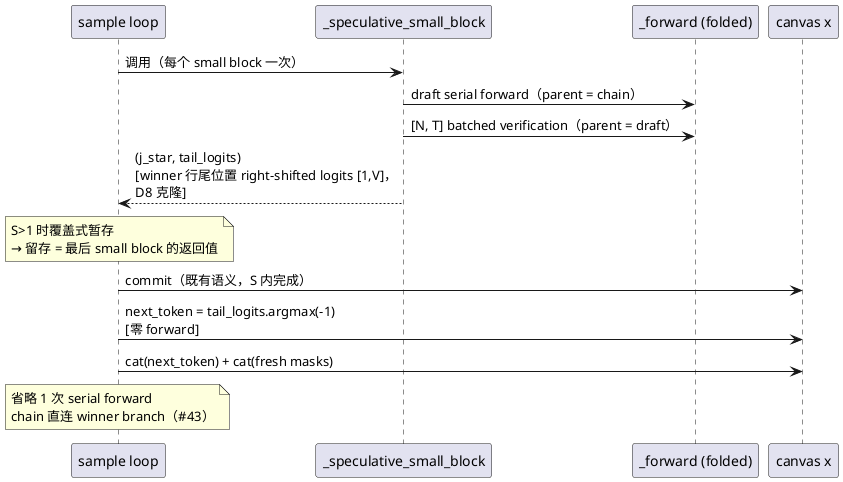
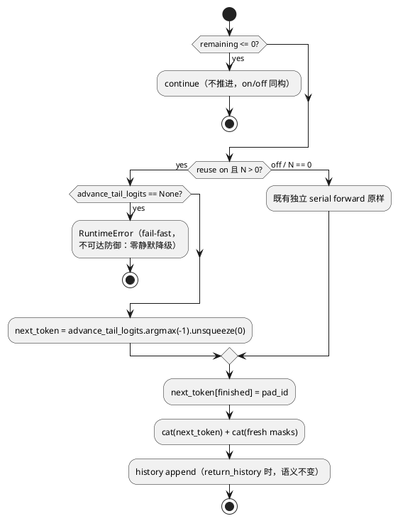

# [AR032] 详细设计

# 1 AR概述

| 组件名称 | actfold（models/sampler 投机回路 + scripts bench） |
| --- | --- |
| AR系统流水号 | AR032 |
| AR描述 | 投机验证前向的块推进复用：投机路径（N>0 + folded_model）下省略 block-advance serial forward，`next_token` 取最后一个 small block 验证前向 winner 行的尾部 argmax；opt-in（默认关 = AR031 末态逐字节不变）；Fast-dLLM v2-1.5B 真实面三臂基准（baseline / reuse-off / reuse-on），H1 质量对齐 + H2/H3 加速与归因，reps=30 预承诺单次。 |

## 1.1 项目边界（模块清单）

| 文件 | 变更类型 | 内容 |
| --- | --- | --- |
| `actfold/models/fast_dllm_sampler.py` | 改 | `FastDLLMSamplerConfig.speculative_advance_reuse`；`_speculative_small_block` 返回签名；`sample` 循环 advance 段双模式 |
| `actfold/utils/config_manager.py` | 改 | `ActFoldConfig.speculative_advance_reuse` YAML 面（#5）。〔勘误 T007：draft-1 原文误写 `actfold/config.py`——实际 YAML 消费面位于 `actfold/utils/config_manager.py`（:174 附近），实现按实际路径交付〕 |
| `tests/test_ar032_advance_reuse.py` | 新 | UT-3170~3177（配置/零回归/计数探针/等价前提/S>1/硬门/记录面/推进语义） |
| `tests/test_ar032_bench_verdicts.py` | 新 | UT-3178~3179（bench 判定纯逻辑 + repro 配对） |
| `scripts/ar032_speculative_advance_bench.py` | 新 | 三臂基准（模板沿 `ar031_adaptive_uncertainty_bench.py`） |
| `results/optimization/ar032_speculative_advance_bench.json` | 新（运行产物） | formal 工件 |
| 文档七件套 | 改 | README 六节全量重写 / RERUN 步骤 20 / AGENTS #51 / CHANGELOG / ALGORITHM §17 / EXPERIMENTS §4.5b（沿 AR031 §4.5a 编号先例；本表原「§4.6」与既有 Ablation 编号冲突，T008 修正）/ GUIDE 第三十七部分 |

**不变面（冻结边界）**：#44/#45 种子公式、min-prob 胜者规则、commit 语义、
`greedy_win_stats`/`posthoc_confidence` 探针、#43 fold-context 契约、#37
图捕获契约、非投机路径全部（baseline 与 N=0 folded-serial 的 advance
逐字节不变）。

# 2 动态行为

## 2.1 投机块推进复用时序（on 模式，FR1）



## 2.2 off 模式（对照组，零变化）

与 AR031 末态逐字节一致：advance 段独立 serial forward
（`_next_folding_branch(f"fastdllm_ar_{block_idx}")` + `_forward` +
`argmax(logits[:, -1])`）。

## 2.3 异常/边界时序



# 3 功能点分解

| 序号 | 功能点名称 | 功能点描述 | 追溯 |
| --- | --- | --- | --- |
| 1 | 配置面 | `speculative_advance_reuse` 双 config 键 + True+N=0 `ValueError` | FR4 |
| 2 | 复用机制 | `_speculative_small_block` 返回 winner 行 shifted；advance 段消费尾部 argmax；省略 serial forward | FR1 |
| 3 | 等价硬验收 | tau=1.0 全重算 on/off 轨迹逐位一致（CPU 非 split）+ S>1 错源捕获 + 输入等价前提 | FR2 |
| 4 | 三臂基准 | baseline / reuse-off / reuse-on；H1-H4 冻结判定先于数据收集；repro 双跑；canary/ledger；forward 计数侧车 | FR3 |
| 5 | 文档收口 | 七件套 + README 六节全量重写 + RERUN 步骤 20 | FR4 |

# 4 实现设计

## 4.1 功能实现思路

### 4.1.1 等价原理（构造性论证）

投机 commit 后 `x == cands[j_star]`（逐位）：`cands = x.repeat(N, 1)`
（fast_dllm_sampler.py:460），候选填充仅在 `[sb_start, sb_end)`（:469/:478），
commit 覆写同一区间（:516）——fill 之外区域（prompt/pad/已 commit 块）在
所有行同源。故**最后一个 small block** 的 winner 行 forward 输入 ==
commit 后 canvas，其 `right_shift(logits)[j_star, -1, :]` 与独立
block-advance forward 的 `logits[:, -1]` 是同一分布（同输入、同模型、同
权重、同 `(T, prompt_len)` fold ctx 对象——`_fold_ctx_for` LRU 保证两次
调用拿到同一 mask/pe/forced 对象，:701/:788）。

### 4.1.2 关键设计决策

| 决策 | 内容 | 理由 |
| --- | --- | --- |
| D1 数据流 | 方案 A（显式返回值 `(j_star, tail_logits)`）而非实例状态暂存 | 零隐藏状态、无跨 `sample` 残留；返回值即 advance 消费的**精确切片**（见 D8） |
| D2 S>1 语义 | 循环内**覆盖式暂存** `advance_tail_logits = tail_logits`（每 small block 覆盖） | 留存值天然 == 最后 small block 的返回值（FR1 冻结来源）；错源（非最后 small block）在 S>1 下 winner 行尾部仍含 `mask_id`，UT 可构造分叉捕获（UT-3174） |
| D3 不可达分支 | on 模式 advance 处 `advance_tail_logits is None` → `RuntimeError` | 投机路径下每个 fresh block 必有 mask → 必有投机调用；None 意味着机制 bug 或未来结构变化，fail-fast 优于静默降级（AGENTS #10 同精神） |
| D4 history 面 | 省略 forward 但**保留** advance 尾的 `history.append(x.clone())` | x 已更新（cat 后），snapshot 语义与 off 模式同构——history 序列零回归 |
| D5 chain 面 | on 模式不调用 `_next_folding_branch(f"fastdllm_ar_...")`（无 forward 无 branch） | 下一 block draft 的 parent = `_folding_parent` = winner cand id（#43 既有语义）直连；branch 计数器序列变化仅影响 cache key 命名，语义无关；默认 off 路径的 frozen sentinels 不受影响 |
| D6 边界同构 | `remaining <= 0` → continue；`finished.all()` 块顶 break；末块（不推进块）两侧 advance 次数均为 0 | off 模式 `remaining <= 0` 时 advance 本就不跑（fast_dllm_sampler.py:779-781）；on/off 完全同构 |
| D7 graph 路径 | 复用读 `_forward` 返回值，与 replay/eager 无关 | 零新增图交互；serial runner 的 replay 次数减少如实反映在 pool 统计（canary 口径不变：degradation 类仍须 == 0） |
| D8 返回切片 | 返回**尾行克隆** `shifted[j_star, -1:, :].clone()`（`[1, V]`） | advance 只消费尾行；若返回整行视图，暂存将滞留整个 `[N, T, V]` `right_shift_logits` cat 结果的 backing（真实面 N=4/T≈200+/V≈152k/bf16 ≈ 250-500MB 瞬态 VRAM——16GB WDDM 预算下不可接受）；`[1, V]` 克隆（~300KB bf16）无条件执行（签名简单、off 模式开销可忽略），复用读取即暂存值本身（argmax 单行） |

### 4.1.3 方案对比记录（已裁定）

方案 A（显式返回值，**采纳**）/ 方案 B（实例状态暂存，否决：隐藏状态 +
残留风险）/ 方案 C（统一 `_block_advance` 决策函数，否决：重构面大收益
相同）。

## 4.2 功能实现设计

### 4.2.1 数据结构与配置

```python
# fast_dllm_sampler.py — FastDLLMSamplerConfig 新增：
speculative_advance_reuse: bool = False
# __post_init__ 追加（#44 同型）：
#   speculative_advance_reuse=True 且 num_block_candidates == 0 → ValueError
#   （复用仅在投机路径有定义）

# actfold/utils/config_manager.py — ActFoldConfig 新增（YAML 消费面，#5；
# 勘误 T007 补遗：draft-1 原文误写 actfold/config.py，与 §1.1 表勘误同源）：
speculative_advance_reuse: bool = False
```

### 4.2.2 流程说明（`_speculative_small_block` 签名）

```python
def _speculative_small_block(...) -> tuple[int, torch.Tensor]:
    """...（既有 docstring 追加返回值说明）...
    Returns:
        ``(j_star, tail_logits)`` — 胜者行号与该行**尾位置**的
        right-shifted 验证 logits ``[1, V]``（``shifted[j_star, -1:, :]
        .clone()``，D8：断开对整个 ``[N, T, V]`` cat 结果的引用滞留；
        ``shifted`` 即 commit 打分已消费的同一张量，唯一新增算子是
        单行克隆）。AR032 advance 复用的唯一来源。
    """
```

函数体仅追加返回（`shifted` 已在 :491 计算）；j_star 计算逻辑
（min-prob / uncertainty 两个分支）逐字不变。

**FR2 AC4 处置注记（gate r1 F1）**：srs FR2 验收「Given 非投机路径，
When on/off A/B, Then 逐位一致」中「on 臂」在非投机路径上**结构空洞**——
`speculative_advance_reuse=True` 且 N=0 在构造期即 `ValueError`（合法的
on 配置必然是投机路径）；故该 AC 的实现面 = 「新代码下非投机路径
（N=0 folded-serial 与 baseline `folded_model=None`）与 AR031 末态逐位
一致」——由 UT-3171 的非投机子句显式钉住（复用机制代码在非投机路径
不触达，UT 证明这一点而非依赖审查）。

### 4.2.3 流程说明（`sample` 循环 advance 段）

```python
# block 循环内、small_block 循环前：
advance_tail_logits: torch.Tensor | None = None

# 投机调用处（:737）：
j_star, tail_logits = self._speculative_small_block(...)
if cfg.speculative_advance_reuse:
    advance_tail_logits = tail_logits  # 覆盖式：留存 = 最后 small block
break

# advance 段（:777 起）双模式：
remaining = total_len + first_block_padding - x.shape[1]
if remaining <= 0:
    continue
if bool(cfg.speculative_advance_reuse) and num_candidates > 0:
    if advance_tail_logits is None:  # D3 fail-fast
        raise RuntimeError(...)
    next_token = advance_tail_logits.argmax(dim=-1)  # [1] -> unsqueeze(0)
else:
    # 既有独立 serial forward 原样（:783-:810 逐字保留）
    ...
next_token = next_token.unsqueeze(0) if reuse-on else next_token  # [1,1]
next_token[finished] = pad_id
x = torch.cat([x, next_token], dim=1)
# fresh masks cat / history append 逐字保留（D4/D6）
```

形状核对：`tail_logits` 为 `[1, V]`；`argmax(dim=-1)` → `[1]`；
`unsqueeze(0)` → `[1, 1]` == off 路径 `logits[:, -1:, :].argmax(dim=-1)`
的 `[B, 1]`（B=1）；`next_token[finished] = pad_id` 同索引语义（行掩码）。

### 4.2.4 时序/性能面

- on 模式每 eligible block 的 `_forward` 调用：`2·num_small_blocks`
  （off：`2·num_small_blocks + 1`）；省略的恰为 1 次 serial forward
  （末块不推进，两侧均为 0）。
- 复用读取是暂存尾行 `[1, V]` 的 argmax（D8 克隆断开 `[N, T, V]`
  backing 滞留——off 模式下一次投机调用的 cat 结果在返回后即全部可回收，
  on 模式仅多滞留一行），开销可忽略；零新增设备同步（argmax 结果立即
  被 cat 消费——与 off 模式的 `argmax` 同步面完全相同，无新增
  `.item()`/readback）。

## 4.3 接口描述

| 接口 | 类型 | 变更 |
| --- | --- | --- |
| `FastDLLMSamplerConfig.speculative_advance_reuse` | 公共配置 | 新增（默认 `False`） |
| `ActFoldConfig.speculative_advance_reuse` | 公共配置（YAML） | 新增（默认 `False`，零 unknown-key 警告） |
| `FastDLLMSampler._speculative_small_block` | 私有方法 | 返回签名 `None` → `tuple[int, torch.Tensor]`（单调用面：`sample` 循环） |
| `FastDLLMSampler.sample` | 公共方法 | 签名不变；行为面 opt-in（默认逐字节不变） |
| `scripts.ar032_speculative_advance_bench` | CLI | 新增：`--reps/--quick/--model-path/--out/--hf-*`（沿 AR031 bench 参数面） |

无对外 API 破坏；`SamplerOutput`/history 契约不变。

## 4.4 代码设计

模块边界：机制全部收敛在 `fast_dllm_sampler.py` 单文件内（配置 +
方法签名 + 循环分支）；`speculative_core.py`（共享核 mixin，LLaDA/Dream）
**零改动**——Fast-dLLM 的 inline 路径不经过共享核的 `_speculative_build/
score_commit`（该面服务 LLaDA/Dream，其推进结构不同，复用面为后续 AR，
srs §2 Out-of-Scope）。bench 脚本单文件；测试两文件（机制面 + bench 判定面）。

# 5 重构设计

无（纯增量 opt-in；既有代码仅 `_speculative_small_block` 返回值与循环内
两处插入点）。

# 6 测试设计

## 6.1 单元测试（UT）

> 编号自 UT-3170 起（3169 为 AR031 末位）；测试文件
> `tests/test_ar032_advance_reuse.py`。合成模型 fixture 沿 AR021/AR022
> 既有家族（CPU、真实张量、零 mock）。

| UT | 覆盖 | 内容 |
| --- | --- | --- |
| UT-3170 | FR4/FR1 边界 | `speculative_advance_reuse` 默认 False；True+N=0 构造期 `ValueError`（消息含两键名）；`ActFoldConfig` YAML 消费无 unknown-key 警告 |
| UT-3171 | FR1 默认零回归 + FR2 AC4 | ① 投机配置（N=4+greedy）+ reuse **False**：`decode_final` + history 快照序列与 AR031 末态逐位一致（同种子双跑同构基线）；② **非投机路径子句**（FR2 AC4 实现面，gate r1 F1）：N=0 folded-serial 与 baseline（`folded_model=None`）在新代码下输出与 AR031 末态逐位一致（on 臂在非投机路径结构空洞：True+N=0 构造期 `ValueError`） |
| UT-3172 | FR1 计数探针（S=1） | wrap `_forward` 计数：on 臂每 eligible block == 2 次、off == 3 次；末块（不推进）两侧 advance 段均 0 次增量；on/off 差值 == eligible block 数 |
| UT-3173 | FR2 输入等价前提 | 捕获 batched forward 的 `cands`：投机 commit 后断言 `x == cands[j_star]` 逐位（最后一个 small block 的 winner） |
| UT-3174 | FR2 S>1 错源捕获 | `small_block_size < block_size` 几何：① 计数 == `2·num_small_blocks`/eligible block（on）；② 受控 fixture 为**内容条件化**真实模型（gate r1 F2：位置查表在首/末 small block 的尾位置同索引 → 错源不可分叉，fixture 必须按 `(token, position)` 条件化）：`emb(x) @ W + pos_bias` 的单层 `nn.Module`（真实 `nn.Embedding` + 线性，真实张量），使尾位置的 argmax 依赖该位置的**输入 token**——首 small block 验证时尾部仍为 `mask_id`、末 small block 验证时尾部已 commit 真实 token ⇒ 两者的尾 argmax 必然不同；断言正确实现的 next_token == 最后 small block 的尾 argmax，且 monkeypatch 注入「保存首个而非最后」缺陷形态时 UT 必失败（缺陷注入是测试技术，#10 清洁——#42 flag-patch 先例） |
| UT-3175 | FR2 eager 硬门 | 合成模型 + `SimilarityGate(tau=1.0)`（cosine，`sim > tau` 判 stable ⇒ 全量重算）+ CPU 非 split 路径：on/off 完整轨迹（decode_final + history）逐位一致 |
| UT-3176 | FR2 折叠记录面 | 折叠开启（tau<1，真实复用语义）：on/off 逐块 next_token 一致率以断言形式记录（一致时 decode_final 逐位一致硬断言、分叉时如实断言分叉块数 > 0，不伪造一致）；on 模式输出为合法 canvas（无 `mask_id` 残留于 decode 区域）。〔勘误 T007：draft-1 原文「一致率记录于测试输出」——交付以断言即记录（更强形式），不以 print 输出速率〕 |
| UT-3177 | FR1 推进语义 | `next_token[finished] = pad_id` 覆写（finished 行）；canvas 长度增长序列 on/off 同构（逐步长度列表相等）；`return_history` 快照数 on/off 相等（D4） |
| UT-3178 | FR3 bench 判定纯逻辑 | `tests/test_ar032_bench_verdicts.py`：H1（posthoc gap ≤ 1e-3 + decode length on==off + exact-match on ≥ off − 1e-9；`None` → refuted；边界 eps 沿 AR023/AR031 `_H1_RATIO_EPS` IEEE 噪声口径应用于 ≤1e-3 与 −1e-9 两个比较点）/ H2/H3（p50 比值严格 > 1.0 + 2σ 报告）/ H4（canary + **逐臂实际事件数驱动的 ledger 界**——#45 `LEDGER_C` 公式按各臂 forward-count sidecar 供数的实际 serial/batched 事件计数参数化，on/off 臂事件数恰差 eligible-block 数，固定公式会假失败 + repro 配对）判定函数的合成输入全分支 |
| UT-3179 | FR3 repro 配对 | repro 双跑按 `(arm, prompt_index)` 双键配对（沿 AR031 `repro_mismatch_rows` UT-3166 先例）：构造错配数据 → mismatch 行非空 → H4 refuted 且 overall refuted（H1-H3 保留各自可重算判定）；正确配对 → 严格相等通过。〔勘误 T007：本行 draft-1 原文沿 srs 措辞「全部 blocked」；T004 Red 冻结的判定函数/UT 契约为 refuted 语义（无 blocked 档）并先于 formal 运行钉死——以冻结契约为准，srs draft-3 同步勘误〕 |

**UT-3174 受控 fixture 说明**：单层内容条件化小模型（真实 `nn.Embedding`
+ 线性前向，零 mock），logits 由 `(token, position)` 共同决定——首
small block 的验证画布尾部仍是 `mask_id`，末 small block 的验证画布尾部
是已 commit 的真实 token，故两次验证前向的尾位置 argmax 必然不同；
「错拿来源」（保存首个而非最后的 tail_logits，monkeypatch 缺陷注入）
在该 fixture 下必然产出错误 next_token，验证 UT 的捕获力。

## 6.2 接口测试

- 配置导入/消费：`ActFoldConfig(speculative_advance_reuse=True)` 字段
  存在性与默认值；`FastDLLMSamplerConfig` `__post_init__` 验证顺序
  （N=0 + reuse=True 的 `ValueError` 与既有 N=0+greedy 的消息可区分）。
- `SamplerOutput` 契约不变（sequences/history 类型与形状）。

## 6.3 业务场景测试

- bench quick（T005）：Fast-dLLM v2-1.5B 真实 checkpoint，AR019 venv，
  `--quick` 几何缩小版全链三臂 + H1-H4 判定 + `_quick.json` 独立工件。
- bench formal（T006）：reps=30 预承诺单次，round-robin 交错，
  `ar032_speculative_advance_bench.json` 正式工件（覆盖保护：默认正式
  路径已存在则拒绝覆写 rc=4；显式 `--out` 为操作员自觉重跑通道——无
  run_formal_queue 的 `--force`/`--force-reason` 审计面，弱于 executor
  语义，T007 勘误如实降格措辞）。

## 6.4 异常场景测试

| 场景 | 期望 | 覆盖 |
| --- | --- | --- |
| True + N=0 | 构造期 `ValueError`（fail-fast，不静默） | UT-3170 |
| on 模式 advance 无来源（不可达防御） | `RuntimeError`，零静默降级（D3） | 代码面 + UT-3174 的错源捕获侧证 |
| 环境不满足（transformers 版本/权重缺失/显存不足） | bench 构造期显式报错 rc=2，不写部分工件 | bench `require_environment`（沿 AR031） |
| 单臂失败（OOM 等） | 进程崩溃、不写任何工件（零伪造数字，AR031 实际口径；draft-1 原文「blocked 工件 + 探针交叉引用」引用不准，T007 勘误） | bench 无 OOM blocked-工件路径（沿 AR031 实际行为） |
| repro 双跑不一致 | H4 refuted 且 overall refuted，数字原样保留；H1-H3 保留各自可重算判定（冻结 UT-3178/3179 契约语义；draft-1 原文「全部 blocked」为措辞漂移，T007 勘误） | UT-3179 + bench repro 面 |

# 7 变更记录

| 版本 | 日期 | 变更 |
| --- | --- | --- |
| draft-1 | 2026-10-22 | 初稿（方案 A/B/C 对比记录；D1-D8 决策；UT-3170~3179 矩阵） |
| draft-2 | 2026-10-22 | 设计门控 r1 FAIL 修复（子代理 `ses_e9ebff210ffe7rTOrq9hTe3m1w`）：① Important——FR2 AC4 处置注记 + UT-3171 非投机子句；② Important——UT-3174 fixture 改内容条件化（`(token, position)` 键控，位置查表在错源面空洞）；③ Important——D8 改尾行克隆 `[1, V]`（消除 `[N,T,V]` cat backing 滞留 ~250-500MB）；④ tasks.md 头更新；⑤ UT-3178 ledger 界改逐臂实际事件数驱动；⑥ UT-3178 去 `gap_bat==0` 措辞、边界 eps 明确应用于 ≤1e-3/−1e-9 两比较点 |
| draft-3 | 2026-10-22 | 设计门控 r2 残留修复（子代理 `ses_e9eb049ddffeGubs4PtxMw11M3`）：D3/§2.3 残留 `advance_winner_shifted`/`winner_shifted[-1:]` 命名统一为 `advance_tail_logits`/`tail_logits`；tasks.md 版本引用 draft-1 → draft-2 |
| draft-4 | 2026-10-22 | T007 review 收口（审查子代理 `ses_e9e0bc23dffeR1htgBsxW1iO8X`，PASS + 4 Important + 5 Minor）：① §1.1 模块路径勘误（`actfold/config.py` → `actfold/utils/config_manager.py`）；② UT-3179/6.4 行 blocked→refuted 语义勘误（以冻结 UT 契约为准，srs draft-3 同步）；③ 6.3 覆盖保护措辞降格（无 executor `--force` 审计面）；④ UT-3176「记录于测试输出」→ 断言即记录；⑤ 6.4 单臂失败行按 AR031 实际口径勘误；测试面强化：UT-3173 由 some-row 升格为 `cands[j_star]` 精确钉住（`_WinnerRowRecorder` 探针）、UT-3171 补 sentinel-suite 依赖注记、两测试文件 Red 态措辞改过去时 |
| final | 2026-10-22 | T008 ST 收口：§4.2.1 代码块残留 `actfold/config.py` 补遗勘误（与 draft-4 ① 同源）；srs final 同步（req r3 两 Minor 落地 + graph-mode 残留补遗）；ST 验收见 st-cases.md |
