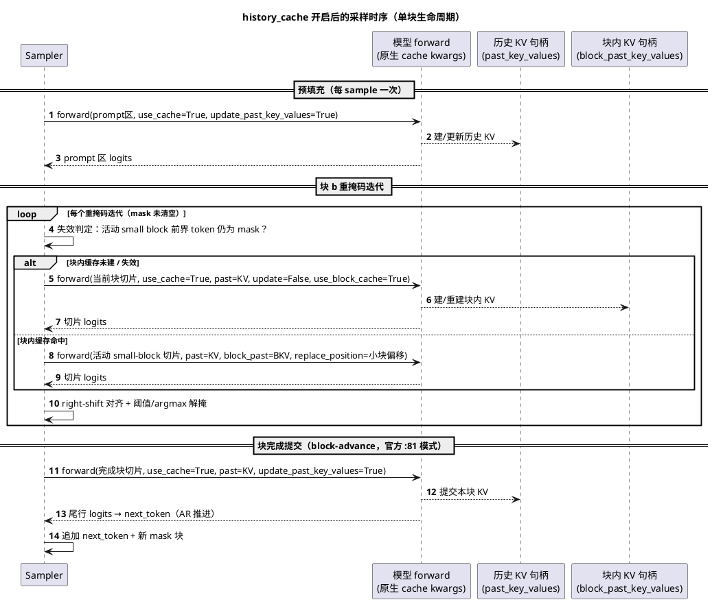
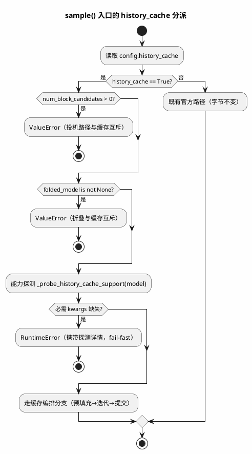
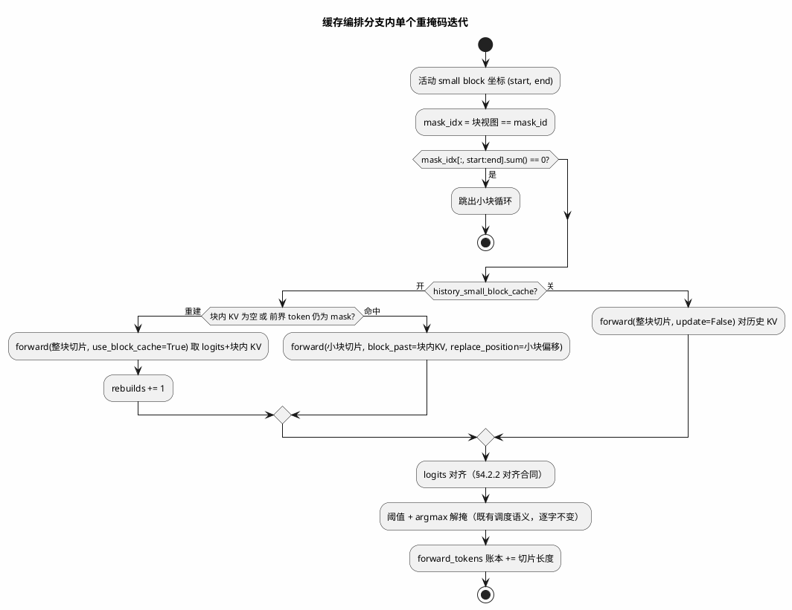
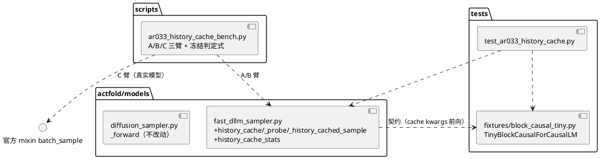

# AR033 详细设计 — Block-causal 精确历史缓存（官方 v2 parity）

| 组件名称 | actfold/models/fast_dllm_sampler.py（history_cache 模式）+ tests fixture + scripts/ar033_history_cache_bench.py |
| --- | --- |
| AR系统流水号 | AR033 |
| AR描述 | `FastDLLMSampler` 新增默认关闭的 `history_cache` 采样模式：跨块历史 KV 缓存 + 块内 small-block KV 缓存（官方 Fast-dLLM v2 `batch_sample` parity），重掩码迭代前向从 [T] 收缩到活动切片；同时交付非缓存基线臂 strawman 勘误与三臂实机基准（A 非缓存基线 / B history_cache / C 官方原生参照）。 |

# 2 动态行为

## 2.1 交互时序图

关键交互律：
- 历史 KV 句柄对 sampler 是**不透明对象**（委托合同：原样持有、原样回传，绝不触
  摸内部结构）；
- 提交前向与 block-advance 前向是**同一次调用**（官方 :81-85 模式：块完成后一次
  forward 同时完成 KV 提交与 next_token 生成）；
- 每迭代的切片前向 `update_past_key_values=False`（历史只读）。

# 3 功能点分解

| 序号 | 功能点名称 | 功能点描述 | 溯源 |
| --- | --- | --- | --- |
| 1 | history_cache 主开关 | `FastDLLMSamplerConfig.history_cache`（默认 False 字节不变）；开启后官方路径采样循环切换为分层缓存形态 | FR1 |
| 2 | 跨块历史缓存编排 | 预填充建史 / 每迭代块切片前向 / 块完成提交+AR 推进合一 | FR1 |
| 3 | 块内 small-block 缓存 | `history_small_block_cache` 子开关；官方边界失效规则（前界 token 仍 mask → 整块重建） | FR2 |
| 4 | 能力探测与委托合同 | forward 签名探测（#15 先例）；不支持 → armed 路径 RuntimeError；kwargs 只传探测交集 | FR1 |
| 5 | logits 对齐合同 | 切片 logits 的 right-shift 对齐由 fixture 契约钉固 + T001 真实模型探针落锤；偏差走显式行偏移校正，禁止静默失配 | FR1/FR3 |
| 6 | 互斥与 fail-fast | history_cache × num_block_candidates>0 / × folded_model 均 ValueError；KV 形状失配 RuntimeError | FR1 |
| 7 | 计数器探针 | `history_cache_stats` 只读实例探针（prefill/slice/commit/rebuild 计数 + forward_tokens 账本） | FR4(H3) |
| 8 | tiny 真实 fixture | fp32 block-causal 2 层小模型，实现同构 cache kwargs 前向契约（tests/） | FR3 |
| 9 | 三臂基准脚本 | A/B/C 三臂、冻结 H1-H4、--quick 独立工件、覆盖保护、(arm, prompt_index) 复算 | FR4 |
| 10 | strawman 勘误 | README/AGENTS/CHANGELOG 基线口径圈定 + 官方行号引用 | FR5 |
| 11 | 复现文档 | RERUN 步骤 + README 复现块（权重重下/venv 重建/命令/资源表） | FR6 |

# 4 实现设计

## 4.1 功能实现思路

**方案对比（需求期裁决，记录于此）：**

- **方案 A（纯委托）**：sampler 只做 kwargs 透传，完全依赖模型原生 cache。
  缺点：UT/合成面必须复刻 remote-code 语义；pad 排除与 logits 对齐不可控；
  官方 mixin 未覆盖我们的画布几何（左 pad 对齐 + forced 语义）。不采纳。
- **方案 B（自研 KV 力学）**：在 ActFold 前向内自采 K/V、自构历史注意力。
  缺点：重写注意力面、偏离官方 parity 目标、真实 checkpoint 上绕开模型自身优
  化路径、交付与验证面过大。不采纳。
- **方案 C（混合，采纳）**：**sampler 拥有编排，模型拥有 KV 力学**。sampler
  负责预填充/切片/提交/失效判定/计数/互斥/对齐校正；KV 的捕获与重放委托给
  模型原生 cache kwargs（真实 checkpoint = remote-code 原生路径，官方 mixin
  即该委托合同在真实面成立的证据）；UT 用实现同一前向契约的 fp32 tiny 真实
  模型（tests fixture，真实计算非 mock，#10）。

**零回归合同**：`history_cache=False`（默认）时新代码路径完全不可达——所有
新逻辑在 `if bool(self.config.history_cache):` 分支内，与 AR021「默认关字节
不变」同一模式；UT 钉固默认关与 AR032 终态输出逐位一致。

**与折叠谱系的关系（设计期定性）**：历史缓存使冻结前缀的折叠 FFN 复用失去
计算对象（前缀不再进入前向）；本 AR 将 history_cache 与 folded_model 定为
互斥（各自独立的计算策略），组合机制记入路线图。基准 sidecar 记录该定性，
不作为机制档交付。

## 4.2 功能实现设计

### 4.2.1 流程图

### 4.2.2 流程说明

**（a）画布几何与切片坐标。** 画布 = `[prompt(含左pad) | 对齐pad | block₀ |
block₁ | …]`（既有几何）。历史区 = 已完成块 + prompt/对齐区；活动切片 =
当前块 `[T-block_size, T)`（或块内缓存命中时为活动 small block 子区间）。
坐标全部来自 host 元数据（T、prompt_len、block_size、small_block_size），
零 device readback（#43 律）。

**（b）预填充。** `sample()` 进入缓存分支后首先对历史区（prompt+对齐pad，
即首个 mask 块之前的全部位置）做一次 `forward(use_cache=True,
update_past_key_values=True)`，持有返回的 `past_key_values` 句柄。
`attention_mask = x != pad_id`（B5 pad 排除，仅当探测交集接受该 kwarg）。

**（c）重掩码迭代。** 每迭代只前向活动切片（子开关关：整块；开：小块，
含边界失效规则——活动小块的前界 token（上一小块末 token）仍为 mask 时整块
重建块内 KV，与官方 :102 语义一致）。调度决策逻辑（阈值 + 每迭代保底
argmax + stop 处理）**逐字复用**既有代码路径的调度语义，仅前向来源不同。

**（d）块完成提交 + AR 推进合一。** 块内全部解掩后，一次
`forward(完成块切片, update_past_key_values=True)`：历史 KV 提交本块 + 返回
尾行 logits → `next_token = argmax`（官方 :81-85 模式）；替代既有 advance
全画布前向。`next_token` 追加后挂新 mask 块（既有几何逻辑不变）。

**（e）logits 对齐合同（本设计的关键风险面，显式钉固）。** 既有路径在**
全画布** logits 上做 `right_shift_logits` 后切 `[:, -block_size:]` 再切
`[:, start:end]`；缓存路径拿到的是**切片** logits。合同：

1. **契约定义**（fixture 钉固）：模型的 cache 前向返回的切片 logits 等于
   全画布前向 logits 在切片位置的行（逐行同值——FR3 位级面）；sampler 对
   切片 logits 应用与全画布 shift **行等价**的对齐：块行 0（token-shift 的
   跨界行）取历史末行 raw logits，块内行 j 取切片行 j-1。历史末行 raw
   logits 由预填充/上一次提交前向的尾行提供（sampler 持有一份 clone，
   防返回视图钉住大缓冲——#51 D8 律）。
2. **真实面落锤**（T001 探针）：在真实模型上对比 cache 前向与全画布前向
   的输出行对齐；若 remote 模型的 cache 输出已内置行偏移（官方 cat 语义
   提示存在此可能），委托适配层应用**显式行偏移校正**并记入探针工件；
   禁止静默失配（对齐失配的表现 = FR3 位级面失败，必然被 UT/探针捕获）。

**（f）能力探测。** `_probe_history_cache_support(model)`（#15 签名探测先
例）：inspect `model.forward` 参数，记录必需集
`{use_cache, past_key_values, update_past_key_values}` 与子开关集
`{use_block_cache, block_past_key_values, replace_position}`、可选集
`{attention_mask}` 的接受情况；armed 路径缺必需集 → `RuntimeError`（消息含
探测详情）；子开关开而子开关集缺失 → `RuntimeError`。调用 kwargs **只传探
测接受交集**，绝不发明 kwargs。探针结果缓存于实例（模型不变）。

**（g）互斥与 fail-fast。** `history_cache=True` 且
`num_block_candidates>0` → `ValueError`（投机路径未定义面）；且
`folded_model is not None` → `ValueError`（两种计算策略互斥，见 §4.1）。
KV 句柄层数/形状与预期不符 → `RuntimeError`（fail-fast，禁止截断式继续）。

**（h）计数器探针。** `history_cache_stats` 只读 dict（实例级，跨 sample
累计，bench 用 before/after 快照差分）：
`{"prefill_forwards", "slice_forwards", "commit_forwards", "block_rebuilds",
"forward_tokens"}`；`forward_tokens` 账本 = 每次前向的输入 token 数之和
（H3 的整数恒等式数据源）。

**（i）异常流程。** 探测失败/互斥在 `sample()` 入口 fail-fast（上电即败，
不耗算力）；运行中 KV 失配 RuntimeError 带操作指引；CUDA OOM 按既有面处
理（工件如实记录，不静默降级）。

## 4.3 接口描述

**内部新增接口（本仓内）：**

1. `FastDLLMSamplerConfig.history_cache: bool = False`、
   `FastDLLMSamplerConfig.history_small_block_cache: bool = False`；
   `__post_init__` 增互斥校验。`ActFoldConfig` 增同名消费键（#5 模式，
   load_config 消费不告警）。
2. `FastDLLMSampler._probe_history_cache_support(model) -> _CacheSupport`
   （冻结 dataclass：必需/子开关/可选集 + 对齐偏移占位）。
3. `FastDLLMSampler._history_cached_sample(...)`：缓存编排分支主体（入口
   分派进 `sample()`，与既有路径完全隔离）。
4. `FastDLLMSampler.history_cache_stats`：只读属性探针。
5. tests fixture：`TinyBlockCausalForCausalLM`（fp32、2 层、hidden 32、
   块因果注意力 + token-shift 语义），forward 契约：
   `forward(input_ids, use_cache, past_key_values, update_past_key_values,
   attention_mask=None, block_size=..., use_block_cache=False,
   block_past_key_values=None, replace_position=None)`
   → `(logits, past_key_values[, block_past_key_values])`；cache/无 cache
   两态切片行逐行同值（fixture 自检钉固契约 (e)1）。
6. `scripts/ar033_history_cache_bench.py`：三臂基准（§6.3）。

**第三方接口（真实 checkpoint remote code，T001 探针落锤）：**

- 必需 kwargs 集（上文 (f)）；`attention_mask` 与 cache kwargs 的共存性；
- cache 前向输出行对齐（§4.2.2 (e)2）；
- 官方 mixin `Fast_dLLM_QwenForCausalLM.batch_sample` 挂接面（C 臂）：
  `types.MethodType` 挂接 + `sample_with_top_p`/tokenizer 依赖，逐项探测
  记录；不兼容 → C 臂 blocked（零伪造，srs FR4）。

## 4.4 代码设计

要点：
- `diffusion_sampler.py` 的 `_forward` **不改动**（缓存分支在
  `fast_dllm_sampler.py` 内独立调 `self.model.forward`，kwargs 走探测交集；
  避免污染共享尾参合同）；
- fixture 放 `tests/fixtures/`（测试载体，非生产代码——生产模型族不新增）；
- bench 沿用 AR031/AR032 模板骨架（`require_environment`、`--quick`、覆盖
  保护、`(arm, prompt_index)` 复算键控、判定函数先于数据收集冻结）。

# 5 重构设计

无既有代码重构。既有官方路径（`sample()` 主体）仅新增入口分派
`if history_cache: return self._history_cached_sample(...)`，其余逐字节不动
（零回归合同，UT 钉固）。

# 6 测试设计

| 测试点描述 | 测试专项 | 测试因子描述 | 组合方式 | 逻辑覆盖 |
| --- | --- | --- | --- | --- |
| 缓存编排正确性 | UT | 开关（off/跨块/跨块+块内）× batch(1,2) × 形状(≥4点) × pad(有/无) | 全遍历（关键因子） | 路径覆盖 |
| 位级精确性 | UT | cache 臂 vs 基线臂贪心 token 序列 | 全遍历 | 路径覆盖 |
| 失效规则 | UT | 前界 token 未解掩时序（人为调度） | 定向构造 | 判定覆盖 |
| 默认关零回归 | UT | 全开关关 vs AR032 终态 | 全遍历 | 语句覆盖 |
| 互斥/fail-fast | UT | 投机×缓存 / 折叠×缓存 / 缺 kwargs / KV 失配 | 定向构造 | 判定覆盖 |
| 三臂基准 | 基准 | A/B/C × reps × prompt 集 | 预承诺单次 | 判定覆盖 |

## 6.1 单元测试（UT）

`tests/test_ar033_history_cache.py`（编号接续既有序列）：

1. **UT-3301 位级等价（主面）**：fixture 上贪心多块生成，cache off /
   跨块 / 跨块+块内 三态输出 token 序列 `torch.equal`；≥4 形状点
   （block_size 32/16、T 128/256）；batch 1/2；有 pad / 无 pad。
2. **UT-3302 对齐合同**：fixture 切片行 vs 全画布行逐行同值（契约 (e)1 的
   直接钉固，含块行 0 的历史末行来源）。
3. **UT-3303 失效规则**：构造「前界 token 迟迟未解掩」调度，断言 rebuild
   恰发生在规则点；命中/重建两路输出一致。
4. **UT-3304 计数恒等**：`history_cache_stats` 的 `forward_tokens` 账本 ==
   几何预测整数（预填充 P + Σ块(Σ迭代·切片长 + 提交·block_size)），
   `prefill+commit+slice` 计数与几何预测相等。
5. **UT-3305 默认关零回归**：全开关关时与既有路径输出逐位一致 +
   `_probe_history_cache_support` 不被调用（探测零副作用）。
6. **UT-3306 互斥与 fail-fast**：五类非法组合各断言异常类型与消息关键段。
7. **UT-3307 能力探测**：缺必需 kwargs 的桩模型（真实 nn.Module，签名缺
   失）→ RuntimeError 详情；子开关开而子开关集缺失 → RuntimeError；
   kwargs 只传交集（以 fixture 的接受面断言实际调用面）。

## 6.2 接口测试

fixture 前向契约的自检面（cache/无 cache 切片行同值）在 UT-3302 覆盖；
`history_cache_stats` 探针 schema（键集、只读性、跨 sample 累计）单独 UT。

## 6.3 业务场景测试（三臂基准，冻结判定式）

`scripts/ar033_history_cache_bench.py`，真实 checkpoint
（Fast_dLLM_v2_1.5B bf16，AR019 venv），贪心 temperature=0，batch 1，
多块工作负载（既有 bench prompt 集，解码长度面 34/66 先例），reps=30 轮转
单次预承诺，#39 计时纪律（perf_counter + synchronize，warmup 丢弃）：

- **臂 A**：既有官方路径（非缓存全量重算）；
- **臂 B**：`history_cache=True` + `history_small_block_cache=True`（完整
  parity 配置），`folded_model=None`；
- **臂 C**：官方 mixin `batch_sample` 挂接同一模型实例（report-only 定位
  臂；不兼容 → blocked 工件 + 最小复现签名，零伪造）。

**冻结判定式（先于数据收集写入脚本，交付后不回改）：**

- **H1 质量（hard）**：B vs A —— (a) 每 prompt 解码长度严格相等；
  (b) token 一致率 ≥ **0.98**（吸收 bf16 ULP 近并列翻转；低于门限 =
  refuted，漂移样本入工件）；(c) posthoc 置信度均值 gap ≤ **0.01**。
- **H2 速度（hard）**：`p50(A)/p50(B) > 1.0`（严格）；B vs C p50 比值
  report-only（parity 定位面，无门限）；平台注记 WDDM（#46）。
- **H3 账本（hard）**：B 臂 `forward_tokens` == 几何预测整数（精确相等）；
  A 臂账本 == Σ迭代·T_call（精确相等）；B < A（结构必然，仍显式判定）。
- **H4 canary/repro（hard）**：B 臂探测降级计数 == 0（ armed 路径零静默
  回退）；复算双跑按 `(arm, prompt_index)` 严格行相等（失配 → 全部判定
  blocked，AR031 一票否决先例）；覆盖保护（已有工件拒绝覆盖除非
  `--force` + `--force-reason`）；`--quick` 独立 `*_quick.json` 工件。

工件：`results/optimization/ar033_history_cache_bench.json`（formal）/
`ar033_history_cache_bench_quick.json`（quick，永不冒充 formal）。

## 6.4 异常场景测试

- 环境缺失（权重/venv/CUDA）→ `require_environment` rc=2 不写工件；
- C 臂 mixin 不兼容 → C 臂 blocked，A/B 判定独立成立（srs FR4）；
- GPU 僵尸/WDDM 挂起 → #46 杀僵尸协议后干净重跑（不计入预承诺运行的
  fishing；预承诺运行本身的复算失配按 H4 阻塞，不重跑）；
- 运行中 OOM → 工件如实记录 blocked（零伪造数字）。

# 6.5 设计期发现：基线臂 block-advance off-by-one（必须在 B 臂交付前修复）

**发现过程**：审计 checkpoint 自带 modeling.py（权重目录 `modeling.py:652-831`
原生含官方 `generate()`——C 臂直接调用，无需挂 NVlabs mixin）时，token-shift
约定被三重证据钉固：

1. 训练代码：`loss_function(logits, labels)` 的 HF 内部位移 ⇒ raw[p] 预测
   位置 p+1 的 token（modeling.py:641）；
2. 官方 denoise：切片 logits `cat([:1], [:-1])` ⇒ 位置 q 消费 raw[q-1]
   （modeling.py:775/788/797）；
3. 官方 advance：**无位移**取 `logits[:, -1:]` = raw[末位] ⇒ 下一块首 token
   （modeling.py:745，NVlabs `generation_functions.py:83` 同）。

**缺陷**：ActFold 基线臂 advance（`fast_dllm_sampler.py:871-872`）对全画布
logits 先 `right_shift_logits` 再取 `[:, -1:]` = raw[T-2]（预测位置 T-1），
而正确行为是取**未位移**尾行 raw[T-1]（预测位置 T）。后果：多块生成的每个
块推进 token ≈ 复制本块末 token（模型对已解掩位置的预测通常就是该位置现值）。

**修复范围（T004 内交付）**：
- 既有官方路径 advance：改为取未位移尾行（`raw[:, -1:]`）；
- AR032 投机路径 `speculative_advance_reuse` 的尾行 stash 同步改为未位移尾行
  （`_speculative_small_block` 返回值第二项），保持 on/off 臂在 advance 缝
  的 A/B 等价性（该等价是 AR032 冻结合同，两臂同步修复后依然成立）；
- 既有单块内 denoise 消费行**不变**（`right_shift` 后按位切——该路径正确）。

**勘误义务（并入 FR5）**：AR033 前的多块工件（含 AR022/031/032 基准的
34/66 token 解码面）的块推进 token 携带旧约定——其 A/B 内部对照仍有效
（两臂同错则比对有效），但不代表官方语义；README 勘误注记载明。

**T001 探针补一项（empirical 落锤）**：真实权重上 teacher-forcing 探针——
无 mask 全 prompt 前向后检验 `argmax(raw[p]) == token[p+1]` 的命中率
（R1 约定）vs `== token[p]`（R2），预期 R1 显著占优；探针结果入工件。

# 7 设计期开放项（T001 探针已落锤，2026-10-24 实测）

| 开放项 | 探针结果（真实 Fast_dLLM_v2_1.5B bf16 @RTX 5000） | 落锤结论 |
| --- | --- | --- |
| remote forward cache kwargs | P1：`use_cache/past_key_values/update_past_key_values/block_size/use_block_cache/block_past_key_values/replace_position` **全部接受** | 委托合同完整成立；probe 面全绿 |
| attention_mask 共存 | 建模代码 :490-496 eval **无条件覆写**外部 mask（`eval_block_diff_mask`=纯 block-causal，:89-94） | cache 路径不传 attention_mask（官方语义）；A/B 两臂在真实面同构忽略外部 mask（B5 pad 排除在真实 remote 模型上本就 inert——勘误注记） |
| cache 前向输出行对齐 | **P3：prefill/slice cache 前向 vs 全画布 maxdiff=0.000000（位级精确）**，argmax match 1.0 | 无需行偏移校正；跨块历史缓存在真实 checkpoint 上**逐位成立** |
| 块内 replace 路径 | P4：block-cache 部分前向 maxdiff=0.3125——掩码语义等价（全真显式 vs None）下的 **sdpa kernel 路径数值漂移**（bf16 28 层累积） | 块内缓存=官方 parity 漂移面：bench 结构精化为 **B1（跨块 only）位级面** + **B2（+块内）漂移面**（H1 冻结门限吸收 B2；B1 期望 token 一致率 1.0）；UT fixture（fp32 同注意力代码）保持位级钉固 |
| 官方配方可挂接性 | checkpoint modeling.py 原生含 `generate()`（:652-831，含 `use_block_cache` 两态与 `sample_with_top_p`） | C 臂直接调用原生 `generate()`，无需 NVlabs mixin |
| 基线臂 advance 行约定（§6.5） | **P2：teacher-forcing hit_next(R1)=0.9028 / hit_self(R2)=0.0000** | R1 决定性确认 ⇒ A 臂 advance 修复 + AR032 stash 同步修复（T004）按 §6.5 执行 |

# 8 交付收口（2026-10-24，formal 后）

| 交付面 | 收口事实 |
| --- | --- |
| 机制（T004） | `fast_dllm_sampler.py`：`history_cache`/`history_small_block_cache` 双开关（默认关逐字节不变）、`_history_cached_sample`（:778+）、能力探针（named-parameter 严格性）、七类整数账本 `history_cache_stats`；§6.5 advance 修复（:1296，R1 未移位尾行约定）+ stash 修复（:703）落地 |
| UT（T005） | `tests/test_ar033_history_cache.py` 15 例全绿（UT-3301~3307）；全仓回归 **1480 passed / 4 skipped / 3 deselected**（1465 + 15）；mypy actfold 0 error |
| 基准（T006-T008） | `scripts/ar033_history_cache_bench.py` 四臂（A/B1/B2/C）、冻结 H1-H4、raw-call recorder 类几何重建账本、C 臂签名探针 + `_resolve_mask_token_id`（#25 坑修复）、覆盖保护 rc=4/rc=3；quick 两次运行（第二次为 C 臂 mask id 修复后）；**formal 预承诺单次**：`results/optimization/ar033_history_cache_bench.json`，**overall supported（H1-H4 全绿）**——p50 A=25592.2 / B1=19703.0 / B2=16584.4 / C=25261.7ms；H2 B1 1.2989× / B2 1.5431×（B2 vs B1 1.188×）；C report-only B1 1.2821× / B2 1.5232× / official_vs_baseline 1.0131×；H3 账本 A=5280 / B1=2208 / B2=714（B2/A=0.1352）；H1 gap 0.0 / decode [34,66] / rate 1.0；H4 canary 全绿 + repro 8/8；sigma ~8200-8400ms（运行中段外部 CPU 争用，round-robin 交错保护 p50 比较） |
| 勘误（FR5） | README 全量更新（创新表行 18 / 机理 §17 / 最新结果头条 / ladder 第 14 档 + 读表口径重述 / 质量基线 1480 / 快速上手 / 路线图第 16 条）；AGENTS #52（历史缓存合同 + 基线口径律）；CHANGELOG AR033 条目；RERUN 第 21 步；ALGORITHM §18 / EXPERIMENTS §4.5c 简节；冻结工件与判定函数零回改 |
| 设计精化追溯 | §7 P4 落锤兑现：B 拆为 B1（位级面，rate 1.0 实测）/B2（漂移面，H1 门限吸收）；B2 快于 B1 1.188× 证实块内缓存增量真实；P3 位级前提在 formal H1（gap 0.0）成立 |
| 质量门（T010） | black 200 files unchanged / isort / pyflakes 零告警；mypy actfold 75 + scripts 31 均 0 error；pytest 全量 **1480 passed / 4 skipped / 3 deselected**（152.36s）——新基线 |
| 归档与同步（T011） | 本地 commit `ab8eabb`（14 files，+4439/−57）；gitee 段推送 `f5423ae..5539e6d`（commit-tree 段）；终树核验 `main^{tree} == gitee/main^{tree} == aabd4e4` **PASS**；spec 归档（srs Delivered / design §8 收口；tasks.md 按 AR031/032 先例不归档） |
