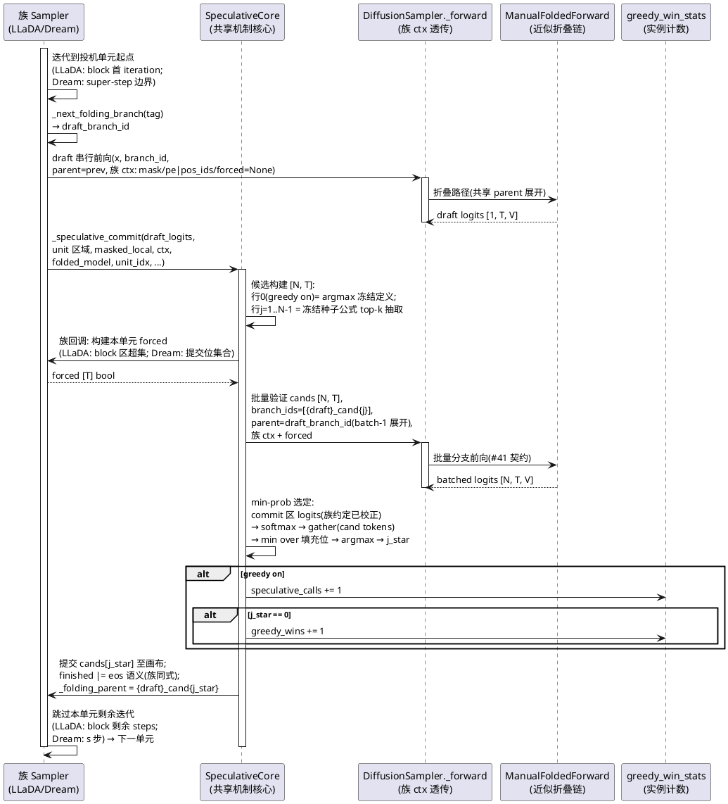
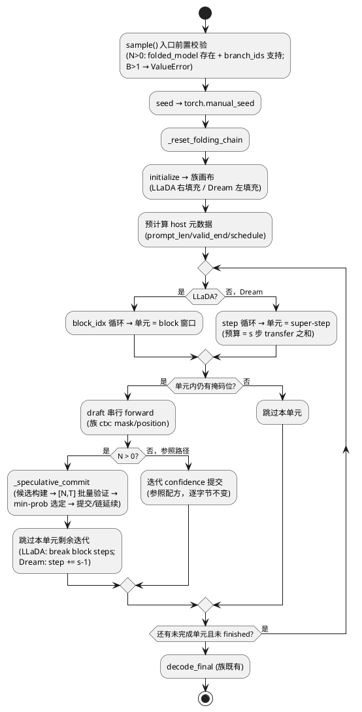

# 1 AR概述

| 组件名称 | ActFold / actfold.models（跨族投机解码生产链） |
| --- | --- |
| AR系统流水号 | AR023 |
| AR描述 | 贪心锚定投机解码跨族泛化：将 AR021 生成循环折叠 + 投机块候选与 AR022 贪心锚定候选的完整生产链，以**共享机制核心（SpeculativeCore）+ 两族薄适配层**的架构移植到 `LLaDASampler`（右填充块解码）与 `DreamSampler`（左填充全画布迭代）；LLaDA-8B / Dream-v0-7B 真实 checkpoint 四模式基准（reps=30 预承诺），质量分级门（OQ1 定案 rev 3）+ 加速比>1；模型探针（T001）先决定量化口径（8bit 优先）与 graph 口径（可行则开+注记），预定义降级规则（某族不可行→UT 合成验证+blocked 注记，另一族不阻塞）。 |

# 2 动态行为

## 2.1 投机单元处理时序图（共享核心 + 族适配；greedy 胜出/落败两分支）



# 3 功能点分解

| 序号 | 功能点名称 | 功能点描述 | srs 追溯 |
| --- | --- | --- | --- |
| 1 | 模型探针 | `scripts/ar023_family_probe.py`：下载/加载/bf16 VRAM/8bit/冒烟/graph 余量/prompt 适配七面逐项实测 + 结论字段（dtype_choice/graph_enabled/degraded） | FR1 |
| 2 | SpeculativeCore 共享机制核心 | `actfold/models/speculative_core.py`：候选构建（贪心行 0 + 冻结种子随机行）、min-prob 选定与提交、链延续、greedy_win_stats、_supports_branch_ids、ctx LRU 骨架 | FR2/FR3 机制面 |
| 3 | LLaDA 族适配 | block 投机单元循环 + 右填充画布 ctx（pad 列排除 mask）+ eos/finished 语义 + B==1 限制 | FR2 |
| 4 | Dream 族适配 | super-step（s 步预算合并）投机单元 + 左填充 ctx（bool mask + position_ids 透传扩展）+ maskgit_plus 置信选位 | FR3 |
| 5 | 配置面 | 两族 config dataclass 新字段 + `ActFoldConfig` YAML 消费面（num_block_candidates/candidate_top_k 新增，candidate_include_greedy 复用）+ per_model YAML | FR4 |
| 6 | 基准脚本与工件 | `scripts/ar023_cross_family_bench.py --family`：四模式 + 分级质量门 + 速度门 + H4 全栈 + 复现自检 + 每族一工件 | FR5 |
| 7 | 质量门 | 全量 pytest ≥951/4/0 + 双文件新 UT + lint 三件 + demo 锚点不动 | FR6 |
| 8 | 文档五件 | README 全量中文重写 + AGENTS 新条目 + GUIDE + CHANGELOG + RERUN | FR7 |

# 4 实现设计

## 4.1 功能实现思路（按方案对比定案）

### 4.1.1 架构定案：共享机制核心 + 两族薄适配（方案 A）

机制核心一份（SpeculativeCore），两族只写适配回调；`FastDLLMSampler` 冻结面零改动
（AR021/AR022 机制在其类内自留实现）——**机制核心双源**是接受的暂时成本，注记
后续统一 AR（§5）。

**单一来源承诺（泛化论证的结构证据）**：冻结种子公式
`(S0·1_000_003 + unit_idx·8_191 + sub_idx·131 + j) & 0x7FFF_FFFF`、贪心行 0 =
top-k 有序集首位（argmax 冻结定义）、min-prob 公平竞争（可落败）、N 语义总数
不变（行 j 保持行号）、`branch_ids` 命名 `{draft}_cand{j}`——全部只在
SpeculativeCore 出现一次，两族与 Fast-dLLM 的机制一致性由 UT-2301 系常量断言
钉死（种子公式常数逐项与 `fast_dllm_sampler.py:411` 对拍）。

**与 Fast-dLLM 实现的两处语义泛化（有意差异，设计冻结）**：
1. **min-prob 评分域**：Fast-dLLM 版对整个 small-block 区评分（含已提交位）；
   Core 对**填充位集合**（本单元仍掩码且被候选填充的位）评分——块起点全掩码时
   两者等价（投机发生在单元首迭代），Core 口径更普适（Dream super-step 单元的
   填充位是 confidence 选位的子集）。UT-2301 注记此差异。
2. **logits 位置约定**：Core 接受**已族校正**的 commit 区 logits——族适配层
   按各自参照路径的**默认约定**在进入 Core 前完成移位处理：Fast-dLLM 与
   **Dream 做 `right_shift_logits`**（`DreamSamplerConfig.right_shift_logits`
   默认 `True`，`dream_sampler.py:49/:149-150` 参照路径同式——AR 对齐模型位
   置 i 预测 i+1，`sampling_utils.py:334-343` 文档契约）；**LLaDA 不移位**
   （默认 `False`，`llada_sampler.py:54/:210-211`，位置 i 预测位置 i）。Core
   零感知（接收方约定：进入 Core 的 logits 语义即"位置自预测"）。UT-2304/
   UT-2310 移位约定断言钉死。

**替代方案权衡（G7 补）**：方案 B=两族各自内嵌全套实现——机制常数三源
（Fast-dLLM+两族）漂移风险，跨族一致性靠纪律非构造，族间经验差异无法排除实
现漂移解释，削弱泛化论证；方案 C=直接泛化改造 `FastDLLMSampler`——违反 srs
Out-of-Scope 的 Fast-dLLM 冻结面零改动约束（AR021/AR022 冻结面扰动风险）。
方案 A（共享核心+薄适配+冻结常数单一来源+UT 常量对拍钉死）为定案。

### 4.1.2 SpeculativeCore 契约（FP2）

```python
# actfold/models/speculative_core.py（新增，~230 行）
@dataclass
class SpecCtx:
    """族适配的投机前向上下文（静态三元组，LRU 缓存对象钉扎）。

    mask: 族折叠路径接受的 attention mask 形态（LLaDA: [T, T] bool 排除 pad 列;
          Dream: [1, T] bool + position_ids 组合）——形态由族适配层定，Core 零感知。
    position: 位置语义载荷（LLaDA: rotary (cos, sin) 或 None;
              Dream: position_ids [1, T]）——经 _forward 的对应尾参透传。
    """
    mask: torch.Tensor
    position: Any | None

class SpeculativeCore:
    """贪心锚定投机候选的共享机制核心（mixin，宿主为 DiffusionSampler 子类）。

    宿主契约：
    - config 暴露 num_block_candidates / candidate_top_k / candidate_include_greedy
      （Dream 宿主额外暴露 speculative_steps）；
    - 宿主持有 _greedy_wins / _greedy_spec_calls 实例计数（__init__ 初始化 0）；
    - 宿主实现 _spec_ctx_for(x, prompt_len) -> SpecCtx（族画布适配，LRU 骨架
      由 Core 的 _ctx_cache_get/_ctx_cache_put 提供，键 (T, prompt_len)，上限 32）；
    - 宿主实现 _commit_region_for(...)（单元区域坐标）与 _build_unit_forced(...)
      （单元 forced 张量）——见各族小节。
    """

    @property
    def greedy_win_stats(self) -> dict[str, int]: ...
    # {"greedy_wins", "speculative_calls"}——只读，跨 sample 存活（AR022 口径）

    @staticmethod
    def _supports_branch_ids(folded_model: Any) -> bool: ...
    # 与 fast_dllm_sampler.py:325-349 逐字对拍（签名探测），UT-2301 常量钉死

    def _speculative_commit(
        self,
        x: torch.Tensor,                    # [1, T] 画布（就地变更）
        finished: torch.Tensor,             # [1] bool
        draft_logits_region: torch.Tensor,  # [1, S, V] 单元区已族校正 draft logits
        region_start: int,                  # 单元区画布起点
        masked_local: torch.Tensor,         # [M] 单元区内仍掩码位（局部坐标）
        draft_branch_id: str,
        ctx: SpecCtx,
        unit_forced: torch.Tensor,          # [T] bool 本单元 forced
        folded_model: Any,
        unit_idx: int,
        sub_idx: int,
        history: list[torch.Tensor],
        forward_fn: Callable[..., torch.Tensor],  # = self._forward（族 ctx 透传闭包）
        stop_token_id: int,
    ) -> None: ...
    # 候选构建（行0贪心/行j种子）→ [N,T] 批量验证（branch_ids/parent=draft/
    # forced repeat N）→ min-prob 选定（填充位域）→ 提交/finished/链延续/
    # greedy 计数 → history。B!=1 时 ValueError（#41 [T,T] 语义限制同构）。
```

**候选构建细节（冻结，与 AR021/AR022 常量逐项一致）**：
`cands = x.repeat(N, 1)`；greedy on 时 `cands[0, masked_local + region_start] =
draft_set[:, 0]`（`draft_set = topk(draft_logits_region)[0, masked_local, :]`，
sorted=True 有序集首位 = argmax 冻结定义；纯设备索引零回读零 generator）；
随机行 `j ∈ range(1 if greedy else 0, N)`，`seed_j = 冻结公式`，CPU
`torch.Generator` 专用（不受全局 RNG 影响），`randint(0, k_eff)` →
`gather(draft_set)` 填充。**`_supports_branch_ids` 与
`fast_dllm_sampler.py:325-349` 逐字对拍**（同一探测逻辑双实现——True/False
两路由 UT-2301 显式钉死）。

**宿主回调/内部骨架签名（G3 补全）**：

```python
    # 宿主回调（族适配层实现）：
    def _commit_region_for(
        self, x: torch.Tensor, unit_idx: int,
    ) -> tuple[int, int]: ...
    # 返回 (region_start, region_end)——LLaDA: block 窗口 [start_j, end_j);
    #   Dream: (0, T) 全画布区（super-step 填充位经 masked_local 表达）。

    def _build_unit_forced(
        self, x: torch.Tensor, region_start: int, region_end: int,
        masked_local: torch.Tensor,
    ) -> torch.Tensor: ...
    # 返回 [T] bool forced——LLaDA: block 区超集（region 全 True）；
    #   Dream: 提交位集合（masked_local + region_start 位 True）。

    # Core 内部 LRU 骨架（宿主经 _spec_ctx_for 间接使用）：
    def _ctx_cache_get(self, key: tuple[int, int]) -> SpecCtx | None: ...
    def _ctx_cache_put(self, key: tuple[int, int], ctx: SpecCtx) -> None: ...
    # 键 (T, prompt_len)，OrderedDict LRU 上限 32（AR021 _MAX_FOLD_CTX_ENTRIES
    #   同值），move_to_end 新鲜度维护；宿主 _spec_ctx_for 构建后经 put 入缓存。

    # forward_fn 闭包（族适配在调用点构造，绑定族 ctx）：
    # forward_fn = functools.partial(
    #     self._forward, folded_model=folded_model, step_idx=unit_idx,
    #     attention_mask=ctx.mask,
    #     position_embeddings=ctx.position,   # LLaDA: rotary 或 None
    #     position_ids=ctx.position,          # Dream: position_ids
    # )  # Dream 侧 forward_fn = right_shift_logits ∘ _forward（闭包输出包裹
    #    # 移位——draft 与批量验证两条路径的移位由此构造统一，Core 零感知）；
    #    # 返回 [B, T, V] logits
```

**min-prob 选定（冻结）**：批量 logits commit 区切片 `[:, region_start:
region_end, :]`（**直接切片**——族适配保证进入 forward 的画布 logits 语义即
位置自预测，无需 Core 移位）→ `softmax` → `gather` at `cands[:, 填充位]` →
`min over 填充位` → `argmax` → `j_star`；`x[填充位+region_start] = cands[j_star,
...]`；`finished |= (x[region] == stop_token_id).any()`（族 stop 语义由
`stop_token_id` 参数承载：LLaDA eos / Dream eos 同式）；`_folding_parent =
f"{draft_branch_id}_cand{j_star}"`。

### 4.1.3 LLaDA 族适配（FP3）

**投机单元 = block**（srs 子决策）：`sample` 的 `block_idx` 循环内，block 首个
迭代 forward 即 draft；N>0 时调 `_speculative_commit` 并 `break` 出该 block 的
`effective_steps` 循环（**跳过 block 剩余 steps_per_block 迭代**，AR021"commit
skips the block's remaining remasking iterations"同构）。单元区 =
`[start_j, end_j)`（该行的 block 窗口，B==1 时单行坐标）；`masked_local` =
block 窗口内 `x == mask_id` 位。

**ctx（右填充画布）**：`mask = [T, T] bool`，全 True 除 **pad 列**（画布
`[valid_end, T)` 的 eos-pad 尾部置 False——列掩码即"任何位置不看 pad"，与参照
路径 `attention_mask = arange < valid_end`（`llada_sampler.py:140-142`）语义
等价的 2-D 表达，MFF/图路径钉扎对象契约（AR021）需要 2-D 形态；**remote code
是否接受 2-D bool 由探针冒烟验证**——不接受则降级 1-D `[1, T]` 钉扎（同对象
契约保持，探针结论字段记录形态）；`position = None`（LLaDA 无 rotary 载荷，
探针验证——若 remote 需要按 AR019 `_resolve_position_embeddings` 模式补）。
`prompt_lens`/`valid_end` 来自宿主 `sample` 既有 host 元数据（零回读）。

**forced**：block 区超集（`[start_j, end_j)` 全 True）——AR021"保守超集"理由
同构（freshly committed vs last denoise iteration 的 P5 partial-flip 场景）。

**B==1 限制**：投机路径（N>0 且 B>1）构造期/入口 `ValueError`（AR021 同构；
参照路径 B>1 面零改动）。`num_candidates > 0` 前置校验（folded_model 存在 +
`_supports_branch_ids`）在 `sample()` 入口，AR021 式。

**stop 语义**：LLaDA eos 早停——参照路径无显式 finished（全画布去噪 + decode
返回原 token）；投机路径 `finished |= eos in commit 区` 后跳过后续 block，
未完成位保持 mask（decode 面不裁剪——与参照 `decode_final` 返回原 canvas 一致，
长度观测以"非 mask 非 pad 尾段"口径由基准脚本计算）。

### 4.1.4 Dream 族适配（FP4）

**投机单元 = super-step**：`speculative_steps: int = 8`（默认，冻结进基准配
置与工件 meta；可配置族旋钮）。super-step 边界处：draft forward（该步本要做的
forward）；**预算合并** = `sum(num_transfer_tokens[:, step:step+s])`（预计算
schedule 的 s 步传输计数之和，host 整数）；**选位** = draft confidence
（`maskgit_plus` 族默认 alg 的 confidence，经 `sample_tokens` 同式）top-预算数
的仍掩码位；填充候选（行 0 argmax / 行 j 种子 top-k）；`_speculative_commit`
提交后**跳过 s 步迭代**（`step += s - 1`）；末段预算被画布掩码位数截断
（`k_eff_budget = min(预算, 仍掩码数)`）。s 覆盖至 schedule 末尾时自然退化为
one-shot 尾段。

**速度解剖（H2 依据）**：每 super-step = 1 draft + 1 `[N,T]` 批量 vs baseline
s 次 forward；s=8、N=4、批量行折叠节省 ε（eager 近似折叠按 gate 通过率）时
加速比 ≈ `s / (1 + N·(1−ε))`——ε=0.4 即 ~2.2×；ε 由工件 `stable_ratio` 记录
（近似折叠面，§4.1.5）。

**ctx（左填充画布）**：`mask = [1, T] bool`（左 pad False——`initialize` 既有
`_attention_mask`，bool 形态 SDPA 契约 `dream_sampler.py:80-82`）；`position =
position_ids [1, T]`（`compute_position_ids(attention_mask)` 既有函数，
`sampling_utils.py:414`）。

**position_ids 折叠透传扩展（本 AR 唯一 core 层改动）**：
`DiffusionSampler._forward` 折叠分支 fold_kwargs 现不含 `position_ids`（仅
raw 分支有，`diffusion_sampler.py:186-217`）——新增 `position_ids` 折叠尾参：
**None 附加无 kwarg**（AR019 `position_embeddings` 先例逐字同构——既有调用
逐字节不变，UT 钉死 None 面零扰动）；MFF/`architecture_utils` 侧
`ManualFoldedForward.forward` 接受 `position_ids` 尾参并按 AR019 透传模式穿
四构建面（serial/batched eager attach-only-when-non-None、graph 捕获烘焙、
AR017 重捕获）。**风险注记**：Dream remote 层（InterLM 系）的层签名是否消费
position_ids 由探针冒烟验证（T001）；不可行则 Dream 折叠路径降级注记
（degraded 语义扩展：仅折叠面 blocked，投机 raw 语义面——raw 分支本就支持
position_ids——仍可用 `[N,T]` raw 批量前向跑批量验证，速度门失去折叠增益
ε 但迭代跳跃收益保留）。

**forced**：本 super-step 选定的提交位集合（`[T]` bool，True = 选定位）——
精确位集（LLaDA 的 block 超集在 Dream 无对应块概念；选定位即"即将变更区"，
P5 partial-flip 等价域）。

**置信规则正交性**：`maskgit_plus`（baseline 参照路径 confidence）与投机机制
面（draft argmax / min-prob）正交——选位用族 confidence 规则（对齐 baseline
选位语义），候选填充与选定用机制冻结式（跨族一致）。

**logits 移位约定（Dream 面，§4.1.1 泛化#2 落实）**：Dream 参照路径默认
`right_shift_logits=True`（`dream_sampler.py:49`，`sampling_utils.py:334-343`
AR 对齐模型位置 i 预测 i+1 的文档契约）——投机路径的 draft logits 与批量验证
logits 在进入 Core 前**同式移位**（draft 前向后 `right_shift_logits`，与参照
路径 `:149-150` 同一调用点语义），使 Core 接收"位置自预测"语义；选位
confidence 亦消费移位后 logits（与参照 `sample_tokens` 输入同源）。
UT-2310 移位断言钉死（draft 与参照路径同式移位的等价性）。

### 4.1.5 近似折叠面（双向 attention 的结构性声明）

Fast-dLLM 块自回归 + 画布增长 ⇒ 前缀构造性稳定（AR021 H1 bit-exact 前提）。
LLaDA/Dream **双向 attention + 固定画布**：一次提交改变 k 位 ⇒ 全画布激活变
化 ⇒ gate（cosine）拦大放小 ⇒ **折叠是近似的**——folded-serial vs baseline
**bit-exact 不预设**（设计假设显式声明，srs §5 假设面的泛化）。

**处置（四层）**：
1. gate tau 沿 MFF 既有默认（`SimilarityGate` cosine），不引入新旋钮（YAML 面
   仅投机开关族，tau 调优留后续 AR）；
2. 工件记录 `stable_ratio`（MFF 既有 profiler 面）+ 近似注记 meta 字段
   `approximate_folding: true`；
3. H2 硬门由**迭代跳跃**主撑（draft+批量验证 vs 多步迭代——raw 模型即有收
   益），折叠增益 ε 为加分项；
4. 质量分级门（OQ1 rev 3）：对齐模式 vs folded-batched 的改善对照里两者共享
   同一近似折叠基座——**机制变量（贪心锚定）被隔离**，近似误差不污染机制
   有效性判定。

### 4.1.6 配置面（FP5，FR4 二选一定案）

**族 dataclass 新字段（同名同默认同校验，两族对称）**：

```python
# LLaDASamplerConfig / DreamSamplerConfig 新增：
num_block_candidates: int = 0      # 0 = 参照路径逐字节不变（默认关）
candidate_top_k: int = 10
candidate_include_greedy: bool = False
# DreamSamplerConfig 专属：
speculative_steps: int = 8         # super-step 预算步数（仅 Dream）
# __post_init__ 校验（AR022 先例同构）：
#   num_block_candidates < 0 → ValueError
#   candidate_top_k < 1 → ValueError
#   candidate_include_greedy and num_block_candidates == 0 → ValueError
#   (Dream) speculative_steps < 1 → ValueError
```

**ActFoldConfig YAML 消费面**：新增 `num_block_candidates: int = 0` 与
`candidate_top_k: int = 10`（纯消费面，无生产校验——N 的操作校验在族
dataclass，AR022 `candidate_include_greedy` 先例同构：`config_manager.py:107-113`
注释面扩展）；`candidate_include_greedy` 复用既有字段（AR022 已建，零改动）。
**不新增族前缀字段**（定案理由：三字段语义族无关——投机机制跨族一致是本 AR
主张，前缀化反而暗示机制族化；族差异由 per_model YAML 与 sampler 构造 kwargs
承载）。per_model YAML **扩展既有** `actfold/configs/per_model/llada_8b.yaml`
与 `dream_7b.yaml`（新增投机段，注释默认关——两文件已存在（无投机段），按
srs FR4"per_model 惯例"扩展而非新建平行文件，避免同族双 YAML 装载面歧义）。

### 4.1.7 探针脚本设计（FP1，FR1）

`scripts/ar023_family_probe.py --repo-override/--hf-home ...`（`_hf_env` 惯例，
`python -m` 形式）：两 checkpoint（`GSAI-ML/LLaDA-8B-Base`、`Dream-org/Dream-v0-Base-7B`
——探针内置清单可覆写）逐族七面：

| 面 | 实测内容 | 结论字段 |
| --- | --- | --- |
| 下载 | curl.exe 经代理逐文件下载 + SHA256（AR019 P6 先例：python requests 栈不可用） | `download.ok/files[{name,sha256,bytes}]` |
| 加载 | AR019 venv transformers 4.53.1 + trust_remote_code（LLaDAModel/DreamModel wrapper） | `load.ok/note`（remote 兼容注记） |
| bf16 | `mem_get_info` 前后差 + 短 forward | `bf16.ok/vram_mb` |
| 8bit | bitsandbytes import + `load_in_8bit` 实测（Windows wheel 风险面） | `int8.available/ok/vram_mb` |
| 冒烟 | 短生成（num_tokens 16）+ decode + mask token 解析（#25） | `smoke.ok/tokens` |
| graph 余量 | 量化口径下 MFF 批量捕获一次 VRAM 增量 | `graph.ok/capture_delta_mb` |
| prompt 适配 | 基准 prompt 集编码/填充走通（右/左填充语义）+ **2-D mask 形态验证（LLaDA）与 position_ids 折叠透传验证（Dream）** | `prompt.ok/note` |

族级结论：`dtype_choice`（"bf16"|"int8"，bf16 ok 优先 bf16——Dream 14.2GB<
15.3GB 边缘由实测仲裁）、`graph_enabled`（bool，graph.ok 且余量 >1GB）、
`degraded`（bool：加载/bf16+8bit/冒烟任一不可行）+ `degrade_reason`。单项失败
不中断（逐项 `ok:false` 记录）。工件
`results/optimization/ar023_family_probe.json`。

### 4.1.8 基准脚本设计（FP6，FR5）

`scripts/ar023_cross_family_bench.py --family llada|dream [--quick]`：
**导入式复用 AR022 框架**（`_ar022` 别名先例——四模式 scaffolding/verdict
结构/墙钟纪律助手/P=2 prompt 集与 seed 2026 沿用；族适配层新增 ~400 行）。

**四模式构造（冻结）**：
- `baseline`：族参照采样器（官方配方：LLaDA block 32/steps 32/low_confidence；
  Dream maskgit_plus/eps 1e-3/官方 steps——配方常数入工件
  `meta.family_constants`）；
- `folded-serial`：投机关（N=0）+ MFF 串行折叠链（族 ctx 透传）；
- `folded-batched`：N=4 + MFF 批量（近似折叠 ε 生效）；
- `folded-batched-greedy`：N=4 + `candidate_include_greedy=True`（对齐模式）。
  Dream 四模式共用 `speculative_steps=8`；graph 按 `graph_enabled` 结论（开则
  warmup 覆盖捕获 + A5 注记延续，关则 eager + meta 注记）。

**分级质量门（H1，OQ1 rev 3 冻结判定式）**：
- 硬门层（不达则 H1=refuted）：`gap(aligned) < gap(batched)`（posthoc
  overall_mean 差收缩，比值阈值 ≤0.5）**且** 长度恢复
  `|len(aligned) − len(baseline)| ≤ |len(batched) − len(baseline)|` **且**
  块级 exact `aligned > batched`（严格改善）；
- 强结论层（非阻塞）：`gap(aligned) == 0` → `quality_full_alignment:
  supported` 入工件；exact 全中/长度相等分别入强结论字段。
  判定式逐字段冻结入脚本（与工件字段一一对应，ST 复算面）。
  **口径交叉注记（N5）**：srs §3.5 硬门层措辞"块级 exact > 0"以本判定式为准
  ——`aligned > batched` 严格改善蕴含 `aligned > 0`（batched==0 时）或更强
  （batched>0 时仍严格更优），设计冻结口径严于 srs 字面，ST 复算以判定式
  （工件字段）为对照基准。

**速度门（H2）**：`speedup_p50(aligned vs baseline) > 1.0`（不预设量级）；
`aligned vs batched` 同形状 A/B 差异由构造归零（N 语义总数不变）。

**H4 全栈**：MFF_C 池捕获/重放计数（graph 族）、canary（退化 fallback 计数
期望 0）、账本界内、`stable_ratio`（近似折叠记录面）。

**复现自检**：baseline 双跑 deterministic 一致（temperature=0 族贪心路径：
LLaDA `add_gumbel_noise` temp 0 → argmax 不变、Dream `sample_tokens`
greedy——冒烟预验证）；失配 ⇒ `reproduction_anomaly` + H1/H2 blocked（AR022
阻断语义同构）。

**工件**：`results/optimization/ar023_llada_bench.json` /
`ar023_dream_bench.json`（每族一工件，srs 定案）；meta：checkpoint SHA256、
dtype/量化（探针结论）、transformers/torch 版本、family_constants、
approximate_folding 注记、graph 开关、CUPTI null（#39）、seed 2026、reps=30。

## 4.2 功能实现设计

### 4.2.1 流程图（投机路径总控：族 sample 内投机单元循环）



### 4.2.2 流程说明

1. **入口前置**（AR021 式）：N>0 无 folded_model → `ValueError`（不静默降
   级）；`_supports_branch_ids` 探测失败 → `ValueError`；B>1 + N>0 →
   `ValueError`（`[T,T]` 族 mask 语义限制）。N=0（默认）时全流程走参照分支
   ——与现末态逐字节（FR2/FR3 验收交叉引用，T018 冻结面零改动）。
2. **draft 前向**：`_next_folding_branch(族 tag)` 取
   `draft_branch_id`（LLaDA `"llada_spec_b{block_idx}"` / Dream
   `"dream_spec_u{unit_idx}"`）；forward 携族 ctx（LLaDA：2-D mask；
   Dream：bool mask + position_ids——经新增折叠尾参）。draft 激活以 batch-1
   入缓存（#41 展开契约的父端）。
3. **单元区与填充位**：族适配给出 `region_start/region_end/masked_local`
   （LLaDA：block 窗口 + 窗口内 mask 位；Dream：全画布区 + confidence 选定的
   提交位集）；draft logits 切片至单元区（**族移位约定**：LLaDA 不移位（默认
   `False`，位置 i 预测位置 i）；Dream 做 `right_shift_logits`（默认 `True`，
   `dream_sampler.py:149-150` 参照路径同式，位置 i 预测 i+1）——族适配层在
   进入 Core 前完成，Core 接收"位置自预测"语义的 logits，零感知）。
4. **_speculative_commit**：§4.1.2 冻结式——候选构建（行 0 贪心/行 j 种子）
   → `[N,T]` 批量验证（branch_ids `[f"{draft}_cand{j}"]`、parent=draft、
   forced repeat N、族 ctx）→ min-prob 填充位域选定 → 提交/finished/链延续
   （`_folding_parent = f"{draft}_cand{j_star}"`）/ greedy 计数 → history。
5. **跳过剩余迭代**：LLaDA `break` 出 block 的 effective_steps 循环（该
   block 一次成形）；Dream `step += s-1`（schedule 消耗 s 步预算）。
6. **finished/早停**：stop token 入提交区 → `finished=True` → 跳过后续单元
   （LLaDA：后续 block 保持 mask；Dream：剩余掩码位保持 mask——族 decode 面
   既有语义不变）。
7. **参照路径零扰动**：N=0 分支不触达 SpeculativeCore/ctx 缓存/任何新代码
   路径（字节级：新逻辑全部 gated 在 `num_candidates > 0` 下）。

## 4.3 接口描述

```python
# actfold/models/speculative_core.py（新增——公共接口面）
class SpeculativeCore:                      # mixin（宿主 DiffusionSampler 子类）
    @property
    def greedy_win_stats(self) -> dict[str, int]: ...
    @staticmethod
    def _supports_branch_ids(folded_model: Any) -> bool: ...
    def _speculative_commit(
        self, x: torch.Tensor, finished: torch.Tensor,
        draft_logits_region: torch.Tensor, region_start: int,
        masked_local: torch.Tensor, draft_branch_id: str, ctx: SpecCtx,
        unit_forced: torch.Tensor, folded_model: Any, unit_idx: int,
        sub_idx: int, history: list[torch.Tensor],
        forward_fn: Callable[..., torch.Tensor], stop_token_id: int,
    ) -> None: ...
    # 异常：B>1 → ValueError；masked_local 空 → no-op（返回前哨兵——
    #   单元无掩码位时族适配层不应调用，防御面）。

# actfold/models/diffusion_sampler.py（唯一 core 层改动）
def _forward(self, x, branch_id, parent_branch_id, folded_model, step_idx,
             attention_mask=None, position_ids=None,          # 既有
             position_embeddings=None, branch_ids=None,       # 既有
             forced_divergent=None) -> torch.Tensor: ...
# 变更：折叠分支 fold_kwargs 新增 position_ids（None 附加无 kwarg——
# AR019 position_embeddings 先例逐字同构；raw 分支既有行为零改动）。

# actfold/models/llada_sampler.py（适配层）
class LLaDASamplerConfig(SamplerConfig):    # 新字段 §4.1.6 + __post_init__
class LLaDASampler(DiffusionSampler, SpeculativeCore):
    def _spec_ctx_for(self, x, prompt_len) -> SpecCtx: ...
    # LRU 骨架 = Core._ctx_cache_get/_ctx_cache_put（键 (T, prompt_len) 上限 32）
    # sample(): N>0 gated 投机 block 循环（§4.2.2）

# actfold/models/dream_sampler.py（适配层）
class DreamSamplerConfig(SamplerConfig):    # 新字段 + speculative_steps
class DreamSampler(DiffusionSampler, SpeculativeCore):
    def _spec_ctx_for(self, x, prompt_len) -> SpecCtx: ...  # bool mask + pos_ids
    # sample(): N>0 gated super-step 循环（§4.2.2）

# actfold/utils/config_manager.py（ActFoldConfig）
num_block_candidates: int = 0      # 新增（YAML 消费面，AR022 注释面扩展）
candidate_top_k: int = 10          # 新增（同上）
# candidate_include_greedy 既有（AR022）零改动

# actfold/models/architecture_utils.py（AR019 模式 position_ids 透传）
# ManualFoldedForward.forward 新尾参 position_ids（None attach 无 kwarg；
# 四构建面透传 + graph 捕获烘焙——探针 Dream 面验证触发，不可行则不启动
# 该透传（Dream 折叠 degraded 注记，raw position_ids 面零改动）。

# scripts/ar023_family_probe.py（新增，~500 行）——§4.1.7 七面 + 工件 schema
# scripts/ar023_cross_family_bench.py（新增，~900 行）——§4.1.8 四模式/分级门
# tests/test_llada_speculative.py + tests/test_dream_speculative.py（新增）
```

## 4.4 代码设计

```
actfold/
├── models/
│   ├── speculative_core.py      [新增 ~230 行] 共享机制核心（§4.1.2）
│   ├── llada_sampler.py         [改 ~+180 行] 适配层 + config 字段
│   ├── dream_sampler.py         [改 ~+190 行] 适配层 + config 字段
│   ├── diffusion_sampler.py     [改 ~+15 行] _forward 折叠 position_ids 尾参
│   ├── architecture_utils.py    [改 ~+40 行] MFF position_ids 透传（AR019 模式，
│   │                              探针 Dream 面验证后启用——注意位于 models/）
│   └── fast_dllm_sampler.py     [零改动] AR021/AR022 冻结面
├── utils/
│   └── config_manager.py        [改 ~+8 行] ActFoldConfig 两字段
└── configs/per_model/
    ├── llada_8b.yaml            [扩展] 新增投机段（注释默认关）
    └── dream_7b.yaml            [扩展] 同上
scripts/
├── ar023_family_probe.py        [新增 ~500 行]
└── ar023_cross_family_bench.py  [新增 ~900 行]
tests/
├── test_llada_speculative.py    [新增 ~600 行]
└── test_dream_speculative.py    [新增 ~600 行]
```

**双源注记**：`fast_dllm_sampler.py` 自留机制实现（冻结面不动）与
SpeculativeCore 并存——UT-2301 系以常量对拍钉死两者机制常数一致（种子公式/
argmax 定义/branch 命名/min-prob 式），漂移风险转化为 UT 硬面；统一迁移留
后续 AR（AGENTS 注记义务）。

# 5 重构设计

无重构。新增路径为主 + 两处最小扩展（`_forward` 折叠 position_ids 尾参 /
MFF position_ids 透传——均 AR019 None-attach-no-kwarg 模式，既有调用逐字节不
变，UT 钉死）。**机制双源**（§4.4 注记）为接受的暂时成本，不在本 AR 内统一。

# 6 测试设计

## 6.1 单元测试（UT）

`tests/test_llada_speculative.py`（UT-2301~2308）+
`tests/test_dream_speculative.py`（UT-2309~2315）——合成 mini 双向模型
（T018 fixture 复用族）+ `_ReferenceLLaDASampler`/`_ReferenceDreamSampler`
对拍类复用。

| ID | 覆盖点 | 断言面 |
| --- | --- | --- |
| UT-2301 | 共享核心候选构建 | 行 0 = argmax（sorted topk 首位）确定性双跑 bit-exact；种子公式常数与 `fast_dllm_sampler.py:411` 逐项对拍（1_000_003/8_191/131/0x7FFF_FFFF）；行 j 专用 CPU generator（全局 RNG spy 零消费）；零设备回读（.item/.tolist/.cpu spy）；`_supports_branch_ids` 对拍 True/False 两路（签名探测：显式含参/**kwargs 透传/均无——与 `fast_dllm_sampler.py:325-349` 行为一致） |
| UT-2302 | N 语义 + 画布一致区 | greedy on 行 1..N-1 与 off 态同 seed 首单元内逐位相同；`[N,T]` 批量形状；branch_ids `[f"{draft}_cand{j}"]` 命名 |
| UT-2303 | 贪心落败（防退化） | 已知后验 fixture（贪心行 min-prob 低于随机行）→ j_star≠0（AR022 `_PosteriorTrapFixture` 模式复用） |
| UT-2304 | min-prob 选定/提交/链延续 | 提交区 == 胜者行逐位；`_folding_parent == f"{draft}_cand{j_star}"`；eos 入提交区 → finished（两族 stop 语义）；min-prob 评分域 = 填充位集合；**族移位约定**：Dream draft/验证 logits 进 Core 前已移位（与参照路径 `right_shift_logits` 同式——移位后 argmax 位 == 参照提交位的等价断言）、LLaDA 无移位 |
| UT-2305 | greedy_win_stats | 只读 property（赋值 AttributeError）；计数与调用自洽；默认关 {0,0} |
| UT-2306 | LLaDA 默认零扰动 | N=0 全输出与现末态 bit-exact（T018 对拍类 + 基础面零改动确认） |
| UT-2307 | LLaDA block 单元 | 跳过 block 剩余迭代（forward 计数 spy：1 draft + 1 batched vs 参照 steps_per_block 次）；B>1+N>0 ValueError；无 folded_model/branch_ids 不支持 ValueError；**单元内无掩码位 → 跳过本单元不前向**（forward 计数零增量断言）；**forced 张量内容断言**：`_build_unit_forced` 输出 block 区超集（`forced[start:end].all()` 且区外 False） |
| UT-2308 | LLaDA ctx | 键 (T,prompt_len) 缓存对象钉扎（同窗同对象）；pad 列 mask 语义（与 1-D 参照等价——元素级对比）；**LRU 淘汰行为**：填充 >32 键后最旧条目被淘汰、最近键仍命中（与 `_MAX_FOLD_CTX_ENTRIES`=32 同值对拍——Core 新增骨架面，非 AR021 既有已测面） |
| UT-2309 | Dream 默认零扰动 + 入口校验 | 同 2306（Dream 面）；**Dream 入口前置校验**：N>0 无 folded_model / branch_ids 不支持 / B>1+N>0 → ValueError（与 UT-2307 LLaDA 面对称） |
| UT-2310 | Dream super-step | s 步预算合并（schedule 消耗断言）；confidence topk 选位；跳迭代（step 推进 spy）；k_eff_budget 截断（预算>掩码数）；s<1 ValueError；**移位约定断言**（§4.1.4：draft 与参照路径同式移位的等价性）；单元内无掩码位 → 跳过（forward 零增量）；**forced 张量内容断言**：`_build_unit_forced` 输出提交位集合（`forced[选定位].all()` 且其余 False） |
| UT-2311 | position_ids 透传 + Dream ctx | `_forward` 折叠分支 None 面零扰动（不附加 kwarg——既有调用逐字节）；非 None 附加（mock MFF kwargs 断言）；raw 分支既有行为不变；**Dream `_spec_ctx_for` 对象契约**：bool mask + position_ids 构造、(T,prompt_len) 缓存对象钉扎（与 UT-2308 LLaDA 面同口径） |
| UT-2312 | 配置校验 | True+N=0 ValueError 两族；N<0/top_k<1/speculative_steps(Dream)<1 ValueError；字段默认值对称 |
| UT-2313 | YAML 消费 | `load_config` 消费 num_block_candidates/candidate_top_k/candidate_include_greedy 无未知键告警（AGENTS #5）；per_model YAML（扩展后的 `llada_8b.yaml`/`dream_7b.yaml`）载入 |
| UT-2314 | SpeculativeCore 防御面 | masked_local 空 no-op；B>1 ValueError |
| UT-2315 | 冻结面全景 | 全量 pytest 基线确认（951/4/0 只增不减）——集成面，跑于 T007 |

## 6.2 接口测试

- 探针工件 schema：七面字段 + 族级结论字段存在性/类型（jsonschema 式断言）；
- 基准工件 schema：四模式分布 + verdict 三态 + meta 全要素（ST 复算面）；
- `--family` CLI：llada/dream/非法值（argparse error）；
- `--quick`：冒烟路径不写正式工件名（quick 后缀惯例）。

## 6.3 业务场景测试（ST 侧，四类）

- 正常：非 degraded 族四模式 reps=30 定案工件 + 分级门判定式复算（H1 硬门层/
  强结论层/H2/H4 独立断言——防自证，AR022 ST 先例 109 项复算口径）；
- 边界：量化口径（8bit）下批量池/graph 余量；Dream 末段 one-shot 退化；
  k_eff_budget 截断；s 覆盖 schedule 末尾；
- 异常：探针单面失败不中断；degraded 族基准面 blocked + 注记；复现自检失配 →
  blocked 语义；
- 回归：951/4/0 基线；T018 两族参照对拍零改动；demo 三锚点不动；**lint 三件**
  （pyflakes 零/mypy clean/black ≤100 列仅新增行——srs FR6 第二条落点）；
- 文档面（FP8/FR7，审阅型用例，T008 交付审阅时执行）：五件文档**数字溯源逐项
  核查**——每个数字可溯源至工件 JSON/门控记录（无凭空数字），README 结构覆盖
  核心创新表新行/最新结果表/快速上手/质量/限制与路线图五节（判据=溯源清单
  全命中；不达=返工 T008）。

## 6.4 异常场景测试

- 构造期：True+N=0 / N<0 / top_k<1 / s<1 / B>1+N>0 / 无 folded_model /
  branch_ids 不支持（全部 ValueError，不静默）；
- 运行期：单元 OOM（基准单模式 blocked + 原因，不伪造数字——AGENTS #10）；
  remote code 加载失败（探针 degrade 路径）；bitsandbytes 不可用（8bit 面
  degrade）；graph 捕获失败（eager 回退 + 注记，AR014 语义）；
- 降级链：degraded 族 UT 合成验证面仍全交付（机制面不因降级缩水）。

# 7 实现澄清（post-gate 追记区）

（开发/审查阶段发现的设计澄清按条追记于此。）

- **[T001-1] LLaDA repo id 修正**（2026-10-15，T001 执行期发现）：§4.1.7 与
  srs 需求面原钉的 `GSA-SAI/LLaDA-8B` 为错误 org id——HF API 实测该 org 全
  系 401（不存在/gated），官方源为 **`GSAI-ML/LLaDA-8B-Base`**（HF API 200，
  base LM 对齐官方生成配方：block 32/steps 32/low_confidence；Instruct 变体
  同 org 可达但非基准口径）。`PROBE_REPOS` 常量与 UT-2316 期望同步修正；
  Dream 侧 `Dream-org/Dream-v0-Base-7B` 实测 200 无需变更。
