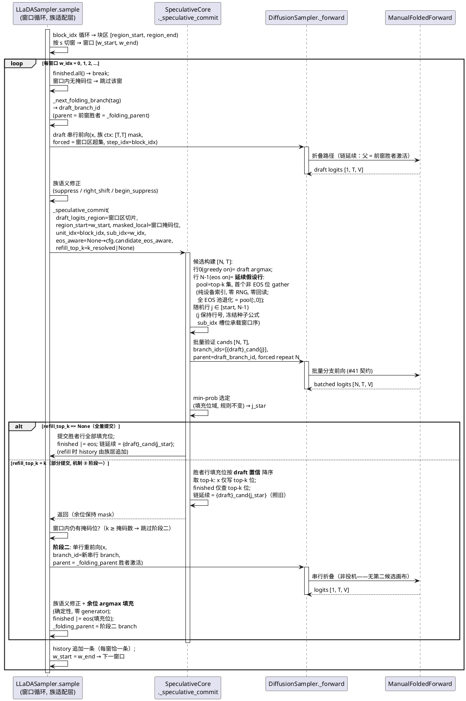
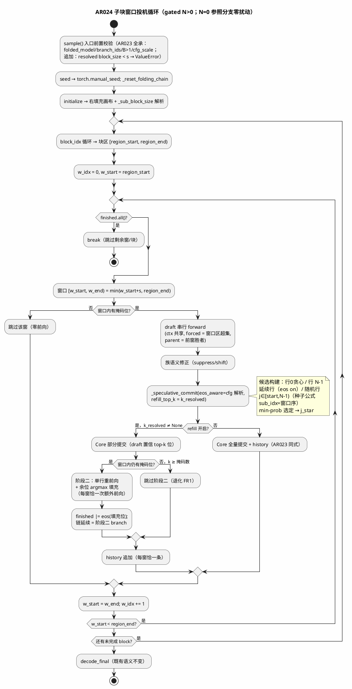

# 1 AR概述

| 组件名称 | ActFold / actfold.models（LLaDA 投机提交粒度生产链） |
| --- | --- |
| AR系统流水号 | AR024 |
| AR描述 | LLaDA 投机提交粒度质量面缓解（P1-7 第十档，`next_rung_memo.md` 候选 A）：把 LLaDA 投机路径的提交单元从整块 one-shot 改为**子块窗口序列**（机制 ①，默认 s=8），叠加窗口内**渐进填充**两阶段提交（机制 ②，opt-in）与候选集 **EOS 感知延续假设行**覆盖（机制 ③，默认开），使对齐模式恢复 baseline 质量面（H1 分级硬面）同时保持 H2 严格加速。AR023 四模式基准协议与判定式全承（导入式复用）；粒度 A/B 构造性隔离（batched = AR023 语义锚 vs greedy = AR024 推荐栈）。机制洞见依据：质量面是提交粒度的函数，不是族的函数（Dream s=8 窗口渐进提交在同等投机机制下质量面保持，LLaDA 整块 one-shot 把全部去噪压力压在一次前向——AR023 quick 冒烟 offset-2 EOS 早停 len 3 vs 64，EOS 审计已排除代码缺陷）。 |

# 2 动态行为

## 2.1 子块窗口投机处理时序图（窗口循环 + Core 提交 + refill 阶段二；含 ③ 延续行构建）



# 3 功能点分解

| 序号 | 功能点名称 | 功能点描述 | srs 追溯 |
| --- | --- | --- | --- |
| 1 | 子块窗口循环 | `llada_sampler.sample` 投机分支内 block 按 s 切窗、逐窗 draft+`_speculative_commit`、逐窗链延续；s=block_size = AR023 语义 A/B 锚（构造性）；`1≤s≤block_size` 校验（N>0 域） | FR1 |
| 2 | EOS 感知延续行 | Core 候选构建扩展：行 N-1 无条件构建为"排除 EOS 的 draft argmax"填充行（纯设备索引）；随机行让位至 j∈[start, N-1)（j 保持行号）；N 总数不变；与贪心锚正交 | FR3 |
| 3 | 渐进填充两阶段 | Core `refill_top_k` 部分提交（胜者行 draft 置信 top-k）+ llada 阶段二（单行重前向 + 余位 argmax 填充）；每窗恰一次额外前向；k 解析 None→s//2 | FR2 |
| 4 | 配置面 | `LLaDASamplerConfig` 四新字段（s=8 / refill=False / refill_top_k=None / eos_aware=True）+ 对称校验（N>0 域）+ `ActFoldConfig` 四消费键 + `llada_8b.yaml` 注释段（推荐栈 + A/B 还原） | FR4 |
| 5 | 基准脚本与工件 | `scripts/ar024_granularity_bench.py`：模块级导入复用 ar023 助手（AR022→AR021 先例）；四模式（batched=AR023 锚 / greedy=AR024 栈）+ `--refill-face` 报告面；判定式全承 | FR5 |
| 6 | 质量门 | 全量 pytest ≥1022/0/4 只增不减 + `tests/test_llada_granularity.py`（UT-2401 起）+ lint 三件 | FR6 |
| 7 | 文档五件 | README 全量中文重写（AGENTS 既定规则）+ AGENTS #46 + GUIDE 第三十一部分 + CHANGELOG + RERUN 第 14 步 | FR7 |

# 4 实现设计

## 4.1 功能实现思路（方案 A 定案）

### 4.1.1 架构定案：族持窗口循环 + Core 最小三扩展（方案 A）

机制核面/族适配面边界与 AR023 完全一致：**Core = 候选构建/选定/提交机器，
族 = 单元几何**。三机制落点：

- **FR1 窗口循环 → 族适配层**（`llada_sampler.sample` 投机分支，gated
  `num_candidates > 0`，参照分支零扰动）：block 几何是 LLaDA 族自有语义；
- **FR3 延续行构建 + FR2 部分提交 → Core 最小三扩展**（srs 预留授权："仅当
  窗口迭代/部分提交语义确属机制核面时"——候选构建与提交正是 Core 冻结面）；
  新可选参 `eos_aware` / `refill_top_k` 默认值 = 现行为字节不变（Dream 宿主
  共乘 Core：getattr 默认 False/None ⇒ Dream 字节不变，UT 钉死）；
- **FR2 阶段二 → 族适配层**：suppress/right_shift 族语义与 finished 面归属族
  （Core 零族语义感知的 AR023 原则保持）。

**替代方案权衡**：方案 B（三机制全内联 llada）= 机制三源（Core+fast_dllm
内联+llada 内联）漂移风险，选定/提交逻辑复制违反 AR023 单源论证结构；方案 C
（窗口迭代抽象进 Core 参数化）= 过度泛化——Dream super-step 已有自有窗口语义
（budget merge/confidence 选位），两套窗口抽象合并未证明必要。方案 A 定案。

**A/B 锚构造性**（粒度归因的结构证据）：s=block_size ⇒ 每块单窗 w=0 ⇒
种子公式 sub_idx=0、branch tag 无 `_w` 后缀（§4.1.3 冻结）、forced = block
超集、全量提交——与 AR023 **同一代码路径**逐位成立，非另写参照实现。

### 4.1.2 Core 最小三扩展契约（FP2/FP3 机制面）

```python
# actfold/models/speculative_core.py — _speculative_commit 签名扩展（仅尾部新增）：
def _speculative_commit(
    self, x, finished, draft_logits_region, region_start, masked_local,
    draft_branch_id, ctx, unit_forced, folded_model, unit_idx, sub_idx,
    history, forward_fn, stop_token_id,
    eos_aware: bool | None = None,        # 新增：None = cfg 解析（getattr 默认 False）
    refill_top_k: int | None = None,      # 新增：None = 全量提交（现行为字节不变）
) -> None: ...
# Dream 既有调用点不传新参 ⇒ 字节不变（UT 钉死）。
```

**③ 延续行构建（eos_aware on，冻结式）**：

```python
eos = eos_aware if eos_aware is not None else bool(
    getattr(cfg, "candidate_eos_aware", False))
# 候选行构建顺序（赋值序即优先级序）：
#   1) 行 0 greedy（include_greedy on 时，现行为不变）
#   2) 随机行 j ∈ [start, N-1)（start = 1 if greedy else 0；
#      eos off 时上界为 N——现行为；种子公式 j 保持行号，不变）
#   3) 行 N-1 延续行（eos on 时最后赋值——N=1 时覆盖行 0，贪心角色被吸纳）：
pool = draft_set                                   # [M, k] top-k 有序集
non_eos = pool != stop_token_id                    # [M, k]
first_non_eos = non_eos.to(torch.uint8).argmax(dim=1)   # 首个非 EOS 位
cont_tokens = pool.gather(1, first_non_eos.unsqueeze(1)).squeeze(1)
cands[N - 1, fill_positions] = cont_tokens
```

- 纯设备索引：零随机性消耗、零设备回读、无检测分支（EOS 不在池 ⇒ argmax=0
  ⇒ `pool[:, 0]` = 贪心值，退化同值自动成立）；
- **行 N-1 优先级冻结**：eos on 时行 N-1 无条件 = 延续行（N=1+greedy 时单行
  兼任两角色，贪心定义精化为"排除 EOS 的贪心"——与机制目的一致：防虚假早停）；
- 随机行让位：eos on 时随机行范围 `[start, N-1)`——行 j=1..N-2 与 eos off
  同 seed 逐位相同（**画布一致区**内，#44 口径）；
- `greedy_win_stats` 不变：`j_star == 0` 判定照旧（eos on 时行 0 仍为贪心行，
  N≥2 场景；N=1 场景行 0 = 延续行 = 精化贪心，计数语义不变）。

**② 部分提交（refill_top_k on，冻结式）**：选定（min-prob argmax → j_star）
**完全同式**后：

```python
# 胜者行填充位按 draft 置信降序取 top-k（draft 侧概率，冻结）：
draft_probs = F.softmax(draft_logits_region, dim=-1)        # [1, R, V]
winner_tokens = cands[j_star, fill_positions]               # [M]
w_conf = draft_probs[0, masked_local, :].gather(
    -1, winner_tokens.unsqueeze(1)).squeeze(1)              # [M]
k_eff = min(int(refill_top_k), num_masked)                  # 运行期钳制
top_local = torch.topk(w_conf, k_eff).indices               # 置信降序前 k
commit_pos = fill_positions[top_local]
x[0, commit_pos] = winner_tokens[top_local]                 # 仅 top-k 位
finished |= (x[:, commit_pos] == stop_token_id).any(dim=1)  # 仅查 top-k 位
self._folding_parent = cand_branch_ids[j_star]              # 链延续照旧
# history：refill 时 Core 不追加（推迟给族层，每窗恰一条——§4.1.4）
# greedy 计数照旧（选择已发生）
```

- 未提交的胜者 token **丢弃**（批量验证值仅作用于 top-k 位）——机制本质：余位
  由阶段二在**已提交上下文**上重前向填充，去噪压力从 one-shot 窗口卸载；
- `k_eff ≥ num_masked` ⇒ 全量提交 ⇒ 行为退化 = FR1（无 refill 差异）。

### 4.1.3 LLaDA 子块窗口循环（FP1）

`sample` 投机分支（gated `num_candidates > 0`，现整块单元循环改窗）：

```python
sub_block = self._sub_block_size      # initialize() 解析存储（config → 实例）
# per block：
region_start = prompt_lens[0] + block_idx * block_size
region_end = min(region_start + block_size, prompt_lens[0] + max_new_tokens, T)
w_start, w_idx = region_start, 0
while w_start < region_end:
    w_end = min(w_start + sub_block, region_end)      # 末窗取余
    if bool(finished.all()): break
    masked_local = (x[0, w_start:w_end] == mask_token_id).nonzero(...).reshape(-1)
    if masked_local.numel() == 0:                     # 窗口无掩码位 → 跳过
        w_start, w_idx = w_end, w_idx + 1; continue
    ctx = self._spec_ctx_for(x, prompt_lens[0])       # (T, prompt_len) 键共享
    unit_forced = self._build_unit_forced(x, w_start, w_end, masked_local)
    # branch tag 冻结（A/B 锚面）：w_idx == 0 → f"llada_spec_b{block_idx}"
    #   （AR023 形态）；w_idx > 0 → f"llada_spec_b{block_idx}_w{w_idx}"
    draft_branch_id, draft_parent_id = self._next_folding_branch(tag)
    draft_logits = self._forward(x, branch_id=draft_branch_id,
        parent_branch_id=draft_parent_id, folded_model=folded_model,
        step_idx=block_idx, attention_mask=ctx.mask,
        position_embeddings=ctx.position, forced_divergent=unit_forced)
    # 族语义修正同式（suppress / right_shift / begin_suppress）
    region_logits = draft_logits[:, w_start:w_end, :]
    k_resolved = None if not cfg.progressive_refill else (
        cfg.refill_top_k if cfg.refill_top_k is not None else sub_block // 2)
    self._speculative_commit(x=x, finished=finished,
        draft_logits_region=region_logits, region_start=w_start,
        masked_local=masked_local, draft_branch_id=draft_branch_id, ctx=ctx,
        unit_forced=unit_forced, folded_model=folded_model,
        unit_idx=block_idx, sub_idx=w_idx, history=history,
        forward_fn=_batched_forward, stop_token_id=eos_token_id,
        refill_top_k=k_resolved)          # eos_aware 缺省 → cfg 解析
    # —— refill 阶段二（§4.1.4）——
    if k_resolved is not None: self._refill_phase_two(...)
    if cfg.return_history and k_resolved is not None:
        history.append(x.clone())         # 每窗恰一条（Core 已推迟）
    w_start, w_idx = w_end, w_idx + 1
```

- **种子公式 sub_idx 槽位承载窗口序**（`(S0·1_000_003 + block_idx·8_191 +
  w_idx·131 + j) & 0x7FFF_FFFF`）：s=block_size ⇒ w=0 ⇒ 与 AR023 种子逐项
  相同（A/B 锚）；s<block_size ⇒ 跨窗种子离散（防候选集跨窗相关）；
- **逐窗链延续**：窗口 w 的 draft parent = `_folding_parent` = 前窗胜者
  branch（`_next_folding_branch` 内部语义，与 AR023 跨 block 链延续同构）；
- **ctx/forced**：ctx 键 `(T, prompt_len)` 块内共享（LRU 钉扎不变）；forced =
  窗口区超集（`_build_unit_forced` 区域参数化——签名不变，传窗口边界）；
- **finished 窗口级检查**：窗间 `finished.all()` break（EOS 提交于窗 w ⇒
  跳过剩余窗/块，未完成位保持 mask——decode 面既有语义）；
- **前向计数面**：每窗 = 1 draft 串行 + 1 `[N,T]` 批量验证（批量验证数 ==
  窗口数——FR1 验收口径，srs"每窗一次 [N,T] 批量前向"为操作性主句）。

### 4.1.4 渐进填充阶段二（FP3，族层）

```python
def _refill_phase_two(self, x, finished, w_start, w_end, block_idx, w_idx,
                      ctx, folded_model, history, eos_token_id) -> None:
    remaining_local = (x[0, w_start:w_end] == self._mask_token_id
                       ).nonzero(...).reshape(-1)
    if remaining_local.numel() == 0: return      # k ≥ 掩码数 → 跳过（FR1 退化）
    r_branch, r_parent = self._next_folding_branch(
        f"llada_spec_b{block_idx}_w{w_idx}_r")
    r_logits = self._forward(x, branch_id=r_branch,
        parent_branch_id=self._folding_parent,   # 胜者激活（batch-1 已发布）
        folded_model=folded_model, step_idx=block_idx,
        attention_mask=ctx.mask, position_embeddings=ctx.position)
    # 族语义修正同式 → 余位填充：
    fill_pos = remaining_local + w_start
    x[0, fill_pos] = r_logits[:, fill_pos, :].argmax(dim=-1)  # 确定性 argmax
    finished |= (x[:, fill_pos] == eos_token_id).any(dim=1)
    self._folding_parent = r_branch              # 最新串行激活为父
```

- **每窗恰一次额外前向**（成本上界冻结）：remaining 空 ⇒ 零额外前向；
- 确定性零回读：argmax 填充，专用 CPU generator 不消费（无随机行）；
- finished 合取：Core top-k 位 + 阶段二填充位 = 与全量提交 eos 语义等价；
- history：每窗恰一条（Core refill 时推迟，族层阶段二后追加）。

### 4.1.5 EOS 感知与贪心锚的正交性（FP2 补充）

- 贪心锚（`candidate_include_greedy`）与延续行（`candidate_eos_aware`）独立
  开关：四种组合均合法（构造恒可，无检测分支）；
- 贪心 off + eos on：行 0..N-2 随机、行 N-1 延续行（无贪心锚时延续行仍可
  构建——假设对 = 延续行 vs 随机行集合）；
- 假设对语义：行 0（贪心，可能含 EOS = stop 假设）vs 行 N-1（延续，必不含
  EOS = continue 假设）——min-prob 公平仲裁，早停语义（#45 合同）不变；
- **srs 验收措辞精化**（T009 自审留档项）："选定结果与 eos_aware=False
  确定性一致"仅在 **N=1+greedy 退化 fixture** 严格成立（单行兼两角色 ⇒
  候选集同值）；一般 N 时行集合构造性不同（随机行 N-1 被替换为延续行），
  选定可能不同——UT 冻结：退化 fixture 断言选定一致；一般 fixture 断言行值
  等（row N-1 == row 0，EOS 不在池时）+ 构建确定性（双跑 bit-exact）。

### 4.1.6 配置面（FP4）

```python
# LLaDASamplerConfig 新增：
speculative_sub_block_size: int = 8      # FR1（用户定案"开启投机时默认"）
progressive_refill: bool = False         # FR2（opt-in）
refill_top_k: int | None = None          # FR2 k（None = s//2 冻结默认）
candidate_eos_aware: bool = True         # FR3（默认开——AR024 推荐栈组成）
# __post_init__ 追加校验（不静默降级，AR022 先例）：
#   speculative_sub_block_size < 1 → ValueError（恒校验——s=0 为畸形值）
#   N>0 且 block_size 已知 且 s > block_size → ValueError（投机域静态校验）
#   progressive_refill and N == 0 → ValueError（refill 仅投机路径有定义）
#   refill_top_k is not None and（<1 或 > s）→ ValueError（FR4 校验面）
# initialize()/sample 投机入口追加：resolved block_size < s → ValueError
#   （block_size=None 时静态不可校验面——运行期解析后校验）

# ActFoldConfig 新增四消费键（同默认，#5 unknown-key 免告警；纯消费面）：
speculative_sub_block_size: int = 8
progressive_refill: bool = False
refill_top_k: int | None = None
candidate_eos_aware: bool = True

# llada_8b.yaml 注释段更新（AR023 段扩展为 AR024 推荐栈）：
#   推荐栈：s=8 + eos_aware on + refill off（+ N=4/top_k=10/greedy on）
#   A/B 还原：s=block_size + eos_aware off 复现 AR023 语义
```

**校验域冻结（N=0 逐字节铁律的推论）**：s 的 block_size 上界校验 scoped 到
投机路径（N>0）——静态面（block_size 已知）在 `__post_init__`、解析面
（block_size=None → num_tokens）在 sample 投机入口；**N=0 配置永不因 s 校验
失败**（现有小 block_size 参照配置零破坏，FR6 冻结面）。`s<1` 与
`refill_top_k` 界外恒校验（畸形值不区分路径）。默认 s=8 + N=0：字段不被
读取、不触发解析校验 ⇒ 参照路径逐字节（FR1 验收第三条）。

**默认开启面语义变更注记**：N>0 未显式设置 eos_aware 时默认 on——LLaDA
投机默认面 vs AR023 末态有意演进（用户定案"开启投机时默认"）；AR023 语义
还原 = 显式 `candidate_eos_aware=False`（A/B 锚模式与 UT 均显式设置）。
Dream/Fast-dLLM config 零新字段（Core getattr 默认 False ⇒ 字节不变）。

### 4.1.7 基准脚本设计（FP5，FR5）

`scripts/ar024_granularity_bench.py --family llada [--quick] [--refill-face]`：

**模块级导入复用（AR022→AR021 先例同构）**：

```python
import scripts.ar023_cross_family_bench as _ar023  # noqa: E402
from scripts.ar023_cross_family_bench import (     # noqa: E402
    SEED, REPS_DEFAULT, QUICK_REPS, QUICK_NUM_TOKENS, BLOCK_GRID,
    _H1_RATIO_EPS, probe_conclusion,
    h1_quality_verdict, h2_speed_verdict, h4_fullstack_verdict,
    reproduction_verdict, mark_all_blocked,
    build_artifact, build_blocked_artifact, write_results,
    _load_family_model, _make_bench_mff, _prepare_prompts,
    _decode_length, _posthoc_face, _block_exact_counts,
    _position_match_counts, _stats_dict,
)
```

- 耦合注记（AR022 (a)/(b) 先例）：ar023 顶层 stdlib-only、无模块级副作用
  （`apply_hf_env` 不在模块层执行）⇒ 导入安全；重实现面禁止（srs FR5"禁止
  复制粘贴重复"）——四模式 scaffolding/verdict/墙钟纪律全走 `_ar023` 助手；
- 新增 ~450 行：粒度模式构造 + llada-only run loop + `--refill-face` + meta
  扩展。

**四模式构造（冻结）**：

| 模式 | 配置 | 语义 |
| --- | --- | --- |
| `baseline` | N=0，官方配方（block 32 / steps 32 / low_confidence） | 族参照（ar023 同式） |
| `folded-serial` | N=0 + MFF | 折叠参照（ar023 同式） |
| `folded-batched` | N=4 + top_k=10 + greedy off + **s=block_size(32) + eos_aware=False** | **AR023 语义 A/B 锚** |
| `folded-batched-greedy` | N=4 + top_k=10 + greedy on + **s=8 + eos_aware=True** | **AR024 推荐栈**（对齐模式） |

- **粒度 A/B 构造性隔离**：batched vs greedy 同 N/形状/seed/prompt/独立同构
  MFF（MFF_C 模式沿用），唯一差异 = 提交粒度栈（s + eos + greedy）——H1 三
  硬面（gap 收缩 / 长度恢复 / exact 严格改善）直接归因粒度机制；
- 每折叠模式独立同构 MFF（`_make_bench_mff` 复用）；graph off（探针结论
  cross-ref，`probe_conclusion` 复用）。

**`--refill-face` 报告面（机制 ② 实机面，设计期冻结边界）**：quick 冒烟尺度，
对齐模式配置 + `progressive_refill=True`（k=None→s//2），独立 `_refill` 后缀
工件；**不入正式 verdict**（② 为 opt-in 机制，UT/mutation 面为交付验收；
正式推荐栈不含 ②）——报告字段：四模式同构 quick 结果 + refill 开启面行为
注记。

**判定式全承（复用零改动）**：H1 分级（`h1_quality_verdict`：gap ≤0.5 比值 +
`_H1_RATIO_EPS` / 逐 prompt 长度恢复 / exact 严格改善 / None 拒判 / 哨兵 /
非阻塞强结论层）；H2 严格 `p50(base)/p50(aligned) > 1.0`；H4 canary/ledger
合取 + profiler 窗口 reset；复现双跑 strict（`reproduction_verdict`，失配 ⇒
`mark_all_blocked`）；blocked 工件零伪造（#10）。

**工件**：`results/optimization/ar024_llada_granularity_bench.json`（+
`_quick` / `_refill` 变体）；meta 全承 ar023 + `granularity_constants`：
`{sub_block_size, candidate_eos_aware, progressive_refill, refill_top_k,
anchor_semantics: "ar023 (s=block_size, eos off)"}`（各模式粒度栈常数）+
探针 cross-ref（AR023 `ar023_family_probe.json` 结论复用——无新探针）。

## 4.2 功能实现设计

### 4.2.1 流程图（投机路径总控：窗口循环 + refill 分支）



### 4.2.2 流程说明

1. **入口前置（AR023 全承 + 追加）**：N>0 无 folded_model /
   `_supports_branch_ids` 失败 / B>1 / cfg_scale>0 → `ValueError`；追加
   resolved block_size < s → `ValueError`（block_size=None 解析面）。N=0 全程
   不触达窗口循环/新字段读取（字节级零扰动）。
2. **窗口迭代**：块内 s 切窗（末窗取余）；窗口无掩码位 → 跳过（零前向，
   AR023 单元语义同构）；finished 窗口级检查。
3. **draft 前向**：tag 冻结（w=0 无后缀 = AR023 形态；w>0 带 `_w{idx}`）；
   parent = 前窗胜者（`_next_folding_branch` 链延续）；ctx `(T, prompt_len)`
   键共享；forced = 窗口区超集。
4. **Core 提交**：候选构建（③ 延续行最后赋值——优先级序）→ `[N,T]` 批量验证
   → min-prob 选定（规则不变）→ 全量提交（AR023 同式）或 top-k 部分提交
   （② 阶段一）；链延续/finished/greedy 计数照旧。
5. **refill 阶段二**：remaining 空 ⇒ 跳过（k≥掩码数退化）；否则单行重前向
   （parent = 胜者激活）+ 余位 argmax 填充 + finished 合取 + 链延续 = 阶段二
   branch；history 每窗恰一条。
6. **早停**：EOS 提交/填充于窗 w ⇒ finished ⇒ 跳过剩余窗与后续块，未完成位
   保持 mask（decode 面不裁剪——AR023 语义不变，长度观测口径由基准脚本
   `_decode_length` 承载）。
7. **异常流程**：构造期（`__post_init__`）s<1 / refill_top_k 界外 / N>0 且
   s>block_size(已知) / refill+N=0 → `ValueError` 不静默；运行期（sample 入口）
   resolved block<s → `ValueError`；Core B>1 防御面全承。

## 4.3 接口描述

```python
# actfold/models/speculative_core.py（改——签名尾部两可选参，默认字节不变）
class SpeculativeCore:
    def _speculative_commit(
        self, x: torch.Tensor, finished: torch.Tensor,
        draft_logits_region: torch.Tensor, region_start: int,
        masked_local: torch.Tensor, draft_branch_id: str, ctx: SpecCtx,
        unit_forced: torch.Tensor, folded_model: Any, unit_idx: int,
        sub_idx: int, history: list[torch.Tensor],
        forward_fn: Callable[..., torch.Tensor], stop_token_id: int,
        eos_aware: bool | None = None,        # 新增（None = getattr(cfg,...,False)）
        refill_top_k: int | None = None,      # 新增（None = 全量提交）
    ) -> None: ...
    # 异常：B>1 → ValueError（既有）；无新增异常面（③ 构建恒可、② 钳制退化）。

# actfold/models/llada_sampler.py（改——窗口循环 + 阶段二 + config）
class LLaDASamplerConfig(SamplerConfig):
    speculative_sub_block_size: int = 8      # 新增（FR1）
    progressive_refill: bool = False         # 新增（FR2）
    refill_top_k: int | None = None          # 新增（FR2 k；None = s//2）
    candidate_eos_aware: bool = True         # 新增（FR3）
    # __post_init__ 追加校验（§4.1.6 冻结域）

class LLaDASampler(DiffusionSampler, SpeculativeCore):
    def _refill_phase_two(self, x, finished, w_start, w_end, block_idx,
                          w_idx, ctx, folded_model, history,
                          eos_token_id) -> None: ...   # 新增（§4.1.4）
    # sample()：投机分支窗口循环（§4.1.3）；N=0 分支零改动

# actfold/utils/config_manager.py（改——ActFoldConfig 四消费键，§4.1.6）
# actfold/configs/per_model/llada_8b.yaml（扩展——AR024 注释段）
# scripts/ar024_granularity_bench.py（新增——§4.1.7，导入式复用 _ar023）
# tests/test_llada_granularity.py（新增——UT-2401 起，§6.1）
```

## 4.4 代码设计

```
actfold/
├── models/
│   ├── speculative_core.py      [改 ~+70 行] ③ 延续行 + ② 部分提交
│   │                            （两可选参默认 = 现行为字节不变；
│   │                              Dream 宿主 getattr 面 UT 钉死）
│   ├── llada_sampler.py         [改 ~+130 行] 窗口循环 + _refill_phase_two
│   │                            + config 四字段（N=0 分支零改动）
│   ├── dream_sampler.py         [零改动]（Core 扩展默认关面）
│   └── fast_dllm_sampler.py     [零改动]（内联参照面，不继承 Core）
├── utils/
│   └── config_manager.py        [改 ~+12 行] ActFoldConfig 四消费键
└── configs/per_model/
    └── llada_8b.yaml            [扩展] AR024 推荐栈 + A/B 还原注释段
scripts/
└── ar024_granularity_bench.py   [新增 ~450 行] 导入式复用 _ar023（§4.1.7）
tests/
└── test_llada_granularity.py    [新增 ~600 行] UT-2401~2412（§6.1）
```

**文档面（T008，FP7）**：README 全量中文重写（AGENTS 既定规则——数字从工件
重算）/ AGENTS #46（提交粒度契约）/ GUIDE 第三十一部分 / CHANGELOG AR024 条目
/ RERUN 第 14 步。

# 5 重构设计

无重构。Core 扩展为**签名尾部可选参**（默认值 = 现行为字节不变——Dream 既有
调用点零改动，UT 钉死）；llada 投机分支内部改窗口循环（gated N>0，参照分支
零扰动）；`_build_unit_forced` 签名不变（区域参数化既有）。机制单源结构不变
（候选/选定/提交仍只在 Core 一份；fast_dllm 内联参照面 #45 口径不变）。

# 6 测试设计

**覆盖率目标（显式声明，G8 补）**：§3 功能点与 §4.2.1 流程图分支 **100% 映射**
至 §6 用例（G12/G13 审查面）；全量 pytest 基线 ≥1022 passed / 4 skipped /
0 failed **只增不减**（FR6）；lint 三件 clean（pyflakes 零 / mypy
`--ignore-missing-imports` clean / black ≤100 列仅新增行）。

## 6.1 单元测试（UT）

`tests/test_llada_granularity.py`（UT-2401 起）——合成 mini 双向模型 fixture
复用族（AR023 `test_llada_speculative.py` 同构）+ 前向计数 spy / generator
spy / 回读 spy（.item/.tolist/.cpu）。

| ID | 覆盖点 | 断言面 |
| --- | --- | --- |
| UT-2401 | FR1 窗口迭代 | s=8/block32/num_tokens64：每块 4 窗；draft 串行计数 == 窗口总数；`[N,T]` 批量验证计数 == 窗口总数（srs 口径：每窗一次批量前向）；逐窗链延续（`_folding_parent` 序列 == 各窗胜者 branch）；窗口 forced 内容（窗区超集 True、区外 False）；branch tag（w=0 无后缀 = AR023 形态，w>0 带 `_w`） |
| UT-2402 | FR1 A/B 锚 | s=block_size + eos off + refill off 输出 vs AR023 等价构造（新字段全显式关）**逐位相同**（含 branch 命名面——同 tag 同 cand 命名）；种子公式 sub_idx=0 逐项一致 |
| UT-2403 | FR1 默认零扰动 | N=0：全输出与 AR023 末态 bit-exact；新字段不被读取（spy：`_refill_phase_two` 零调用、窗口循环零进入）；默认配置（s=8/eos on）N=0 同样逐字节（字段读取 gated N>0） |
| UT-2404 | FR1/FR2 校验域 | s=0 → ValueError（恒）；N>0 + s>block_size(显式) → ValueError；N>0 + block_size=None + resolved block<s → ValueError（sample 入口）；N=0 + 小 block_size + 默认 s=8 → **不**触发（校验域冻结面）；refill+N=0 → ValueError；refill_top_k<1 / >s → ValueError |
| UT-2405 | FR2 两阶段 | refill on（k=4, s=8）：每窗 3 次前向（1 draft + 1 批量 + 1 阶段二）；top-4 位提交值 == 胜者行 token（draft 置信降序）；余位 == 阶段二 argmax（部分提交画布条件下）；阶段二零 generator 消耗（CPU generator spy）；k==s 退化：阶段二跳过、每窗 2 前向、输出与 FR1 同构；refill=False 默认与 FR1 逐位 |
| UT-2406 | FR2 k 解析 | refill_top_k=None → s//2 生效（提交位数断言）；显式 k 生效；k > 窗口掩码数 → 钳制全提交 + 阶段二跳过；每窗恰一次额外前向（计数上界） |
| UT-2407 | FR3 假设对 | EOS 在 draft 池 fixture（N=4, greedy on）：行 N-1 不含 EOS 且 == 排除 EOS 的 argmax 填充；行 0 可含 EOS（贪心原值）；行 1..N-2 与 eos off 同 seed 逐位相同；N 总数不变（`[N,T]` 形状）；min-prob 仲裁可落败（延续行可输——防特殊化） |
| UT-2408 | FR3 退化 + 确定性 | EOS 不在池：行 N-1 == 行 0（值同，argmax=0 退化路径）；N=1+greedy：单行兼两角色、选定与 eos off 一致（退化 fixture 严格面）；构建确定性：双跑 bit-exact、零回读、零 generator |
| UT-2409 | FR3 正交/默认 | greedy off + eos on：行 N-1 仍构建（无贪心锚独立性）；eos off：候选构建与 AR023 逐位（默认关面）；默认配置（未显式设置）N>0 → eos on 生效（默认开面）；Dream 宿主：`_speculative_commit` 无新参调用 → 字节不变（getattr False 面） |
| UT-2410 | 配置/YAML 面 | 四键 `load_config` 零 UserWarning（#5）；`llada_8b.yaml` 注释段载入；`ActFoldConfig` 默认值对称；Dream/Fast-dLLM config 零新字段；各族 sampler 默认构造 N=0 输出与 AR023 末态逐位 |
| UT-2411 | 基准脚本合同面 | 四模式 config 断言（batched：s==block_size+eos off+greedy off；greedy：s==8+eos on+greedy on）；粒度 A/B 构造性隔离面（同 N/seed/prompt，唯一差异 = 粒度栈）；`--refill-face` 独立 `_refill` 工件名（不入正式 verdict）；`_ar023` 导入面 + 助手可导入（CI stdlib-only 面）；blocked 语义（`mark_all_blocked` 复用零伪造）；meta `granularity_constants` 字段存在性 |
| UT-2412 | 冻结面全景 | 全量 pytest ≥1022 passed / 4 skipped / 0 failed 只增不减（集成面，跑于 T007）；既有 `test_llada_speculative.py`（19）/`test_diffusion_samplers.py`/`test_ar023_bench.py`（9）零破坏 |
| UT-2413 | FR1 窗口级早停（design 门控 G13 补） | 合成 fixture 强制 EOS 于块内第 2 窗提交：剩余窗跳过（前向计数 == 已执行窗数 × 2）、后续块跳过、未完成位保持 mask、decode 面不裁剪；refill on 面：EOS 落在未提交余位时 finished **不**置位（Core 仅查 top-k 位语义断言）；窗口无掩码位 → 跳过该窗零前向 |

## 6.2 接口测试

- `_speculative_commit` 新参边界：`eos_aware=True/False/None` 三态（None =
  cfg 解析）、`refill_top_k=None/1/s/s+1`（s+1 运行期钳制非异常）；
- `LLaDASamplerConfig` 四字段类型/默认值/校验异常面（6.1 UT-2404 交叉）；
- 基准 CLI：`--family llada` 固定（dream 拒绝——本 AR 族域）、`--quick`/
  `--refill-face` 独立工件名、非法值 argparse error。

## 6.3 业务场景测试（ST 侧，四类）

- 正常：LLaDA-8B 四模式 reps=30 定案工件 + 判定式复算（H1 硬面/强结论层/
  H2/H4 独立断言——防自证；AR022 ST 109 项复算口径先例）+ 粒度 A/B 归因面
  （batched vs greedy 唯一差异复核）；
- 边界：末窗取余（block 非整除 s）；k ≥ 窗口掩码数退化；N=1 单行；EOS 全
  占 top-k 池（延续行退化贪心值）；
- 异常：复现自检失配 → blocked；单模式失败 → blocked 工件 + 探针 cross-ref
  零伪造；
- 回归：1022/0/4 基线；AR023 冻结面（19+9 测试）零破坏；demo 三锚点不动；
  lint 三件（pyflakes 零 / mypy clean / black ≤100 列仅新增行）；
- 文档面（FP7/FR7，审阅型用例，T008 交付审阅时执行）：五件文档数字溯源逐项
  核查 + README 五节全覆盖（AGENTS 既定规则判据）。

## 6.4 异常场景测试

- 构造期：s<1 / N>0+s>block_size(显式) / refill_top_k 界外 / refill+N=0
  （全部 ValueError 不静默）；N=0 + 小 block + 默认 s **不**触发（校验域面）；
- 运行期：resolved block<s（block_size=None 解析面）ValueError；Core B>1
  防御面全承；
- 降级链：GPU 排队约束下 UT/mutation 面先行全交付（机制面不因排队缩水）；
  实机面 blocked 语义全承（探针 cross-ref + 零伪造）。

# 7 实现澄清（post-gate 追记区）

（开发/审查阶段发现的设计澄清按条追记于此。）

- **[design-gate r1] G13 Important WARN**（2026-10-16）：§4.2.1 窗口级早停
  分支缺显式 UT——已补 UT-2413（窗口级早停确定性断言 + refill
  finished-仅-top-k 位语义 + 无掩码位跳过），随 T002 Red 批实现。
- **[design-gate r1] G3/G8/G14 Minor**（2026-10-16）：§4.1.4 伪码签名补
  `ctx`（与 §4.3 一致）；§6 头部补覆盖率目标显式声明；srs FR3 第二条验收
  句按 §4.1.5 精化措辞回写（srs 同步修订，2026-10-16）。
