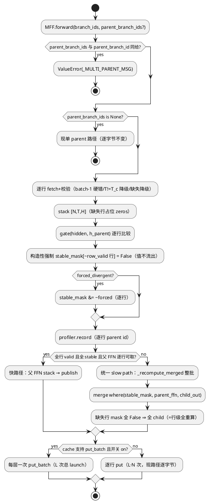

# [AR025] 设计说明书

| 字段 | 内容 |
|------|------|
| AR 编号 | AR025 |
| 关联 srs | ./srs.md rev 2 |
| 日期 | 2026-10-16（rev 1）/ 2026-10-17（rev 2 修复） |
| 状态 | rev 4（rev 3=design 门控第 2 轮 **PASS**（ses_eb84f414fffefXCz2O1eIE44k6）：7 项修复全 VERIFIED+代码锚点实测全命中；Minor×4+Nit×4 当轮修入：DD2 伪代码残句/H1 CUDA M-shape 残余风险注记+归因字段/跨工件对照 AR023 同表补映射/PlantUML 构造性强制步骤/§6.1 胜者延续/合成面确定性注记/tasks 门控留档。历史：rev 2=第 1 轮 FAIL 修复 7 项。**rev 4=T003 实现期 DD2 erratum（append-only 前缀捐赠，见 DD2 尾注）+ DD8a 真实面接线增补（T006 实现前定案，见 DD8 之后）——DD8a 门控 **PASS WITH CONDITIONS**（ses_eb75aa130ffeOVCYAtYBaDeYxf）：C1-C6 六项代码断言全 VERIFIED（对已提交 HEAD）/DD8 冻结判定式零改动/FR5 备选形态原文确认 in-scope；Major F1（W2 折叠链状态清单不全：`_folding_parent`/`_folding_counter` 实例级——单实例+per-chain 状态+双实例禁令）+Minor F2（合并闭包 kwargs 翻译）/F3（temperature==0 前置条件）/F4-F5（C2 措辞+Dream ctx 来源注记）+Nit N6/N7 **全部当轮修入 DD8a**——T006 实现解锁**） |

> 章节说明：本 design 为六章式压缩版（0 总览→1 DD 决策〔内嵌功能点
> 标注 FR〕→6.1 UT 矩阵→7 PlantUML→8 复用映射；§2-§5 需求/详设
> 分解由 srs rev 2 承担，§4 接口异常场景内嵌各 DD，§5 约束见 srs
> §1.3）。重构设计：**无**（纯增 API+开关门控行为，无既有代码
> 结构性重排——DD3 分支统一属行为等价收敛非重构）。

## 0. 设计总览

per-row parent 泛化的核心洞察（srs §1.1 机制数学基础的设计落地）：
**现有批量 eager 体的逐行机制面（gate 比较/forced AND/profiler record/
merge where）已经是 per-row 的**——唯一整批粒度的东西是父装配
（单键 fetch → `expand(N,-1,-1)`，`folded_transformer.py:490-536`）与
三分支决策（全 stable/全 0/混合，:582-615）。因此泛化 = ①父装配从
"单键 expand"改为"逐行 fetch + stack"，②三分支的行级语义统一化，
③发布从逐行 put 升级 put_batch（AR020 #42 能力首次接入 eager 路径），
④接线层合批。无新算法、无注意力面改动、无图路径改动。

## 1. 核心决策（DD）

### DD1 API：`parent_branch_ids` 尾参（FR1）

```python
# ManualFoldedForward.forward / FoldedTransformerLayer.forward（keyword-only）
parent_branch_ids: Sequence[str] | None = None
```

- 与 `parent_branch_id` 互斥（两者同给 → `ValueError`，消息含
  `_MULTI_PARENT_MSG` 单一常量）；仅 `parent_branch_ids` 而无
  `branch_ids` → `ValueError`（逐行父只定义在批量分支上）；
  `len(parent_branch_ids) != len(branch_ids)` → `ValueError`。
- `None` 附加零 kwarg（AR021 None-attach 模板，UT-2103 先例）——
  单 parent 现路径逐字节不变。
- 行 i 的父 = `parent_branch_ids[i]`；各父仍须以 **batch 1** 存储
  （#41 expand 契约逐行版——batch≠1 的父行 = 硬 `RuntimeError`，
  与现契约同严）。
- **v1 等长语义（定案；T003 erratum 见 DD2 尾注）**：`T_p_i == T_c`
  （逐行校验）。生产链形态依据：扩散解码同画布迭代（T 恒定，
  AR021/22/23 投机块候选与父同画布）——等长是生产自然形态；变长
  prefix（AR003 append-only / AR007 截断）与变长 pad 面同属
  Out-of-Scope 切分（srs 明示）。逐行 `T_p_i != T_c` = 该行降级
  （DD3），不整批失败。

### DD2 per-row 父装配（FR2，批量读）

替换 `:490-536` 单键装配为逐行三态：

```python
row_parent: list[torch.Tensor | None]  # 每行 [1, T, H] 或 None
row_valid: list[bool]
for i, pid in enumerate(parent_branch_ids):
    fetch(pid, gate_layer) -> 校验 dim/H/T>0/T==T_c/batch==1
    # batch!=1 -> RuntimeError（硬）；缺失/T!=T_c -> row_valid[i]=False
h_parent = torch.cat(  # [N, T, H]；缺失行占位 zeros_like(child[:1])
    [row if valid else zeros_placeholder for ...], dim=0)
```

- 缺失行占位零张量（值不流出——**构造性强制**，不依赖 metric：
  gate 调用之后、forced AND 之前显式
  `stable_mask[~row_valid 的行] = False`——cosine 下占位 sim=0
  本就不越 tau，但 l2/tau=0 度量下 sim 可为正，显式强制使
  "值不流出"对全部 metric 成立，UT 以 l2/tau=0 反例钉死）；
  `parent_shape_mismatch_rows` 计数器入 profiler 侧注记
  （观测面，非错误）。
- 全部行缺失 = 整批重算（现 :523-529 语义的逐行版本自然退化）。
- gate 调用零改动：`self.gate(hidden_states, h_parent)` 对
  `[N,T,H]` 逐父比较天然正确（cosine 逐行）；`forced_divergent`
  AND 逐行（:561-565 现状已 per-row）；profiler record 循环
  （:567-576）仅替换 `parent_branch_id=parent_branch_ids[i]`。

> **T003 erratum（2026-10-17，实现期发现）**：上表伪代码与 v1 等长
> 语义的 `T_p != T_c -> 降级` 按字面实现后，UT-2420/2423（生成循环
> 接线 parity）稳定比 0.0 vs 参考 0.563 暴露语义缺口——
> `folded_generate`/`folded_generate_batched` 的正典形态是
> **child = parent + 1 token（父恒短于子一字）**，单父批量面
> （`_forward_batched` :577-604）对此支持 **append-only 前缀折叠**
> （gate 比较前缀+后缀构造性发散），多父面若全降级则在生成循环内
> 永不折叠。修正（机制方向不变，仅放宽短父）：
> ①`_fetch_parent_gate_row`/`_fetch_parent_ffn_row` 长度校验改为
> `T_p > T_c -> 降级`（**父长于子仍降级**——UT-2409 钉死的无 AR007
> 截断面不变；等长→全画布比较——机制 UT-2401..2415 原路径逐字节
> 保留）；②短父行捐赠前缀：gate 分档（全 valid+统一长度→一次批量
> gate 镜像单父面前缀/全画布两形态；混合长度/部分缺失→逐行 gate+
> 逐行 zeros 行，无效行不再对 zeros 占位过 gate，构造性强制后终态
> mask 与原设计一致）；③merge 端短父 FFN 补零对齐（`where` 永不读
> 补零位——mask 构造性 False）；④DD3 全 stable 快路径对短父不可达
> （后缀 zeros ⇒ stable_count < num_tokens，自动退统一 slow path，
> 无需显式条件）。"变长 pad 面 Out-of-Scope" 切分不变——本修正
> 仅覆盖单父面既有的 append-only 前缀形态的逐行泛化。

### DD3 三分支行级统一（OQ1 定案：掩码式）

- **全 stable 快路径**（:582-609）保留，条件收紧为整批全满足：
  所有行 `row_valid` 且 `stable_mask` 全 True 且逐行父 FFN
  fetch 成功（`[1,T]` 逐行校验→stack `[N,T,H]`）；任一不满足
  → 统一 slow path。
- **统一 slow path**（混合/含缺失行/全发散/父 FFN 缺失）：整批
  `_recompute_merged`（child 全重算，与父无关零改动）+ merge。
  依据（现契约原文 :617-620）："A fully stable row inside a
  mixed batch merges to the parent values — bit-identical to
  the serial fast path for that row"——`where(stable_mask,
  parent_ffn, child_out)` 的行级语义天然实现三分支的行级退化：
  缺失行 mask 全 False=全 child（=全重算）；全发散行同理；全
  stable 行 merge 出父值（bit-identical）。**OQ1 掩码式定案，
  零拆批、零新增分支结构。**
- 全 0 分支（:611-615）并入统一 slow path（全发散行 mask 全
  False 时 merge 结果==child_out，值正确；省一次分支判断——
  对拍 UT 钉死**并入后形态对分批基线**等价（原分支已删，
  "两形态对拍"字面不可测，G9 勘误））。

### DD4 merge per-row（FR3）

`_merge_parent_child_batched`（:656-727）泛化：

- 逐行 fetch 父 FFN（`[1, T]` 逐行校验）→ stack `[N, T, H]`；
  缺失行/形状不匹配行占位 `child_out[:1]`（mask 全 False 值不
  流出——占位仅形状对齐）；
- `_merge_stable_divergent_torch(parent_ffn, child_out,
  stable_mask)` **零改动**（已支持 `[N, T]` mask 的 where 语义）；
- `prefix_len` 参数在 v1 等长语义下恒 None（变长面 Out-of-Scope），
  保留形参不删（未来变长 AR 的接缝）；
- 快路径（DD3）父 FFN stack 同 DD4 逐行装配（共用 helper
  `_fetch_parent_rows(name, layer) -> Tensor[N,T,H] | None`，
  gate 层与 FFN 层两次调用——装配单一来源）。

### DD5 发布 put_batch 化（FR4，OQ3 放大器）

- 现状：eager 批量路径 `_store_batched`（:638-654）逐行
  `_store_activations` = L 层 × N 行 = L·N 次 put launch；
  AR021 仅 graph 路径接了 put_batch——**eager 路径从未接**。
- 泛化：`_store_batched` 开头探测 `BatchedPutCapable`（#42
  结构协议，每次调用重探不缓存——publish 先例）；有能力 →
  每层一次 `put_batch`（N 行 entry，顺序=branch_ids 序）；
  无能力 → 现逐行路径逐字节回退。**单 parent 批量同样受益**
  （put_batch 化与 parent 数正交——合批开关 on 时统一走）。
- 等价性钉死：#42 现成 UT 面（`torch.equal`+key 序+num_entries）
  + 本 AR 对拍（合批发布 vs 逐行 put 的缓存终态逐位一致）。
- 账本：`write_op_count` 沿 #42 语义（put_batch 计 foreach 组+
  即时执行）；UT 断言合批 ≤ 分批（排除循环验证）。

### DD6 配置（FR6）：单开关定案

- `ActFoldConfig.multi_parent_batch: bool = False`（YAML 键
  `multi_parent_batch`，#5 unknown-key 规则）；
- off（默认）：`_batched_forward_supported` 谓词逐字节现行为；
  `_store_batched` 逐行 put；`folded_generate` 单链不变——
  全链逐字节兼容（UT 钉死）；
- on：谓词泛化（等长保留；同 parent 放宽为"全部行有各自
  batch-1 父"——多 parent 行与单 parent 行可混批）；eager
  发布 put_batch 化；DD7 入口可用。
- **API 面（FR1 `parent_branch_ids`）不走开关**：新参数默认
  None=零扰动，机制可用性与行为开关分离（AR021 graph_pool
  先例：API 常在、行为 opt-in）。

### DD7 接线（OQ2 定案：`folded_generate_batched` 多链变体）

```python
@dataclass
class ChainInput:
    input_ids: torch.Tensor          # [1, prompt_len_i]
    acceptance_policy: AcceptancePolicy | None = None  # 缺省 Greedy

def folded_generate_batched(
    model, chains: list[ChainInput], max_new_tokens,
    folded_model, draft_generator=None,
    num_branches_per_step=1, record_stability=True,
) -> list[FoldedGenerationResult]
```

- 每链独立 BranchTree/active/policy（复用单链循环结构）；
  共享 model/folded_model/draft_generator/step；
- 每 step：各链 `_make_candidates` 收集 → 全链候选等长且
  `multi_parent_batch` on → **一次** MFF 调用
  （`branch_ids`/`parent_branch_ids` 逐行展开，行序=链序×候选序）
  → 各链 policy select + prune（prune/`clear_branch` 逐链，
  现逻辑不变）；
- 回退：off / 不等长 / 单链 → 逐链 `folded_generate`（现函数
  零改动，多链变体是纯增包装——AR023 SpeculativeCore mixin
  的"共享机制核心+薄适配"同构）；
- 单链提前结束语义（G11 注记）：某链 no-candidates break /
  max_new_tokens 耗尽时**退出合批、余链继续**（该链从合批
  候选收集摘除，后续 step 对余链合批或退化串行——不阻塞
  也不终止其他链）；
- 接受率/stable_ratio 逐链独立统计（结果结构 = 单链
  `FoldedGenerationResult` 列表，无新容器）。

### DD8 基准判定式（FR7 预注册冻结，先于数据）

**合成面** `scripts/ar025_multi_parent_bench.py --mode synth`
（确定性对拍/账本面，不涉计时统计——srs 验收 4 "双面 reps=30"
的计时统计专指真实面；合成面 S1-S3 每几何点单次构造即定案）：

- 三方：A=合批（on，一次 `[ΣN, T]`）/ B=分批（每链一次
  `[N, T]`）/ C=串行（逐候选）；
- multi-geometry 网格（≥4 点）：(链数 {2,4}) × (N {4,8}) ×
  (T {256,1024}) 取 ≥4 组合；
- 判定式（冻结）：**S1** 每几何点 A vs B 对拍——非 split 路径
  逐位；split 路径 `allclose(1e-6)`（#41 分档先例）——任一
  FAIL ⇒ 全 verdict blocked；**S2** `write_op_count(A) <
  write_op_count(B)`（严格小，每点）；**S3** 账本缩减比
  `1 - ops(A)/ops(B)` 每点 >0（报告值，无硬门——诚实预告：
  收益温和）。

**真实面** `--mode real --family llada|dream`（ar019 venv，
AR023 T006 完成后）：

- 双链并行（每族一链：同一 checkpoint 两 prompt 各一链投机，
  N=4/top_k=10/greedy 锚定 on——AR023 对齐模式配置原样）；
  A=合批（开关 on：合批+eager put_batch 发布）vs B=现状
  （开关 off：分批+逐行 put——**B 侧开关状态显式钉死 off**；
  唯一差异=合批模式**（含发布面捆绑）**，A/B 净差=用户视角
  总收益，split 拆分面归合成 S1）；同 seed 同 prompt 同构造；
- **真实基准构造 `split_layers=False`**（G12 修复定案）：split
  层在 N=4/真实画布 T≥128 下必然激活（#28 batch*seq≥512），
  gathered GEMM M=2N vs 2×M=N 跨微内核边界 1-ULP（#41 已知）
  → temp=0 近平票处 argmax 翻转 → token 发散属**机制数值边界
  非正确性失败**；显式关 split 恢复 H1 构造性，split 风险面
  由合成 S1 分档（allclose 1e-6）完整覆盖——两面互补不遗漏；
- **H1 CUDA 残余风险注记**：#41 冻结契约的逐位保证措辞为
  "bit-exact **on CPU** for non-split paths"（CPU 限定）；真实面
  在 CUDA/bf16 跑 A=[2N,T] vs B=2×[N,T]，非 split dense GEMM 的
  M-shape 差异不在该契约字面保证内——与 split 面同机制（近平票
  argmax 翻转→token 发散），属**机制数值边界非正确性失败**；H1
  硬门方向过严不过松（blocked 交付本身诚实），工件 meta 预留
  `h1_blocked_attribution` 归因字段（若 blocked：逐 token 首分
  岔位置+两侧 logits allclose 检查，区分 M-shape 数值边界与
  机制性错误）；
- reps=30 预承诺单次定案；墙钟纪律 #39（perf_counter+sync、
  warmup 弃、逐 rep round-robin、repro 双采样自检——沿 AR023
  脚本模板）；
- 判定式（冻结）：**H1**（质量硬层，split_layers=False 构造下）
  双链 token 序列 A vs B 一致率 ==1.0（构造性依据：非 split
  路径合批 vs 分批逐位+同构造 temp=0——任何不一致 ⇒ 全
  verdict blocked）；**H2**（假设门）`p50(B)/p50(A) > 1.0`
  （加速>1 过/不过）；**交付线**（独立于 H2）：相对提升
  `p50(B)/p50(A) - 1 >= 0.10`——H2 PASS 但 <10% ⇒ 触发 srs
  FR7 冻结降级：交付"机制完备+合成面+真实面 blocked 注记"，
  零伪数字（H2 与交付线拆分，G12 勘误）；**H4** 账本
  `write_op_count(A) < write_op_count(B)`（**从严声明**：srs
  验收 3 为"≤"，本判定式取严格"<"——相等意味着合批零收益，
  按诚实标准记 blocked；合成 S2 同理从严）；+ canary（非
  结构性 eager 回退 timed==0）。
- 工件：`results/optimization/ar025_multi_parent_bench.json`
  （合成+真实双节；meta 含 #39 CUPTI null 注记/开关状态
  （A=on,B=off）/split_layers=False 构造声明/几何网格/seed/
  reps/降级触发器原文/`h1_blocked_attribution` 归因字段）；
  **跨工件对照（srs FR7）**：真实面结果与 AR023 同表
  （`ar023_llada_bench.json`/`ar023_dream_bench.json` 合批
  基线行并列——T008 README 表执行，基准脚本写入 cross_ref
  节引用 AR023 工件路径）。

### DD8a 真实面接线增补（rev 4，T006 实现前定案）

**缺口声明**：OQ2/rev 3 将 FR5 定案为 `folded_generate_batched`
（生成循环形态——合成基准与 UT-2420..2424 已覆盖）；但 FR7 真实面
要求"用户视角总收益"（A/B 净差=两 prompt 解码完成的端到端），其
载体是**族采样器投机路径**（AR023 SpeculativeCore 面），即 srs
FR5 的"批量投机服务入口"备选形态——rev 3 未细化，本增补定案。

**结构约束（经已提交代码核实，C1-C6）**：

- **C1**：`_speculative_commit` 每链画布 B==1 硬约束（#41
  `[T,T]` mask 结构限制）——**合批只发生在候选验证 forward**
  （`[N,T]`→`[2N,T]` 候选堆叠）；画布状态、草稿串行 forward
  （`[1,T]`）、候选构造、评分/commit 规则全部 per-chain 零合并；
- **C2**：族 fold ctx 键 `(T, prompt_len)`——**两链 prompt token
  长度必须相等**（bench 定长 pad/截断，两 prompt 同长是合批
  合法性前提）；等长 ⇒ 同调度 ⇒ 同 mask 值（LLaDA `valid_end`
  同；Dream 无 pad ⇒ all-ones mask+arange position_ids 同）⇒
  合批调用携带单一 2D mask + 单一 position 载荷即可（族形态
  各异：LLaDA `position=None` 无 rotary cargo，Dream 为
  `position_ids`——值等同即足；对象恒等 pin 仅图回放需要——
  图面本 AR 冻结，Out-of-Scope）。Dream 侧实现注记：其 ctx
  内容取自 `initialize` 设置的实例 `_attention_mask` 而非键
  本身——联合循环须先完成两画布 initialize 再查 ctx，避免
  "键 ⇒ 内容"依赖初始化顺序；
- **C3**：候选构造 frozen seed 公式 per-chain 计数器
  （`unit_idx`/`sub_idx` 链内自计数）与 `forced_divergent`
  per-chain 构造零改动——A/B 两侧逐字节同构造（H1 构造性前提）；
- **C4**：合批调用形态（DD1-DD7 机制面，已实现）：
  `forward_fn(joint_cands [2N,T], branch_id=None,
  branch_ids=[链1 cand ids..., 链2 cand ids...],
  parent_branch_ids=[p1]*N + [p2]*N,
  forced_divergent=两链 unit_forced stack)`——行序=链序×候选序
  （DD7 约定沿用）；
- **C5**：提前结束（某链 EOS/画布完成）⇒ 该链从合批摘除，余链
  退化单链 `[N,T]`（DD7 单链提前结束语义同构——退出合批不阻塞
  不终止）；
- **C6**：H1 构造性依据：同权重/同候选构造（C3）/同父缓存
  （各链草稿 forward 各自发布）/per-row 折叠行等价（T002 机制
  parity+T003 前缀捐赠 erratum 已钉）——A vs B 每链 token 相等；
  CUDA M-shape 残余风险沿 DD8 H1 注记（`h1_blocked_attribution`
  归因字段，blocked 即诚实结论）。

**接线三案**：

- **W1 线程 hub**（两线程各跑 `sample()`，forward 闭包在 barrier
  处合并请求）：**否决**——GIL 交错/错误路径死锁（一链异常挂
  barrier）/确定性风险；
- **W2 lockstep 联合循环 `sample_joint`（定案）**：族采样器新入口
  `sample_joint(ids_list: list[Tensor], folded_model=...)`——
  单线程共享块调度循环、per-chain 画布/finished/history 状态；
  每 unit：两链草稿串行 forward（各自 `[1,T]`）→ 两链候选构造
  （现行 frozen 公式）→ **一次** `[2N,T]` 合批验证 forward（C4）→
  各链独立 min-prob 评分/commit/折叠链延续（现规则零改动；
  `greedy_win_stats` 实例级记账——联合循环单实例驱动两链，
  计数聚合，报告面语义不变）；C5 提前结束摘除；返回两链
  输出（`SampleOutput` 列表，用户视角=两 prompt 解码完成）；
  开关 off 时逐链 `sample()` 语义分发（DD7 回退模式同构）。
  **折叠链状态清单（门控 F1 必修项）**：`_folding_parent`/
  `_folding_counter` 为**实例级**链状态（`_next_folding_branch`
  生成新 id、`_speculative_commit` 尾部写
  `self._folding_parent = cand_branch_ids[j_star]`）——联合循环
  必须**单实例驱动 + 显式 per-chain 折叠链状态**（链各自的
  `_folding_parent` 与链内下一 draft id 指针），否则链 2 的
  下个 draft 会错误挂到链 1 的胜者分支上，破坏 C6"同父缓存"
  前提与 H1；反向禁令：**禁止双实例各跑一链**——`_folding_counter`
  单实例化正是 branch id 全局唯一的来源（`llada_spec_b0_1`
  之类的 id 命名含实例内计数），双实例会在共享缓存中 id 碰撞；
  **前置条件（门控 F3）**：投机候选构造的确定性仅对
  `temperature==0`（greedy 路径）成立——`sample_tokens` 在
  temperature>0 时消费全局 RNG，交错联合循环 vs 背靠背
  `sample()` 构造性发散；`sample_joint` 须在入口对
  temperature>0 显式 `ValueError`（镜像 `sample()` 对
  `cfg_scale>0` 的拒绝面），`stochastic_transfer` 同理须关；
- **W3 core 配对 hook**（隐式合并）：**否决**——隐式耦合；单线程
  下两链 `sample()` 的 commit 不交错，hook 无自然屏障点。

**实现落点与复用**：`SpeculativeCore` 最小扩展——`_speculative_commit`
内部按 **forward 接缝两段拆分**（门控 N7：含 forward 调用的单一
helper 无法产出一次 `[2N,T]` 合批——必须拆为"候选构造"与
"评分+commit"两段，接缝间的验证 forward 由联合循环提供合并版
闭包）；合并闭包**kwargs 翻译**（门控 F2）：`_speculative_commit`
冻结调用形态恒传单数 `parent_branch_id=draft_branch_id`，而 MFF
面 `parent_branch_id` 与 `parent_branch_ids` 互斥（同传
`ValueError`）——合并闭包须消费并覆写该单数 kwarg 为
`parent_branch_ids=[p1]*N+[p2]*N` 后放行；`llada_sampler.py`/
`dream_sampler.py` 各加 `sample_joint`（循环骨架复制自各自
`sample()` 投机分支，画布状态与折叠链状态 per-chain，见 W2
F1 清单）。**B 侧零新代码**（现行 `sample()` 逐 prompt 两次，
开关 off，AR023 对齐模式配置原样）。碰撞注记：`llada_sampler.py`/
`speculative_core.py`（及关联 `tests/test_llada_speculative.py`）
现为 AR024 并行会话在飞（`dream_sampler.py` 当面干净——仍按在飞
对待，实现统一待 AR024 落地后开工）。

**UT 面（T006 前置机制守卫，合成族模型）**：`sample_joint`（on）vs
逐链 `sample`（off）每链 token 逐位相等 + `write_op_count` 合批侧
严格小；提前结束混合用例（链 1 早停后链 2 独立完成）；开关 off
`sample_joint` 逐链语义等价。真实 reps=30 前的机制锚点（真实面
沿 DD8 判定式原文，H1/H2/交付线/H4/canary 零改动；计时对象=两
prompt 解码总墙钟：A=`sample_joint` 一次调用，B=`sample()` 背靠背
两次——与 AR023 模式间测量同构；cross_ref 引用 AR023 工件路径）。

### DD9 模块影响与文件计划

| 文件 | 改动 |
|------|------|
| `actfold/models/architecture_utils.py` | **DD1 落点（主 API 面）**：`ManualFoldedForward.forward` 尾参 `parent_branch_ids`+互斥/长度校验+None-attach 零扰动+向层透传；**DD10 防御**：多父调用进批量 graph 分支（`_graph_forward_batched_or_none` :759-771 单一 `parent_branch_id` 签名）时 warn-once+eager 回退；DD5 参照 `_publish_graph_children`（:1510-1575）put_batch 探测先例 |
| `actfold/core/folded_transformer.py` | DD1 层级 keyword-only 尾参；DD2 `_fetch_parent_rows` helper+装配替换；DD3 分支统一+构造性 `stable_mask[~row_valid]=False`；DD4 merge 泛化；DD5 `_store_batched` put_batch 化 |
| `actfold/speculative/folded_generation.py` | DD7 `ChainInput`+`folded_generate_batched`；`_batched_forward_supported` 谓词泛化（开关 on 时） |
| `actfold/utils/config_manager.py` | `ActFoldConfig.multi_parent_batch: bool = False`（G13 勘误：实际路径在 `utils/` 下，rev 1 误写 `actfold/config_manager.py` 不存在） |
| `actfold/configs/per_model/*.yaml` | 注释段 `multi_parent_batch: false`（默认关） |
| `tests/test_multi_parent_batch.py` | 新 UT 全量（§6.1 矩阵） |
| `tests/test_batched_branch_forward.py` | 冻结面零破坏（现 UT 不改，只确认通过） |
| `scripts/ar025_multi_parent_bench.py` | DD8 基准（判定式冻结入脚本） |
| AGENTS.md / GUIDE / CHANGELOG / RERUN / README | T008 文档五件 |

### DD10 风险与边界

- **`_recompute_merged` 的整批性**：child 重算整批一次
  （`[N,T]` 一起过原层）——合批 `[2N,T]` 与分批两次 `[N,T]`
  的 GEMM 形状不同（M=2N vs M=N）——split 路径 1-ULP 差异
  风险（#41 已知：M=1 vs M>1 跨微内核边界）——**对拍容差
  分档即为此设**（split `allclose(1e-6)`），srs 验收 1 已冻结。
- **put_batch 首接 eager**：#42 等价面 UT 现成（graph 路径
  验证过）；eager 接线的 entry 构造（branch_ids 序+逐行
  `[1,T,H]` view）需对拍钉死（UT：合批发布后缓存终态 ==
  逐行 put 终态，逐层 torch.equal）。
- **profiler 逐行 parent id**：`record(parent_branch_id=...)`
  的现有消费面（stable 归因按 parent 分组）在多父下每行独立
  分组——语义自然，UT 对拍（合批 vs 分批 profile 逐行相等）。
- **CUDA graph 面**：`_forward_batched` 的 graph 分支
  （`graph_runner_batched`）对 `parent_branch_ids` 不感知——
  **多父调用进 graph 分支 = 不支持 → 静默 eager 回退**（AR023
  探针 graph-off 生产态下不触发；防御：多父+图启用时
  warn-once 注记，非错误——图面整体 Out-of-Scope）。
- **开关谓词竞态**：`_batched_forward_supported` 在 off 时
  逐字节现行为——泛化条件仅在 on 时求值（UT 钉死 off 路径
  谓词短路序不变）。

## 6.1 UT 覆盖点矩阵（T001 Red 基线）

| 组 | 用例（UT-24xx） |
|----|----------------|
| API | 互斥 ValueError/无 branch_ids ValueError/长度不齐 ValueError/None-attach 零扰动（字节级）/单 parent 逐字节回退 |
| 装配 | 全异父逐位对拍（vs 分批）/缺失行掩码降级（值==child）/缺失行值不流出**构造性**（l2/tau=0 反例：显式 `stable_mask[~row_valid]=False` 下占位不泄漏）/形状不匹配行降级+计数/全部缺失=整批重算/父 batch≠1 硬错（逐行） |
| 三分支 | 整批全 stable 快路径（多父 stack）/混合批全 stable 行 bit-identical/全发散行==child_out/快路径父 FFN 缺失→slow path |
| merge | 逐行父 FFN stack 对拍/占位行值不流出断言/`_merge_stable_divergent_torch` 零改动回归 |
| 发布 | put_batch 等价（缓存终态逐层 torch.equal）/能力缺失回退逐行/账本 A<B 断言/单 parent 批量同样 put_batch 化 |
| 接线 | `folded_generate_batched` 等长合批 vs 逐链对拍（token/stable_ratio 逐链相等，含胜者延续两轮——srs 验收 1）/不等长回退/off 回退/单链退化/prune 逐链 |
| 配置 | 默认 off 全链逐字节/YAML 消费无 unknown-key 警告/on 谓词泛化（含混合单/多父行） |
| 冻结面 | 现批量契约 UT（AR015）/族投机面（AR023）/`folded_generate` 现路径——零破坏确认 |

## 7. PlantUML 决策流



## 8. 复用与先例映射

- None-attach 零扰动：AR021 UT-2103 模板；
- 批量对拍 bit-identical（mixed 批全 stable 行）：AR015 :617-620
  原文契约；
- put_batch 等价面：AR020 #42 UT（graph 路径验证）→ eager 首接；
- 容差分档：#41 split 路径 allclose(1e-6) 先例；
- 基准判定式冻结/reps=30/降级触发器：AGENTS Experimental
  Validation Rule + AR023 脚本模板；
- 薄包装纯增接线：AR023 SpeculativeCore mixin 同构。
