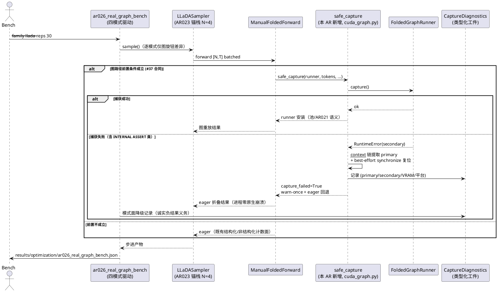
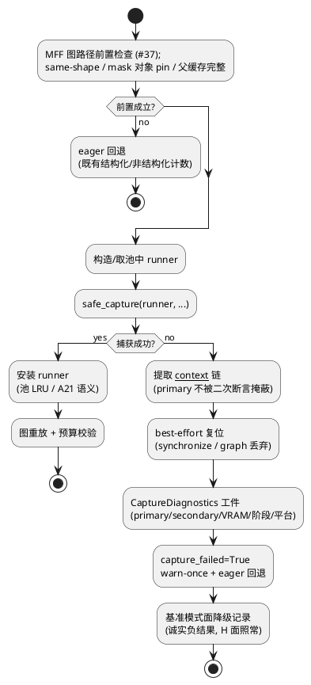

# [AR026] 详细设计 — 真实 checkpoint 端到端图路径

# 1 AR概述

| 组件名称 | ActFold 折叠推理引擎（`actfold/core` 图机制 + `actfold/models` 采样器 + `scripts` 基准面） |
| --- | --- |
| AR系统流水号 | AR026 |
| AR描述 | 把生产 `FoldedGraphRunner` CUDA-graph 捕获在真实 remote-code checkpoint（LLaDA-8B 优先，Dream-7B 跟随）上启用/修复：捕获失败根因保真（anti-masking）、类型化降级强化、tuple-unwrap Caveat 重审、探针 graph face 生产化，并以图上四模式实机基准（baseline 官方配方 / folded-batched eager / graph 固定容量 / graph 自适应）把 AR018 谱系合成证据桥接到真实 checkpoint，登上框架优越性阶梯真实端到端档。 |

# 2 动态行为

## 交互时序图



# 3 功能点分解

| 序号 | 功能点名称 | 功能点描述 | srs 追溯 |
| --- | --- | --- | --- |
| 1 | 捕获根因保真与类型化降级强化 | `safe_capture` 包装生产捕获边界：primary 异常（`__context__` 链）不被 capture-unwinding 的 INTERNAL ASSERT 二次失败掩蔽；失败路径 best-effort 状态复位 + `CaptureDiagnostics` 工件；三处捕获点（serial L1153 / batched L1443 / AR017 自适应再捕获）统一路由 | FR1 |
| 2 | Dream 生产捕获面 | 生产 Dream 批量捕获验证（position_ids/pe 已按 AR019/AR023 线程）或 blocked 工件（最小复现签名，零伪造） | FR2 |
| 3 | tuple-unwrap Caveat 重审落地 | 静态体解包语义 UT 钉固（CPU 直接调用等价 + CUDA 门重放）；AGENTS #45 文本修正（钉 UT 引用可溯源） | FR3 |
| 4 | 探针 graph face 生产化 | `ar023_family_probe` graph face 改走 MFF+runner 生产捕获；原裸捕获降级为 `graph_raw` 诊断面 | FR4 |
| 5 | 图上四模式实机基准 | LLaDA-8B baseline / folded-batched eager（AR023 锚）/ graph 固定 C / graph 自适应；reps=30 预承诺单次；H 面全承；VRAM 余量面 | FR5 |

# 4 实现设计

## 4.1 功能实现思路

**核心假设（设计驱动）**：探针记录的 `captures_underway.empty() INTERNAL ASSERT
(CUDACachingAllocator.cpp:2967)` 是**捕获展开期的二次失败**——`with
torch.cuda.graph(g)` 体内先发生 primary 异常，`__exit__` 路径的
`capture_end`/分配器状态机在不一致状态上断言，**掩蔽了 primary 错误**（探针
以独立子进程运行 CUDA 面的事实旁证： poisoned 分配器状态使同进程后续 CUDA 面
不可信）。生产强化因此不是"猜根因修根因"，而是**根因保真**：失败工件必须携带
primary 异常链，使 T006 实机首验直接拿到真实阻塞点（shape/分配/sdpa 交互），
修复迭代有靶。

**三处捕获点现状**：serial（architecture_utils.py:1153-1164）与 batched
（:1443 附近）均已 `except RuntimeError → capture_failed + warn-once + eager
回退`；AR017 自适应再捕获失败仅退休自适应路径（#37）。本 AR 在**不动降级矩阵
语义**的前提下，把"裸 except"升级为"except + 诊断提取 + 复位尝试"，全部路由
过单一 `safe_capture`（消除三处漂移）。

**四模式单旋钮纪律**（AR024 先例）：mode 间仅图旋钮差异——
`baseline`：官方配方（`folded_model=None`）；`eager`：AR023 锚栈（N=4 / top_k
=10 / 图全关）；`graph_fixed`：同栈 + `use_cuda_graph=True` +
`graph_capacity_ratio=0.5` + `graph_runner_pool_size>0`（AR021 池；基准
warmup+reps 协议满足 A5 摊销前提，工件 meta 注记）；`graph_adaptive`：同
graph_fixed + `graph_adaptive_capacity=True`。MFF 构造、prompt 集、种子纪律、
profiler 窗口全同 AR023 基准合同。

**Dream 面判定设计**：探针裸捕获断裂（`[64 vs 4] dim-2`）与生产路径的差异变量
= position_ids/pe/mask 线程（AR019 四构造面 + AR023 `position = 
compute_position_ids(mask)`）。T006 以生产路径首验：通过 → FR2 verified 工件；
复现形状断裂 → blocked 工件记录最小签名（探针裸捕获签名并列入档）。

## 4.2 功能实现设计

### 4.2.1 流程图



### 4.2.2 流程说明

1. **前置检查**：既有 #37 合同原样（同形窗口 / gate 类型 / 无 scheduler /
   mask 对象 pin / 父缓存完整 / batched 侧重验证）；本 AR 零改动。
2. **safe_capture**：薄包装，签名与 `runner.capture` 对齐（透传 kwargs）；
   成功路径零额外行为（除返回诊断对象的 `ok=True` 面）。失败路径顺序固定：
   (a) `exc.__context__` 链提取（primary = 链上首个非 capture-end 阶段异常）；
   (b) best-effort `torch.cuda.synchronize()`（自身 try 包裹，失败仅并入
   工件）；(c) `CaptureDiagnostics` 组装（primary/secondary/调用方 stage 标签
   / `mem_get_info` 快照 / 平台戳）；(d) 重抛原异常——**调用点既有 except
   语义不变**，仅新增诊断旁路。禁新增任何热路径开销（成功路径无 try 代价——
   包装器仅 try/except 包裹 capture 调用本身，与现状同构）。
3. **降级矩阵不动**：serial `capture_failed` / batched
   `_graph_batched_capture_failed` / AR017 仅退休自适应路径，语义字节不变；
   诊断计数挂 `graph_pool_stats` 同源只读探针（`capture_diagnostics` 列表，
   进程内累计，上限 8 条后仅计数）。
4. **探针 graph face 生产化**：face 构造 MFF **与 AR023 锚栈同构**
   （`_make_bench_mff` 口径：`split_layers=False`，探测几何 256 <
   `split_min_tokens=512` 使 split 惰性，但生产面声明必须与基准构造一致）+
   `use_cuda_graph=True`；**捕获触发不裸跑 forward**——图捕获是惰性路径，
   须走 #37 全前置集（batch-1 父缓存 / 同形 `[N,T]` `branch_ids` 调用 /
   mask/pe/position_ids 对象 pin），face 以**家族 sampler 的一个 mini 投机
   窗口**驱动（前置由 sampler 原生线程），记录 ok/`capture_delta_mb`/
   `headroom_mb`/`CaptureDiagnostics`；原裸捕获保留为 `graph_raw` 诊断面
   （`graph_enabled` 结论**只**依据生产面）。face 仍跑独立子进程
   （`graph_raw` 追加进 `CUDA_FACE_NAMES`，`graph` 保留——子进程包裹由该
   元组驱动）。
5. **基准**：`scripts/ar026_real_graph_bench.py`，导入式复用
   `ar023_cross_family_bench` 的合同件（prompt 集/种子/profiler 窗口/H 判定
   件——AR024 `ar023` 模块级导入先例）；四模式 + reps=30 + 双跑复现自检 +
   `--quick` 独立工件 + blocked 语义（降级族/单模式失败零伪造）。新增面：
   每模式 `headroom_mb`（mem_get_info 快照）+ 图模式降级计数入工件 meta。
   **几何继承注记义务**：图摊销是形状敏感机制（A5 caveat / 形状键池），本 AR
   继承 AR023 锚几何（P=2 prompts × 单 num_tokens → 每模式 ≤2 池键）——工件
   meta 必须携带预注册的几何继承理由（16GB 卡上 bf16-8B + 图池 VRAM 余量是
   绑定约束；正式几何扩展列为后续 AR 面），EVR ≥4 形状点门槛据此豁免面
   显式化而非静默。

## 4.3 接口描述

| 接口 | 位置 | 签名/形态 | 说明 |
| --- | --- | --- | --- |
| `safe_capture` | `actfold/core/cuda_graph.py`（模块级） | `def safe_capture(runner: FoldedGraphRunner, stage: str, *args: Any, **kwargs: Any) -> CaptureDiagnostics` | 透传 `runner.capture`；成功 `ok=True`；失败提取 primary 链 + 复位尝试 + 工件后**重抛原异常**（调用点 except 语义不变） |
| `CaptureDiagnostics` | `actfold/core/cuda_graph.py` | `@dataclass(frozen=True)`：`ok/stage/primary_error/secondary_error/vram_free_mb/vram_total_mb/platform` + `to_json_dict()` | 工件可序列化面；平台戳含 torch/CUDA 版本串 |
| 捕获点路由 | `architecture_utils.py` 三处 | `safe_capture(new_runner, stage="serial"|"batched"|"adaptive", ...)` 替换裸 `new_runner.capture(...)` | except 块字节不变；诊断列表经 `graph_pool_stats` 只读暴露 |
| `graph_pool_stats` 扩展 | `architecture_utils.py` | 新增 `capture_diagnostics: list[dict]` 键 | 只读探针，累计上限 8 条 |
| 探针 graph face | `scripts/ar023_family_probe.py` | `graph`（生产面，MFF+runner）+ `graph_raw`（原裸捕获，诊断面）；`graph_enabled` 仅依据生产面 | 返回结构向后兼容：原键保留于 `graph_raw` |
| 基准脚本 | `scripts/ar026_real_graph_bench.py` | `python -m scripts.ar026_real_graph_bench --family llada --reps 30 [--quick]`（dream 面允许但 formal 承诺=llada） | schema `ar026_real_graph_bench`；模式矩阵冻结于脚本 |

**无破坏性变更**：`FoldedGraphRunner.capture` 公开签名不动；`use_cuda_graph`
默认 False 字节不变（NFR 表）；`safe_capture` 失败重抛原异常 ⇒ 任何未升级的
外部调用方行为不变。

## 4.4 代码设计

```
actfold/core/cuda_graph.py        +safe_capture / +CaptureDiagnostics（纯增量）
actfold/models/architecture_utils.py  三捕获点路由 safe_capture（except 语义字节不变）
                                   +graph_pool_stats.capture_diagnostics 探针键
scripts/ar023_family_probe.py     graph face 生产化 + graph_raw 诊断面
scripts/ar026_real_graph_bench.py 新增（导入式复用 ar023 合同件；AR024 先例）
tests/test_ar026_capture_safety.py 新增（UT-2601/2602 + mock 面）
tests/test_ar026_graph_unwrap.py   新增（UT-2603/2604）
tests/test_ar026_bench_contract.py 新增（UT-2605/2606）
AGENTS.md                          #45 Caveat 修正（钉 UT-2603/2604 引用）
README.md / docs/OPTIMIZATION_GUIDE.md / CHANGELOG.md   T009 全量文档面
```

分层纪律：根因保真机制在 `core`（模型无关）；生产路由在 `models`
（architecture_utils 三点）；探针/基准在 `scripts`；UT 按面分文件。无多仓。
MVP 靠拢：`safe_capture` 是最小可独立验证单元（UT-2601/2602 纯 CPU mock 可
验），基准与探针面依赖它但不阻塞它的 Red→Green。

# 5 重构设计

**捕获点统一**（微重构，范围内）：三处捕获调用（serial/batched/adaptive）从
各自裸 `try/except RuntimeError` 升级为统一 `safe_capture` 路由——降级语义
矩阵不变（serial 全禁 / batched 全禁 / adaptive 仅退休），仅新增诊断旁路。
动机：消除三处失败处理漂移（AR017 adaptive 分支已与另两处语义不同，继续放任
会漂移出第四种）；本 AR 的根因保真面必须同构覆盖三处。

# 6 测试设计

## 6.1 单元测试（UT）

| 编号 | 覆盖 | 设计 |
| --- | --- | --- |
| UT-2601 | FP1 类型化降级 | mock runner `capture` 抛 `RuntimeError("...captures_underway.empty() INTERNAL ASSERT...")`（secondary 样本文本）→ `safe_capture` 重抛 + 诊断工件 `secondary_error` 含样本、`primary_error` 为链上 primary；调用点既有 except 路径不变（CPU） |
| UT-2602 | FP1 primary 保真 | mock 链：capture 体内先抛 `ValueError("shape mismatch ...")`（primary），unwinding 再抛 INTERNAL ASSERT（secondary）→ 工件 primary/secondary 分离正确；`to_json_dict` 往返（CPU） |
| UT-2603 | FP3 静态体解包（CPU 面） | tuple-returning mini 层栈：`_static_forward` 直接调用（CPU 张量）vs MFF eager 循环输出逐位一致（`_recompute_all` 解包语义钉固） |
| UT-2604 | FP3 CUDA 门 | 同栈 `use_cuda_graph=True` 捕获+重放 vs eager allclose（`torch.cuda.is_available()` False 时 `pytest.skip`） |
| UT-2605 | FP4 探针合同 | mock 模型面：`graph` face 走生产路径（断言 MFF 构造调用**且捕获被真实尝试**——mini 投机窗口驱动，前置由 sampler 线程）、`graph_raw` 保留原裸捕获键、`graph_enabled` 仅依据生产面、`graph_raw` 已加入 `CUDA_FACE_NAMES`（子进程包裹元组）；CUDA 不可用时 face 返回 `ok:False` 且不异常——探针既有行为） |
| UT-2606 | FP5 基准合同 | 模式矩阵冻结（四模式仅图旋钮差异，逐一断言旋钮集）；schema 名 `ar026_real_graph_bench`；`--quick` 独立工件；dream-only CLI 守卫（AR024 `exit 2` 先例；本 AR dream 允许、formal 注记）；双跑复现自检判定在位 |

## 6.2 接口测试

`safe_capture` 透传合同：kwargs 逐字到 `runner.capture`（mock 断言调用参数）；
成功路径工件 `ok=True` 且零 primary/secondary；重抛异常为**原对象**（`is` 同一）。

## 6.3 业务场景测试

T006 GPU smoke（实机）：真实 LLaDA-8B 四模式 quick 跑——捕获成功/降级两分支
各拿到工件面（`capture_diagnostics` 空/非空）；Dream 生产捕获面 verified/blocked
工件。T007 formal（reps=30）为 ST 前置证据面。

## 6.4 异常场景测试

- 捕获中途 OOM：`except RuntimeError` 既有面 + 诊断工件 VRAM 快照（UT-2601 变体，
  mock CUDA OOM 样本文本）。
- poisoned 分配器状态：`safe_capture` 复位尝试自身失败 → 工件记录复位失败、
  重抛原异常不变（UT-2602 变体：mock synchronize 抛）。
- 降级族/单模式失败（基准）：blocked 工件零伪造（AR023 FR5 语义，UT-2606 断言
  blocked 路径写独立工件名）。
- 探针子进程面失败：既有 fresh-subprocess 隔离语义不变（UT-2605 断言 face 仍
  子进程执行）。

## 设计输入分析摘要（Step 2 存档）

功能点：FR1-FR5（上表 FP1-FP5 一一对应）。约束：#37 图合同全承；
`use_cuda_graph` 默认 False 不变；三捕获点降级语义字节不变；探针
fresh-subprocess 隔离保留；基准 H 面全承 AR023（H1 层级质量 / H2 p50 / H4
账本+canary）+ 新增 VRAM 余量面；GPU 串行队列（AR023-T006 → AR024 实机 →
AR025 实机 → 本 AR T006/T007）；串行归档（AR024/AR025 先）。技术栈：
Python 3.10+ / black 100 列 / mypy `--ignore-missing-imports` / pyflakes 零 /
pytest（CUDA 门 skip）。Open Questions：无（FR1 失败分支已在设计中定案——
primary 保真后修复迭代有靶；不可修则类型化降级 + 诚实负结果工件，FR1 验收
"修复或隔离"可判定）。

## 方案对比（Step 3 存档，自动模式择优）

**方案 A：基准接线先行**——仅以既有降级矩阵接四模式基准，零机制代码。优点：
最快；缺点：真实捕获若触断言，primary 被掩蔽（学不到根因）、poisoned 状态
可能崩掉基准进程（探针以子进程隔离的同一原因）。不满足 FR1"根因定位"验收。
**方案 B（选定）：捕获根因保真 + 生产图面 + 基准**——`safe_capture` 诊断包装
（FP1）先行，探针/基准 riding 其上；失败分支天然可判定。缺点：机制面多一个
包装层（热路径零开销设计约束已定）。
**方案 C：纯诊断延期基准**——只做根因分析，基准出 AR。违反 FR5 与"丰富实验
验证"总纲，不满足 srs 范围。
**择优理由**：B 是唯一同时满足 FR1 验收（根因保真使"修复或隔离"可判定）与
FR5 基准承诺的方案；A 的降级矩阵已存在但学不到根因，C 违范围。
