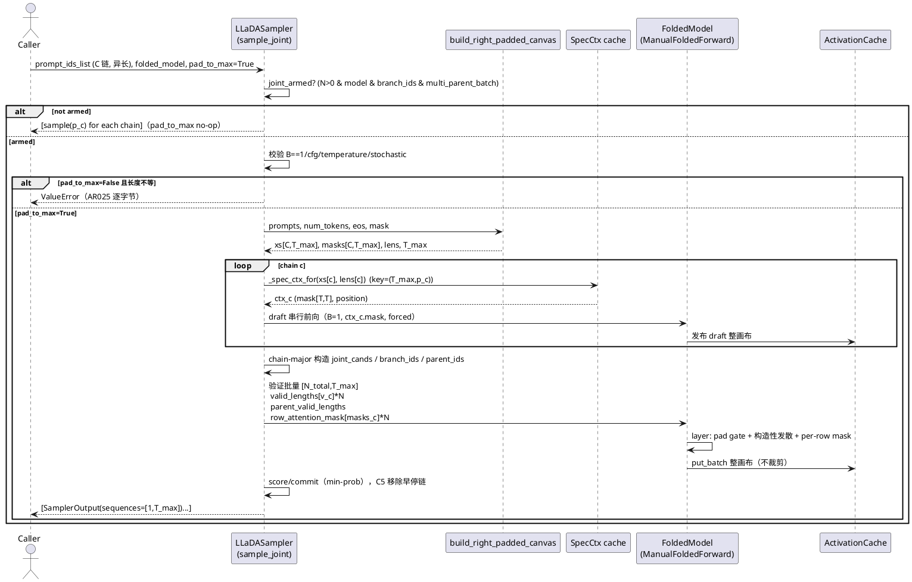
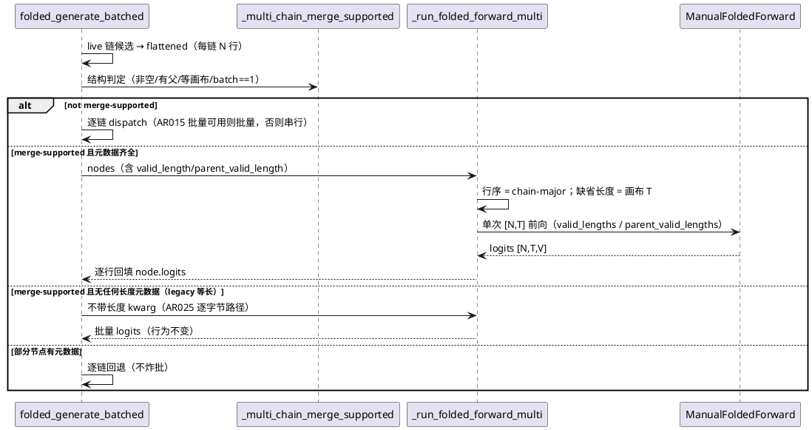
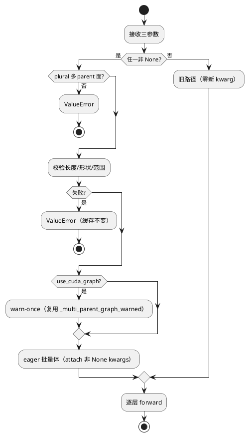

# 1 AR概述

| 组件名称 | ActFold — Branch Folding 批量折叠引擎 / 扩散采样器 |
| --- | --- |
| AR系统流水号 | AR028 |
| AR描述 | 变长多 parent 批量折叠：在 plural 多 parent 批量面新增 `valid_lengths` / `parent_valid_lengths` / `row_attention_mask` 三个通道，支持右 pad 到 T_max 的同批异长候选；pad 列构造性发散、父 pad 列 no-leak、发布整画布、统计只计有效 token；采样面为 LLaDA `sample_joint(pad_to_max=True)` 提供不等长 prompt 的 lockstep 路径；生成循环面放宽合并谓词接受变长候选（causal-only）。默认路径（三参数全 None）逐字节兼容。 |

**设计输入：** `specs/changes/AR028-variable-length-multi-parent/srs.md`
（req 门控第 11 轮 PASS）；领域契约 `AGENTS.md` #41/#42/#43/#47；
代码基线为 AR025 归档态 + AR027-server-formal-runner 并行工作树。

**设计边界：** 组件详设 `specs/component-detail-design/` 缺失，本设计以
AGENTS 契约与 AR025 归档 design 作为领域基准（与 srs §1 一致）。

# 2 动态行为

## 2.1 采样面：LLaDA `sample_joint(pad_to_max=True)`



**关键时序约束：**
- `pad_to_max` 只在 **joint-armed** 路径生效；off-switch 逐链 `sample()`
  不使用 pad（no-op）。
- 每链 draft 必须使用各自 `(T_max, prompt_len_c)` 的 ctx；禁止复用链 0
  的 `[T,T]` mask（否则短链 pad 列被当有效 key）。
- 验证批量按 **chain-major** 行序装配：`[chain0 的 N 行, chain1 的 N 行, ...]`，
  三个逐行参数同序；**行集合 = 当窗实际 `window` 条目**（零预算窗/已完成链
  不产生条目，C5 同样缩行），长度值恒为 `p_c+num_tokens`。
- **每链块窗偏移独立**：`region_start_c = p_c + block_idx*block_size`，
  `region_end_c = min(region_start_c+block_size, p_c+num_tokens, T_max)`；
  子窗/forced/logits 切片均用该链 `w_*_c`（不得用最长链绝对偏移）。
- `sequences` 返回整画布 `[1,T_max]`（与 `decode_final` 现状一致），
  验收在 `[:p_c+L_new]` 切片比较。

## 2.2 生成循环面：`folded_generate_batched` 变长候选



# 3 功能点分解

| 序号 | 功能点名称 | 功能描述 | 对应 FR | 设计落点 |
| --- | --- | --- | --- | --- |
| 1 | 三参数入口与校验 | MFF/layer 接受 `valid_lengths`/`parent_valid_lengths`/`row_attention_mask`，仅 plural 多 parent 面；形状/范围/互斥校验；默认 None 零 kwarg | FR1 | §4.2.1 / §4.3.1 |
| 2 | 逐行 pad 感知 gate | gate 区间 `[0,min(v_i,v_p,i))`；pad/父 pad 构造性发散；长父整行降级；短父前缀捐赠 | FR2 | §4.2.2 |
| 3 | per-row attention mask | `[N,T]` row key mask 与共享 `[T,T]`/key-pad mask 组合；仅 non-causal 变长等价所需；模型不接受时硬错误 | FR1/FR2 | §4.2.3 |
| 4 | pad 感知发布 | 整画布 `[N,T,H]` 发布，行序/键序/ledger 与逐行发布等价；不裁剪不重排 | FR3 | §4.2.4 |
| 5 | 统计口径 | 每 branch `num_tokens=v_i`，stable 计数只覆盖有效区；`v_i=T` 与旧行为一致 | FR4 | §4.2.5 |
| 6 | 采样面 pad-to-max | LLaDA armed 路径右 pad；per-chain ctx；chain-major 长度/mask；输出整画布 | FR5 | §4.2.6 |
| 7 | 生成循环变长谓词 | `ChainInput/BranchNode` 长度字段；仅 `_multi_chain_merge_supported` 泛化；causal-only；逐链回退 | FR6 | §4.2.7 |
| 8 | 合成基准 | 12 点网格 + S1/S1m/S2/S3 冻结判定式；真实面延后 | FR7 | §4.2.8 |

# 4 实现设计

## 4.1 功能实现思路

### 4.1.1 方案对比

**方案 A：三通道（有效长度 × 2 + 专用 row mask）+ 层内逐行 gate（推荐）**
- 思路：`ManualFoldedForward` / `FoldedTransformerLayer` 显式接收三个宿主
  元数据通道；层内在 `_forward_batched_multi` 按行计算 gate 前缀，pad 列
  强制 divergent；`row_attention_mask` 由层组合成底模可接受的 mask 形状后
  传入 attention。
- 优点：语义可精确表达（父 pad no-leak + 非 causal 等价）；默认 None 时
  零行为变化；长度/mask 是宿主元数据，零设备回读；publish/ledger 不改。
- 缺点：需要底模接受逐行 mask（`[N,T,T]` 或 `[N,1,T]`），remote 模型
  接受度需 real smoke（本 AR 延后，UT 用合成模型双形状覆盖）。
- 对 NFR：默认路径逐字节；变长面写账本严格更小（一次 put_batch）。

**方案 B：仅 row mask，从 mask 推导有效长度**
- 思路：不新增长度参数，层内从 `row_attention_mask` 求每行 `sum` 得到
  `v_i`，父长度另从父缓存 mask 推导。
- 优点：接口更少。
- 缺点：父缓存没有 row mask（#42 缓存格式不变），父真实有效长度不可得，
  父 pad no-leak 不可实现；且每层需设备侧归约（host sync 风险）。
  **不满足 FR2**，排除。

**方案 C：非 causal 变长逐行串行**
- 思路：非 causal 变长时不做批量，逐行调用。
- 优点：实现简单、无需 mask 通道。
- 缺点：合批收益消失；S2 写账本硬门无法成立；与 AR028 目标相悖。
  仅作为**降级兜底**保留（逐链回退面）。

**推荐：方案 A。** 理由：唯一同时满足 FR2（父 pad no-leak）与 FR1（非
causal 等价）的方案，且默认路径零扰动、publish/ledger 不变。

### 4.1.2 关键设计决策（DD）

| ID | 决策 | 理由 | 备选/影响 |
| --- | --- | --- | --- |
| DD1 | 三参数 keyword-only，仅 plural 多 parent 面允许 | 与 AR025 `parent_branch_ids` 作用面一致；singular/串行保留 AR007 | 其他面传参 → `ValueError` |
| DD2 | `row_attention_mask` 用**专用 kwarg**，不复用 `attention_mask` | 消除 `[T,T]` 与 `[N,T]` 的 `N==T` 歧义；旧 mask 语义逐字节不变 | 与共享 mask 同时给出取交集 |
| DD3 | 层内逐行 gate：`L_i=min(v_i, v_p,i)`，`[L_i,v_i)` 强制 divergent | pad/父 pad 不作为证据；构造性 no-leak | 长父 `T_p>T` 沿 AR025 整行降级 |
| DD4 | 发布整画布 `[N,T,H]`，不裁剪 | 下游按 `valid_lengths` 使用；#42 状态等价 | 缓存格式不变 |
| DD5 | 统计在 call site 切片 `stable_mask[row,:v_i]` 后 `record` | 不改 profiler API；`num_tokens=v_i` 自然成立 | `v_i=T` 与旧行为逐位 |
| DD6 | 采样 pad id 用 `build_right_padded_canvas` 的 `eos_token_id`；生成循环面用 `pad_token_id` | 与两面既有语义各自对齐 | 两面分别 pin |
| DD7 | per-chain ctx key `(T_max, prompt_len_c)` | 短链 pad 不得被链 0 mask 当有效 key | Dream 不进入该面 |
| DD8 | 图路径：三参数任一非 None ⇒ eager；复用 `_multi_parent_graph_warned` | 图静态体只感知单 mask；不新增警告源 | `use_cuda_graph=False` 不警告 |
| DD9 | 生成循环 causal-only、不传 row mask | 两 run 函数无 mask 通道；非 causal 留后续 AR | 变长仍受合批谓词保护 |
| DD10 | mask 组合：`[T,T]` ∩ row → `[N,T,T]`；key-pad `[1,T]` ∩ row → `[N,1,T]` | 对齐 LLaDA（矩阵 mask）与 Dream/生成循环（key mask）两类底模 | 模型不接受 ⇒ `RuntimeError` |

## 4.2 功能实现设计

### 4.2.1 入口校验与透传（FR1）

**MFF 入口（`architecture_utils.py`）：**

```
forward(tokens, branch_id, parent_branch_id=None, attention_mask=None,
        step_idx=0, branch_ids=None, position_embeddings=None,
        forced_divergent=None, position_ids=None, parent_branch_ids=None,
        *, valid_lengths=None, parent_valid_lengths=None,
        row_attention_mask=None)
```

校验顺序（全部前置，失败即 `ValueError`，缓存/模型状态不变）：

1. 既有 `parent_branch_ids` 互斥/长度校验（顺序不变）；
2. 三参数任一非 None 时：`parent_branch_ids is not None` 且
   `branch_ids is not None`，否则 `ValueError`（plural-only）；
3. `valid_lengths` / `parent_valid_lengths`：`len == len(branch_ids)`；
   每项 `int` 且 `1 <= v <= tokens.shape[1]`（父侧同，另由层按 `T_p`
   `clamp`）；
4. `parent_valid_lengths` 非 None 必须有 `parent_branch_ids`；
5. `row_attention_mask`：`torch.Tensor`、`bool`、`ndim==2`、
   `shape == (N, T)`；`N == len(branch_ids)`；
6. `row_attention_mask` 与 `attention_mask` 同时给出时不校验两者形状
   （组合在层内，见 §4.2.3）；
7. `use_cuda_graph` 且（三参数任一非 None）⇒ 复用既有 warn-once 并走
   eager（plural 本身已绕过 graph 分派）。

**透传：** eager 循环按 attach-only-when-non-None 将三参数加入 layer kwargs
（与 `forced_divergent`/`position_ids` 同模板）；`None` 时**不出现**在任何
底层调用 kwargs 中（UT 用 spy 断言）。



### 4.2.2 pad 感知 gate（FR2）

对行 `r`，输入 `h = hidden_states[r:r+1]`（`[1,T,H]`）：

0. `v_r = valid_lengths[r] if valid_lengths 给定 else T`（仅给
   `parent_valid_lengths` 时子行默认全画布，srs FR1）；

1. `parent = _fetch_parent_gate_row(p_branch, gate_layer, gate_name, T, H)`
   （不变：长父 `T_p>T` 返回 None ⇒ 整行重算；batch≠1 硬 `RuntimeError`）；
2. `T_p = parent.shape[1]`；`v_p = clamp(parent_valid_lengths[r] if 给定 else T_p, 1, T_p)`；
3. `L = min(v_r, v_p)`；
4. `sim = gate(h[:, :L], parent[:, :L])`（cosine/quantile，按现有 gate API）；
5. `stable = zeros(T, bool); stable[:L] = sim >= tau`（或 adaptive 选择）；
6. **构造性发散**：`stable[v_p:] = False; stable[v_r:] = False`
   （覆盖父 pad `[v_p,v_r)` 与 child pad `[v_r,T)`）；
7. `stable &= ~forced_divergent[r]`；
8. `GLOBAL_STABILITY_PROFILER.record(..., stable[:v_r], ...)`（DD5）。

**快路径（性能）：** 所有行同 `L` 且父可用 ⇒ 单次 `torch.cat` gate；
否则逐行（现有 mixed 分支已具备逐行结构，新增长度参数即可）。

**长父规则：** `T_p > T` ⇒ 该行 `None`（整行重算，不做 AR007 截断）；
singular 面不经过本函数（AR015 原语义）。

```plantuml
@startuml
start
:行 r: h, v_r, v_p?, forced_r;
:parent = _fetch_parent_gate_row;
if (parent is None?) then (是)
  :stable[r] = False（整行重算）;
  stop
endif
:T_p = parent.shape[1];
:v_p = clamp(parent_valid_lengths[r] ?? T_p, 1, T_p);
:L = min(v_r, v_p);
:sim = gate(h[:, :L], parent[:, :L]);
:stable = zeros(T); stable[:L] = (sim >= tau);
:stable[v_p:] = False; stable[v_r:] = False;
:stable &= ~forced_r;
:record(stable[:v_r])  // num_tokens = v_r
stop
@enduml
```

### 4.2.3 per-row attention mask 组合（FR1）

`_compose_attention_mask(shared, row, N, T)`：

| shared 形态 | row 形态 | 输出 | 说明 |
| --- | --- | --- | --- |
| `None` | `[N,T]` | `[N,T,T]` = `row[:,None,:].expand(N,T,T)` | LLaDA 矩阵语义：所有 query 共享行 key mask |
| `[T,T]` bool | `[N,T]` | `[N,T,T]` = `shared[None] & row[:,None,:]` | 交集（DD10） |
| `[B,T,T]`（B==N） | `[N,T]` | `[N,T,T]` = `shared & row[:,None,:]` | 已批量矩阵 mask |
| `[T]` / `[1,T]`（key pad） | `[N,T]` | `[N,1,T]` = `shared[None,None,:] & row[:,None,:]` | HF key-padding 语义 |
| 其他 | — | `ValueError` | 明确不支持 |

**传递规则：** 组合结果作为 `attention_mask` 传给原始 layer；若原始
layer 签名不接受 `attention_mask`（`_recompute_all` 的 accepted 检查）
且有 row mask ⇒ `RuntimeError`（**不得静默忽略**，FR1）。
无 row mask 时 `attention_mask` 原样传递（旧路径逐字节）。

**远端接受度：** real checkpoint 冒烟延后（用户总纲）；design 记录
`[N,T,T]`/`[N,1,T]` 双形态，UT 用合成模型分别验证；RERUN 步骤包含
"底模接受度"检查项。
**内存说明：** `[N,T,T]` 的元素数 = `N*T*T`（joint 面 `N = 存活链·N_c`；
T=256、N=16 时约 1.05M bool ≈ 1 MB/层调用，不跨层常驻）；
`row[:,None,:].expand(N,T,T)` 为**零拷贝视图**，与共享 `[T,T]` 取交集时
产生一次 `[N,T,T]` 分配（按层调用生命周期释放）。

### 4.2.4 发布（FR3）

`_store_batched(branch_ids, h_out, hidden_states)` **签名不变**：
- 入口顺序 = `branch_ids` 顺序（chain-major 由调用方保证）；
- `multi_parent_batch=True` 且 cache `BatchedPutCapable` ⇒ 单次
  `put_batch`（整画布 `[N,T,H]`，layer 0 附 `embedding`）；
- 否则逐行 `_store_activations`；
- 不读 `valid_lengths`/`row_attention_mask` 裁剪或重排；
- 零 host sync（沿用 AR018/AR020 语义）。

**自一致性证明：** 一次 `put_batch(entries[0..N-1])` 与 N 次 `put`
在 `buffer[:final _counts]`、`_counts`、逐层键序、`num_entries` 上等价
（#42 已证；本 AR 直接复用，不新增缓存代码）。

### 4.2.5 统计（FR4）

变长路径由 eager layer 调用 `GLOBAL_STABILITY_PROFILER.record`：
- 传入 `stable_mask_row[:v_r]`（shape `[1,v_r]`），`numel=v_r`；
- `stable_sum` 只含有效区；
- `debug_enabled` 的 `divergence_positions` 也只在有效区；
- `record_precomputed` 不进入变长路径（图面不感知 pad），保持原样；
- `v_r=T` 时切片等于原 tensor，输出与旧路径逐位一致。

### 4.2.6 采样面（FR5）

**签名：**
```
LLaDASampler.sample_joint(prompt_ids_list, folded_model=None, pad_to_max=False)
DreamSampler.sample_joint(prompt_ids_list, folded_model=None, pad_to_max=False)
```

**LLaDA armed：**
1. `pad_to_max=False`：
   - 所有 prompt 等长 ⇒ **完全走 AR025 原路径**（单 `prompt_len`、链 0
     ctx、零新 kwarg，逐字节不变）；
   - 长度不等 ⇒ 沿用 AR025 `ValueError`；
   - **仅 `not pad_to_max` 时执行既有等长守卫**（prompt 长度
     `llada_sampler.py:683-691`、画布 T `:719-724`、推导 prompt_lens
     `:753-758`）；`pad_to_max=True` 跳过这三处，改用 `build_right_padded_canvas`
     的 `lens`（否则不等长仍被旧守卫拦截）；
2. `pad_to_max=True`：
   - 先逐链 `initialize`（设置 `_block_size/_sub_block_size/_mask_token_id/
     _eos_token_id` 等几何属性；与现有路径一致），**丢弃其返回画布；
     不读取任何旧 `_attention_mask`**；`pad_to_max=True` 时显式
     `self._max_length = T_max`（确定性收口；该属性当前无读取点，
     仅保持几何一致）；
     再以 1-D prompt 列表
     `prompts = [p.reshape(-1) for p in prompt_ids_list]` 调用
     `xs, masks, lens, T_max = build_right_padded_canvas(prompts, num_tokens, eos, mask)`
     重建 T_max 画布；`masks = masks.bool()`；
   - 每链 `ctx_c = _spec_ctx_for(xs[c], lens[c])`（key 含 `T_max`），
     draft **与 refill** 均使用各自 `ctx_c.mask/position`（禁止共享链 0
     ctx）；
   - **每链块窗几何（与 solo 完全同构）**：
     `region_start_c = p_c + block_idx*block_size`；
     `region_end_c = min(region_start_c + block_size, p_c + num_tokens, T_max)`；
     子窗 `w_start_c/w_end_c` 按该链 `region_start_c/region_end_c` 独立推导；
     `masked_local`、`_build_unit_forced(region_start=w_start_c,
     region_end=w_end_c, ...)`、`region_logits = draft_logits[:, w_start_c:w_end_c]`、
     `_speculative_build(..., region_start=w_start_c)`、
     `_speculative_score_commit(..., region_start=w_start_c)`、
     refill 的 `w_start_c/w_end_c` 与 `ctx=ctx_c` 全部使用**该链自己的**
     参数（禁止用最长链的绝对偏移）；
     `num_blocks` 与相对窗数由同一 `num_tokens/block_size` 决定（各链相同），
     仅绝对偏移不同；
   - **`window_chains` 定义**：`window_chains = [entry.chain for entry in window]`
     （当窗实际追加进 `window` 的链，chain-major 顺序；finished/零 masked
     链不产生条目）；`joint_branch_ids`/`joint_parent_ids`/`joint_forced`/
     长度/mask **全部由同一 `window` 列表派生、严格同序**；
   - **验证批共享 `attention_mask` pin**：**每个 window 对当窗存活链取
     最长者**的 ctx mask（`valid_end = max(window_chains 的 p_c)+num_tokens`
     = 当窗上界，不截断任何链）；**禁止取短链 ctx**；全局最长链已移除时
     余链仍按此规则重算（不缓存单次 ctx）；
   - 验证批量：`row_attention_mask = torch.cat([masks[c].unsqueeze(0).expand(N, -1) for c in window_chains])`
     （`masks[c]` 为 `[T_max]` 1-D，先 `unsqueeze(0)`；bool `[N_total,T_max]`）；
     `valid_lengths=[lens[c]+num_tokens]*N`（每步**常量**）；
     **行数与行序按当窗实际 `window` 条目装配**（零预算窗/已完成链不产生
     条目，C5 移除链同样缩行），三组逐行参数与 `joint_cands` 严格同序；
     `parent_valid_lengths` 同值；
   - `_forward(..., branch_ids=..., parent_branch_ids=...,
     attention_mask=longest_window_ctx.mask, row_attention_mask=...,
     valid_lengths=..., parent_valid_lengths=...,
     forced_divergent=joint_forced)`（`joint_forced` 与
     `joint_branch_ids`/`joint_parent_ids` 同序，来自同一 `window` 列表；
     **不得漏传**，否则窗口强制重算语义丢失）；
3. `_spec_ctx_for` 保持 `[T,T]` 矩阵（LLaDA 语义），逐行通道由
   `row_attention_mask` 承担；共享 mask（最长链）与 per-row mask 在层内取
   交集（§4.2.3）；
4. 返回整画布 `[1,T_max]`（不裁剪）。

**Dream：**
- 签名接受 `pad_to_max`；armed 且 True ⇒ `ValueError`（左 pad 冲突）；
- off-switch no-op；armed 且 False ⇒ 走现有等长路径。

**`DiffusionSampler._forward`：** 新增
`valid_lengths=None, parent_valid_lengths=None, row_attention_mask=None`，
attach-only-when-non-None 传给 folded_model（旧调用零扰动）。

### 4.2.7 生成循环（FR6）

- `ChainInput.valid_length: int | None = None`；
- `BranchNode.valid_length: int | None = None`、
  `BranchNode.parent_valid_length: int | None = None`（`branch_tree.py`，
  带默认值，旧构造兼容）；
- `folded_generate_batched` 将 chain 长度复制到候选行；跨步公式：
  `valid = L0 + t + 1`、`parent = L0 + t`（调用方字段优先）；
- **谓词分层（AR025 冻结面优先）**：
  1. `_multi_chain_merge_supported` **结构判定不变**（等画布/batch 1/有父）；
  2. 命中且**全部节点**两字段非 None 且合法 ⇒ 带长度走
     `_run_folded_forward_multi`（新路径）；
  3. 命中且**全部节点**均无字段（None）⇒ **不带长度 kwarg** 仍走
     `_run_folded_forward_multi`（AR025 逐字节 legacy 路径，不得改为回退）；
  4. 命中但**部分节点**有字段（混合）⇒ 逐链回退（安全降级）；
  5. 字段存在但非法（`<1`/`>T`/非 int）⇒ `ValueError`（入口 helper）；
- `_run_folded_forward_multi` 仅在路径 2 传两长度参数；**不传 row mask**
  （causal-only，DD9）；
- 单链 `folded_generate` 路径**显式忽略**两字段（不读取、不转发，helper 层
  UT 钉死）；
- `_batched_forward_supported` 与 `_run_folded_forward_batched` 逐字节不变。

### 4.2.8 基准（FR7）

`scripts/ar028_variable_length_bench.py`（stdlib-only 顶层，`-m` 运行）：

| 项 | 值 |
| --- | --- |
| 网格 | chains{2,4} × 长度映射 × {nonsplit,split} = 12 点；chains=2：`[T,T]`/`[T,T/2]`/`[3T/4,T/4]`；chains=4：`[T,T,T,T]`/`[T,T/2,T,T/2]`/`[3T/4,T/4,3T/4,T/4]` |
| 参数 | T=256, N=4, `multi_parent_batch=True`, 预算 16384 行/层；最坏人口 `(chains + chains·N)·T` = chains=4 时 `20·256=5120`（3.2× 余量，**#47 失效谓词 `人口 > 预算` 不触发**）；meta 记录 `cache_budget_tokens_per_layer` |
| S1 | LLaDA joint(pad_to_max) 输出 token == 逐链 solo（切片比较），chains=2；chains=4 report-only |
| S1m | 批量（A=chains·N 行）vs 同 T 单行参考（参考 `valid_lengths`/`parent_valid_lengths` 与目标对应行同值；父为全有效或按 `v_i` 对齐切片，design pin 构造），pad 区无父重算对拍（同一 mask 行） |
| S2 | `write_op_count(A) < write_op_count(B)`；A=单次 plural 批量；B=chains·N 次单行 plural + 无 `put_batch` 缓存 |
| S3 | 账本缩减比 + p50 report-only |
| 工件 | `results/optimization/ar028_variable_length_bench.json`（`_quick` 独立） |

**S2 可执行性 pin（与 srs FR7 对齐）：**
- `write_op_count` 归零点在 A/B **各自父预填充之后**（prefill 不计入 delta）；
- 缓存实现 pin 为 `ActivationCache` / `VectorizedActivationCache`；
- B 侧使用**显式 `AttributeError("put_batch")`** 的包装缓存（#42），A 侧
  直连同一**底层**缓存实例（类型一致）；B 的每次单行 plural 调用必须携带
  `branch_ids=[b]`、`parent_branch_ids=[p]`、`valid_lengths=[v]`、
  `parent_valid_lengths=[v_p]`（FR1 plural-only）；
- A/B 逐点共用同一**底层** cache 实例（包装只改能力探测，不改存储/
  生命周期）。

## 4.3 接口描述

### 4.3.1 新增/修改接口

| 接口 | 签名变化 | 参数/返回 | 异常 |
| --- | --- | --- | --- |
| `ManualFoldedForward.forward` | 追加 3 个 keyword-only 参数 | `valid_lengths: Sequence[int]|None`, `parent_valid_lengths: Sequence[int]|None`, `row_attention_mask: Tensor|None` | `ValueError`（形状/范围/plural-only/无 parent）；`RuntimeError`（底模不接受 row mask） |
| `FoldedTransformerLayer.forward` | 追加 3 个 keyword-only 参数 | 同上，透传到 `_forward_batched_multi` | 同上 |
| `_forward_batched`（内部） | 追加 3 参数并转发 | `_forward_batched_multi` 前的同父/多父分派；None 不附加 | 同层契约 |
| `_forward_batched_multi`（内部） | 追加 3 参数 | 返回 `[N,T,H]` 或 tuple | 父 batch≠1 硬 `RuntimeError`（现有） |
| `_run_folded_forward_multi`（内部） | 追加 `valid_lengths=None, parent_valid_lengths=None` | attach-only 传 MFF；不传 row mask | 长度非法由 MFF 入口 `ValueError` |
| `_compose_attention_mask`（新增内部） | `(shared, row, N, T) -> Tensor` | `[N,T,T]` 或 `[N,1,T]` | 不支持的 shared 形态 `ValueError` |
| `DiffusionSampler._forward` | 追加 3 个 keyword-only 参数 | attach-only 透传 | 同 MFF |
| `LLaDASampler.sample_joint` | 追加 `pad_to_max: bool=False` | `list[SamplerOutput]`（整画布） | 不等长且未开 ⇒ `ValueError`（现状） |
| `DreamSampler.sample_joint` | 追加 `pad_to_max: bool=False` | 同上 | armed 且 True ⇒ `ValueError` |
| `ChainInput` | 追加 `valid_length: int|None=None` | 逐链 | — |
| `BranchNode` | 追加 `valid_length`/`parent_valid_length: int|None=None` | 逐候选 | — |
| `_multi_chain_merge_supported` | 语义不变 | bool | — |
| `_length_metadata_supported`（新增内部） | `(nodes) -> str` | `"all"` / `"none"` / `"partial"`；非法值抛 `ValueError` | 用于谓词分层 |
| `StabilityProfiler.record` | **不变** | 调用方切片 | — |

### 4.3.2 数据形状契约

| 参数 | 形状 | dtype | 语义 |
| --- | --- | --- | --- |
| `valid_lengths` | `[N]` | Python int | 行 i 有效区 `[0,v_i)` |
| `parent_valid_lengths` | `[N]` | Python int | 父有效区 `[0,v_p,i)`；层内 `clamp(v_p,T_p)` |
| `row_attention_mask` | `[N,T]` | bool | 行 i 的 key 允许集（1=允许） |
| `attention_mask`（旧） | `[T,T]` / `[T]` / `[1,T]` | bool | 旧语义逐字节不变 |
| joint 验证批 | `[sum_live*N, T_max]` | — | chain-major 行序 |
| `sequences` | `[1,T_max]` | long | 整画布（不裁剪） |

### 4.3.3 组合规则（row mask × 共享 mask）

按 §4.2.3 表格执行；组合顺序不影响结果（按位与交换律）；组合后形状
必须被底模接受，否则 `RuntimeError`（明确错误，不静默忽略）。

## 4.4 代码设计

### 4.4.1 受影响文件

| 文件 | 变更 |
| --- | --- |
| `actfold/core/folded_transformer.py` | `FoldedTransformerLayer.forward` 3 参数；`_forward_batched_multi` 逐行长度 gate/发散/统计；`_compose_attention_mask`；mask 透传 |
| `actfold/models/architecture_utils.py` | MFF 入口 3 参数 + 校验；eager attach-only；warn 条件扩展（复用同一标志） |
| `actfold/models/diffusion_sampler.py` | `_forward` 3 参数 attach-only |
| `actfold/models/llada_sampler.py` | `sample_joint(pad_to_max)`；per-chain ctx；chain-major 长度/mask 装配 |
| `actfold/models/dream_sampler.py` | `sample_joint(pad_to_max)` 签名 + armed 守卫 |
| `actfold/speculative/folded_generation.py` | `ChainInput` 字段；节点长度传播；`_length_metadata_supported`；`_run_folded_forward_multi` 传长度 |
| `actfold/speculative/branch_tree.py` | `BranchNode` 两字段（默认 None） |
| `scripts/ar028_variable_length_bench.py`（新） | 12 点基准 + 冻结判定式 |
| `tests/test_ar028_*.py`（新） | UT 矩阵（§6.1） |
| `docs/RERUN_CHECKLIST.md` / `README.md` / `AGENTS.md` / `CHANGELOG.md` / `docs/OPTIMIZATION_GUIDE.md` | T008 文档收口 |

### 4.4.2 数据结构

```
@dataclass
class ChainInput:
    input_ids: torch.Tensor          # [B,T]
    valid_length: int | None = None  # 真实有效长度（不含右 pad）

@dataclass
class BranchNode:
    ...existing...
    valid_length: int | None = None         # 子行真实长度
    parent_valid_length: int | None = None  # 父行真实长度
```

### 4.4.3 关键算法伪代码

**逐行 gate（`_forward_batched_multi`）：**

```
for r in range(N):
    h = hidden[r:r+1]
    v_r = valid[r] if valid is not None else T
    parent = fetch(parent_ids[r], T, H)
    if parent is None: stable[r] = False; continue
    Tp = parent.shape[1]
    vp = clamp(parent_valid[r] or Tp, 1, Tp)
    L = min(v_r, vp)
    sim = gate(h[:, :L], parent[:, :L])
    s = zeros(T, bool); s[:L] = sim >= tau
    s[vp:] = False; s[v_r:] = False
    s &= ~forced[r]
    stable[r] = s
    profiler.record(..., s[:v_r], ...)
```

**mask 组合：**

```
def compose(shared, row, N, T):
    if shared is None: return row[:,None,:].expand(N,T,T)
    if shared.ndim == 2 and shared.shape == (T,T):
        return shared[None,:,:] & row[:,None,:]
    if shared.ndim == 3 and shared.shape[0] == N:
        return shared & row[:,None,:]
    if shared.ndim == 1 or (shared.ndim == 2 and shared.shape[0] == 1):
        return shared.reshape(1,1,-1) & row[:,None,:]
    raise ValueError(...)
```

**采样验证装配（LLaDA）：**

```
row_mask = torch.cat([masks[c].bool().unsqueeze(0).expand(N,-1) for c in window_chains])
valid = [lens[c]+L_new for c in window_chains for _ in range(N)]   # 每步常量
parent_valid = valid[:]                                           # 当窗条目顺序
forced = joint_forced                                             # 同一 window 派生
shared = longest_window_ctx.mask                                  # 当窗最长存活链，不截断
out = folded_model(x, branch_ids=..., parent_branch_ids=...,
                   attention_mask=shared, forced_divergent=forced,
                   row_attention_mask=row_mask,
                   valid_lengths=valid, parent_valid_lengths=parent_valid)
```

### 4.4.4 模块化与边界

- 机制层（`core/`）不感知模型族/采样器；长度与 mask 为宿主元数据；
- 采样器只负责装配逐行参数，不做 gate 逻辑；
- 生成循环只负责谓词/字段传播，不做 pad 构造；
- 缓存层零改动（格式/API 不变）。

# 5 重构设计

无。默认路径逐字节兼容，不重写既有折叠/发布/图逻辑。

# 6 测试设计

## 6.1 单元测试（UT）

| 用例 | 覆盖功能点 | 断言 |
| --- | --- | --- |
| UT-2801 | 默认零扰动 | 三参数 None ⇒ 与 AR025 输出 `torch.equal`，spy 断言底层 kwargs 无三参数 |
| UT-2802 | 入口校验 | 长度不符/0/>T/非 plural/无 parent/mask 形状错 ⇒ `ValueError`，缓存不变 |
| UT-2803 | gate 区间 | `v=[T,T/2]`、`v_p` 给定 ⇒ `[0,L)` 参与 gate，`[L,v_i)` 强制 divergent |
| UT-2803a | 父 clamp | `v_p > T_p` ⇒ 层内 `clamp(v_p,T_p)`，gate 用 `T_p`，不越界 |
| UT-2804 | 父 pad no-leak | 父画布 T、`v_p<v_i`：输出 == 无父重算 且 != 父 pad 列 |
| UT-2804a | 子行满画布 + 父 pad | `v_i=T, v_p<T`：`[0,v_p)` gate、`[v_p,T)` 重算，输出 == 无父重算 |
| UT-2805 | child pad 发散 | child pad 列 == 无父重算，且 != 父缓存对应列（父 pad 内容刻意不同） |
| UT-2806 | 长父降级 | `T_p>T` 整行重算，不炸批 |
| UT-2806a | 父长于子有效长度 | `v_i < T_p <= T` 且无 `parent_valid_lengths` ⇒ gate 区间严格 `[0,v_i)` |
| UT-2807 | 短父前缀 | `T_p<v_i` 无 `parent_valid_lengths` ⇒ 前缀 gate + 后缀重算 |
| UT-2807a | 父条目缺失 | 父 cache miss/形状不匹配 ⇒ 该行整行重算，其余行不受影响 |
| UT-2808 | singular/串行拒绝 | 单父面/串行传三参数 ⇒ `ValueError` |
| UT-2809 | mask 组合矩阵 | `[T,T]`∩row → `[N,T,T]`；`[1,T]`∩row → `[N,1,T]`；None+row → `[N,T,T]` |
| UT-2810 | mask 交集语义 | 行 i 看不到 `attention_mask=0` 或 `row_attention_mask_i=0` 的 key |
| UT-2811 | mask 不被接受 | 底模无 `attention_mask` 参数 ⇒ `RuntimeError` |
| UT-2812 | 图回退/warn | `use_cuda_graph=True` + 长度 ⇒ eager、warn 一次、与 `use_cuda_graph=False` 同输入**逐位一致**；runner 探针计数 0；`use_cuda_graph=False` 无 warn |
| UT-2813 | publish 等价 | 批量发布 vs 逐行发布：buffer/`_counts`/键序/`num_entries` 等价 |
| UT-2814 | publish 整画布 | 缓存无裁剪/pad 重排；回读逐位；**mask 不进入缓存值/键**（同 hidden 下带/不带 mask 发布逐位一致） |
| UT-2815 | 统计口径 | `num_tokens==v_i`，stable 计数只覆盖有效区；`v_i=T` 与旧一致；`valid_lengths` 行数不一致 ⇒ `ValueError` |
| UT-2816 | LLaDA pad-to-max | 输出 token == solo（切片）；整画布返回；**joint 调用含 `forced_divergent=joint_forced` 且与 solo `unit_forced` 逐位一致（spy）** |
| UT-2816a | LLaDA 默认拒绝 | armed + `pad_to_max=False` + 不等长 ⇒ `ValueError`（AR025 消息面） |
| UT-2817 | 每链 ctx | spy 断言 ctx key `(T_max,p_c)` 每链独立（变异复用链 0 ⇒ 失败） |
| UT-2818 | chain-major | 长度/mask/父 ids 行序一致；**零预算窗子例**与 C5 缩行后三组参数行数 == `joint_cands` 行数 |
| UT-2819 | off-switch | `pad_to_max` no-op（两路 token 相同）；N>0 无 model 守卫不变 |
| UT-2820 | Dream 守卫 | armed + `pad_to_max=True` ⇒ `ValueError`；off-switch no-op |
| UT-2821 | 等长两路 | 输出 token 相同；logits nonsplit 逐位/split 1e-6；**`pad_to_max=False` 等长路径 spy 断言三参数未出现在任何底层 kwargs** |
| UT-2822 | 生成循环长度 | 字段传播、跨步公式 `L0+t(+1)`、缺省画布 T |
| UT-2823 | 单链忽略 | `folded_generate` 带字段 ⇒ 行为逐字节一致 |
| UT-2824 | 合并谓词分层 | 元数据齐全 ⇒ 带长度；**全部无元数据（legacy 等长）⇒ 不带 kwarg 仍走 multi（AR025 逐字节）**；部分有 ⇒ 逐链回退；非法值 ⇒ `ValueError` |
| UT-2825 | 冻结面 | AR015/AR023/AR025 测试全过；AR026 图静态体零破坏 |
| UT-2826 | benchmark 合同 | S1/S1m/S2/S3 判定式在玩具输入上按预期 PASS/FAIL |
| UT-2827 | N==T 歧义 | `N==T` 时 row mask 仍正确（专用 kwarg，不误判） |
| UT-2828 | pad id 分面 | FR5 spy 断言 `eos_token_id`；FR6 为**调用方契约**（框架不 pad、无可 spy 面）——以契约/文档断言覆盖，T005 备注注明 |
| UT-2829 | 共享 mask 选择 | 验证批共享 mask 为最长链 ctx（短链在前、长链在后仍不截断长链）；取短链 ctx 的变异实现失败 |
| UT-2830 | 元数据判定 | `_length_metadata_supported` 返回 all/none/partial；非法值 `ValueError` |
| UT-2831 | 父 batch≠1 | 父缓存 batch != 1 ⇒ 既有硬 `RuntimeError`（#41 不变；多 parent 面） |
| UT-2832 | 参考 mask 一致性 | 目标/参考使用不同 row mask ⇒ fixture 断言判为构造错误（公共有效区必须一致） |
| UT-2833 | 每链块窗偏移 | 两链 `p` 不等：断言每链 `region_start_c/w_*_c` 与 solo 一致、输出 token == solo（防最长链偏移错位） |
| UT-2834 | 批不变性正面断言 | 有效区 == 同 T_max 单行参考（nonsplit `torch.equal` / split `1e-6`） |

**覆盖率目标：** 新增/修改行 ≥ 90%；分支覆盖三参数组合矩阵
（None/长度/mask/三者）全覆盖；`core/folded_transformer.py` 变长分支
100% 命中。

## 6.2 接口测试

| 接口 | 用例 |
| --- | --- |
| MFF.forward | 参数边界（空/单行/最大 T/非法值）；返回形状；异常消息含行号/取值 |
| layer.forward | 三参数直传与组合；tuple 层与 bare 层返回 |
| `_compose_attention_mask` | 4 种 shared 形态 + 非法形态 |
| `sample_joint` | LLaDA/Dream × armed/off-switch × pad 开关（8 组合） |
| `folded_generate_batched` | 有/无元数据 × causal 合成模型 × 单/多链 |
| `ChainInput`/`BranchNode` | 旧构造（无字段）与新构造兼容 |
| `DiffusionSampler._forward` | 三参数 attach-only：None 时底层 kwargs 不出现；非 None 原样透传 |
| `_length_metadata_supported` | all/none/partial 三态；非法值 `ValueError` |
| `StabilityProfiler.record` | API 不变；`num_tokens=切片 numel`；`record_precomputed` 不被变长路径调用 |
| `_forward_batched`（内部） | 三参数 attach-only：同父路径零附加；多父路径转发；长度在 singular 面 `ValueError` |
| `_forward_batched_multi`（内部） | 三参数形状/父 batch≠1 异常；行序=输入行序 |
| `_run_folded_forward_multi`（内部） | 长度参数 attach-only；None 时与 AR025 逐字节一致 |

## 6.3 业务场景测试

| 场景 | 期望 |
| --- | --- |
| LLaDA 双链异长 prompt pad-to-max | 每链 token == solo；chain-major 参数正确 |
| 双链首窗一链早停（C5） | 余链行数缩减，长度值不变 |
| 双链某窗零预算 | 该链不产生 `window` 条目；三组逐行参数行数 == `joint_cands` 行数 |
| 12 点合成网格 | S1m 全 PASS；S2 严格更小；S3 记录 |
| 生成循环双链变长合并 | 有效区逐候选参考一致；pad 区重算 |

## 6.4 异常场景测试

| 场景 | 处理 |
| --- | --- |
| 长度参数在 singular/串行面 | `ValueError`（前置，缓存不变） |
| `row_attention_mask` 形状错/非 bool | `ValueError` |
| 底模不接受 per-row mask | `RuntimeError`（不静默忽略） |
| 父缓存 batch != 1 | 既有硬 `RuntimeError`（#41 不变） |
| 父条目缺失/形状不匹配 | 该行整行重算，不炸批 |
| 图启用 + 变长参数 | eager + 单次 `RuntimeWarning` |
| 生成循环部分节点有元数据（partial） | 逐链回退（不炸批） |
| 生成循环字段存在但非法（<1/>T/非 int） | 入口 helper `ValueError`（明确错误） |
